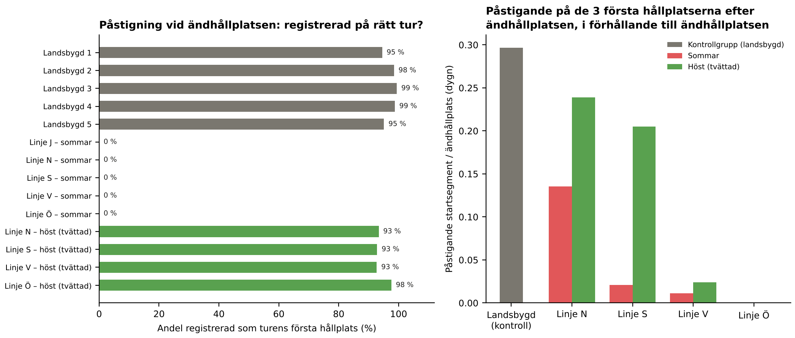
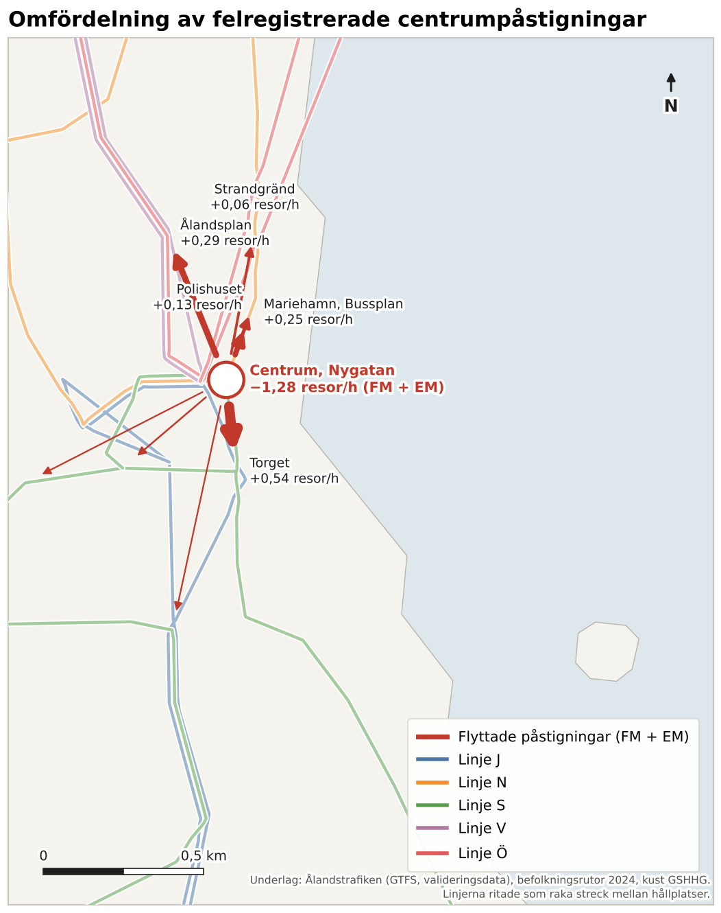
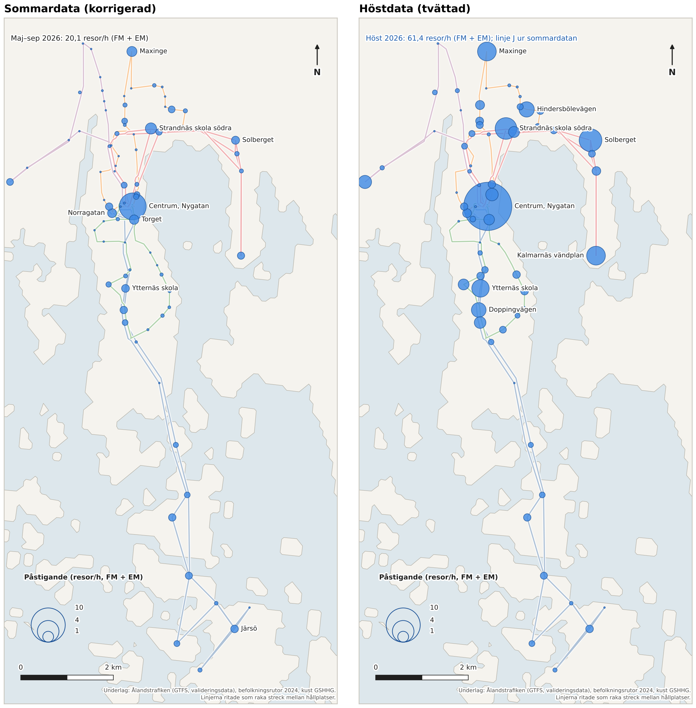
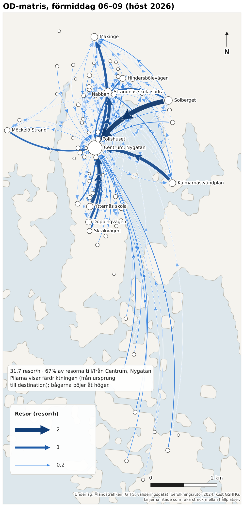
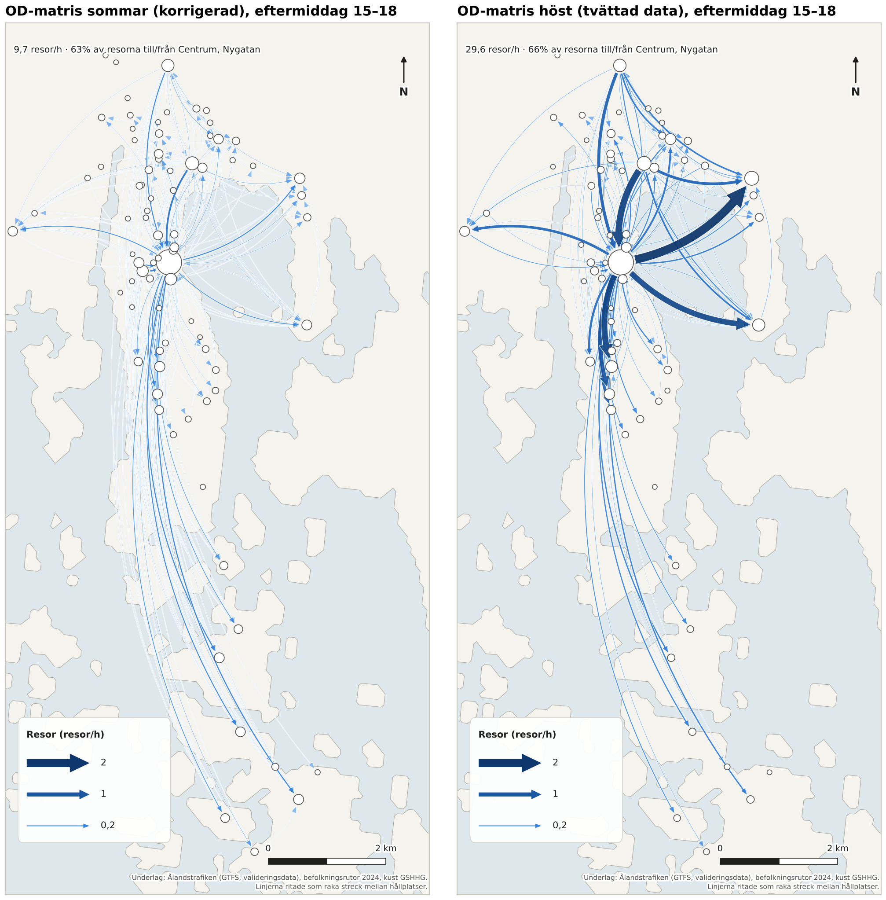

# 1 Granskning av påstigandedata och OD-matrisen

> **Sammanfattning.** Utredningen bygger på tvättad påstigandedata för vardagar hösten 2026, med linjerna N, S, V
> och Ö. Den ersätter den tidigare sommardatan (maj–september 2026), som hade flera fel. Linje J finns inte i
> höstdatan och hämtas därför ur sommardatan. All data används som den är, utan centrumkorrigering
> (beställaren 2026-11-03).
>
> - **Registreringsfelet är borta.** 93–98 % av påstigningarna vid Centrum, Nygatan registreras på turens första
>   hållplats. Det är i nivå med landsbygdslinjerna (95–99 %); i sommardatan var andelen 0 %.
> - **Startsegmentet:** hållplatserna närmast efter centrum har 0,24 (N) respektive 0,21 (S) gånger så många
>   påstigningar som centrumhållplatsen. Det ligger nära kontrollgruppens 0,30, och i sommardatan var kvoten
>   0,02–0,14.
> - **Resandet:** cirka 321 påstigande per vardag, varav 21,5 på linje J. Det är ungefär tre gånger
>   sommarnivån, eftersom mätperioden ligger under terminstid.
> - **OD-matrisen:** framtagen med samma gravitationsmodell som tidigare. Den ger 31,7 (FM) respektive 29,6
>   (EM) resor per timme, och 67 % av resorna går till eller från Centrum, Nygatan (sommardatan: 75 %). Matrisen
>   används som grund för utredningsalternativen i kapitel 4. Kartorna visar flödena som pilar i färdriktningen.
>
> Granskningen av sommardatan redovisas i avsnitt 1.3 som bakgrund. Där var stadslinjernas påstigningar vid
> ändhållplatsen knutna till fel tur, linje Ö saknades och gångpar räknades som bussresor.

## 1.1 Underlag och metod

**Tvättad höstdata.** Underlaget är `data/raw/Databas_vardag_host.xlsx`. Det anger medelpåstigande per vardag
för varje tur och hållplats, med tur-ID, linje, avgångstid, omlopp och hållplatsens sekvens i turen. Det
omfattar 82 turer på linjerna N, S, V och Ö. Turerna knyts till GTFS-tidtabellen via tur-ID och hållplatserna
via namn. Hållplatser utan påstigande saknas i underlaget och räknas som noll. Omloppskolumnen ger operatörens
omlopp, som används i omloppsverifieringen i kapitel 4.

**Sommardata.** Valideringsdata från 8 maj till 14 september 2026 (flik *Radata* i `Analys_resemönster.xlsx`).
Den används nu bara för linje J och som jämförelse.

**OD-modellen** är densamma som i den ursprungliga OD-matrisen (`Analys_resemonster_OD.xlsx`), en dubbelt
begränsad gravitationsmodell:

- **Ursprung (O):** påstigande per hållplatsområde och timme, vardagar, FM 06–09 respektive EM 15–18. En tur
  räknas till perioden efter sin avgångstid.
- **Destination (D):** speglade påstigningar, dvs. D under FM = påstigande under EM i samma område (och omvänt),
  skalat så att ΣD = ΣO.
- **Motstånd:** f(c) = exp(−0,1·c), där c är kortaste schemalagda restid i linjenätet inklusive 5 minuters
  bytesstraff och gång upp till 400 m mellan hållplatsområden. Par som bara förbinds med gång räknas inte som
  bussresor.

Metoden har återskapats i `src/a1_od_granskning.py`, med restider beräknade ur GTFS för en representativ vardag.
Den återskapade matrisen överensstämmer med den levererade, med korrelationen 0,998 (FM) respektive 0,999 (EM)
cell för cell.

## 1.2 Kontroll av den tvättade höstdatan

Höstdatan har kontrollerats med samma två test som avslöjade felet i sommardatan (avsnitt 1.3):

- **K1:** hur stor andel av påstigningarna vid ändhållplatsen som registreras på turens första hållplats.
- **K2:** kvoten mellan påstigande på de tre första hållplatserna efter centrum (inom 800 m) och påstigande
  vid centrum, jämförd med landsbygdslinjerna.

*Tabell 1.1. Kontroll av höstdatan per linje (vardag).*

| Linje | Påstigande per vardag, höst (sommar) | K1: vid centrum på turens första hållplats | K2: startsegment / centrum (dygn) |
|---|---:|---:|---:|
| N | 103,9 (33,0) | 93 % | 0,24 |
| S | 73,8 (20,6) | 93 % | 0,21 |
| V | 30,0 (8,9) | 93 % | 0,02 |
| Ö | 91,7 (20,6) | 98 % | – (inget startsegment) |
| J (sommardata) | 21,5 | 0 % | 0,04 |
| Kontrollgrupp, landsbygdslinjerna 1–5 | | 95–99 % | 0,30 |

Påstigningarna vid centrum registreras nu på rätt tur (figur 1.1, vänster), och linjerna N och S har ett
startsegment i nivå med kontrollgruppen (figur 1.1, höger). Linje V har låg kvot, men linjen har bara
30 påstigande per vardag. Underlaget räcker inte för att avgöra om den låga kvoten beror på registreringen, och
K1 är i nivå med kontrollgruppen. Linje Ö lämnar centrumområdet direkt och har inget startsegment inom 800 m.

Om korrigeringsmetoden från sommardatan (steg S4) ändå tillämpades skulle 8 % (FM) respektive 6 % (EM) av
centrums påstigningar flyttas. I sommardatan var andelen 21 % respektive 15 %. Skillnaden ligger inom vad som
kan förklaras av slumpvariation och verkliga skillnader mellan linjerna. **Ingen centrumkorrigering görs.**
Underlaget används som det är, även för linje J, som bara finns i sommardatan.

*Figur 1.1. Vänster: andel av påstigningarna vid ändhållplatsen som registreras på turens första hållplats;
landsbygdslinjerna, stadslinjerna i sommardatan och i den tvättade höstdatan. Höger: påstigande på de tre
första hållplatserna efter ändhållplatsen i förhållande till påstigande vid ändhållplatsen.*

## 1.3 Granskning av sommardatan (bakgrund)

Avsnittet beskriver felen i den tidigare sommardatan och hur de korrigerades i den tidigare versionen av
utredningen. Korrigeringen används inte längre.

### Registrering av påstigning vid ändhållplatsen

Samtliga stadslinjer (J, N, S, Ö och V) är slinglinjer som både startar och slutar vid Centrum, Nygatan.
I sommardatan var ingen av stadslinjernas påstigningar vid centrumhållplatsen registrerad som turens första
hållplats. 90–100 % var registrerade som turens *sista* hållplats, dvs. på den tur som just hade avslutats.
Landsbygdslinjerna 1–5, som utgår från Mariehamn, Bussplan, registrerar däremot 95–99 % av sina
terminalpåstigningar på turens första hållplats. Valideringsutrustningen på stadslinjerna fortsatte alltså att
peka på föregående tur och dess sista hållplats tills den nya turen hade startats i systemet. Valideringar på
de första hållplatserna efter avgång hamnade därmed felaktigt på Centrum, Nygatan.

Det bekräftades av ett påfallande underskott på hållplatserna närmast efter centrum. Landsbygdslinjerna
registrerar på sina tre första hållplatser efter terminalen 41 % (FM) respektive 28 % (EM) så många
påstigningar som vid terminalen. Motsvarande kvot för stadslinjerna var 0–14 % över dygnet. Linje S hade under
hela mätperioden inte en enda registrerad påstigning på de två första hållplatserna efter centrum.

### Övriga brister

- **Linje Ö saknades i underlaget.** Filterfliken angav linjen ”E”, som inte finns i datan, i stället för ”Ö”.
  Linje Ö har 20 % av stadslinjernas påstigningar i sommardatan.
- **Gångpar räknades som bussresor.** Hållplatsområden inom 400 m kopplas i restidsmatrisen med gång. Par där
  den snabbaste förbindelsen är ren gång fick därför hög attraktion i modellen, trots att resan inte kräver
  buss. Det gällde 2,1 % (FM) respektive 2,0 % (EM) av resorna i den levererade matrisen.
- **Dubbelräkning i hållplatssammanställningen.** Flikarna *Hallplatsomraden* i `Analys_resemönster.xlsx`
  redovisar exakt dubbla värden, eftersom 16-siffriga hållplats-ID tolkas som tal med 15 siffrors precision.
  OD-flikarna påverkas inte.
- **Byten.** Biljettypen *Bussbyte 2h* står för 2,2 % av påstigningarna vid centrumhållplatsen. Byten räknas,
  liksom i den ursprungliga matrisen, som nya resor från bytespunkten.

### Kvantifiering och korrigering

Överskottet vid centrumhållplatsen skattades per linje och period med landsbygdslinjernas kvot R som referens:

- verkligt antal vid centrum = (BC + BS) / (1 + R)
- överskott E = max(0, BC − (BC + BS) / (1 + R))

BC är stadslinjens påstigningar vid centrum och BS påstigningarna i startsegmentet, dvs. de
tre första hållplatserna efter ändhållplatsen inom 800 m. Som känslighetsanalys prövades två och fyra hållplatser.

*Tabell 1.2. Bedömt felregistrerade påstigningar vid centrum i sommardatan.*

| | FM 06–09 | EM 15–18 |
|---|---:|---:|
| Påstigande vid Centrum, Nygatan (vardagar, mätperioden) | 804 | 1 267 |
| Referenskvot R, landsbygdslinjer (3 hållplatser) | 0,41 | 0,28 |
| **Bedömt felregistrerade påstigningar vid centrum** | **166 (21 %)** | **189 (15 %)** |
| Känslighetsintervall (2–4 hållplatser) | 18–21 % | 10–16 % |

Korrigeringen gjordes i fyra steg (tabell 1.3). Linje Ö lades till (S2), gångpar exkluderades (S3) och
överskottet flyttades från Centrum, Nygatan till startsegmentets hållplatsområden på respektive linje (S4,
figur 1.2). Fördelningen gjordes proportionellt mot samtliga busslinjers påstigande på dessa hållplatser.

*Tabell 1.3. Stegvis korrigering av OD-matrisen ur sommardatan.*

| Steg | Resor/h FM | Resor/h EM | Andel resor till/från centrum | Andel gångpar |
|---|---:|---:|---:|---:|
| S0 Levererad matris | 8,4 | 7,6 | 79 % | 2,1 % |
| S1 Återskapad (kontroll) | 8,4 | 7,6 | 79 % | 1,8 % |
| S2 + linje Ö | 10,4 | 9,7 | 75 % | 1,2 % |
| S3 + gångpar exkluderade | 10,4 | 9,7 | 75 % | 0 % |
| S4 + centrumkorrigering | 10,4 | 9,7 | 63 % | 0 % |

*Figur 1.2. Sommardatan: felregistrerade påstigningar som flyttats från Centrum, Nygatan till hållplatserna i
linjernas startsegment (FM + EM, resor per timme).*

## 1.4 Resultat: OD-matrisen ur höstdatan

*Tabell 1.4. OD-matrisen ur höstdatan jämförd med sommardatan.*

| | Resor/h FM | Resor/h EM | Andel resor till/från centrum | Påstigande per vardag |
|---|---:|---:|---:|---:|
| Sommardata som levererad, med linje Ö (S3) | 10,4 | 9,7 | 75 % | 104 |
| **Höstdata, tvättad, utan korrigering (används i kapitel 4)** | **31,7** | **29,6** | **67 %** | **321** |

Resandet under hösten är ungefär tre gånger så stort som under sommaren. Ökningen är störst på linje Ö
(4,5 gånger), som trafikerar Strandnäs skola, och minst på linje N (3,1 gånger). Centrum, Nygatan har 37 % av påstigningarna på
linjerna N, S, V och Ö. Övriga större hållplatser är Strandnäs skola södra (28 påstigande per vardag),
Maxinge (19), Solberget (16), Hindersbölevägen (12), Kalmarnäs vändplan (10) och Ytternäs skola (10)
(figur 1.3).

Andelen resor via centrum, 67 %, är lägre än i sommardatan (75 %), där påstigningar efter avgång
registrerades på centrumhållplatsen. De största OD-flödena under FM går från Solberget (2,3 resor per timme),
Ytternäs skola (1,6), Kalmarnäs vändplan (1,5) och Doppingvägen (1,1) till centrum, och från centrum till
Strandnäs skola södra (1,5) och Maxinge (1,2). Under EM går flödena i
motsatt riktning (figur 1.4 och 1.5). Mellan Solberget och Strandnäs skola södra går 0,7–0,8 resor per timme
utan att passera centrum.

*Figur 1.3. Påstigande per hållplatsområde (FM + EM, resor per timme) i sommardatan som levererad (med linje Ö)
respektive den tvättade höstdatan, båda utan korrigering.*

*Figur 1.4. OD-matrisen, förmiddag 06–09: de största flödena (85 % av resorna). Varje flöde är en pil från
ursprung till destination, med pilspets mitt på bågen och vid målet. Bågarna böjer åt höger i färdriktningen,
så att resor åt var sitt håll mellan samma hållplatser syns som två bågar. Bredd och färg anger antal resor.*

*Figur 1.5. OD-matrisen, eftermiddag 15–18 (som figur 1.4).*

## 1.5 Osäkerheter och rekommendation

- **Linje J** finns bara i sommardatan, som används utan korrigering. Linjens påstigande vid centrum kan därför
  vara något överskattat och resandet under terminstid underskattat. Linje J berörs inte av
  utredningsalternativen i kapitel 4.
- **Sommar och höst:** skillnaden i nivå beror främst på att höstdatan avser terminstid. Höstdatan bedöms
  därför vara mest representativ för en typvardag.
- **Speglade destinationer:** modellen antar att resor under FM speglar resor under EM. Det är rimligt för
  arbets- och skolresor men osäkert för andra ärenden.
- **Byten:** byten i centrum räknas som nya resor från bytespunkten, liksom i den ursprungliga matrisen.

Turbytet i valideringsutrustningen fungerar i den tvättade höstdatan. Det rekommenderas att Ålandstrafiken
behåller tvättningen, eller kontrollerar turbytet, även framöver. Linje J bör läggas till i den tvättade datan.

**Filer.** OD-matrisen ur höstdatan: `data/processed/a1_od_FM_korrigerad.csv` och `a1_od_EM_korrigerad.csv`
(långt format) samt `..._matris.csv`. Den tidigare korrigerade sommarmatrisen (bakgrund): `a1_od_FM_sommar.csv` och
`a1_od_EM_sommar.csv`. Kontroll av höstdatan: `a1_kontroll_host.csv`. Påstigande per hållplatsområde:
`a1_zoner_pastigande.csv`. Restider: `a1_restider_min.csv`. Nyckeltal: `a1_sammanfattning.json`. Skript:
`src/a1_od_granskning.py`, `src/data_las.py` och `src/a1_kartor.py`.
