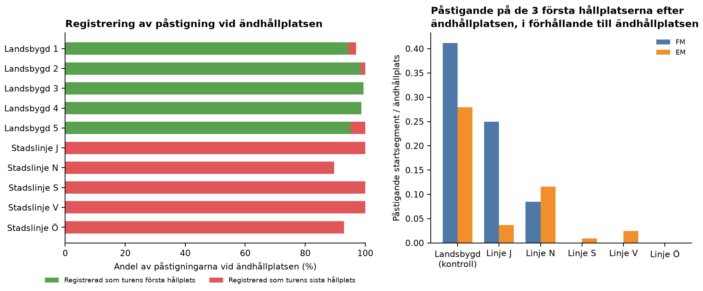
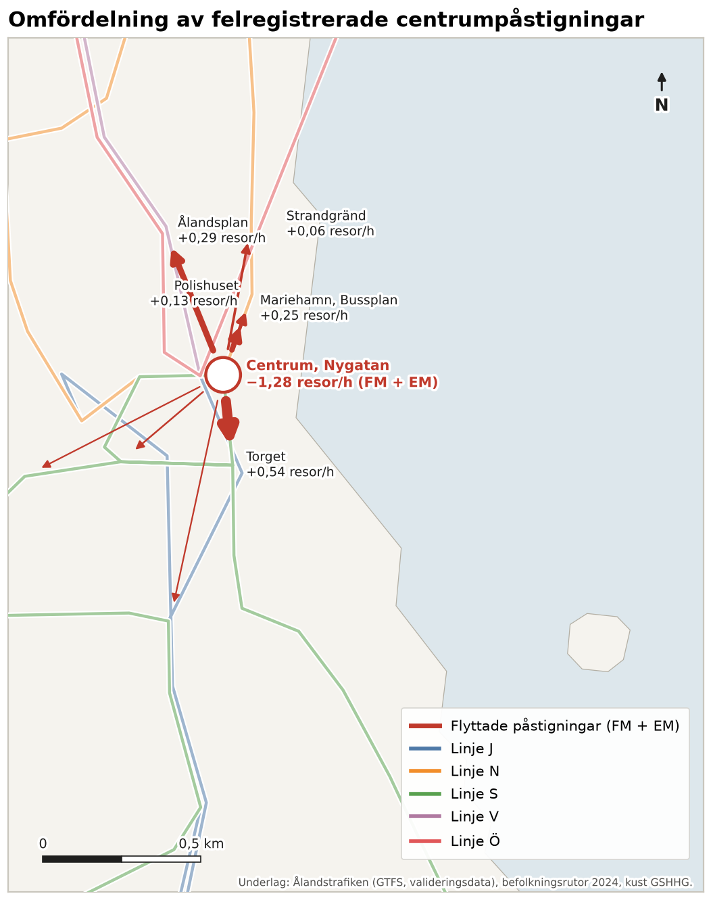
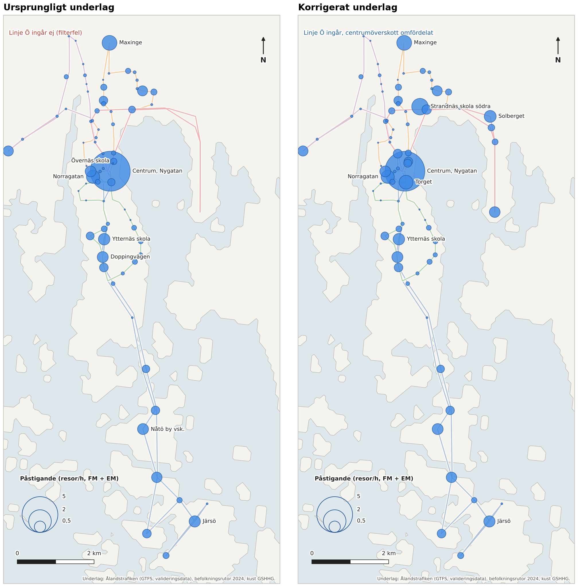
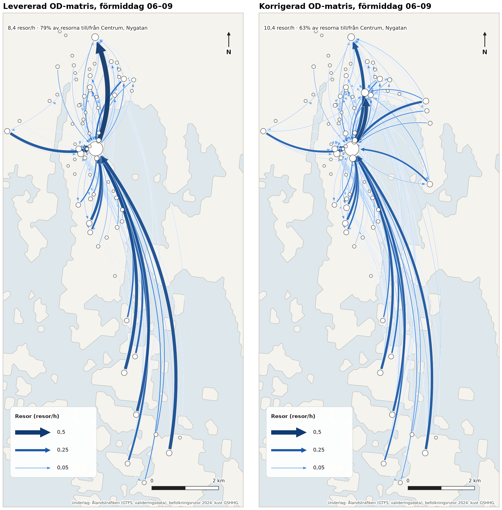
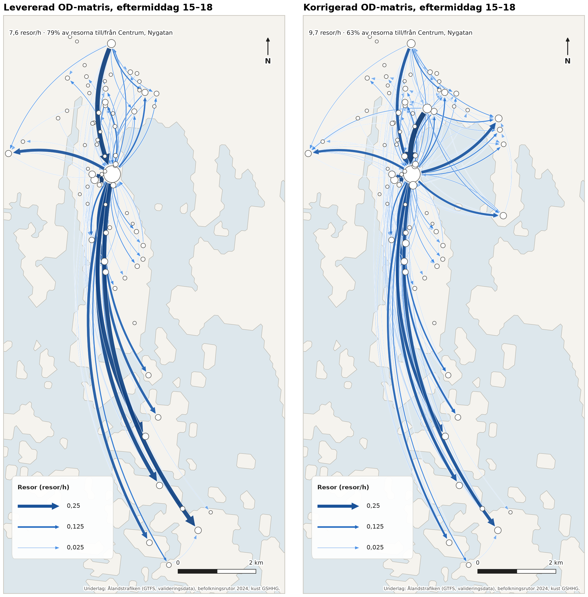

# 1 Granskning och korrigering av OD-matrisen

> **Sammanfattning.** Den levererade OD-matrisen överskattar Centrum, Nygatan. I den går 79 % av alla resor
> till eller från centrumhållplatsen. Granskningen visar tre felkällor. Den viktigaste är att stadslinjernas
> valideringssystem registrerar påstigningar vid ändhållplatsen på *föregående turs sista hållplats*. Det gäller
> även påstigningar som i själva verket sker på de första hållplatserna efter avgång. Med landsbygdslinjerna som
> kontrollgrupp bedöms 21 % (FM) respektive 15 % (EM) av centrumhållplatsens påstigningar vara felregistrerade
> (känslighetsintervall 10–21 %). Därutöver saknas linje Ö helt i underlaget på grund av ett filterfel, vilket
> motsvarar 20 % av stadslinjernas påstigningar. Dessutom räknar modellen 2 % av resorna mellan hållplatsområden
> som bara förbinds med gång som bussresor. Efter korrigering, med samma gravitationsmodell och parametrar som
> tidigare, går 63 % av resorna till eller från Centrum, Nygatan. Den korrigerade matrisen omfattar 92
> hållplatsområden och 10,4 (FM) respektive 9,7 (EM) resor per timme. Den används som grund för utredningsalternativen
> i kapitel 4.

## 1.1 Underlag och ursprunglig metod

Underlaget utgörs av valideringsdata (flik *Radata* i `Analys_resemönster.xlsx`). Den innehåller antal
påstigningar per tur, hållplatsläge och biljettyp under perioden 8 maj – 14 september 2026. Den ursprungliga
OD-matrisen (`Analys_resemonster_OD.xlsx`) är framtagen med en dubbelt begränsad gravitationsmodell:

- **Ursprung (O):** påstigande per hållplatsområde och timme, vardagar, FM 06–09 respektive EM 15–18
  (92 vardagar, 3 timmar per period).
- **Destination (D):** speglade påstigningar, dvs. D under FM = påstigande under EM i samma område (och omvänt),
  skalat så att ΣD = ΣO.
- **Motstånd:** f(c) = exp(−0,1·c), där c är kortaste schemalagda restid i linjenätet inklusive 5 minuters
  bytesstraff och gång upp till 400 m mellan hållplatsområden.

Metoden har återskapats i `src/a1_od_granskning.py`, med restider beräknade ur GTFS för en representativ vardag.
Den återskapade matrisen överensstämmer med den levererade, med korrelationen 0,998 (FM) respektive 0,999 (EM)
cell för cell. Korrigeringarna nedan kan därmed tillskrivas felkällorna och inte skillnader i metod.

## 1.2 Felanalys

### Registrering av påstigning vid ändhållplatsen

Samtliga stadslinjer (J, N, S, Ö och V) är slinglinjer som både startar och slutar vid Centrum, Nygatan.
Ingen av stadslinjernas påstigningar vid centrumhållplatsen är registrerad som turens första hållplats.
90–100 % är registrerade som turens *sista* hållplats, dvs. på den tur som just har avslutats (figur 1.1, vänster).
Landsbygdslinjerna 1–5, som utgår från Mariehamn, Bussplan, registrerar däremot 94–99 % av sina
terminalpåstigningar på turens första hållplats. Mönstret visar att valideringsutrustningen på stadslinjerna
fortsätter att peka på föregående tur och dess sista hållplats tills den nya turen har startats i systemet.

Valideringar som görs medan bussen står vid centrumhållplatsen får därmed rätt hållplats, men knyts till
fel tur. Valideringar som görs på de första hållplatserna efter avgång, innan systemet har bytt tur, hamnar
däremot felaktigt på Centrum, Nygatan.

*Figur 1.1. Vänster: på vilken position i turen påstigningar vid ändhållplatsen registreras. Höger: påstigande
på de tre första hållplatserna efter ändhållplatsen i förhållande till påstigande vid ändhållplatsen.*

### Underskott på hållplatserna närmast efter centrum

Om påstigningar efter avgång registreras på centrumhållplatsen bör hållplatserna i turens början ha
påfallande få påstigningar. Det bekräftas av data. Landsbygdslinjerna registrerar på sina tre första
hållplatser efter terminalen i centrala Mariehamn (Torget, GE-huset, Savoy m.fl.) 41 % (FM) respektive 28 % (EM)
så många påstigningar som vid terminalen. Motsvarande kvot för stadslinjerna är 0–14 %: linje V 1 %,
linje S 2 %, linje J 4 % och linje N 14 % räknat över dygnet (figur 1.1, höger). Linje S har under hela
mätperioden inte registrerat en enda påstigning på de två första hållplatserna efter centrum. Det är inte
rimligt för hållplatser i stadskärnan.

### Övriga brister

- **Linje Ö saknas i underlaget.** Filterfliken anger linjen ”E”, som inte finns i datan, i stället för ”Ö”.
  Linje Ö (Kalmarnäs/Solberget) har 1 896 påstigningar under mätperiodens vardagar, vilket motsvarar 20 % av
  stadslinjernas påstigningar. Hållplatsområdena längs linjen, bland annat Strandnäs skola södra, saknas
  därmed helt i matrisen.
- **Gångpar räknas som bussresor.** Hållplatsområden inom 400 m kopplas i restidsmatrisen med gång. Par där
  den snabbaste förbindelsen är ren gång får därför mycket kort restid och hög attraktion i modellen, trots
  att resan inte kräver buss. Det gäller 2,1 % (FM) respektive 2,0 % (EM) av resorna i den levererade matrisen.
- **Dubbelräkning i hållplatssammanställningen.** Flikarna *Hallplatsomraden* i `Analys_resemönster.xlsx`
  redovisar exakt dubbla värden. 16-siffriga hållplats-ID tolkas som tal med 15 siffrors precision, så att
  samtliga lägen på samma hållplats matchas. OD-flikarna använder textnycklar och påverkas inte, men
  sammanställningen bör inte användas direkt.
- **Byten.** Biljettypen *Bussbyte 2h* står för 2,2 % av påstigningarna vid centrumhållplatsen. Byten med
  periodkort kan inte identifieras i underlaget. Byten räknas därför, liksom i den ursprungliga matrisen,
  som nya resor från bytespunkten. Effekten bedöms som liten och korrigeras inte.

## 1.3 Kvantifiering av felet

Överskottet vid centrumhållplatsen skattas per linje och period med landsbygdslinjernas kvot R som referens.
R är kvoten mellan påstigande i startsegmentet och påstigande vid terminalen. Om registreringen vore korrekt
skulle stadslinjens påstigningar vid centrum, BC, och i startsegmentet, BS, fördela sig
i samma proportion:

- verkligt antal vid centrum = (BC + BS) / (1 + R)
- överskott E = max(0, BC − (BC + BS) / (1 + R))

Startsegmentet definieras som de tre första hållplatserna efter ändhållplatsen som ligger inom 800 m från
den, dvs. i centrala Mariehamn. Som känslighetsanalys prövas två och fyra hållplatser.

| | FM 06–09 | EM 15–18 |
|---|---:|---:|
| Påstigande vid Centrum, Nygatan (vardagar, mätperioden) | 804 | 1 267 |
| Andel av stadslinjernas påstigande i perioden | 28 % | 47 % |
| Referenskvot R, landsbygdslinjer (3 hållplatser) | 0,41 | 0,28 |
| **Bedömt felregistrerade påstigningar vid centrum** | **166 (21 %)** | **189 (15 %)** |
| Känslighetsintervall (2–4 hållplatser) | 18–21 % | 10–16 % |
| Andel av samtliga påstigningar i perioden | 5,8 % | 7,1 % |

Linje Ö lämnar centrumområdet direkt och har inget startsegment inom 800 m. Linjens första hållplats efter
centrum (Strandnäs skola södra) registrerar dessutom 35 % av linjens påstigningar. Det visar att turbytet
sker i tid, och ingen korrigering görs för linje Ö.

## 1.4 Korrigeringsmetod och antaganden

Korrigeringen görs i fyra steg. Varje stegs effekt redovisas i tabell 1.2.

1. **Återskapad matris (S1).** Ursprunglig metod och samma urval, som kontroll.
2. **Linje Ö inkluderas (S2).** Hållplatsområdena längs linje Ö läggs till, och restidsmatrisen räknas om för
   hela stadslinjenätet.
3. **Gångpar exkluderas (S3).** OD-par vars snabbaste förbindelse inte använder buss sätts till noll, på samma
   sätt som inomzonsresor.
4. **Centrumöverskottet omfördelas (S4).** Det skattade överskottet E flyttas från Centrum, Nygatan till
   startsegmentets hållplatsområden på respektive linje. Fördelningen sker proportionellt mot det
   påstigandemönster som samtliga busslinjer har på dessa hållplatser i samma period. Påstigningar på en turs
   första hållplats räknas inte med, så att terminaleffekten vid Mariehamn, Bussplan inte styr fördelningen
   (figur 1.2). Destinationerna speglas från den korrigerade motsatta perioden. Därefter fördelas resorna med
   samma gravitationsmodell. De flyttade resornas destinationer följer därmed övriga hållplatsers OD-mönster.

**Antaganden.**

- **Fungerande registrering:** landsbygdslinjernas fördelning mellan terminal och startsegment speglar hur
  påstigningarna fördelar sig i centrala Mariehamn när registreringen fungerar.
- **Felets utbredning:** felregistreringen gäller påstigningar i centrumområdet (inom 800 m). Påstigningar
  längre ut på linjerna registreras korrekt, vilket stöds av att påstigningarna längs linjerna i övrigt är
  rimligt fördelade.
- **Vikter för omfördelningen:** samtliga busslinjers påstigande på en hållplats är ett rimligt mått på
  hållplatsens relativa efterfrågan.
- **Oförändrade modellparametrar:** β = 0,1, bytesstraff 5 min och gång 400 m behålls. Den
  speglingsprincip för destinationer som den ursprungliga matrisen bygger på behålls också.
- **Sommarperiod:** mätperioden omfattar skolornas sommarlov. Nivåerna är därför lägre än under
  terminstid, medan mönstret antas vara representativt.

*Figur 1.2. Felregistrerade påstigningar som flyttats från Centrum, Nygatan till hållplatserna i linjernas
startsegment (FM + EM, resor per timme).*

## 1.5 Resultat

*Tabell 1.2. Stegvis korrigering av OD-matrisen.*

| Steg | Resor/h FM | Resor/h EM | Andel resor till/från centrum | Andel gångpar |
|---|---:|---:|---:|---:|
| S0 Levererad matris | 8,4 | 7,6 | 79 % | 2,1 % |
| S1 Återskapad (kontroll) | 8,4 | 7,6 | 79 % | 1,8 % |
| S2 + linje Ö | 10,4 | 9,7 | 75 % | 1,2 % |
| S3 + gångpar exkluderade | 10,4 | 9,7 | 75 % | 0 % |
| **S4 + centrumkorrigering (korrigerad matris)** | **10,4** | **9,7** | **63 %** | **0 %** |

Korrigeringen minskar andelen resor till eller från Centrum, Nygatan med 16 procentenheter. Av dessa beror
cirka 4 procentenheter på att linje Ö nu ingår och cirka 12 procentenheter på felregistreringen. Under FM
minskar centrumhållplatsens andel av destinationerna från 51 % till 40 %, och under EM minskar dess andel
av ursprungen i motsvarande grad. Resorna flyttas framför allt till Torget, Ålandsplan, Mariehamn, Bussplan
och Polishuset (figur 1.3). Matrisen får därtill ett nytt resandestråk österut längs linje Ö, med
Strandnäs skola södra, Solberget och Kalmarnäs (figur 1.4 och 1.5).

*Figur 1.3. Påstigande per hållplatsområde (FM + EM, resor per timme) i ursprungligt respektive korrigerat
underlag.*

*Figur 1.4. Största OD-flödena (85 % av resorna), förmiddag 06–09. Bågarna går från ursprung till destination
och böjer åt höger i färdriktningen. Bredd och färg anger antal resor.*

*Figur 1.5. Största OD-flödena (85 % av resorna), eftermiddag 15–18.*

## 1.6 Osäkerheter och rekommendation

Den korrigerade matrisen bedöms ge en betydligt riktigare bild av resmönstret än den levererade, men den
vilar på ett antagande om felregistreringens omfattning. Beroende på period och hur startsegmentet avgränsas
bedöms 10–21 % av centrums påstigningar vara felregistrerade, mot 15–21 % i basfallet. Variationen påverkar
inte slutsatserna: andelen resor till eller från centrum hamnar i samtliga fall väsentligt under den
levererade matrisens 79 %. Det väsentliga för linjeplaneringen är att resandet i centrumområdet är fördelat på flera hållplatser och att
linje Ö:s resande ingår.

Det rekommenderas att Ålandstrafiken och AxBuss ser över turbytet i valideringsutrustningen på stadslinjerna,
så att nya turer startas innan avgång från Centrum, Nygatan. En kortare kontrollmätning, till exempel
manuell räkning av påstigande på Torget, Polishuset och Ålandsplan under en vecka, kan verifiera
korrigeringen. Inför en slutlig matris bör även data från terminstid användas.

**Filer.** Korrigerad matris: `data/processed/a1_od_FM_korrigerad.csv` och `a1_od_EM_korrigerad.csv`
(långt format) samt `..._matris.csv`. Påstigande per hållplatsområde: `a1_zoner_pastigande.csv`.
Restider: `a1_restider_min.csv`. Nyckeltal: `a1_sammanfattning.json`. Skript: `src/a1_od_granskning.py`
och `src/a1_kartor.py`.
