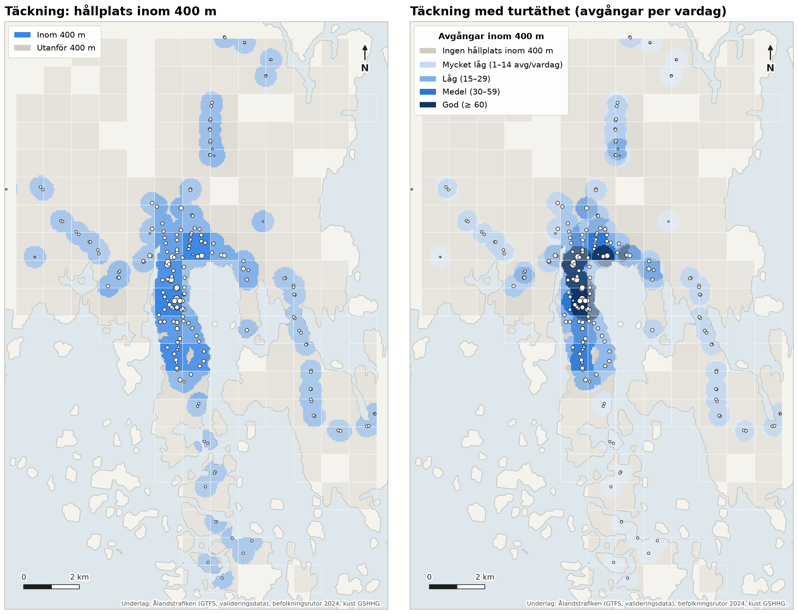
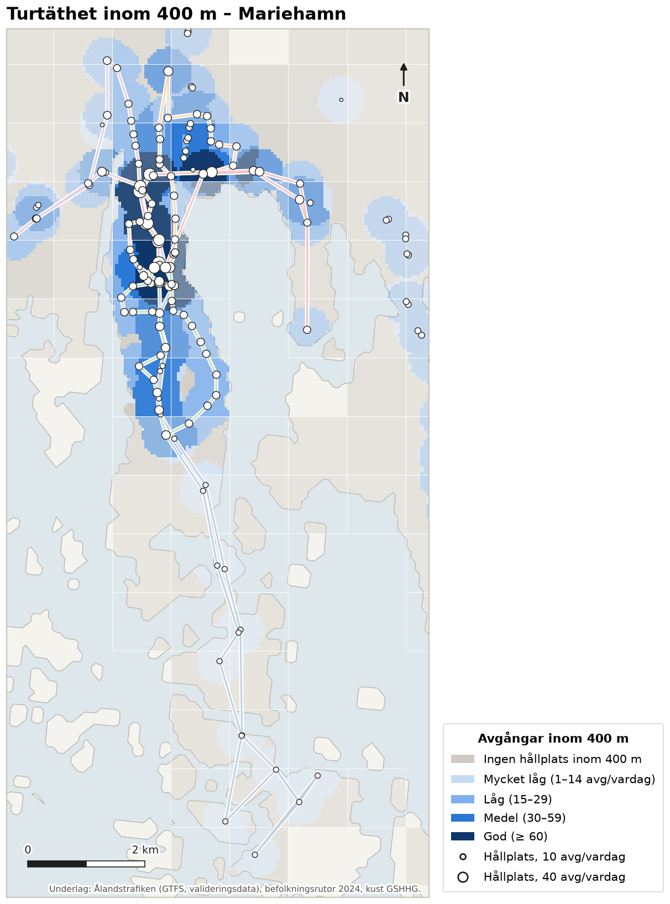
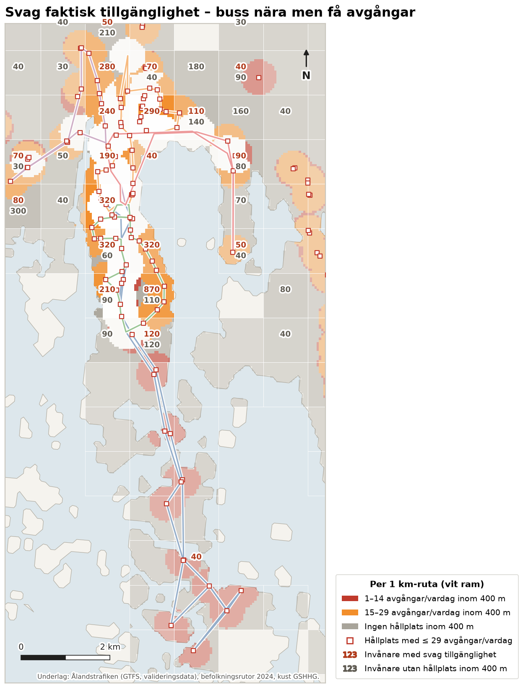

# 2 Täckningsgrad med hänsyn till turtäthet

> **Sammanfattning.** 84 % av Mariehamns invånare bor inom 400 m från en busshållplats. Avståndsmåttet
> överskattar dock den faktiska tillgängligheten. Inom 400 m har endast 56 % av invånarna minst 30 avgångar per
> vardag, vilket motsvarar ungefär halvtimmestrafik under dagen. 28 % (cirka 4 150 invånare) har en hållplats
> nära men färre än 30 avgångar per vardag. De har i praktiken en enda stadslinje med 1–2 avgångar i timmen
> och har därmed svag faktisk tillgänglighet. Svag tillgänglighet finns framför allt i södra Mariehamn
> längs linje S (kring Källstigen–Lindstigen och Gröna Udden), i stadens norra och nordvästra delar som
> trafikeras av linje V ensamt, i Strandnäs och i Järsö–Nåtö, där linje J har nio turer per dag.
> Ytterligare 16 % (cirka 2 430 invånare) saknar hållplats inom 400 m. Störst är de grupperna vid Möckelö
> Strand, längs Lillåkersvägen/Örtvägen och vid Solberget–Kalmsta.

## 2.1 Metod

Den befintliga täckningsanalysen mäter andelen av befolkningen som bor inom 400 m fågelväg från en hållplats.
Den här analysen kompletterar måttet med antalet avgångar som finns att nå inom samma avstånd:

- **Befolkning.** Befolkningsrutor 2024 (1 × 1 km). Varje rutas befolkning fördelas jämnt över rutans landdel i
  delpunkter om 50 × 50 m. Landdelen avgränsas med kustlinje enligt GSHHG. En finare fördelning medges inte av
  underlaget, och resultatet ska därför tolkas på rutnivå.
- **Utbud.** Avgångar en typisk vardag (tisdag 1 september 2026) enligt GTFS, för samtliga busslinjer:
  stadslinjerna J, N, S, Ö, V och landsbygdslinjerna 1–6. För varje delpunkt räknas antalet *unika turer* som
  avgår från någon hållplats inom 400 m. En tur som passerar flera närliggande hållplatser räknas en gång, och
  avstigning vid slutstation räknas inte som avgång.
- **Klassning.** Antal avgångar per vardag inom 400 m. Stadslinjerna trafikerar cirka 07–20:30 med 20–22 turer
  per linje (linje J 9 turer), och klassgränserna har satts utifrån det:

| Klass | Avgångar/vardag inom 400 m | Tolkning |
|---|---|---|
| Ingen | 0 | Ingen hållplats inom 400 m |
| Mycket låg | 1–14 | Sämre än timtrafik |
| Låg | 15–29 | I regel en stadslinje, 1–2 avgångar per timme |
| Medel | 30–59 | Ungefär halvtimmestrafik eller bättre |
| God | ≥ 60 | Fyra avgångar per timme eller fler i genomsnitt |

*Svag faktisk tillgänglighet* definieras som en hållplats inom 400 m men färre än 30 avgångar per vardag,
dvs. klasserna *mycket låg* och *låg*. Resultaten redovisas för Mariehamn (kartutsnittet inklusive Järsö och
Nåtö) och för hela rutnätet, som även omfattar delar av Jomala.

## 2.2 Resultat

*Tabell 2.1. Befolkning efter tillgång till avgångar inom 400 m (typisk vardag).*

| | Mariehamn, alla bussar | Mariehamn, endast stadslinjer | Hela rutnätet, alla bussar |
|---|---:|---:|---:|
| Befolkning | 14 821 | 14 821 | 17 697 |
| Inom 400 m från hållplats (befintligt mått) | 84 % | 82 % | 74 % |
| Ingen hållplats inom 400 m | 16 % (2 431) | 18 % (2 731) | 26 % (4 652) |
| Mycket låg, 1–14 avg/vardag | 3 % (385) | 2 % (330) | 3 % (508) |
| Låg, 15–29 avg/vardag | 25 % (3 769) | 34 % (5 046) | 24 % (4 209) |
| Medel, 30–59 avg/vardag | 31 % (4 546) | 30 % (4 380) | 26 % (4 637) |
| God, ≥ 60 avg/vardag | 25 % (3 691) | 16 % (2 336) | 21 % (3 691) |
| **Svag faktisk tillgänglighet (1–29)** | **28 % (4 153)** | **36 % (5 376)** | **27 % (4 716)** |
| Minst 30 avg/vardag inom 400 m | 56 % | 45 % | 47 % |

Jämförelsen mellan avståndsmåttet och det turtäthetsvägda måttet framgår av figur 2.1. Med enbart
avståndskriteriet framstår nästan hela Mariehamn som väl försörjt. När antalet avgångar vägs in återstår god
eller medelgod tillgänglighet främst i centrum och i stråken norrut mot Maxinge, där flera stadslinjer och
landsbygdslinjerna sammanfaller (figur 2.2).

Under förmiddagens rusningstimmar (06–09) har 82 % av Mariehamns invånare minst tre avgångar inom 400 m,
dvs. minst en per timme. Utbudet i rusning är därmed i stort sett lika fördelat som över dygnet.

Landsbygdslinjerna bidrar påtagligt till tillgängligheten inne i staden. Utan dem skulle andelen med svag
tillgänglighet öka från 28 % till 36 %, främst längs landsbygdslinjernas infarter (bl.a. Strandnäs och
Maxinge). Det
talar för att samordna stadslinjerna med landsbygdstrafiken i de gemensamma stråken och att inte dubblera
den.

*Figur 2.1. Täckning med enbart avståndskriterium (vänster) jämfört med täckning med hänsyn till antal
avgångar (höger), hela befolkningsrutnätet. Ytornas opacitet speglar befolkningstätheten i 1 km-rutan.*

*Figur 2.2. Antal avgångar per vardag inom 400 m, Mariehamn. Cirklarnas storlek anger antal avgångar per
hållplatsläge.*

## 2.3 Var har invånarna buss nära men få avgångar?

Svag faktisk tillgänglighet koncentreras till följande områden (figur 2.3; antal invånare avser 1 km-rutor):

- **Södra Mariehamn längs linje S, delvis J** (Källstigen–Lindstigen–Sälgstigen, Gröna Udden–Parkgatan,
  Matrosgatan–Skillnadsgatan): cirka 1 500 invånare. Området har tät bebyggelse men trafikeras av linje S
  ensamt, med 22 avgångar per vardag i en riktning. Det är det största sammanhängande området med svag
  tillgänglighet.
- **Norra och nordvästra Mariehamn längs linje V, delvis N** (Kasbergsvägen–Länsmansgränd, Kasbrinken–Åsvägen):
  cirka 530 invånare med 20 avgångar per vardag.
- **Strandnäs**, öster om centrum: cirka 290 invånare. Området trafikeras av landsbygdslinjerna och delvis
  av linje N, men sammantaget med färre än 30 avgångar.
- **Centrumnära västra delen** (Övernäs skola–Norragatan): cirka 320 invånare som bara når linje J.
- **Järsö och Nåtö**, som trafikeras av linje J med nio turer per vardag. Befolkningen är liten, men här är
  tillgängligheten svagast i hela nätet.

Av de cirka 2 430 invånare i Mariehamn som saknar hållplats inom 400 m bor de största grupperna vid Möckelö
Strand–Norrgårdsvägen (cirka 240), längs Lillåkersvägen–Örtvägen (cirka 180) och vid Solberget–Kalmsta
(cirka 300). Lägen för nya hållplatser i dessa områden behandlas i kapitel 3.

*Figur 2.3. Ytor inom 400 m från hållplats med färre än 30 avgångar per vardag (orange/röd) samt ytor utan
hållplats inom 400 m (grå). Siffrorna anger berörda invånare per 1 km-ruta.*

## 2.4 Osäkerheter

- **Befolkningens fördelning inom rutorna.** Befolkningen antas jämnt fördelad inom 1 km-rutornas landdel.
  I rutor med både bebyggelse och obebyggd mark kan andelen inom 400 m därför både över- och underskattas.
  Ett rutnät om 100 × 100 m skulle ge väsentligt säkrare resultat och rekommenderas inför slutrapporten.
- **Avstånd fågelvägen.** 400 m fågelväg motsvarar i regel 450–550 m gångväg. Måttet är därmed en övre
  gräns för den faktiska täckningen.
- **Tidtabell.** Utbudet avser en typisk vardag under hösten 2026 (terminstid) och kan skilja sig från
  sommartidtabellen under mätperioden för påstigandedata.

**Filer.** Delpunkter med klass: `data/processed/a2_delpunkter.csv.gz`. Per 1 km-ruta (GIS):
`a2_tackning_rutor.gpkg`. Avgångar per hållplatsläge: `a2_hallplatser_avgangar.csv`. Nyckeltal:
`a2_sammanfattning.json`. Skript: `src/a2_tackning.py` och `src/a2_kartor.py`.
