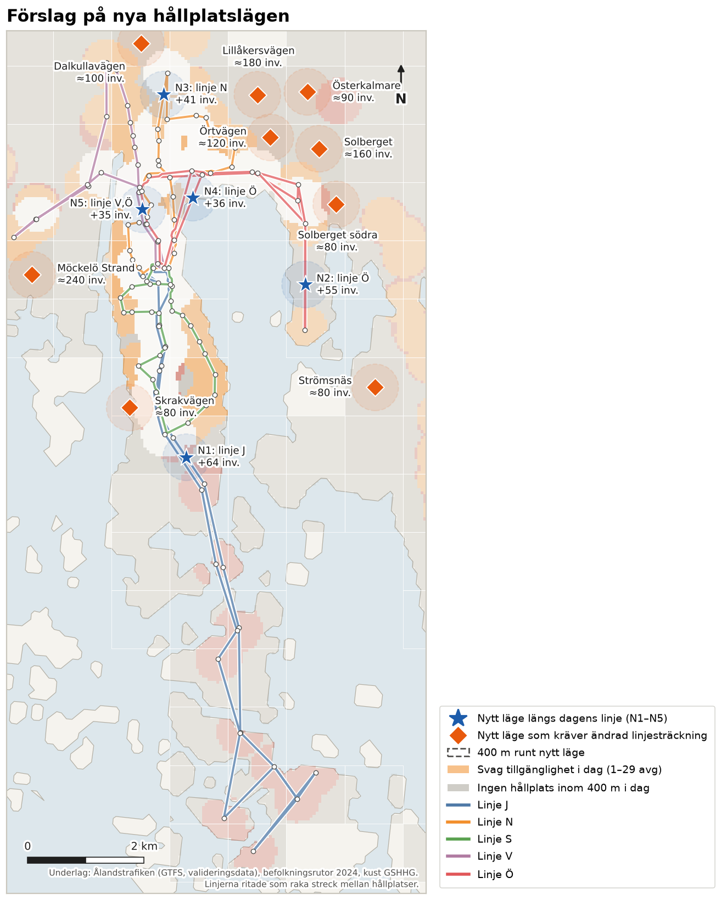
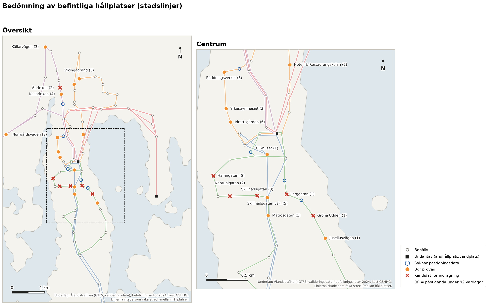

# 3 Hållplatslägen – nya och överflödiga hållplatser

> **Sammanfattning.** Fem nya hållplatslägen längs dagens linjer (N1–N5) ger cirka 140 invånare en
> hållplats inom 400 m. Ytterligare cirka 95 invånare får minst 30 avgångar per vardag i stället för färre. De
> största vinsterna finns sydost om Lervik på linje J, längs linje Ö mot Kalmarnäs och söder om Maxinge på linje N.
> Läget N5 innebär i praktiken att linje V och Ö också stannar vid Klintvägen. Huvuddelen av den otäckta
> befolkningen, cirka 2 000 invånare, bor dock mer än 400 m från stadslinjernas körvägar. Den kan bara nås med
> ändrad linjesträckning. Nio sådana områden med sammanlagt cirka 1 130 invånare har identifierats, de största
> vid Möckelö Strand, Lillåkersvägen och Solberget–Örtvägen. De utgör underlag för linjeförslagen i kapitel 4.
> Sex hållplatser bedöms som kandidater för indragning: Torggatan, Gröna Udden, Neptunigatan, Skillnadsgatan
> och Hamngatan på linje S samt Åbrinken på linje V. De har högst fem påstigningar under 92 vardagar, avståndet
> mellan kvarvarande grannhållplatser blir högst 600 m och ingen invånare förlorar hållplats inom 400 m.
> Ytterligare 13 hållplatser bör prövas, bland annat skolhållplatser som ska bedömas med data från terminstid.

## 3.1 Metod

**Nya hållplatslägen längs dagens linjer.** Kandidatlägen har genererats var 50:e meter längs
stadslinjernas körvägar. I den här versionen återges körvägen som rak linje mellan hållplatserna i GTFS.
Analysen är förberedd för att i stället använda linjernas faktiska vägdragning längs gatunätet (OSRM) och
körs om när vägdragningen har hämtats. Lägen på vatten och lägen närmare än 250 m från en befintlig hållplats på samma linje har
uteslutits. Ett läges nytta är antalet invånare som

- i dag saknar hållplats inom 400 m och skulle få det, eller
- i dag har svag tillgänglighet (1–29 avgångar per vardag, se kapitel 2) och skulle få minst 30 avgångar
  per vardag när linjens turer stannar i läget.

Lägena har valts stegvis med det mest nyttiga först. Nyttan räknas om efter varje val, så att samma invånare
inte räknas två gånger, och det är minst 300 m mellan nya lägen. Urvalet avbryts när nyttan understiger 30
invånare.

**Behov av ändrad linjesträckning.** Otäckt befolkning som ligger mer än 400 m från stadslinjernas körvägar
kan inte nås med nya hållplatser på dagens linjer. Den har sammanställts per 1 km-ruta (minst 75 invånare).
För varje område anges ett indikativt hållplatsläge i den otäckta befolkningens tyngdpunkt. Läget ska
anpassas till gatunätet vid den fortsatta utformningen.

**Överflödiga hållplatser.** Stadslinjernas 91 hållplatsområden har prövats en i taget, med lägst påstigande
först, mot tre kriterier:

1. *Lågt påstigande* (nödvändigt villkor): färre än 0,1 påstigande per vardag på stadslinjerna, dvs. färre än
   cirka nio påstigningar under mätperiodens 92 vardagar.
2. *Tät placering*: avståndet mellan de kvarvarande grannhållplatserna på linjen blir högst 600 m efter
   indragning.
3. *Liten unik täckning*: färre än 25 invånare förlorar busshållplats inom 400 m. Hållplatser som även
   trafikeras av landsbygdslinjer finns kvar för dem.

Hållplatser som uppfyller alla tre kriterier är *kandidater för indragning*. Den prövningen sker efter
föregående indragning, så att två grannhållplatser inte dras in samtidigt. Hållplatser med lågt påstigande
som uppfyller ett av de övriga kriterierna *bör prövas*. Följande hållplatser kan som mest klassas som *bör
prövas*:

- centrumhållplatsen och vändplatser;
- hållplatser i startsegmentet, vars påstigande är underskattat på grund av registreringsfelet i kapitel 1;
- skol- och säsongshållplatser, eftersom mätperioden omfattar sommarlovet.

Fem hållplatser i 2026 års tidtabell saknar påstigningsdata och har inte bedömts.

## 3.2 Nya hållplatslägen

*Tabell 3.1. Nya hållplatslägen längs dagens linjer.*

| Nr | Linje | Läge | Avgångar/vardag | Ny täckning, inv. | Lyfts från svag tillgänglighet, inv. |
|---|---|---|---:|---:|---:|
| N1 | J | Sydost om Lervik (cirka 400 m från befintlig hållplats) | 9 | 61 | 3 |
| N2 | Ö | Längs linjen mot Kalmarnäs vändplan (cirka 780 m norr om vändplatsen) | 20 | 55 | – |
| N3 | N | Söder om Maxinge (cirka 370 m) | 22 | 17 | 24 |
| N4 | Ö | Öster om Musikinstitutet (cirka 340 m), på linje Ö:s körväg | 16 | 3 | 33 |
| N5 | V, Ö | Vid Klintvägen, där i dag endast linje N stannar | 40 | – | 35 |
| | | **Summa** | | **136** | **95** |

Med de fem lägena ökar andelen av Mariehamns invånare med hållplats inom 400 m från 83,6 % till 84,5 %.
Andelen med svag tillgänglighet är i stort sett oförändrad. De som får sin första hållplats nära, på linjer
med 9–22 avgångar per vardag, hamnar i gruppen svag tillgänglighet, medan ungefär lika många lyfts ur den.
Varje ny hållplats förlänger körtiden med uppskattningsvis 20–30 sekunder per tur när den används. Effekten
på omloppen redovisas i kapitel 4.

*Figur 3.1. Nya hållplatslägen längs dagens linjer (stjärnor) och indikativa lägen där ändrad
linjesträckning krävs (romber), med 400 m upptagningsområde. Bakgrund: tillgänglighet i dag enligt kapitel 2.*

## 3.3 Områden som kräver ändrad linjesträckning

*Tabell 3.2. Otäckt befolkning mer än 400 m från stadslinjernas körvägar (per 1 km-ruta, minst 75 invånare).*

| Område (närmaste hållplats) | Invånare utan hållplats inom 400 m | Avstånd till närmaste körväg (median) |
|---|---:|---:|
| Möckelö Strand | 240 | 750 m |
| Lillåkersvägen | 180 | 930 m |
| Solberget | 160 | 770 m |
| Örtvägen | 130 | 560 m |
| Dalkullavägen | 100 | 540 m |
| Österkalmare | 90 | 1 510 m |
| Skrakvägen | 80 | 470 m |
| Solberget södra | 80 | 600 m |
| Strömsnäs | 80 | 1 600 m |
| **Summa** | **≈ 1 130** | |

Områdena i norr och nordost (Lillåkersvägen, Örtvägen, Solberget och Österkalmare), med sammanlagt cirka
560 invånare, ligger mellan linje N:s och linje Ö:s nuvarande körvägar. De kan sannolikt nås genom en
justering av endera linjen. Möckelö Strand och Dalkullavägen ligger väster respektive norr om linje V.
Strömsnäs och Österkalmare ligger så långt från nätet att en betjäning bedöms kräva oproportionerligt
lång omväg inom ramen för dagens fordonsresurser.

## 3.4 Överflödiga hållplatser

*Tabell 3.3. Kandidater för indragning.*

| Hållplats | Linje | Påstigande, 92 vardagar | Avstånd mellan kvarvarande grannar | Invånare som förlorar hållplats inom 400 m |
|---|---|---:|---:|---:|
| Torggatan | S | 1 | 315 m | 0 |
| Gröna Udden | S | 1 | 542 m | 2 |
| Neptunigatan | S | 2 | 475 m | 0 |
| Åbrinken | V | 2 | 430 m | 0 |
| Skillnadsgatan | S | 3 | 599 m | 0 |
| Hamngatan | S | 5 | 465 m | 1 |

Fem av sex kandidater ligger på linje S, vars slinga genom centrum och södra Mariehamn har tät
hållplatsplacering. Med antagandet 20–30 sekunder per hållplatsangöring bedöms indragningen förkorta linje S:s
körtid med upp till cirka 2 minuter och linje V:s med upp till en halv minut per tur. Besparingen är en övre
gräns, eftersom bussen redan i dag sällan stannar vid hållplatser utan resande, men tidtabellen kan
kortas med motsvarande marginal. Det kan ge utrymme att förlänga eller räta ut linjer inom dagens omlopp
(kapitel 4).

Ytterligare 13 hållplatser *bör prövas*. GE-huset, Matrosgatan och Juseliusvägen har lika få
påstigningar, men en indragning skulle ge luckor på 750–1 100 m. Yrkesgymnasiet, Idrottsgården och Hotell &
Restaurangskolan är skolhållplatser som ska bedömas med data från terminstid. Skillnadsgatan vsk. ligger i
linjernas startsegment, där påstigandet är underskattat. Övriga är Källarvägen, Kasbrinken, Hjortronstigen,
Vikingagränd, Räddningsverket och Norrgårdsvägen.

*Figur 3.2. Bedömning av stadslinjernas hållplatser. Siffran inom parentes anger påstigande under
mätperiodens 92 vardagar.*

## 3.5 Osäkerheter

- **Underlagets upplösning.** Befolkningen är fördelad jämnt inom 1 km-rutor och körvägarna är förenklade till
  raka linjer mellan hållplatser. Nyttan per läge är därför ungefärlig, och lägena ska justeras mot gatunät,
  bebyggelse och trafiksäkerhet innan de fastställs.
- **Påstigandet är mätt under sommaren.** Indragning bör inte beslutas förrän påstigandet har kontrollerats
  med data från terminstid och registreringsfelet vid centrum har åtgärdats.
- **Hållplatser utan påstigningsdata.** Fem hållplatser i 2026 års tidtabell (Parkgatan, Stadshuset, Östra
  Esplanadgatan, Elverksgatan och Åsvägen) saknar påstigningsdata. De bör bedömas när data finns.

**Filer.** `data/processed/a3_nya_hallplatser.csv`, `a3_behov_ny_linjestrackning.csv` och
`a3_hallplatsbedomning.csv`, samt `a3_hallplatsforslag.gpkg` (lager för nya lägen, behov av ändrad
linjesträckning och hållplatsbedömning, för GIS). Skript: `src/a3_hallplatser.py` och `src/a3_kartor.py`.
