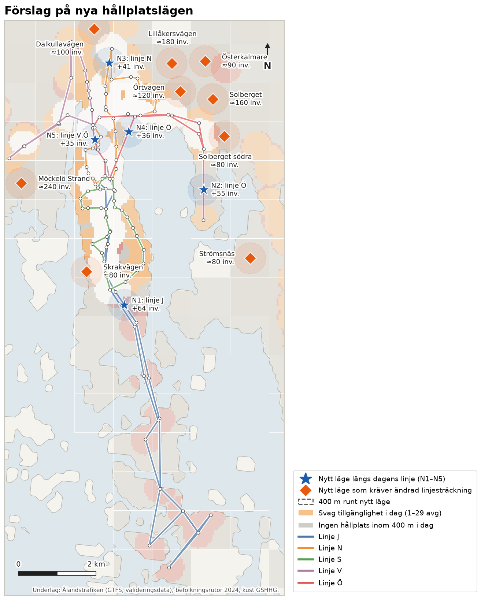
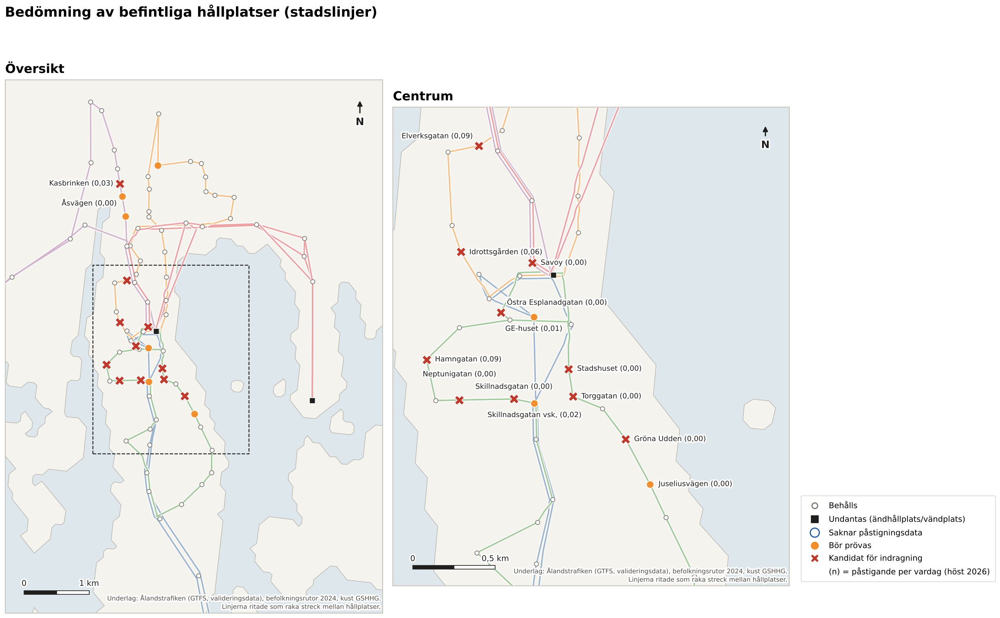

# 3 Hållplatslägen – nya och överflödiga hållplatser

> **Sammanfattning.** Fem nya hållplatslägen längs dagens linjer (N1–N5) ger cirka 140 invånare en
> hållplats inom 400 m. Ytterligare cirka 95 invånare får minst 30 avgångar per vardag i stället för färre. De
> största vinsterna finns sydost om Lervik på linje J, längs linje Ö mot Kalmarnäs och söder om Maxinge på linje N.
> Läget N5 innebär i praktiken att linje V och Ö också stannar vid Klintvägen. Huvuddelen av den otäckta
> befolkningen, cirka 2 000 invånare, bor dock mer än 400 m från stadslinjernas körvägar. Den kan bara nås med
> ändrad linjesträckning. Nio sådana områden med sammanlagt cirka 1 130 invånare har identifierats, de största
> vid Möckelö Strand, Lillåkersvägen och Solberget–Örtvägen. De utgör underlag för utredningsalternativen (UA) i kapitel 4.
> Med den tvättade påstigandedatan från hösten 2026 bedöms elva hållplatser som kandidater för indragning:
>
> - **linje S:** Torggatan, Stadshuset, Hamngatan, Skillnadsgatan, Östra Esplanadgatan, Neptunigatan och Gröna Udden;
> - **linje N:** Elverksgatan och Idrottsgården;
> - **linje V:** Åbrinken;
> - **linjerna V och Ö:** Savoy.
>
> De har högst 0,1 påstigande per vardag, avståndet mellan kvarvarande grannhållplatser blir högst 600 m och
> högst nio invånare förlorar hållplats inom 400 m. Sex av dem ligger inom 800 m från Centrum, Nygatan.
> Ytterligare sex hållplatser bör prövas.

## 3.1 Metod

**Nya hållplatslägen längs dagens linjer.** Kandidatlägen har genererats var 50:e meter längs
stadslinjernas körvägar. I den här versionen återges körvägen som rak linje mellan hållplatserna i GTFS.
Analysen är förberedd för att i stället använda linjernas faktiska vägdragning längs gatunätet (OSRM) och
körs om när vägdragningen har hämtats. Lägen på vatten och lägen närmare än 250 m från en befintlig hållplats på samma linje har
uteslutits. Ett läges nytta är antalet invånare som

- i dag saknar hållplats inom 400 m och skulle få det, eller
- i dag har svag tillgänglighet (1–29 avgångar per vardag, se kapitel 2) och skulle få minst 30 avgångar
  per vardag när linjens turer stannar i läget.

Lägena har valts stegvis med det mest nyttiga först. Nyttan räknas om efter varje val, så att samma invånare
inte räknas två gånger, och det är minst 300 m mellan nya lägen. Urvalet avbryts när nyttan understiger 30
invånare.

**Behov av ändrad linjesträckning.** Otäckt befolkning som ligger mer än 400 m från stadslinjernas körvägar
kan inte nås med nya hållplatser på dagens linjer. Den har sammanställts per 1 km-ruta (minst 75 invånare).
För varje område anges ett indikativt hållplatsläge i den otäckta befolkningens tyngdpunkt. Läget ska
anpassas till gatunätet vid den fortsatta utformningen.

**Överflödiga hållplatser.** Stadslinjernas 91 hållplatsområden har prövats en i taget, med lägst påstigande
först, mot tre kriterier:

1. *Lågt påstigande* (nödvändigt villkor): högst 0,1 påstigande per vardag på stadslinjerna, dvs. i
   genomsnitt högst en påstigning varannan vecka. Påstigandet är hämtat ur den tvättade höstdatan för linjerna
   N, S, V och Ö (kapitel 1). Hållplatser som inte finns i den har inga påstigningar. För linje J används
   sommardatan.
2. *Tät placering*: avståndet mellan de kvarvarande grannhållplatserna på linjen blir högst 600 m efter
   indragning.
3. *Liten unik täckning*: färre än 25 invånare förlorar busshållplats inom 400 m. Hållplatser som även
   trafikeras av landsbygdslinjer finns kvar för dem.

Hållplatser som uppfyller alla tre kriterier är *kandidater för indragning*. Den prövningen sker efter
föregående indragning, så att två grannhållplatser inte dras in samtidigt. Hållplatser med lågt påstigande
som uppfyller ett av de övriga kriterierna *bör prövas*. Följande hållplatser kan som mest klassas som *bör
prövas*:

- centrumhållplatsen och vändplatser;
- hållplatser som bara trafikeras av linje J och ligger i startsegmentet, vars påstigande i sommardatan är
  underskattat på grund av registreringsfelet i kapitel 1;
- skol- och säsongshållplatser som bara trafikeras av linje J, eftersom sommardatan omfattar sommarlovet.

Höstdatan avser terminstid och har inte registreringsfelet. Undantagen gäller därför inte hållplatser på
linjerna N, S, V och Ö.

## 3.2 Nya hållplatslägen

*Tabell 3.1. Nya hållplatslägen längs dagens linjer.*

| Nr | Linje | Läge | Avgångar/vardag | Ny täckning, inv. | Lyfts från svag tillgänglighet, inv. |
|---|---|---|---:|---:|---:|
| N1 | J | Sydost om Lervik (cirka 400 m från befintlig hållplats) | 9 | 61 | 3 |
| N2 | Ö | Längs linjen mot Kalmarnäs vändplan (cirka 780 m norr om vändplatsen) | 20 | 55 | – |
| N3 | N | Söder om Maxinge (cirka 370 m) | 22 | 17 | 24 |
| N4 | Ö | Öster om Musikinstitutet (cirka 340 m), på linje Ö:s körväg | 16 | 3 | 33 |
| N5 | V, Ö | Vid Klintvägen, där i dag endast linje N stannar | 40 | – | 35 |
| | | **Summa** | | **136** | **95** |

Med de fem lägena ökar andelen av Mariehamns invånare med hållplats inom 400 m från 83,6 % till 84,5 %.
Andelen med svag tillgänglighet är i stort sett oförändrad. De som får sin första hållplats nära, på linjer
med 9–22 avgångar per vardag, hamnar i gruppen svag tillgänglighet, medan ungefär lika många lyfts ur den.
Varje ny hållplats förlänger körtiden med uppskattningsvis 20–30 sekunder per tur när den används. Effekten
på omloppen redovisas i kapitel 4.

*Figur 3.1. Nya hållplatslägen längs dagens linjer (stjärnor) och indikativa lägen där ändrad
linjesträckning krävs (romber), med 400 m upptagningsområde. Bakgrund: tillgänglighet i dag enligt kapitel 2.*

## 3.3 Områden som kräver ändrad linjesträckning

*Tabell 3.2. Otäckt befolkning mer än 400 m från stadslinjernas körvägar (per 1 km-ruta, minst 75 invånare).*

| Område (närmaste hållplats) | Invånare utan hållplats inom 400 m | Avstånd till närmaste körväg (median) |
|---|---:|---:|
| Möckelö Strand | 240 | 750 m |
| Lillåkersvägen | 180 | 930 m |
| Solberget | 160 | 770 m |
| Örtvägen | 130 | 560 m |
| Dalkullavägen | 100 | 540 m |
| Österkalmare | 90 | 1 510 m |
| Skrakvägen | 80 | 470 m |
| Solberget södra | 80 | 600 m |
| Strömsnäs | 80 | 1 600 m |
| **Summa** | **≈ 1 130** | |

Områdena i norr och nordost (Lillåkersvägen, Örtvägen, Solberget och Österkalmare), med sammanlagt cirka
560 invånare, ligger mellan linje N:s och linje Ö:s nuvarande körvägar. De kan sannolikt nås genom en
justering av endera linjen. Möckelö Strand och Dalkullavägen ligger väster respektive norr om linje V.
Strömsnäs och Österkalmare ligger så långt från nätet att en betjäning bedöms kräva oproportionerligt
lång omväg inom ramen för dagens fordonsresurser.

## 3.4 Överflödiga hållplatser

*Tabell 3.3. Kandidater för indragning (påstigande per vardag, höst 2026).*

| Hållplats | Linje | Påstigande per vardag | Avstånd mellan kvarvarande grannar | Invånare som förlorar hållplats inom 400 m |
|---|---|---:|---:|---:|
| Torggatan | S | 0 | 565 m | 0 |
| Stadshuset | S | 0 | 453 m | 0 |
| Skillnadsgatan | S | 0 | 599 m | 0 |
| Östra Esplanadgatan | S | 0 | 275 m | 0 |
| Neptunigatan | S | 0 | 475 m | 0 |
| Gröna Udden | S | 0 | 542 m | 2 |
| Hamngatan | S | 0,09 | 465 m | 1 |
| Åbrinken | V | 0 | 430 m | 0 |
| Savoy | V, Ö | 0 | 465 m | 0 |
| Elverksgatan | N | 0,09 | 354 m | 0 |
| Idrottsgården | N | 0,06 | 498 m | 9 |

Sju av de elva kandidaterna ligger på linje S, vars slinga genom centrum och södra Mariehamn har tät
hållplatsplacering. Sex av kandidaterna ligger inom 800 m från Centrum, Nygatan: Savoy (150 m), Östra
Esplanadgatan (390 m), Stadshuset (580 m), Idrottsgården (580 m), Torggatan (750 m) och Skillnadsgatan (790 m).
Där är avståndet till centrum och andra hållplatser kort. Med antagandet
20–30 sekunder per hållplatsangöring kan indragningen förkorta linje S:s körtid med upp till cirka 3 minuter
per tur. För linjerna N och V blir det upp till 1 minut. Besparingen är en övre gräns, eftersom bussen
redan i dag sällan stannar vid hållplatser utan resande, men tidtabellen kan kortas med motsvarande marginal.
Det kan ge utrymme att förlänga eller räta ut linjer inom dagens omlopp (kapitel 4).

Jämfört med sommardatan har följande ändrats:

- **Nya kandidater:** Stadshuset, Östra Esplanadgatan och Elverksgatan saknade tidigare påstigningsdata.
  Savoy hade några påstigningar under sommaren men inga i höstdatan.
- **Skolhållplats utan undantag:** Idrottsgården klassades tidigare som skolhållplats som skulle bedömas med
  data från terminstid. Den har 0,06 påstigande per vardag även under terminstid.
- **Behålls nu:** Matrosgatan, Källarvägen, Hjortronstigen, Räddningsverket, Norrgårdsvägen, Parkgatan,
  Yrkesgymnasiet och Hotell & Restaurangskolan har tillräckligt många påstigningar i höstdatan.

Sex hållplatser *bör prövas*. De har lika få påstigningar, men en indragning skulle ge luckor på 730–1 050 m:

- Juseliusvägen (S), där 15 invånare förlorar hållplats;
- Åsvägen och Kasbrinken (V), där 17 invånare förlorar hållplats vid Kasbrinken;
- Vikingagränd (N), där 23 invånare förlorar hållplats;
- GE-huset (J);
- Skillnadsgatan vsk. (J, S).

*Figur 3.2. Bedömning av stadslinjernas hållplatser. Siffran inom parentes anger påstigande per vardag
(höst 2026; linje J sommar).*

## 3.5 Osäkerheter

- **Underlagets upplösning.** Befolkningen är fördelad jämnt inom 1 km-rutor och körvägarna är förenklade till
  raka linjer mellan hållplatser. Nyttan per läge är därför ungefärlig, och lägena ska justeras mot gatunät,
  bebyggelse och trafiksäkerhet innan de fastställs.
- **Påstigandet avser hösten 2026.** Höstdatan är tvättad och avser terminstid, men en hållplats kan ha
  annan funktion än påstigning, till exempel som avstigningshållplats eller för enstaka resenärer med särskilda
  behov. Avstigande ingår inte i underlaget. Indragning bör därför stämmas av med operatören och berörda
  innan beslut.
- **Linje J** bedöms med sommardatan, som har registreringsfelet i kapitel 1. GE-huset och Skillnadsgatan vsk.
  bör bedömas på nytt när linje J finns i den tvättade datan.

**Filer.** `data/processed/a3_nya_hallplatser.csv`, `a3_behov_ny_linjestrackning.csv` och
`a3_hallplatsbedomning.csv`, samt `a3_hallplatsforslag.gpkg` (lager för nya lägen, behov av ändrad
linjesträckning och hållplatsbedömning, för GIS). Skript: `src/a3_hallplatser.py` och `src/a3_kartor.py`.
