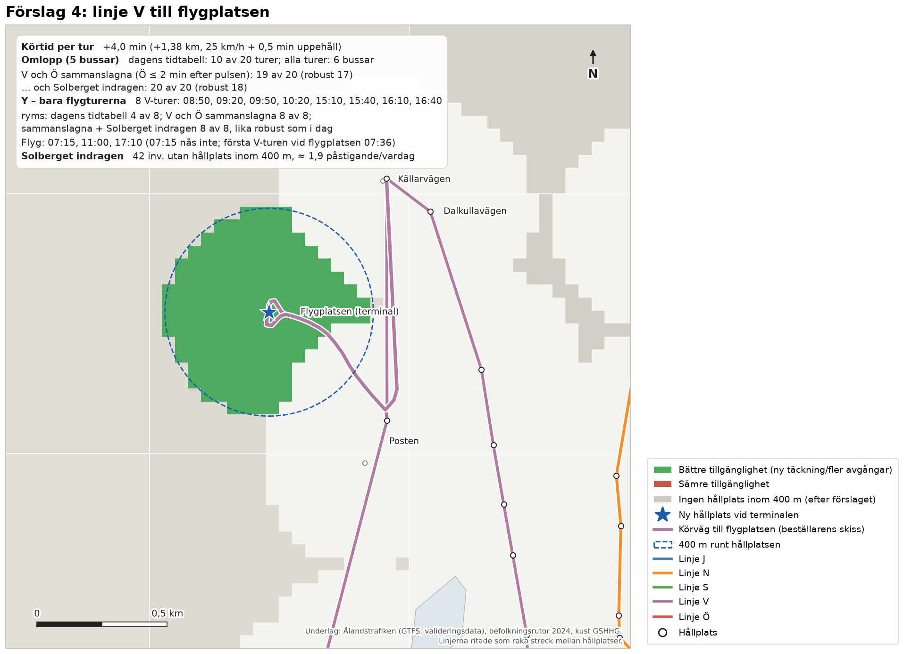

# 4 Justering av linjenätet

> **Status.** Delleverans i Fas B. Kapitlet redovisar dagens omlopp, de förslag som beställaren valde ut
> efter granskningen av Fas A (2026-10-14), förslaget om linje V till flygplatsen och en analys av sammanslagna
> linjer. Förslagen redovisas och
> prövas **var för sig**. En sammanställning för beställaren finns i `PM_linjeforslag.md`.

> **Sammanfattning.** Stadstrafiken körs i dag med fem bussar. Förarna byter linje i centrum enligt en fast
> norm: Syd ↔ Norr (S ↔ N) och Öst ↔ Väst (Ö ↔ V). Bussen som har kört linje V fortsätter alltså som linje Ö
> och tvärtom. Marginalerna är små: med krav på 2 minuters vändtid i stället för 1 skulle det krävas en
> sjätte buss.
>
> - **Möckelö Strand ny via dagens vägar (1a):** bussen kör som i dag till Möckelö Strand och tillbaka till
>   Norrgårdsvägen. Därefter kör den den befintliga vägen till den nya hållplatsen och tillbaka, 2 + 2 minuter.
>   Det ger 4,5 minuter per tur. Med dagens tidtabell ryms 9 av 20 turer; alla turer kräver en sjätte buss.
> - **1a med V och Ö sammanslagna:** bussen fortsätter direkt som linje Ö efter en halv minut, och Ö avgår
>   upp till 2 minuter efter pulsen. Då ryms 17 av 20 turer med fem bussar, eller 16 om robustheten ska vara
>   som i dag. Möckelö Strand ny kan alltså trafikeras redan med dagens vägar. Turerna som inte ryms ligger
>   i varven med Ö:s skolturer.
> - **Möckelö Strand ny via förlängd Norrgårdsvägen (1b):** bussen kör en slinga. Den går förlängningen till
>   den nya hållplatsen (1 minut) och den befintliga vägen tillbaka till Norrgårdsvägen (2 minuter). Netto blir
>   det 2,5 minuter per tur, eftersom sträckan Möckelö Strand → Norrgårdsvägen (1 minut) inte längre körs.
>   Alla 20 turer ryms; en robust variant har 15 av 20.
> - **N2 på linje Ö (2):** hållplatsen ger 55 invånare en hållplats inom 400 m och ryms med alla 20 turer.
> - **Linje N via Bo-Bil (3):** ändringen ryms och är i praktiken körtidsneutral (+0,1 min per tur). Cirka 44
>   invånare vid Bo-Bil får minst 30 avgångar per vardag. Däremot förlorar 23 invånare vid Vikingagränd
>   hållplatsen inom 400 m.
>
> - **Linje V till flygplatsen (4):** omvägen Posten – terminalen – Norra Svibyvägen tar cirka 4 minuter per
>   tur. Varianterna, alla med fem bussar utom den första:
>   - **alla turer med dagens tidtabell:** kräver en sjätte buss;
>   - **dagens tidtabell utan extra buss:** 10 av 20 turer ryms;
>   - **V och Ö sammanslagna:** 19 av 20 turer ryms;
>   - **sammanslagna och Solberget indragen på linje Ö** (1,6–2,5 min kortare per Ö-tur): alla 20 turer ryms;
>   - **Y-versionen:** bara de 8 V-turer som behövs för flygen 11:00 och 17:10. Den ryms helt och lika robust
>     som i dag med V och Ö sammanslagna och Solberget indragen.
>
>   Solberget har cirka 2 påstigande per vardag, men 42 invånare förlorar då sin hållplats inom 400 m.
>
> Med Möckelö Strand ny (1a eller 1b) får 179 invånare en hållplats inom 400 m, och andelen i Mariehamn ökar
> från 83,6 till 84,8 %.

## 4.1 Ramen – dagens omlopp

**Metod.** Ramen för förslagen är att linjenätet ska rymmas inom dagens omloppsplaner, med samma antal
fordon och samma körtid. GTFS-underlaget saknar omloppsuppgifter (block_id), så omloppen har härletts ur
tidtabellen för en typisk vardag (tisdag 2026-09-01):

- **Turerna:** alla stadslinjeturer börjar och slutar i Centrum, Nygatan. Turerna har kedjats till omlopp
  så att antalet fordon blir det minsta som tidtabellen kräver (minimikostnadstilldelning).
- **Norm för linjebyten:** enligt beställaren byter föraren linje vid varje vändning i centrum, Syd ↔ Norr
  (S ↔ N) och Öst ↔ Väst (Ö ↔ V), så långt tidtabellen medger. Omloppen följer den normen, och ett fordon
  fortsätter aldrig på samma linje. Linje J, som går en gång i timmen, kör i egen slinga.
- **Val mellan likvärdiga lösningar:** bland lösningar med lika många fordon har den med kortast
  omloppstid valts. Omloppstiden är fordonstimmarna från första avgång till sista ankomst.
- **Vändtid:** ett fordon får ta nästa tur tidigast 1 minut efter ankomsten, vilket är den kortaste
  vändtiden i dagens tidtabell. Vid byte inom paret (t.ex. V → Ö) räcker 0,5 minut, eftersom regleringen
  då kan tas vid nästa byte i varvet.

Ett förslag har verifierats på följande sätt:

1. Förslagets körtidsförändring läggs på berörda turer. Avgångstiderna från centrum ligger fast, så att
   pulsen och bytesmöjligheterna behålls.
2. Omloppen byggs om. Förslaget ryms om antalet fordon inte ökar och omloppstiden ökar med högst
   10 minuter per dag. Toleransen motsvarar att dagens sista tur kan bli något längre.
3. Ryms inte alla turer prövas turerna en i taget, och det redovisas hur många som ryms.
4. **Sammanslagning:** för linje V prövas också att slå ihop V och Ö till en genomgående linje (avsnitt 4.5).
   Bussen fortsätter då som linje Ö efter 0,5 minut, och Ö:s avgång får skjutas upp till 2 minuter efter
   pulsen. Övriga avgångstider ligger fast.
5. **Robusthet:** varje varv, dvs. två på varandra följande byten, bör ha minst 3 minuters reglering vid
   något av bytena. Antalet varv utan sådan reglering redovisas. I dag finns ett sådant varv (linje J
   13:17–15:20). Ger ett förslag fler sådana varv redovisas också en robust variant.

**Resultat.** Dagens 93 vardagsturer kräver fem fordon (figur 4.1). Två bussar växlar mellan S och N, två
mellan V och Ö, och en kör linje J. Körtiden är 42,5 timmar och omloppstiden 61,4 timmar per vardag.

Linjerna N, S, V och Ö avgår från centrum i en gemensam puls (:20 och :50) med 30 minuters intervall i
rusningstid. Linje J går ungefär en gång i timmen. Vändtiden i centrum varierar mellan linjerna:

| Linje | Turer per vardag | Körtid per tur (median) | Vändtid i centrum (median) |
|---|---|---|---|
| J | 9 | 48 min (41–62) | 5,5 min (1–19) |
| N | 22 | 26 min | 4 min |
| S | 22 | 23 min | 7 min |
| V | 20 | 27 min | 3 min |
| Ö | 20 | 23 min (skolturer 28–29) | 7 min (1–2 efter skolturer) |

Marginalerna är små. Med 2 minuters lägsta vändtid i stället för 1 minut skulle det krävas sex fordon,
eftersom linje J vänder på 1 minut 14:19–14:20 och 15:19–15:20 och fordonen växlar linje 08:45–08:50.
Vändtiderna i tabellen är också bytestiderna i paren: efter en V-tur har bussen 3 minuter innan den
fortsätter som Ö, och efter en Ö-tur 7 minuter innan den fortsätter som V.

*Figur 4.1. Härledd omloppsplan för en typisk vardag, med förarnas norm för linjebyten (S ↔ N, V ↔ Ö).
Varje rad är ett fordon och varje stapel en tur i linjens färg. Markeringar anger byten under 3 minuter.
Det nedre diagrammet visar antalet fordon i trafik.*

## 4.2 Förslag 1 – linje V till ny hållplats i Möckelö Strand

**Utformning.** Linje V vänder i dag vid hållplatsen Möckelö Strand: bussen kör Norrgårdsvägen →
Möckelö Strand (1,6 min) → Norrgårdsvägen (1 min). Den nya hållplatsen, *Möckelö Strand ny*, placeras i det
indikativa läget från kapitel 3, cirka 700 m söder om dagens vändpunkt. Restiderna är beställarens:

- **den befintliga vägen** mellan Norrgårdsvägen och den nya hållplatsen tar 2 minuter (cirka 1,4 km, mätt i
  beställarens skiss);
- **förlängningen av Norrgårdsvägen** från Möckelö Strand till den nya hållplatsen skulle ta 1 minut
  (cirka 0,7 km). Vägen finns inte i dag.

De 3 minuter som angavs för dagens vägar är alltså Möckelö Strand → Norrgårdsvägen (1 min, som bussen redan
kör) plus den befintliga vägen (2 min). Två varianter har prövats:

- **1a – dagens vägar:** bussen kör som i dag till Möckelö Strand och tillbaka till Norrgårdsvägen. Därefter
  kör den den befintliga vägen till den nya hållplatsen och samma väg tillbaka. Tillägget blir
  2 + 0,5 + 2 = **4,5 minuter per tur** och 2,7 km per tur. Bussen måste kunna vända vid den nya hållplatsen.
- **1b – förlängd Norrgårdsvägen, slinga:** bussen kör Möckelö Strand → förlängningen (1 min) → den nya
  hållplatsen (0,5 min) → den befintliga vägen (2 min) → Norrgårdsvägen. Sträckan Möckelö Strand →
  Norrgårdsvägen (1 min enligt tidtabellen) körs inte längre. Tillägget blir 1 + 0,5 + 2 − 1 = **2,5 minuter
  per tur** och 1,6 km per tur. Som känslighet har 3,5 minuter prövats, om tidtabellens minut inte kan
  räknas av.

*Tabell 4.1. Förslag 1 – effekter och verifiering mot dagens omlopp (5 bussar).*

| | 1a dagens vägar | 1b förlängd Norrgårdsvägen, slinga |
|---|---|---|
| Körtid per tur | +4,5 min | +2,5 min (känslighet +3,5) |
| Alla 20 turer, dagens tidtabell | 6 bussar – ryms inte (omloppstid +11,4 h/dag) | **5 bussar – ryms** (omloppstid +3 min/dag) |
| Turer som ryms, dagens tidtabell | 9 av 20 | 20 av 20 (känslighet: 10 av 20) |
| Med V och Ö sammanslagna (avsnitt 4.5) | **17 av 20** (16 lika robust som i dag) | – (känslighet: 19 av 20) |
| Varv med < 3 min reglering (i dag 1) | 1 (dagens tidtabell); 3 (sammanslagna) | 8 – robust variant 15 av 20 turer, 1 varv |
| Fordonskilometer per vardag | +24 km (9 turer); +46 km (17 turer) | +32 km |
| Invånare som får hållplats inom 400 m | 179 | 179 |
| Avgångar vid nya hållplatsen | 9 eller 17 per vardag | 20 (robust 15) per vardag |
| Uppskattat påstigande (sommarnivå) | 0,4–1,9 per vardag (17 turer) | 0,5–2,2 per vardag |
| Längre restid för genomresande | cirka 7–8 resenärsminuter per vardag | cirka 5 resenärsminuter per vardag |

**Bedömning.**

- **Variant 1a med dagens tidtabell** ryms bara på 9 turer: 07:20, 09:50, 10:20, 13:10, 13:40, 15:40, 16:40,
  17:40 och 20:40. Med alla turer krävs en sjätte buss och nästan 11,5 timmar mer omloppstid per vardag.
- **Variant 1a med V och Ö sammanslagna** ryms med 17 av 20 turer och fem bussar (avsnitt 4.5, figur 4.9).
  Möckelö Strand ny kan alltså trafikeras redan med dagens vägar, utan fler bussar. Priset är att 14 Ö-turer
  avgår upp till 2 minuter efter pulsen, och att tre V-turer kör som i dag: 07:50, 08:20 och 14:40.
- **Variant 1b** ryms med alla 20 turer (figur 4.3). Bytet V → Ö blir 0,5 minut, och regleringen tas vid
  bytet Ö → V. Kring Ö:s skolturer blir regleringen kortare än 3 minuter per varv. I en robust variant körs
  slingan inte på V-turerna 07:50, 08:50, 13:40, 14:40 och 15:40.
- **Effekt:** båda varianterna ger 179 invånare en hållplats inom 400 m. Det beräknade påstigandet är lågt i
  sommardata men bör vara högre under terminstid.

1a med V och Ö sammanslagna kan införas utan nya vägar. 1b ger kortare omväg, alla turer och kräver ingen
ändring av Ö:s avgångstider, men förutsätter att Norrgårdsvägen förlängs. Robustheten kring Ö:s skolturer bör
stämmas av mot verkliga körtider i båda fallen.

*Figur 4.2. Förslag 1. Grönt anger invånare som får bättre tillgänglighet och grått befolkning som
fortfarande saknar hållplats inom 400 m. Den befintliga vägen är ritad efter beställarens skiss, och
förlängningen (streckad) är schematisk.*

*Figur 4.3. Omlopp före och efter för förslag 1. Skrafferad del av en tur är tillagd körtid och prickad ram
anger att turen avgår senare än i dag. Rubriker i rött anger lösningar som kräver fler bussar. Blå markering
anger kort byte inom linjeparet.*

## 4.3 Förslag 2 – ny hållplats N2 på linje Ö

**Utformning.** Hållplatsen N2 placeras på sträckan mellan Österkullagatan och Kalmarnäs vändplan, i
läget från kapitel 3. Bussen passerar läget i båda riktningarna. Ett uppehåll per tur i genomsnitt
(0,5 minut) har antagits.

**Resultat.**

- **Omlopp:** alla 20 turer ryms med fem bussar (figur 4.5), och förslaget är lika robust som i dag.
  Skolturen 08:20 kommer tillbaka 08:49,5 och bussen fortsätter som linje V 08:50 efter ett kort byte.
- **Täckning:** 55 invånare får en hållplats inom 400 m med 20 avgångar per vardag.
- **Påstigande:** det uppskattade påstigandet är 0,4–1,8 per vardag på sommarnivå. Linje Ö har stadsnätets
  högsta påstigande per invånare.
- **Ombordvarande:** förlusten för resenärer som redan sitter på bussen är försumbar, cirka 1
  resenärsminut per vardag.

**Bedömning.** Förslaget ryms i dagens omlopp.

*Figur 4.4. Förslag 2, ny hållplats N2 på linje Ö.*

*Figur 4.5. Omlopp före och efter för förslag 2.*

## 4.4 Förslag 3 – linje N via Bo-Bil i stället för Vikingagränd

**Utformning.** Linje N kör i dag Maxinge – Vikingagränd – Bolstavägen. I förslaget kör linjen i stället
Maxinge – Bo-Bil – Bolstavägen och stannar vid hållplatsen Bo-Bil på Nya Godbyvägen. Syftet är att bussen
inte ska behöva vänta vid Nya Godbyvägen för att komma till Maxinge. Bo-Bil trafikeras i dag främst av
landsbygdslinjerna 2–4.

**Resultat.**

- **Körtid:** den nya körvägen är cirka 27 % kortare fågelvägen. Med dagens schemalagda tid för
  delsträckan ger det 0,4 minut kortare körtid per tur. Bo-Bil blir däremot ett verkligt uppehåll
  (+0,5 minut), medan bussen i dag sällan stannar vid Vikingagränd. Netto blir körtiden +0,1 minut per tur,
  dvs. i praktiken oförändrad. Fordonskilometrarna minskar med cirka 9 km per vardag. Den minskade väntan
  vid Nya Godbyvägen ingår inte, eftersom den inte kan beräknas utan realtidsdata. Den talar för kortare och
  jämnare körtid.
- **Omlopp:** förslaget ryms med alla 22 turer och fem bussar (figur 4.7). Linje N:s vändtid blir 3,9
  minuter i stället för 4.
- **Bo-Bil:** hållplatsen får linje N:s 22 avgångar utöver landsbygdslinjernas. Cirka 44 invånare får
  därmed minst 30 avgångar per vardag i stället för 15–29.
- **Vikingagränd:** 23 invånare förlorar hållplats inom 400 m. Påstigandet vid Vikingagränd är i dag
  cirka 0,05 per vardag, dvs. fem påstigningar under 92 vardagar, och hållplatsen bedömdes redan i
  kapitel 3 som en hållplats som bör prövas.
- **Restid:** förändringen för genomresande på linje N är försumbar, cirka 2 resenärsminuter per vardag.

**Bedömning.** Förslaget ryms och förbättrar körtidens tillförlitlighet. Den förlorade täckningen vid
Vikingagränd är liten men bör vägas in. Den kan mildras om hållplatsen N3 söder om Maxinge (kapitel 3)
genomförs samtidigt.

*Figur 4.6. Förslag 3. Rött anger invånare som får sämre tillgänglighet och grönt invånare som får bättre.
Körvägarna är schematiska tills vägdragningen har hämtats.*

*Figur 4.7. Omlopp före och efter för förslag 3.*

## 4.5 Sammanslagning av linjer

### 4.5.1 Princip – reglering vid bytet till partnerlinjen

Bussarna växlar redan i dag mellan linjerna i paren S ↔ N och Ö ↔ V. Varje byte har i dag en egen reglering,
lika med linjens vändtid. Slås paret ihop till en genomgående linje läggs all reglering vid det ena bytet i
varvet, och det andra bytet blir kort:

- Linje A får ett kort byte i centrum (0,5 minut) och kan förlängas med 30 − 0,5 − körtiden.
- Partnerlinjen B behåller minst 3 minuters reglering vid sitt byte.
- Om B dessutom får avgå upp till 2 minuter efter pulsen kan A förlängas ytterligare, så länge B har minst
  3 minuters reglering kvar.

Med pulsen kvar ger det 2,5 minuter mer per tur än om varje byte ska ha minst 3 minuters reglering
(tabell 4.2). Får partnerlinjen avgå upp till 2 minuter efter pulsen ökar utrymmet för N och V med
ytterligare 2 minuter. Om bytet skyltas som genomgående linje kan resenärerna dessutom sitta kvar på bussen.

*Tabell 4.2. Utrymme för förlängning per tur utan fler bussar (30 minuters turintervall, rusningstid).*

| Linje (körtid) | Reglering ≥ 3 min vid varje byte | Reglering hos partnern, pulsen kvar | … och partnern ≤ 2 min efter pulsen | Utan puls (paret) |
|---|---|---|---|---|
| N (26 min), partner S | 1 min | 3,5 min | 5,5 min | 7,5 min |
| S (23 min), partner N | 4 min | 6,5 min | 7,5 min | 7,5 min |
| V (27 min), partner Ö | 0 min | 2,5 min | 4,5 min | 6,5 min |
| Ö (23 min, skolturer 28–29), partner V | 4 min | 6,5 min | 6,5 min | 6,5 min |

**Behov.** Behovet har jämförts med de nio områden som enligt kapitel 3 kräver ändrad linjesträckning
(figur 4.8). Behövd tid per tur har beräknats som två gånger avståndet till närmaste körväg × 1,3 i
hastigheten 25 km/h plus 0,5 minuts uppehåll. För Möckelö Strand har beställarens restider via dagens vägar
(1a, 4,5 min) använts.

- **Ryms med reglering hos partnerlinjen:** Solberget (linje Ö, cirka 5 min) och Solberget södra (linje Ö,
  cirka 4 min).
- **Ryms om partnerlinjen dessutom avgår upp till 2 minuter efter pulsen:**
  - Möckelö Strand (linje V, 4,5 min, se avsnitt 4.5.2);
  - Örtvägen (linje N, 4,4 min);
  - Dalkullavägen (linje V, 4,4 min).
- **Ryms inte:** Lillåkersvägen (linje N, 6,5 min), Österkalmare (linje N, 10 min) och Strömsnäs (linje Ö,
  10 min) kräver en större omläggning.

Utrymmet i ett par kan bara användas en gång. Förlängs linje V till Möckelö Strand ny har Ö kvar sitt eget
utrymme på 4 minuter per tur, men inte mer. Tabellen gäller rusningstidens körtider. I varven med Ö:s
skolturer är utrymmet mindre.

**Resor som kan bli direkta.** Skyltas bytet som genomgående linje kan resenärerna sitta kvar. För dagens
par ger det under 1 resa per vardag vardera (N/S och V/Ö). Paret S/Ö skulle ge flest, cirka 2 per vardag,
men är inte ett av dagens par. Med sommarens låga resande är effekten liten. Paren avgår från samma
hållplatsläge i centrum (V och Ö från läge 66202, N och S från läge 66201).

*Figur 4.8. Sammanslagning av linjer. Till vänster områden utan hållplats inom 400 m med behövd tid per
tur. Uppe till höger tidsutrymmet per linje. Nere till höger resor per vardag som kan bli direkta om bytet
skyltas som genomgående linje.*

### 4.5.2 V och Ö sammanslagna – Möckelö Strand ny redan med dagens vägar?

Ett varv V → Ö → V tar 60 minuter, och två bussar kör varvet med 30 minuters förskjutning (figur 4.9).

- **I dag:** varvet består av V (27 min), byte (3 min), Ö (23 min) och byte (7 min). Med Ö:s skolturer
  (28 min) blir det sista bytet 2 minuter.
- **1a med dagens tidtabell:** V tar 31,5 minuter och kommer tillbaka 1,5 minut efter att Ö ska avgå. Bara de
  turer där en annan buss kan ta Ö-turen ryms (9 av 20).
- **1a med V och Ö sammanslagna:** bussen fortsätter som linje Ö efter 0,5 minut. Ö avgår då 2 minuter efter
  pulsen, och regleringen före nästa V-tur blir 5 minuter. Det ryms i rusningstid.
- **Varv med Ö:s skolturer:** V (31,5) + byte (0,5) + Ö (28) = 60 minuter, så det finns ingen tid kvar för
  bytet före nästa V-tur. Där kör V-turen som i dag.

Omloppen har byggts om tur för tur med dessa regler (b4_omlopp.py, figur 4.3). Resultatet:

- **Turer:** 17 av 20 V-turer kan trafikera Möckelö Strand ny med fem bussar. 07:50, 08:20 och 14:40 kör som i
  dag.
- **Robusthet:** 3 varv får mindre än 3 minuters reglering, mot 1 i dag. Med samma robusthet som i dag ryms
  16 av 20 turer (även 08:50 kör som i dag).
- **Ö:s avgångar:** 14 av Ö:s 20 turer avgår 2 minuter senare än i dag, dvs. :22/:52 i stället för
  :20/:50 på förmiddagen och :12/:42 i stället för :10/:40 på eftermiddagen.
- **Kostnad:** omloppstiden ökar med cirka 7 minuter och körsträckan med 46 km per vardag.

**Konsekvenser för resenärerna.** Resenärer som byter till linje Ö i pulsen får 2 minuter längre väntan, och Ö
kommer tillbaka till centrum 2 minuter senare. Ö når ändå centrum före nästa pulsavgång. Resenärer som åker
vidare från V till Ö kan sitta kvar. Nätverksmodellen räknar med en schablon för byten och fångar därför inte
de 2 minuterna.

**Bedömning.** Ja – med V och Ö sammanslagna kan Möckelö Strand ny trafikeras redan med dagens vägar, på 17 av
20 turer och med dagens fem bussar. Förlängningen av Norrgårdsvägen (1b) behövs inte för att det ska rymmas.
Vägen ger däremot följande:

- **Kortare omväg:** 2,5 i stället för 4,5 minuter per tur.
- **Fler turer:** alla 20 turer via den nya hållplatsen.
- **Pulsen kvar:** Ö kan behålla sina avgångar i pulsen.

För 1a behövs en vändmöjlighet vid den nya hållplatsen.

*Figur 4.9. Sammanslagning av linje V och Ö: tidsbudget per varv och antal turer som ryms per alternativ.*

### 4.5.3 Genomgående N/S – Örtvägen, Lillåkersvägen och Österkalmare (B4.5)

Linje N har i dag 26 min körtid och 4 min vändtid. Med genomgående N/S (bussen fortsätter N → S efter 0,5 min och
regleringen tas vid S → N) ryms 3,5 min per tur med bevarad puls. Tabellen visar hur många av N:s 22 turer som ryms
inom dagens fem bussar (vändtid ≥ 1 min, omloppstid + ≤ 10 min/dag) när S-turen som följer får avgå högst *skift*
min efter pulsen. Skriptet är `src/b4_ns_sammanslagning.py`, utdata `data/processed/b4_ns_*.csv/json`.

| Område (tillägg/tur) | Puls bevarad | S ≤ 2 min efter | S ≤ 4 min efter | Utan puls (≤ 7 min) |
|---|---|---|---|---|
| Bo-Bil (+0,1) | 22/22 | 22/22 | 22/22 | 22/22 |
| Örtvägen (+4,4) | 7/22 | 22/22 (robust 21) | 22/22 | 22/22 |
| Lillåkersvägen (+6,5) | 7/22 | 7/22 | 21/22 (22 med S-indragning, robust 21) | 21/22 |
| Österkalmare (+10,3) | 5/22 | 5/22 | 5/22 | 7/22 (20 med S-indragning, robust 6) |

* **Bo-Bil** (förslag 3) ryms med genomgående N/S utan skift; det krävs ingen sammanslagning.
* **Örtvägen** ryms på alla turer om S får avgå 2 min efter pulsen (samma nivå som V/Ö i 4.5.2). Med de fem
  indragna S-hållplatserna blir lösningen också robust (inga fler varv under 3 min reglering än i dag).
* **Lillåkersvägen** kräver att S-avgången släpps 4 min efter pulsen. Därmed är pulsen inte bevarad och
  bytesresor mellan S och N-linjens partner får längre väntan; effekten ingår inte i nätverksmodellen.
* **Österkalmare** (+10,3 min) ryms inte utan fler bussar eller större omläggning (B4.6).
* **Indragna hållplatser på S** (Gröna Udden, Torggatan, Neptunigatan, Skillnadsgatan, Hamngatan) antas spara
  0,5 min per hållplats, ≈ 2,5 min per tur (tidtabellen saknar direkttider; antagandet bör ersättas med
  operatörens körtider). De lyfter Örtvägen till robust och Lillåkersvägen till 22/22.
* **S/Ö som alternativt par** (S ↔ Ö, N ↔ V) ger sämre resultat: S förlängd med 6,5 min ryms bara på 10/22 turer,
  med 10,5 min på 6–9/22 (utan puls ≤ 7 min), eftersom Ö:s skolturer har mindre utrymme. Pulsfria N/S-varianter
  ger alltså mer än S/Ö-par; det teoretiska utrymmet 10,5 min (S/Ö) nås inte i praktiken.

Resultatet pekar mot att Örtvägen är det som ryms med genomgående N/S och S ≤ 2 min efter pulsen, medan
Lillåkersvägen och Österkalmare hör ihop med en omläggning av N och Ö i nordost (B4.6).
Områdespunkter med resultat finns som GeoJSON: `output/kartor/b4_ns_sammanslagning.geojson`.

## 4.6 Förslag 4 – linje V till flygplatsen

**Utformning.** Linje V passerar i dag Posten på Flygfältsvägen. I förslaget kör bussen från Posten upp till
flygterminalen, runt terminalen och tillbaka till Norra Svibyvägen, och därefter vidare mot Källarvägen som i
dag (figur 4.10). Körvägen är digitaliserad ur beställarens skiss.

- **Omväg:** cirka 1,4 km per tur. Med 25 km/h och 0,5 minuts uppehåll blir tillägget cirka **4 minuter per
  tur** (känslighet 3–5 minuter).
- **Vid flygplatsen:** bussen är där cirka 16 minuter efter avgången från centrum, t.ex. 09:36 med turen 09:20.

**Flygen.** Enligt Finavia avgår flyg från Mariehamn 07:15 (Arlanda), 11:00 (Åbo) och 17:10 (Arlanda).
Ankomsttiderna fanns inte i underlaget. Det har antagits att samma flygplan landar 35 minuter före avgångarna
11:00 och 17:10, dvs. 10:25 och 16:35. Antagandet ska ersättas med de verkliga tiderna. Y-versionen av linjen
kör till flygplatsen bara på de V-turer som behövs för flygen:

- **till flyget:** turer som är vid flygplatsen mellan 2 timmar och 30 minuter före avgång – 08:50, 09:20 och
  09:50 (flyget 11:00) samt 15:10, 15:40 och 16:10 (flyget 17:10);
- **från flyget:** den första turen 10–40 minuter efter ankomst – 10:20 (vid flygplatsen 10:36) och 16:40
  (16:56);
- **07:15-flyget** kan inte nås, eftersom den första V-turen är vid flygplatsen 07:36. Det skulle kräva en
  extra tur före 06:45, med cirka 30 minuter längre omloppstid.

**Solberget.** Hållplatsen Solberget på linje Ö ligger på en omväg. Dras den in kör bussen direkt mellan
grannhållplatserna, vilket sparar 1,6–2,5 minuter per Ö-tur. Det ger mer tid i varvet V → Ö → V, framför allt i
varven med Ö:s skolturer.

*Tabell 4.4. Förslag 4 – verifiering mot dagens omlopp och effekter.*

| Variant | Turer via flygplatsen | Bussar | Varv < 3 min reglering (i dag 1) | Omloppstid | Fordonskm per vardag | Driftkostnad per år (bas) |
|---|---|---|---|---|---|---|
| Alla turer, dagens tidtabell | 20 av 20 | **6** | 1 | +11,4 h/dag | +28 | +209 000 € |
| Dagens tidtabell, de turer som ryms | 10 av 20 | 5 | 1 | +8 min/dag | +14 | – |
| V och Ö sammanslagna (Ö ≤ 2 min efter pulsen) | 19 av 20 | 5 | 7 (17 av 20: 1) | +5 min/dag | +26 | +7 300 € |
| V och Ö sammanslagna + Solberget indragen | 20 av 20 | 5 | 7 (18 av 20: 1) | +3 min/dag | +28 | +7 200 € |
| Y: flygturerna, dagens tidtabell | 4 av 8 | 5 | 1 | ±0 | +6 | – |
| Y: flygturerna, V och Ö sammanslagna | 8 av 8 | 5 | 3 | ±0 | +11 | – |
| **Y: flygturerna, sammanslagna + Solberget indragen** | **8 av 8** | 5 | **1** | −2 min/dag | +11 | +2 300 € |
| Känslighet 3 min, sammanslagna | 20 av 20 | 5 | 8 | +4 min/dag | +28 | – |
| Känslighet 5 min, sammanslagna | 8 av 20 | 5 | 1 | +5 min/dag | +11 | – |

**Resultat.**

- **Dagens tidtabell:** omvägen ryms inte. Alla turer kräver en sjätte buss och drygt 11 timmar mer omloppstid
  per vardag, och utan extra buss ryms bara 10 av 20 turer.
- **V och Ö sammanslagna:** bussen fortsätter direkt som linje Ö, och Ö avgår upp till 2 minuter efter
  pulsen. Då ryms 19 av 20 turer. V-turen 07:50 ryms inte, eftersom den följs av Ö:s skoltur 08:20, som tar
  29 minuter.
- **Solberget indragen dessutom:** alla 20 turer ryms. Med samma robusthet som i dag ryms 18 av 20 (07:50 och
  14:40 kör som i dag).
- **Y-versionen:** alla 8 flygturer ryms med V och Ö sammanslagna. Med Solberget indragen blir det lika robust
  som i dag. 7 Ö-turer avgår då upp till 2 minuter efter pulsen.
- **Känslighet:** resultaten är känsliga för omvägens körtid. Tar den 5 minuter i stället för 4 räcker inte
  2 minuters förskjutning av Ö, och bara 8 turer ryms.

**Effekter.**

- **Täckning:** 20 invånare nära terminalen får en hållplats inom 400 m.
- **Solberget:** med Solberget indragen förlorar 42 invånare sin hållplats inom 400 m. Hållplatsen har cirka
  2 påstigande per vardag på sommarnivå.
- **Restid:** genomresande på linje V får cirka 4 minuter längre restid på de turer som kör via flygplatsen,
  cirka 10–12 resenärsminuter per vardag. Med Solberget indragen blir resan på linje Ö kortare för cirka 12 resor
  per vardag.
- **Flygresenärerna:** OD-matrisen saknar flygplatsen som målpunkt, så nyttan för dem ingår inte i beräkningen.

**Bedömning.** Linje V till flygplatsen kan inte köras med dagens tidtabell utan en sjätte buss. Med V och Ö
sammanslagna och Ö upp till 2 minuter efter pulsen ryms nästan alla turer. Y-versionen med 8 flygturer ryms helt
och är lika robust som i dag, om Solberget samtidigt dras in. Två saker behöver beslutas:

- om förlusten vid Solberget (42 invånare) är acceptabel, och
- om en till två minuters senare avgång för Ö är acceptabel.

Den verkliga körtiden till terminalen och flygens ankomsttider bör kontrolleras innan förslaget går vidare.
Förslaget konkurrerar om samma tidsutrymme som Möckelö Strand ny (förslag 1), eftersom båda förlänger linje V.
Båda kan därför inte genomföras i samma omlopp utan fler bussar, om inte 1b med förlängd Norrgårdsvägen väljs.

*Figur 4.10. Förslag 4, linje V till flygplatsen. Körvägen är ritad efter beställarens skiss.*

*Figur 4.11. Förslag 4: tidsbudget per varv V → Ö → V och antal turer som ryms per variant.*

*Figur 4.12. Omlopp före och efter för förslag 4. Skrafferad del är tillagd körtid, svart prickad ram anger att
turen avgår senare än i dag och prickad ram i linjens färg efter en Ö-tur anger kortare körtid (Solberget
indragen).*

## 4.7 Systemeffekter per förslag

Varje förslag har prövats för sig mot dagens nät (figur 4.13 och 4.14). Täckningen gäller invånarna i
Mariehamn (14 821). Förslag 4 redovisas i tabell 4.4.

*Tabell 4.3. Systemeffekter per förslag, i dag och med varje förslag för sig.*

| | I dag | 1a alla turer | 1a dagens tidtabell | 1a V och Ö sammanslagna | 1b | 2 N2 | 3 Bo-Bil |
|---|---|---|---|---|---|---|---|
| Turer via förslaget | – | 20 av 20 | 9 av 20 | 17 av 20 | 20 av 20 | 20 av 20 | 22 av 22 |
| Hållplats inom 400 m | 83,6 % | 84,8 % | 84,8 % | 84,8 % | 84,8 % | 84,0 % | 83,4 % |
| Minst 15 avgångar per vardag | 81,0 % | 82,2 % | 81,0 % | 82,2 % | 82,2 % | 81,4 % | 80,8 % |
| Minst 30 avgångar per vardag | 55,6 % | 55,6 % | 55,6 % | 55,6 % | 55,6 % | 55,6 % | 55,9 % |
| Svag tillgänglighet (1–29 avg.) | 28,0 % | 29,2 % | 29,2 % | 29,2 % | 29,2 % | 28,4 % | 27,6 % |
| Invånare med bättre / sämre | – | 179 / 0 | 179 / 0 | 179 / 0 | 179 / 0 | 55 / 0 | 44 / 24 |
| Bussar | 5 | **6** | 5 | 5 | 5 | 5 | 5 |
| Omloppstid (h per vardag) | 61,4 | 72,9 | 61,6 | 61,5 | 61,5 | 61,4 | 61,4 |
| Fordonskilometer per vardag | 1 136 | 1 191 | 1 161 | 1 183 | 1 168 | 1 136 | 1 127 |
| Varv med < 3 min reglering | 1 | 1 | 1 | 3 | 8 | 1 | 1 |
| Längre restid, befintliga resenärer (resenärsmin. per vardag) | – | 10 | 4 | 7 | 5 | 1 | 2 |

Förändringarna är lokala och syns bara i de berörda områdena (figur 4.14):

- **Möckelö Strand ny:** 179 invånare som i dag saknar hållplats får en med 15–20 avgångar per vardag. Med
  dagens tidtabell blir det 9 avgångar. Andelen med svag tillgänglighet ökar därför. Det är en förbättring:
  invånarna flyttar från *ingen hållplats* till *svag tillgänglighet*.
- **N2:** 55 invånare får en hållplats inom 400 m med 20 avgångar.
- **Bo-Bil:** 44 invånare lyfts till minst 30 avgångar per vardag, medan 23 invånare vid Vikingagränd förlorar
  hållplatsen inom 400 m.
- **Flygplatsen:** 20 invånare nära terminalen får en hållplats inom 400 m. Nyttan för flygresenärerna ingår
  inte, eftersom OD-matrisen saknar flygplatsen som målpunkt.
- **Solberget indragen:** 42 invånare förlorar sin hållplats inom 400 m och 7 får färre avgångar.

Förlusten för befintliga resenärer är högst 10 resenärsminuter per vardag. Kostnaderna redovisas i kapitel 5.

*Figur 4.13. Systemeffekter: invånare med bättre respektive sämre tillgänglighet och nyckeltal för varje
förslag för sig (förslag 1a och 4 i flera driftformer).*

*Figur 4.14. Turtäthet inom 400 m i dag och med förslaget, inzoomat per förslag. Grön ram anger bättre och
röd ram sämre klass än i dag.*

## 4.8 Fortsatt arbete

Nästa leverans ska redovisa följande:

1. **V och Ö sammanslagna (Möckelö Strand ny via dagens vägar).** Pröva tidtabellen med Ö 2 minuter efter
   pulsen mot verkliga körtider och mot bytena i centrum, och undersök vändmöjligheten vid den nya hållplatsen.
2. **Paret N ↔ S.** Reglering vid bytet N → S, med S upp till 2 minuter efter pulsen, ger utrymme för linje N
   att nå Örtvägen. Pröva det tillsammans med Bo-Bil (3), alternativt i kombination med indragning av
   hållplatser på linje S enligt kapitel 3.
3. **Nordost.** En omläggning av linje N och Ö norr och nordost om centrum prövas för Lillåkersvägen,
   Solberget och Österkalmare, med och utan bibehållen puls.
4. **Dalkullavägen** på linje V ryms enligt screeningen om Ö avgår efter pulsen, men konkurrerar om samma
   utrymme som Möckelö Strand och flygplatsen.
5. **Flygplatsen.** Hämta flygens ankomsttider och kontrollera körtiden Posten – terminalen (OSRM eller
   provkörning). Pröva också en extra morgontur för 07:15-flyget och vändmöjligheten vid terminalen.

## 4.9 Osäkerheter

- **Omloppen** är härledda ur tidtabellen och kan avvika från operatörens faktiska omloppsplaner. Förarnas
  raster och tjänstgöring ingår inte. Verifieringen bör stämmas av mot operatörens omloppsplaner.
- **Körtider för nya delsträckor** bygger på beställarens restider (Möckelö Strand: 2 minuter på den befintliga
  vägen, 1 minut på förlängningen) och fågelvägsavstånd (Bo-Bil). Längden på den befintliga vägen är mätt i
  beställarens skiss. När vägdragningen hämtas från OSRM ruttas även förslagens nya delsträckor, och OSRM:s
  körtider redovisas för kontroll i `b4_forslag.json`. I den här versionen kunde OSRM inte nås från
  analysmiljön.
- **Vägdragningen i GIS** hämtas med `output/gis/rutta_med_osrm.py` i QGIS. Där OSRM väljer en annan väg än
  bussen, t.ex. huvudvägen i stället för vägen söder om den mellan Lönnhagsvägen och Norrgårdsvägen, styrs
  rutten med via-punkter (lagret `00_viapunkter`).
- **Flygplatsen:** körvägen och terminalens läge är uppskattade ur beställarens skiss (± 25 %), och
  flygens ankomsttider är antagna.
- **Ö efter pulsen (1a och 4 med V och Ö sammanslagna)** förutsätter att resenärer som byter till Ö kan vänta
  2 minuter längre. Effekten på bytesresor ingår inte i nätverksmodellen.
- **Normen för linjebyten** (S ↔ N, Ö ↔ V) bygger på beställarens uppgift och bör stämmas av mot
  operatörens omloppsplaner.
- **Påstigande och restider** bygger på sommardata (2026-05-08 – 2026-09-14) och är låga i absoluta tal.
  Effekterna bör räknas om med terminsdata.
- **Hållplatslägena** för Möckelö Strand och N2 är indikativa. Befolkningen är jämnt fördelad inom varje
  1 km-ruta, så antalet invånare som får täckning beror på det exakta läget.
