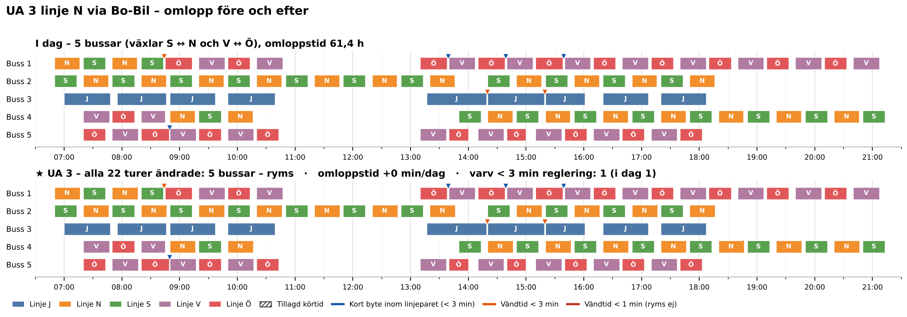
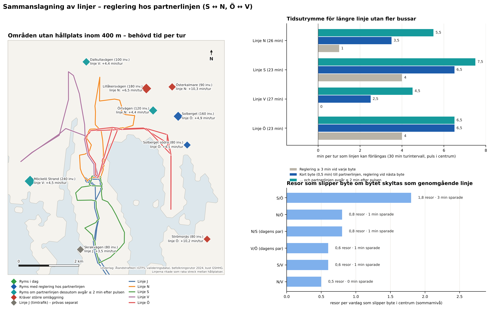

# 4 Justering av linjenätet

> **Status.** Delleverans i Fas B. Kapitlet redovisar dagens omlopp och de utredningsalternativ (UA) som
> beställaren valde ut efter granskningen av Fas A (2026-10-14), inklusive UA 4 om linje V till flygplatsen, samt en
> analys av sammanslagna linjer. Varje UA prövas **för sig** i flera driftformer. Kravet för en sammanslagen linje
> V–Ö har preciserats av beställaren 2026-10-15: varje varv V + Ö ska rymmas inom timmen med minst 5 minuter i
> centrum.
>
> - **Huvudalternativ (★):** den mest realistiska driftformen. Den visas på kartorna och i QGIS.
> - **Uteslutna:** driftformer som kräver fler bussar. De redovisas i tabellerna men får ingen karta.
>
> En sammanställning för beställaren finns i `PM_utredningsalternativ.md`.

> **Sammanfattning.** Stadstrafiken körs i dag med fem bussar. Förarna byter linje i centrum enligt en fast
> norm: Syd ↔ Norr (S ↔ N) och Öst ↔ Väst (Ö ↔ V). Bussen som har kört linje V fortsätter alltså som linje Ö
> och tvärtom. Linje V kan inte förlängas utan att V och Ö slås ihop till en genomgående linje V–Ö. Bussen
> fortsätter då som Ö efter en halv minut, och resenärer mellan V och Ö kan sitta kvar. Ö startar när V har
> kommit tillbaka. Det enda kravet är att varje varv V + Ö ryms inom 55 minuter, dvs. minst 5 minuter i
> centrum, och helst inom 50 minuter. I huvudalternativen startar Ö 0–2 minuter efter pulsen.
>
> | UA | Huvudalternativ (★) | Turer | Bussar | Uteslutet |
> |---|---|---|---|---|
> | UA 1a – Möckelö Strand ny via dagens vägar (+4,5 min/tur) | V och Ö sammanslagna | 16 av 20 | 5 | Alla turer med dagens tidtabell (6 bussar) |
> | UA 1b – Möckelö Strand ny via förlängd Norrgårdsvägen (+2,5 min/tur) | V och Ö sammanslagna | 16 av 20 | 5 | – |
> | UA 2 – N2 på linje Ö (+0,5 min/tur) | Alla turer | 20 av 20 | 5 | – |
> | UA 3 – Linje N via Bo-Bil (+0,1 min/tur) | Alla turer | 22 av 22 | 5 | – |
> | UA 4 – Linje V–Ö via flygplatsen (+4 min/tur) | V och Ö sammanslagna | 16 av 20 | 5 | Bara förlängning av V (6 bussar) |
>
> I UA 1a, 1b och 4 kör fyra V-turer som i dag. V 07:50, 13:40 och 14:40 följs av Ö:s skolturer (28–29 minuter),
> och V 08:20 fortsätter som linje N. I de varven finns inte 5 minuter kvar i centrum.
>
> Övriga driftformer:
>
> - **UA 1a med dagens tidtabell:** 8 av 20 turer.
> - **UA 1b med alla turer:** ryms med fem bussar, men varven med Ö:s skolturer får bara 1,5–2,5 minuter i
>   centrum och uppfyller inte kravet.
> - **UA 4:**
>   - med dagens tidtabell 8 av 20 turer;
>   - med Solberget indragen dessutom samma 16 turer, men med större marginal. Indragningen behövs alltså inte;
>   - **UA 4Y:** bara de 8 V-turer som behövs för flygen 11:00 och 17:10. Alla 8 ryms med V och Ö sammanslagna
>     och minst 6 minuter i centrum, utan att Solberget dras in.
>
> **Effekter:**
>
> - **Möckelö Strand ny (UA 1a eller 1b):** 179 invånare får en hållplats inom 400 m, och andelen i Mariehamn
>   ökar från 83,6 till 84,8 %.
> - **N2 (UA 2):** 55 invånare får en hållplats inom 400 m.
> - **Bo-Bil (UA 3):** 44 invånare får minst 30 avgångar per vardag, medan 23 invånare vid Vikingagränd förlorar
>   hållplatsen.
> - **Flygplatsen (UA 4):** 20 invånare nära flygplatsen får en hållplats inom 400 m.
> - **Genomgående linje V–Ö:** resor mellan V- och Ö-området slipper bytet i centrum. Med sommarens resande
>   gäller det cirka 1 resa per vardag, och effekten ingår i restiderna.
>
> UA 1a, 1b och 4 använder samma tidsutrymme på linje V. Två av dem ryms inte tillsammans inom kravet utan fler
> bussar.

## 4.1 Ramen – dagens omlopp

**Metod.** Ramen för utredningsalternativen är att linjenätet ska rymmas inom dagens omloppsplaner, med samma antal
fordon och samma körtid. GTFS-underlaget saknar omloppsuppgifter (block_id), så omloppen har härletts ur
tidtabellen för en typisk vardag (tisdag 2026-09-01):

- **Turerna:** alla stadslinjeturer börjar och slutar i Centrum, Nygatan. Turerna har kedjats till omlopp
  så att antalet fordon blir det minsta som tidtabellen kräver (minimikostnadstilldelning).
- **Norm för linjebyten:** enligt beställaren byter föraren linje vid varje vändning i centrum, Syd ↔ Norr
  (S ↔ N) och Öst ↔ Väst (Ö ↔ V), så långt tidtabellen medger. Omloppen följer den normen, och ett fordon
  fortsätter aldrig på samma linje. Linje J, som går en gång i timmen, kör i egen slinga.
- **Val mellan likvärdiga lösningar:** bland lösningar med lika många fordon har den med kortast
  omloppstid valts. Omloppstiden är fordonstimmarna från första avgång till sista ankomst.
- **Vändtid:** ett fordon får ta nästa tur tidigast 1 minut efter ankomsten, vilket är den kortaste
  vändtiden i dagens tidtabell. Vid byte inom paret (t.ex. V → Ö) räcker 0,5 minut, eftersom regleringen
  då kan tas vid nästa byte i varvet.

Ett UA har verifierats på följande sätt:

1. Alternativets körtidsförändring läggs på berörda turer. Avgångstiderna från centrum ligger fast, så att
   pulsen och bytesmöjligheterna behålls.
2. Omloppen byggs om. Alternativet ryms om antalet fordon inte ökar och omloppstiden ökar med högst
   10 minuter per dag. Toleransen motsvarar att dagens sista tur kan bli något längre.
3. Ryms inte alla turer prövas turerna en i taget, och det redovisas hur många som ryms.
4. **Sammanslagning (UA på linje V):** V och Ö slås ihop till en genomgående linje (avsnitt 4.5). Dagens omlopp
   ligger fast, så att varje V-tur fortsätter som den Ö-tur som samma buss kör i dag. Bussen fortsätter efter
   0,5 minut, och Ö flyttas så att den startar när V har kommit tillbaka. Övriga avgångstider ligger fast.
5. **Kravet för linje V–Ö (beställaren 2026-10-15):** varje varv, dvs. V-turen och Ö-turen, ska rymmas inom
   55 minuter, så att det blir minst 5 minuter i centrum per timme, och helst inom 50 minuter. Tiden i centrum är genomgången V → Ö plus regleringen
   före bussens nästa avgång. Kravet tillämpas på alla driftformer för UA på linje V, även med dagens tidtabell.
   Varv som redan i dag har mindre marginal godtas oförändrade. Det gäller V 07:50 följd av Ö:s skoltur 08:20,
   som i dag har 4 minuter.
6. **Robusthet (UA 2 och 3):** varje varv, dvs. två på varandra följande byten, bör ha minst 3 minuters
   reglering vid något av bytena. Antalet varv utan sådan reglering redovisas. I dag finns ett sådant varv
   (linje J 13:17–15:20).

**Resultat.** Dagens 93 vardagsturer kräver fem fordon (figur 4.1). Två bussar växlar mellan S och N, två
mellan V och Ö, och en kör linje J. Körtiden är 42,5 timmar och omloppstiden 61,4 timmar per vardag.

Linjerna N, S, V och Ö avgår från centrum i en gemensam puls (:20 och :50) med 30 minuters intervall i
rusningstid. Linje J går ungefär en gång i timmen. Vändtiden i centrum varierar mellan linjerna:

| Linje | Turer per vardag | Körtid per tur (median) | Vändtid i centrum (median) |
|---|---|---|---|
| J | 9 | 48 min (41–62) | 5,5 min (1–19) |
| N | 22 | 26 min | 4 min |
| S | 22 | 23 min | 7 min |
| V | 20 | 27 min | 3 min |
| Ö | 20 | 23 min (skolturer 28–29) | 7 min (1–2 efter skolturer) |

Marginalerna är små. Med 2 minuters lägsta vändtid i stället för 1 minut skulle det krävas sex fordon,
eftersom linje J vänder på 1 minut 14:19–14:20 och 15:19–15:20 och fordonen växlar linje 08:45–08:50.
Vändtiderna i tabellen är också bytestiderna i paren: efter en V-tur har bussen 3 minuter innan den
fortsätter som Ö, och efter en Ö-tur 7 minuter innan den fortsätter som V. Ett varv V + Ö har alltså i dag
10 minuter i centrum, och 4–5 minuter i varven med Ö:s skolturer.

*Figur 4.1. Härledd omloppsplan för en typisk vardag, med förarnas norm för linjebyten (S ↔ N, V ↔ Ö).
Varje rad är ett fordon och varje stapel en tur i linjens färg. Markeringar anger byten under 3 minuter.
Det nedre diagrammet visar antalet fordon i trafik.*

## 4.2 UA 1a och UA 1b – Möckelö Strand ny

**Utformning.** Linje V vänder i dag vid hållplatsen Möckelö Strand: bussen kör Norrgårdsvägen →
Möckelö Strand (1,6 min) → Norrgårdsvägen (1 min). Den nya hållplatsen, *Möckelö Strand ny*, placeras i det
indikativa läget från kapitel 3, cirka 700 m söder om dagens vändpunkt. Restiderna är beställarens:

- **den befintliga vägen** mellan Norrgårdsvägen och den nya hållplatsen tar 2 minuter (cirka 1,4 km, mätt i
  beställarens skiss);
- **förlängningen av Norrgårdsvägen** från Möckelö Strand till den nya hållplatsen skulle ta 1 minut
  (cirka 0,7 km). Vägen finns inte i dag.

De 3 minuter som angavs för dagens vägar är alltså Möckelö Strand → Norrgårdsvägen (1 min, som bussen redan
kör) plus den befintliga vägen (2 min). Två varianter har prövats:

- **1a – dagens vägar:** bussen kör som i dag till Möckelö Strand och tillbaka till Norrgårdsvägen. Därefter
  kör den den befintliga vägen till den nya hållplatsen och samma väg tillbaka. Tillägget blir
  2 + 0,5 + 2 = **4,5 minuter per tur** och 2,7 km per tur. Bussen måste kunna vända vid den nya hållplatsen.
- **1b – förlängd Norrgårdsvägen, slinga:** bussen kör Möckelö Strand → förlängningen (1 min) → den nya
  hållplatsen (0,5 min) → den befintliga vägen (2 min) → Norrgårdsvägen. Sträckan Möckelö Strand →
  Norrgårdsvägen (1 min enligt tidtabellen) körs inte längre. Tillägget blir 1 + 0,5 + 2 − 1 = **2,5 minuter
  per tur** och 1,6 km per tur. Som känslighet har 3,5 minuter prövats, om tidtabellens minut inte kan
  räknas av. Bussen kör alltså rakt fram från Möckelö Strand på den nya vägen till den nya hållplatsen och
  tillbaka till Norrgårdsvägen på befintlig väg, bl.a. Möckelövägen, i stället för att vända. Det motsvarar
  beställarens skiss 2026-10-15 (slingan 3 min, minus 1 min som inte körs tillbaka, plus 0,5 min uppehåll).

*Tabell 4.1. UA 1a och UA 1b – effekter och verifiering mot dagens omlopp (★ = huvudalternativ).*

| | UA 1a – dagens vägar | UA 1b – förlängd Norrgårdsvägen, slinga |
|---|---|---|
| Körtid per tur | +4,5 min | +2,5 min (känslighet +3,5) |
| **V och Ö sammanslagna** | **★ 16 av 20 turer, 5 bussar** | **★ 16 av 20 turer, 5 bussar** (känslighet: 16 av 20) |
| Minsta tid i centrum i de ändrade varven (krav 5 min) | 5,5 min | 7,5 min (känslighet 6,5) |
| Ö-turer som avgår senare än i dag | 14, 2 min efter pulsen | inga (känslighet: 14, 1 min) |
| V-turer som kör som i dag | 07:50, 08:20, 13:40, 14:40 | 07:50, 08:20, 13:40, 14:40 |
| Alla 20 turer, dagens tidtabell | 6 bussar – **utesluten** (omloppstid +11,4 h/dag) | 5 bussar, men 1,5–2,5 min i centrum i varven med Ö:s skolturer – uppfyller inte kravet |
| Dagens tidtabell, de turer som ryms | 8 av 20 | 16 av 20 (samma som sammanslagna) |
| Fordonskilometer per vardag | +43 km | +26 km |
| Invånare som får hållplats inom 400 m | 179 | 179 |
| Avgångar vid nya hållplatsen | 16 per vardag | 16 per vardag |
| Uppskattat påstigande (sommarnivå) | 0,4–1,8 per vardag | 0,4–1,8 per vardag |
| Restid, befintliga resenärer | +7 resenärsminuter per vardag | +3 resenärsminuter per vardag |

Restiden för befintliga resenärer är netto: omvägen för genomresande på linje V minus vinsten för resor mellan
V och Ö som slipper bytet (cirka 1 resenärsminut per vardag).

**Bedömning.**

- **UA 1a, alla turer med dagens tidtabell – utesluten:** kräver en sjätte buss och nästan 11,5 timmar mer
  omloppstid per vardag.
- **UA 1a med dagens tidtabell:** ryms bara på 8 turer.
- **UA 1a ★ med V och Ö sammanslagna (huvudalternativ):** 16 av 20 turer ryms med fem bussar (avsnitt 4.5,
  figur 4.9). Ö avgår då 2 minuter efter pulsen på 14 turer, och de ändrade varven har minst 5,5 minuter i
  centrum. Möckelö Strand ny kan alltså trafikeras redan med dagens vägar, utan fler bussar.
- **UA 1b ★ med V och Ö sammanslagna (huvudalternativ):** 16 av 20 turer ryms med fem bussar. V-turen kommer
  tillbaka en halv minut före Ö:s avgång, så Ö kan behålla pulsen, och varven har minst 7,5 minuter i centrum.
  Med alla 20 turer får varven med Ö:s skolturer bara 1,5–2,5 minuter i centrum.
- **Samma fyra turer kör som i dag i båda varianterna.** V 07:50, 13:40 och 14:40 följs av Ö:s skolturer
  (28–29 minuter). De varven har redan i dag bara 4–5 minuter i centrum. V 08:20 fortsätter som linje N 08:50
  och har 5 minuter.
- **UA 1b med Solberget indraget på Ö:s skolturer 14:10 och 15:10:** då ryms även V 13:40 och 14:40, alltså 18
  av 20 turer. Varven blir dock 55,2 minuter, dvs. 4,8 minuter i centrum, strax under kravet på 5 minuter.
  Med "säg 5 minuter" som riktvärde är det en möjlig variant att pröva mot verkliga körtider.
- **Effekt:** båda varianterna ger 179 invånare en hållplats inom 400 m med 16 avgångar per vardag. Det
  beräknade påstigandet är lågt i sommardata men bör vara högre under terminstid.

UA 1a och UA 1b ger alltså lika många turer. Förlängningen av Norrgårdsvägen ger kortare omväg (2,5 i stället
för 4,5 minuter), större marginal i centrum och att Ö kan behålla pulsen, men den förutsätter en ny väg. För 1a
behövs en vändmöjlighet vid den nya hållplatsen.

*Figur 4.2. UA 1a och UA 1b – huvudalternativen. Linje V visas som del av den genomgående linjen V–Ö. Grönt
anger invånare som får bättre tillgänglighet och grått befolkning som
fortfarande saknar hållplats inom 400 m. Den befintliga vägen är ritad efter beställarens skiss, och
förlängningen (streckad) är schematisk.*

*Figur 4.3. Omlopp före och efter för UA 1a och UA 1b, alla driftformer (★ = huvudalternativ). Skrafferad del av en tur är tillagd körtid och prickad ram
anger att turen avgår senare än i dag. Rubriker i rött anger lösningar som kräver fler bussar eller inte
uppfyller kravet på 5 minuter i centrum per varv. Blå markering anger kort byte inom linjeparet.*

## 4.3 UA 2 – N2 på linje Ö

**Utformning.** Hållplatsen N2 placeras på sträckan mellan Österkullagatan och Kalmarnäs vändplan, i
läget från kapitel 3. Bussen passerar läget i båda riktningarna. Ett uppehåll per tur i genomsnitt
(0,5 minut) har antagits.

**Resultat.**

- **Omlopp:** alla 20 turer ryms med fem bussar (figur 4.5), och alternativet är lika robust som i dag.
  Skolturen 08:20 kommer tillbaka 08:49,5 och bussen fortsätter som linje V 08:50 efter ett kort byte. Om
  kravet på 5 minuter i centrum per varv V + Ö ska gälla även här får varven med Ö:s skolturer 3,5–4,5
  minuter, mot 4–5 minuter i dag.
- **Täckning:** 55 invånare får en hållplats inom 400 m med 20 avgångar per vardag.
- **Påstigande:** det uppskattade påstigandet är 0,4–1,8 per vardag på sommarnivå. Linje Ö har stadsnätets
  högsta påstigande per invånare.
- **Ombordvarande:** förlusten för resenärer som redan sitter på bussen är försumbar, cirka 1
  resenärsminut per vardag.

**Bedömning.** Alternativet ryms i dagens omlopp.

*Figur 4.4. UA 2, ny hållplats N2 på linje Ö.*

*Figur 4.5. Omlopp före och efter för UA 2.*

## 4.4 UA 3 – Linje N via Bo-Bil

**Utformning.** Linje N kör i dag Maxinge – Vikingagränd – Bolstavägen. I alternativet kör linjen i stället
Maxinge – Bo-Bil – Bolstavägen och stannar vid hållplatsen Bo-Bil på Nya Godbyvägen. Syftet är att bussen
inte ska behöva vänta vid Nya Godbyvägen för att komma till Maxinge. Bo-Bil trafikeras i dag främst av
landsbygdslinjerna 2–4.

**Resultat.**

- **Körtid:** den nya körvägen är cirka 27 % kortare fågelvägen. Med dagens schemalagda tid för
  delsträckan ger det 0,4 minut kortare körtid per tur. Bo-Bil blir däremot ett verkligt uppehåll
  (+0,5 minut), medan bussen i dag sällan stannar vid Vikingagränd. Netto blir körtiden +0,1 minut per tur,
  dvs. i praktiken oförändrad. Fordonskilometrarna minskar med cirka 9 km per vardag. Den minskade väntan
  vid Nya Godbyvägen ingår inte, eftersom den inte kan beräknas utan realtidsdata. Den talar för kortare och
  jämnare körtid.
- **Omlopp:** alternativet ryms med alla 22 turer och fem bussar (figur 4.7). Linje N:s vändtid blir 3,9
  minuter i stället för 4.
- **Bo-Bil:** hållplatsen får linje N:s 22 avgångar utöver landsbygdslinjernas. Cirka 44 invånare får
  därmed minst 30 avgångar per vardag i stället för 15–29.
- **Vikingagränd:** 23 invånare förlorar hållplats inom 400 m. Påstigandet vid Vikingagränd är i dag
  cirka 0,05 per vardag, dvs. fem påstigningar under 92 vardagar, och hållplatsen bedömdes redan i
  kapitel 3 som en hållplats som bör prövas.
- **Restid:** förändringen för genomresande på linje N är försumbar, cirka 2 resenärsminuter per vardag.

**Bedömning.** Alternativet ryms och förbättrar körtidens tillförlitlighet. Den förlorade täckningen vid
Vikingagränd är liten men bör vägas in. Den kan mildras om hållplatsen N3 söder om Maxinge (kapitel 3)
genomförs samtidigt.

*Figur 4.6. UA 3. Rött anger invånare som får sämre tillgänglighet och grönt invånare som får bättre.
Körvägarna är schematiska tills vägdragningen har hämtats.*

*Figur 4.7. Omlopp före och efter för UA 3.*

## 4.5 Sammanslagning av linjer

### 4.5.1 Princip – ett varv inom timmen

Bussarna växlar redan i dag mellan linjerna i paren S ↔ N och Ö ↔ V. Varje byte har i dag en egen reglering,
lika med linjens vändtid. Slås paret ihop till en genomgående linje fortsätter bussen direkt från A till B efter
0,5 minut, och regleringen tas en gång per varv. Kravet (beställaren) är att hela varvet A + B ryms inom timmen
med minst 5 minuter i centrum. Utrymmet för att förlänga A blir då det minsta av två tal:

- **varvet inom timmen:** 60 − 5 − körtiden för A − körtiden för B;
- **pulsen:** 30 − 0,5 − körtiden för A, om B ska avgå i pulsen. Flyttas B så att den startar när A har
  kommit tillbaka gäller bara varvet.

Om bytet skyltas som genomgående linje kan resenärerna dessutom sitta kvar på bussen.

*Tabell 4.2. Utrymme för förlängning per tur utan fler bussar (30 minuters turintervall, vanligt varv).*

| Linje (körtid) | Reglering ≥ 3 min vid varje byte | Genomgående, partnern i pulsen | Genomgående, partnern startar senare (varvet ≤ 55 min) |
|---|---|---|---|
| N (26 min), partner S | 1 min | 3,5 min | 6 min |
| S (23 min), partner N | 4 min | 6 min | 6 min |
| V (27 min), partner Ö | 0 min | 2,5 min | 5 min |
| Ö (23 min, skolturer 28–29), partner V | 4 min | 5 min | 5 min |

I varven med Ö:s skolturer finns inget utrymme alls för linje V: 27 + 28 minuter lämnar bara 5 minuter i
centrum, vilket är kravet.

**Behov.** Behovet har jämförts med de nio områden som enligt kapitel 3 kräver ändrad linjesträckning
(figur 4.8). Behövd tid per tur har beräknats som två gånger avståndet till närmaste körväg × 1,3 i
hastigheten 25 km/h plus 0,5 minuts uppehåll. För Möckelö Strand har beställarens restider via dagens vägar
(1a, 4,5 min) använts.

- **Ryms som genomgående linje med Ö i pulsen:** Solberget (linje Ö, cirka 5 min) och Solberget södra
  (linje Ö, cirka 4 min).
- **Ryms om partnerlinjen startar senare än pulsen:**
  - Möckelö Strand (linje V, 4,5 min, se avsnitt 4.5.2);
  - Örtvägen (linje N, 4,4 min);
  - Dalkullavägen (linje V, 4,4 min).
- **Ryms inte:** Lillåkersvägen (linje N, 6,5 min), Österkalmare (linje N, 10 min) och Strömsnäs (linje Ö,
  10 min) kräver en större omläggning.

Utrymmet i ett par kan bara användas en gång, eftersom kravet gäller hela varvet. Förlängs linje V med 4,5
minuter finns bara 0,5 minut kvar för Ö. Tabellen gäller vanliga varv. I varven med Ö:s skolturer är utrymmet
mindre.

**Resor som kan bli direkta.** Skyltas bytet som genomgående linje kan resenärerna sitta kvar. För dagens
par ger det under 1 resa per vardag vardera (N/S och V/Ö). Paret S/Ö skulle ge flest, cirka 2 per vardag,
men är inte ett av dagens par. Med sommarens låga resande är effekten liten. Paren avgår från samma
hållplatsläge i centrum (V och Ö från läge 66202, N och S från läge 66201).

*Figur 4.8. Sammanslagning av linjer. Till vänster områden utan hållplats inom 400 m med behövd tid per
tur. Uppe till höger tidsutrymmet per linje i ett vanligt varv, med kravet 5 minuter i centrum per varv. Nere
till höger resor per vardag som kan bli direkta om bytet skyltas som genomgående linje.*

### 4.5.2 V och Ö sammanslagna – Möckelö Strand ny redan med dagens vägar?

Ett varv V → Ö → V tar 60 minuter, och två bussar kör varvet med 30 minuters förskjutning (figur 4.9). Kravet
är minst 5 minuter i centrum per varv.

- **I dag:** varvet består av V (27 min), byte (3 min), Ö (23 min) och byte (7 min), dvs. 10 minuter i centrum.
  Med Ö:s skolturer (28 min) blir det 5 minuter, och med skolturen 08:20 (29 min) 4 minuter.
- **1a med dagens tidtabell:** V tar 31,5 minuter och kommer tillbaka 1,5 minut efter att Ö ska avgå. Bara 8 av
  20 turer ryms.
- **1a med V och Ö sammanslagna:** bussen fortsätter som linje Ö efter 0,5 minut. Ö avgår då 2 minuter efter
  pulsen, och varvet får 5,5 minuter i centrum. Det ryms.
- **1b med V och Ö sammanslagna:** V tar 29,5 minuter och hinner till Ö:s avgång i pulsen. Varvet får 7,5
  minuter i centrum.
- **Varv med Ö:s skolturer:** 1a ger 0,5 minut och 1b 2,5 minuter i centrum. Där kör V-turen som i dag.

Varje V-tur har prövats för sig med dagens omlopp (b4_omlopp.py, figur 4.3). Resultatet:

- **Turer:** 16 av 20 V-turer kan trafikera Möckelö Strand ny med fem bussar, både i 1a och 1b. 07:50, 08:20,
  13:40 och 14:40 kör som i dag.
- **Ö:s avgångar (1a):** 14 av Ö:s 20 turer avgår 2 minuter senare än i dag, dvs. :22/:52 i stället för
  :20/:50 på förmiddagen och :12/:42 i stället för :10/:40 på eftermiddagen. I 1b avgår Ö som i dag.
- **Kostnad:** i 1a ökar omloppstiden med cirka 7 minuter och körsträckan med 43 km per vardag.

**Konsekvenser för resenärerna.** Resenärer som byter till linje Ö i pulsen får i 1a 2 minuter längre väntan,
och Ö kommer tillbaka till centrum 2 minuter senare. Ö når ändå centrum före nästa pulsavgång. Resenärer som åker
vidare från V till Ö kan sitta kvar. Nätverksmodellen räknar med det: resor mellan V- och Ö-området slipper
bytesstraffet. Med sommarens resande gäller det cirka 1 resa per vardag, och restiden minskar med cirka 1
resenärsminut per vardag. Modellen räknar med en schablon för byten och fångar därför inte de 2 minuterna.

**Bedömning.** Ja – med V och Ö sammanslagna kan Möckelö Strand ny trafikeras redan med dagens vägar, på 16 av
20 turer och med dagens fem bussar. Förlängningen av Norrgårdsvägen (1b) ger inte fler turer, men den ger
följande:

- **Kortare omväg:** 2,5 i stället för 4,5 minuter per tur.
- **Större marginal:** minst 7,5 i stället för 5,5 minuter i centrum per varv.
- **Pulsen kvar:** Ö kan behålla sina avgångar i pulsen.

För 1a behövs en vändmöjlighet vid den nya hållplatsen.

*Figur 4.9. Sammanslagning av linje V och Ö: tidsbudget per varv med tiden i centrum mot kravet 5 minuter,
och antal turer som ryms per alternativ.*

## 4.6 UA 4 – Linje V–Ö via flygplatsen

**Utformning.** Linje V passerar i dag Posten på Flygfältsvägen. I alternativet kör bussen från Posten upp till
flygterminalen, runt terminalen och tillbaka till Norra Svibyvägen, och därefter vidare mot Källarvägen som i
dag (figur 4.10). Körvägen är digitaliserad ur beställarens skiss.

- **Omväg:** cirka 1,4 km per tur. Med 25 km/h och 0,5 minuts uppehåll blir tillägget cirka **4 minuter per
  tur** (känslighet 3–5 minuter).
- **Vid flygplatsen:** bussen är där cirka 16 minuter efter avgången från centrum, t.ex. 09:36 med turen 09:20.

**Flygen.** Enligt Finavia avgår flyg från Mariehamn 07:15 (Arlanda), 11:00 (Åbo) och 17:10 (Arlanda).
Ankomsttiderna fanns inte i underlaget. Det har antagits att samma flygplan landar 35 minuter före avgångarna
11:00 och 17:10, dvs. 10:25 och 16:35. Antagandet ska ersättas med de verkliga tiderna. UA 4Y av linjen
kör till flygplatsen bara på de V-turer som behövs för flygen:

- **till flyget:** turer som är vid flygplatsen mellan 2 timmar och 30 minuter före avgång – 08:50, 09:20 och
  09:50 (flyget 11:00) samt 15:10, 15:40 och 16:10 (flyget 17:10);
- **från flyget:** den första turen 10–40 minuter efter ankomst – 10:20 (vid flygplatsen 10:36) och 16:40
  (16:56);
- **07:15-flyget** kan inte nås, eftersom den första V-turen är vid flygplatsen 07:36. Det skulle kräva en
  extra tur före 06:45, med cirka 30 minuter längre omloppstid.

**Solberget.** Hållplatsen Solberget på linje Ö ligger på en omväg. Dras den in kör bussen direkt mellan
grannhållplatserna, vilket sparar 1,6–2,5 minuter per Ö-tur. Det har prövats som ett sätt att få mer tid i
varvet V + Ö.

*Tabell 4.4. UA 4 – alla driftformer, verifiering mot dagens omlopp (★ = huvudalternativ).*

| Driftform | Turer via flygplatsen | Bussar | Minsta tid i centrum i de ändrade varven (krav 5 min) | Omloppstid | Fordonskm per vardag | Driftkostnad per år (bas) |
|---|---|---|---|---|---|---|
| Alla turer, dagens tidtabell – **utesluten** | 20 av 20 | **6** | – | +11,4 h/dag | +28 | +209 000 € |
| Dagens tidtabell, de turer som ryms | 8 av 20 | 5 | 9 min | +8 min/dag | +11 | – |
| **★ V och Ö sammanslagna** | **16 av 20** | 5 | 6 min | +5 min/dag | +22 | +6 400 € |
| V och Ö sammanslagna + Solberget indragen | 16 av 20 | 5 | 8,1 min | +3 min/dag | +22 | +5 900 € |
| UA 4Y: flygturerna, dagens tidtabell | 4 av 8 | 5 | 9 min | ±0 | +6 | – |
| **UA 4Y: flygturerna, V och Ö sammanslagna** | **8 av 8** | 5 | 6 min | ±0 | +11 | +2 800 € |
| UA 4Y: dito + Solberget indragen | 8 av 8 | 5 | 8,1 min | −2 min/dag | +11 | – |
| Känslighet 3 min, sammanslagna | 16 av 20 | 5 | 7 min | +4 min/dag | +22 | – |
| Känslighet 5 min, sammanslagna | 2 av 20 | 5 | – | +5 min/dag | +3 | – |

**Resultat.**

- **Dagens tidtabell:** omvägen ryms inte. Alla turer kräver en sjätte buss och drygt 11 timmar mer omloppstid
  per vardag, och utan extra buss ryms bara 8 av 20 turer.
- **V och Ö sammanslagna:** bussen fortsätter direkt som linje Ö, och Ö avgår 1,5 minut efter pulsen. Då ryms
  16 av 20 turer, och de ändrade varven har minst 6 minuter i centrum. V 07:50, 13:40 och 14:40 ryms inte,
  eftersom de följs av Ö:s skolturer: 31 + 28 minuter lämnar bara 1 minut i centrum. V 08:20 fortsätter som
  linje N och ryms inte heller.
- **Solberget indragen dessutom:** varven med skolturerna får ändå bara cirka 3 minuter i centrum. Inga fler
  turer ryms, men marginalen i övriga varv ökar till minst 8 minuter. Indragningen behövs alltså inte.
- **UA 4Y:** alla 8 flygturer ryms med V och Ö sammanslagna, utan att Solberget dras in. Varven med flygturerna
  har minst 6 minuter i centrum, och 7 Ö-turer avgår 1,5 minut efter pulsen. De varv som har mindre än 5 minuter
  (Ö:s skoltur 08:20 före V 08:50) är oförändrade mot i dag.
- **Känslighet:** med 3–5 minuters omväg ryms samma 16 turer, vid 5 minuter med exakt 5 minuter i centrum. Med
  5,5–7 minuter behöver Solberget dras in på en del Ö-turer (se känsligheten nedan).

**Känslighet – omvägens körtid och Solberget på utvalda turer (figur 4.15).** Omvägens körtid är osäker,
eftersom körvägen är uppskattad ur en skiss. Ö startar när V har kommit tillbaka, och fyra driftformer har prövats
för omvägar på 3–8 minuter:

- **A:** varvet V + Ö ≤ 55 minuter (kravet), Solberget kvar. Det är huvudalternativet.
- **B:** som A, men Solberget dras in på de Ö-turer där varvet annars inte ryms. Det gäller bara den Ö-tur som
  följer en V-tur via flygplatsen.
- **C:** varvet ≤ 50 minuter (helst), Solberget kvar.
- **D:** som C, men Solberget dras in där det behövs.

*Tabell 4.5. UA 4 – turer via flygplatsen per omväg och driftform (alla V-turer / UA 4Y), fem bussar.*

| Omväg per tur | A ≤ 55 min | B ≤ 55 min, Solberget där det behövs | C ≤ 50 min | D ≤ 50 min, Solberget där det behövs |
|---|---|---|---|---|
| 3 min | 16 / 8 | 16 / 8 | 6 / 2 | 6 / 2 |
| 4 min (beräknad) | **16 / 8** | 16 / 8 | 4 / 2 | 6 / 2 |
| 5 min | 16 / 8 (Ö startar 2,5 min efter pulsen) | 16 / 8 | 4 / 2 | 4 / 2 |
| 5,5–7 min | 6 / 2 | **16 / 8** – Solberget indraget på 10 / 6 Ö-turer, Ö startar 3–4,5 min efter pulsen | 4 / 2 | 4 / 2 |
| 7,5–8 min | 6 / 2 | 6 / 2 | 4 / 2 | 4 / 2 |

- **Upp till 5 minuters omväg** ryms 16 av 20 turer (UA 4Y 8 av 8) utan att Solberget dras in. Vid 5 minuter
  startar Ö 2,5 minuter efter pulsen och varven har exakt 5 minuter i centrum.
- **Med 5,5–7 minuters omväg** behövs Solberget. Dras hållplatsen in på de Ö-turer som följer en V-tur via
  flygplatsen ryms fortfarande 16 av 20 turer (UA 4Y 8 av 8). Det gäller 10 Ö-turer (UA 4Y: 6, kring flygen),
  och Ö-turen blir då 1,6–2,5 minuter kortare. Ö startar 3–4,5 minuter efter pulsen.
- **Solberget i B:** hållplatsen behålls med 10 av 20 avgångar (alla turer) eller 14 av 20 (UA 4Y). Ingen förlorar
  hållplatsen inom 400 m, men 49 invånare får lägre turtäthet. Det berör cirka 0,9 respektive 0,6 påstigande
  per vardag (sommarnivå).
- **Över 7 minuter** ryms bara de V-turer som följs av uppställning eller dagens slut, och Ö:s korta
  eftermiddagsturer (13:40 och 14:40).
- **Helst ≤ 50 minuter (C och D)** nås bara i varv där Ö-turen är kort (13:40 och 14:40, 20 minuter) eller
  bussen ställs upp efteråt. Dagens vanliga varv ligger redan på exakt 50 minuter.

Körtiden till terminalen bör därför mätas. Blir den högst 5 minuter behövs ingen indragning. Blir den
5,5–7 minuter är det rimligt att dra in Solberget bara på de Ö-turer som följer flygturerna (UA 4Y: 6 turer).

**Effekter.**

- **Täckning:** 20 invånare nära terminalen får en hållplats inom 400 m.
- **Restid:** genomresande på linje V får cirka 4 minuter längre restid på de turer som kör via flygplatsen.
  Netto, med vinsten för resor mellan V och Ö som slipper bytet, blir det cirka 8 resenärsminuter per vardag
  (UA 4Y cirka 4).
- **Flygresenärerna:** OD-matrisen saknar flygplatsen som målpunkt, så nyttan för dem ingår inte i beräkningen.
- **Solberget (bara i varianten med indragning):** 42 invånare skulle förlora sin hållplats inom 400 m.
  Hållplatsen har cirka 2 påstigande per vardag på sommarnivå.

**Bedömning.**

- **Utesluten:** att bara förlänga linje V till flygplatsen. Med dagens tidtabell krävs en sjätte buss.
- **Det enda rimliga är en genomgående linje V–Ö:** V och Ö slås ihop, och Ö avgår upp till 1,5 minut efter
  pulsen.
- **Huvudalternativ ★:** linje V–Ö via flygplatsen. 16 av 20 turer ryms med fem bussar, och Solberget behålls.
  Huvudalternativet visas i figur 4.10.
- **UA 4Y:** samma linje, men bara de 8 flygturerna går via flygplatsen. Alla 8 ryms med kravet uppfyllt, och
  Solberget behålls.

Det som behöver beslutas är om en 1,5 minut senare avgång för Ö är acceptabel (14 turer, i UA 4Y 7 turer).
Den verkliga körtiden till terminalen och flygens ankomsttider bör kontrolleras innan alternativet går vidare.
UA 4 konkurrerar om samma tidsutrymme som Möckelö Strand ny (UA 1a och 1b), eftersom båda förlänger linje V. Två
förlängningar av V ryms inte tillsammans inom kravet utan fler bussar. Hur UA kan kombineras prövas i ett senare
skede.

*Figur 4.10. UA 4 – huvudalternativet: linje V–Ö (V och Ö sammanslagna) via flygplatsen.
Körvägen är ritad efter beställarens skiss. Kartan visar bara huvudalternativet; övriga driftformer finns i tabell 4.4.*

*Figur 4.11. UA 4: tidsbudget per varv V + Ö med tiden i centrum mot kravet 5 minuter, och antal turer som
ryms per variant.*

*Figur 4.15. UA 4 – känslighet: turer via flygplatsen per omväg och driftform (A–D), för alla V-turer och för
UA 4Y. "Ö startar +x min" anger hur långt efter pulsen Ö startar; "Solberget dras in" anger antalet Ö-turer där
hållplatsen dras in (Ö-turen blir då kortare).*

*Figur 4.12. Omlopp före och efter för UA 4, alla driftformer (★ = huvudalternativ). Skrafferad del är tillagd körtid, svart prickad ram anger att
turen avgår senare än i dag och prickad ram i linjens färg efter en Ö-tur anger kortare körtid (Solberget
indragen).*

## 4.7 Systemeffekter per UA

Varje UA har prövats för sig mot dagens nät (figur 4.13 och 4.14). Täckningen gäller invånarna i
Mariehamn (14 821). UA 4 redovisas i tabell 4.4.

*Tabell 4.3. Systemeffekter, i dag och med UA 1–3 för sig (★ = huvudalternativ). UA 4 redovisas i tabell 4.4.*

| | I dag | UA 1a alla turer (utesluten) | UA 1a dagens tidtabell | UA 1a ★ V och Ö sammanslagna | UA 1b ★ V och Ö sammanslagna | UA 2 ★ N2 | UA 3 ★ Bo-Bil |
|---|---|---|---|---|---|---|---|
| Turer via alternativet | – | 20 av 20 | 8 av 20 | 16 av 20 | 16 av 20 | 20 av 20 | 22 av 22 |
| Hållplats inom 400 m | 83,6 % | 84,8 % | 84,8 % | 84,8 % | 84,8 % | 84,0 % | 83,4 % |
| Minst 15 avgångar per vardag | 81,0 % | 82,2 % | 81,0 % | 82,2 % | 82,2 % | 81,4 % | 80,8 % |
| Minst 30 avgångar per vardag | 55,6 % | 55,6 % | 55,6 % | 55,6 % | 55,6 % | 55,6 % | 55,9 % |
| Svag tillgänglighet (1–29 avg.) | 28,0 % | 29,2 % | 29,2 % | 29,2 % | 29,2 % | 28,4 % | 27,6 % |
| Invånare med bättre / sämre | – | 179 / 0 | 179 / 0 | 179 / 0 | 179 / 0 | 55 / 0 | 44 / 24 |
| Bussar | 5 | **6** | 5 | 5 | 5 | 5 | 5 |
| Omloppstid (h per vardag) | 61,4 | 72,9 | 61,6 | 61,5 | 61,5 | 61,4 | 61,4 |
| Fordonskilometer per vardag | 1 136 | 1 191 | 1 158 | 1 180 | 1 162 | 1 136 | 1 127 |
| Varv V + Ö med < 5 min i centrum | 1 | 1 | 1 | 1 | 1 | 3 | 1 |
| Längre restid, befintliga resenärer (resenärsmin. per vardag) | – | 10 | 4 | 7 | 3 | 1 | 2 |

Restiden för UA 1a och 1b med V och Ö sammanslagna är netto, efter vinsten för resor mellan V och Ö som slipper
bytet.

Förändringarna är lokala och syns bara i de berörda områdena (figur 4.14):

- **Möckelö Strand ny:** 179 invånare som i dag saknar hållplats får en med 16 avgångar per vardag. Med
  dagens tidtabell blir det 8 avgångar. Andelen med svag tillgänglighet ökar därför. Det är en förbättring:
  invånarna flyttar från *ingen hållplats* till *svag tillgänglighet*.
- **N2:** 55 invånare får en hållplats inom 400 m med 20 avgångar.
- **Bo-Bil:** 44 invånare lyfts till minst 30 avgångar per vardag, medan 23 invånare vid Vikingagränd förlorar
  hållplatsen inom 400 m.
- **Flygplatsen:** 20 invånare nära terminalen får en hållplats inom 400 m. Nyttan för flygresenärerna ingår
  inte, eftersom OD-matrisen saknar flygplatsen som målpunkt.
- **Solberget indragen (bara en variant av UA 4):** 42 invånare skulle förlora sin hållplats inom 400 m och 7
  få färre avgångar.

Förlusten för befintliga resenärer är högst 10 resenärsminuter per vardag. Kostnaderna redovisas i kapitel 5.

*Figur 4.13. Systemeffekter: invånare med bättre respektive sämre tillgänglighet och nyckeltal för varje
UA för sig (UA 1a och 4 i flera driftformer; ★ = huvudalternativ).*

*Figur 4.14. Turtäthet inom 400 m i dag och med alternativet, inzoomat per UA. Grön ram anger bättre och
röd ram sämre klass än i dag.*

## 4.8 Fortsatt arbete

Nästa leverans ska redovisa följande:

1. **V och Ö sammanslagna.** Pröva tidtabellen mot verkliga körtider, särskilt Ö:s skolturer, som avgör vilka
   V-turer som ryms. Pröva Ö:s senare start (0–2 minuter efter pulsen) mot bytena i centrum, och undersök vändmöjligheten
   vid den nya hållplatsen (1a).
2. **Paret N ↔ S.** Reglering vid bytet N → S, med S som startar senare än pulsen, ger utrymme för linje N
   att nå Örtvägen. Pröva det tillsammans med Bo-Bil (3), alternativt i kombination med indragning av
   hållplatser på linje S enligt kapitel 3.
3. **Nordost.** En omläggning av linje N och Ö norr och nordost om centrum prövas för Lillåkersvägen,
   Solberget och Österkalmare, med och utan bibehållen puls.
4. **Dalkullavägen** på linje V ryms enligt screeningen i vanliga varv om Ö avgår efter pulsen, men konkurrerar
   om samma utrymme som Möckelö Strand och flygplatsen.
5. **Flygplatsen.** Hämta flygens ankomsttider och kontrollera körtiden Posten – terminalen (OSRM eller
   provkörning). Den avgör om Solberget behöver dras in på flygturerna (tabell 4.5). Pröva också en extra morgontur för 07:15-flyget och vändmöjligheten vid terminalen.

## 4.9 Osäkerheter

- **Omloppen** är härledda ur tidtabellen och kan avvika från operatörens faktiska omloppsplaner. Förarnas
  raster och tjänstgöring ingår inte. Verifieringen bör stämmas av mot operatörens omloppsplaner.
- **Körtider för nya delsträckor** bygger på beställarens restider (Möckelö Strand: 2 minuter på den befintliga
  vägen, 1 minut på förlängningen) och fågelvägsavstånd (Bo-Bil). Längden på den befintliga vägen är mätt i
  beställarens skiss. När vägdragningen hämtas från OSRM ruttas även utredningsalternativens nya delsträckor, och OSRM:s
  körtider redovisas för kontroll i `b4_ua.json`. I den här versionen kunde OSRM inte nås från
  analysmiljön.
- **Vägdragningen i GIS** hämtas med `output/gis/rutta_med_osrm.py` i QGIS. Där OSRM väljer en annan väg än
  bussen, t.ex. huvudvägen i stället för vägen söder om den mellan Lönnhagsvägen och Norrgårdsvägen, styrs
  rutten med via-punkter (lagret `00_viapunkter`).
- **Flygplatsen:** körvägen och terminalens läge är uppskattade ur beställarens skiss (± 25 %), och
  flygens ankomsttider är antagna.
- **Ö efter pulsen (1a och 4 med V och Ö sammanslagna)** förutsätter att resenärer som byter till Ö kan vänta
  1,5–2 minuter längre. Effekten på bytesresor ingår inte i nätverksmodellen.
- **Kravet på varvet** (≤ 55 minuter, helst ≤ 50) är beställarens riktvärde. Antalet turer ändras inte om
  marginalen ligger mellan 3 och 5,5 minuter: varven med Ö:s skolturer får 0,5–2,5 minuter och de ändrade
  varven minst 5,5 minuter. Nivån 50 minuter (10 minuter i centrum) nås inte med någon av förlängningarna av V,
  eftersom dagens vanliga varv redan ligger på exakt 50 minuter.
- **Normen för linjebyten** (S ↔ N, Ö ↔ V) bygger på beställarens uppgift och bör stämmas av mot
  operatörens omloppsplaner.
- **Påstigande och restider** bygger på sommardata (2026-05-08 – 2026-09-14) och är låga i absoluta tal.
  Effekterna bör räknas om med terminsdata.
- **Hållplatslägena** för Möckelö Strand och N2 är indikativa. Befolkningen är jämnt fördelad inom varje
  1 km-ruta, så antalet invånare som får täckning beror på det exakta läget.
