# 4 Justering av linjenätet

> **Status.** Delleverans i Fas B. Kapitlet redovisar dagens omlopp och de utredningsalternativ (UA) som
> beställaren valde ut efter granskningen av Fas A (2026-10-14), inklusive UA 4 om linje V till flygplatsen och
> UA 5 om svängen via Cedersvägen (operatörens förslag 2026-11-15), samt en
> analys av sammanslagna linjer. Varje UA prövas **för sig** i flera driftformer. Kravet för en sammanslagen linje
> V–Ö har preciserats av beställaren 2026-10-15: varje varv V + Ö ska rymmas inom timmen med minst 5 minuter i
> centrum. Kapitlet är uppdaterat 2026-11-02 med den tvättade påstigandedatan från hösten 2026 och operatörens
> omlopp, som finns i samma underlag.
>
> - **Huvudalternativ (★):** den mest realistiska driftformen. Den visas på kartorna och i QGIS.
> - **Uteslutna:** driftformer som kräver fler bussar. De redovisas i tabellerna men får ingen karta.
>
> En sammanställning för beställaren finns i `PM_utredningsalternativ.md`.

> **Sammanfattning.** Stadstrafiken körs i dag med fem bussar. Förarna byter linje i centrum enligt en fast
> norm: Syd ↔ Norr (S ↔ N) och Öst ↔ Väst (Ö ↔ V). Bussen som har kört linje V fortsätter alltså som linje Ö
> och tvärtom. Verifieringen utgår från operatörens omlopp, med beställarens rättelser (avsnitt 4.1). Linje V kan
> inte förlängas utan att V och Ö slås ihop till en genomgående linje V–Ö. Bussen
> fortsätter då som Ö efter en halv minut, och resenärer mellan V och Ö kan sitta kvar. Ö startar när V har
> kommit tillbaka. Det enda kravet är att varje varv V + Ö ryms inom 55 minuter, dvs. minst 5 minuter i
> centrum, och helst inom 50 minuter. I huvudalternativen startar Ö 0–2,5 minuter efter pulsen.
>
> Linjerna och utredningsalternativens körvägar följer gatunätet (OSRM, OpenStreetMap), och
> fordonskilometrarna är vägavstånd. Med den verkliga vägdragningen kör stadstrafiken 1 287 km per vardag.
>
> | UA | Huvudalternativ (★) | Turer | Fordon (fler?) | Fordonskm per vardag | Uteslutet |
> |---|---|---|---|---|---|
> | UA 1a – Möckelö Strand ny via dagens vägar (+4,5 min/tur) | V och Ö sammanslagna | 16 av 20 | 5 (nej) | +44 | Alla turer med dagens tidtabell (6 fordon) |
> | UA 1b – Möckelö Strand ny via förlängd Norrgårdsvägen (+2,5 min/tur) | V och Ö sammanslagna | 16 av 20 | 5 (nej) | +25 | – |
> | UA 2 – N2 på linje Ö (+0,5 min/tur) | Alla turer | 20 av 20 | 5 (nej) | ±0 | – |
> | UA 3 – Linje N via Bo-Bil (+0,5 min/tur) | Alla turer | 22 av 22 | 5 (nej) | ±0 | – |
> | UA 4 – Linje V–Ö via flygplatsen (+5 min/tur) | V och Ö sammanslagna | 16 av 20 | 5 (nej) | +27 | Bara förlängning av V (6 fordon) |
> | UA 5 – Linje V via Cedersvägen, linje N rakt på Västra utfarten (V +2, N −2 min/tur) | V och Ö sammanslagna | 17 av 20 V-turer | 5 (nej) | −1 | – |
>
> I UA 1a, 1b och 4 kör fyra V-turer som i dag, eftersom deras varv saknar marginal i operatörens omlopp:
>
> - V 07:50, 13:40 och 14:40 följs av Ö:s skolturer (28–29 minuter);
> - V 08:20 vänder direkt, utan uppehåll, till Ö:s skoltur 08:45.
>
> Övriga driftformer:
>
> - **UA 1a med dagens tidtabell:** 8 av 20 turer.
> - **UA 1b med alla turer:** ryms med fem bussar, men varven med Ö:s skolturer får bara 1,5–2,5 minuter i
>   centrum och uppfyller inte kravet.
> - **UA 4:**
>   - med dagens tidtabell 7 av 20 turer;
>   - med Solberget indragen ryms inga fler turer (16 av 20), bara mer tid i centrum, medan 49 invånare får 20
>     avgångar färre per vardag;
>   - **UA 4Y:** bara de 3 V-turer som når ett flyg (V 08:50, 15:10 och 17:10). Alla 3 ryms med V och Ö
>     sammanslagna och minst 5 minuter i centrum, utan att Solberget dras in;
>   - **flygen (tider från beställaren 2026-11-15):** dagens V-turer når tre av sex flyg (avgångarna 11:00 och
>     17:10 och ankomsten 16:45). Avgången 07:15 och ankomsterna 10:35 och 21:35 kräver extra turer, +44
>     fordonskm per vardag för alla tre, som körs av befintliga fordon (inga fler fordon).
> - **UA 5:** med dagens drift ryms 16 av 20 V-turer via svängen, alltså utan att V och Ö slås ihop. Linje N får
>   6 minuter i centrum i stället för 4 vid alla byten N → S. Varianten med bara linje N rakt på (svängen utan
>   buss) ger samma vinst för N utan att belasta V.
>
> **Effekter:**
>
> - **Möckelö Strand ny (UA 1a eller 1b):** 178 invånare får en hållplats inom 400 m, och andelen i Mariehamn
>   ökar från 83,6 till 84,8 %.
> - **N2 (UA 2):** 58 invånare får en hållplats inom 400 m.
> - **Bo-Bil (UA 3):** 44 invånare får minst 30 avgångar per vardag, medan 23 invånare vid Vikingagränd förlorar
>   hållplatsen.
> - **Flygplatsen (UA 4):** 21 invånare nära flygplatsen får en hållplats inom 400 m.
> - **Svängen (UA 5):** ingen förlorar hållplatsen inom 400 m. 125 invånare får fler avgångar och 62 lyfts till
>   minst 30 avgångar per vardag, medan 11 invånare väster om Västra macken får 17 färre, eftersom linje V inte
>   längre stannar där. Svängen har i dag cirka 1 påstigande per vardag.
> - **Fler och färre avgångar (figur 4.16):** i UA 1a och 1b får 178 invånare 16 avgångar mer per vardag inom
>   400 m, i UA 2 får 58 invånare 20 mer, i UA 4 får 22 invånare 16 mer och i UA 5 får 125 invånare upp till 22
>   mer. Färre avgångar ger UA 3, där 24 invånare vid Vikingagränd får 22 färre medan 44 vid Bo-Bil får 22 fler,
>   och UA 5, där 11 invånare får 17 färre.
> - **Genomgående linje V–Ö:** resor mellan V- och Ö-området slipper bytet i centrum. Med höstens resande
>   gäller det cirka 1,5 resor per vardag, och effekten ingår i restiderna.
> - **Påstigande (höst 2026):** den nya hållplatsen i Möckelö Strand beräknas få 1,5–6,5 påstigande per vardag
>   och N2 2,2–11,8.
>
> UA 1a, 1b, 4 och 5 använder samma tidsutrymme på linje V. Två av dem ryms inte tillsammans inom kravet utan
> fler bussar. UA 5 i varianten med bara linje N rakt på påverkar inte linje V.

## 4.1 Ramen – dagens omlopp

**Metod.** Ramen för utredningsalternativen är att linjenätet ska rymmas inom dagens omloppsplaner, med samma antal
fordon och samma körtid. Påstigandedatan från hösten 2026 (kapitel 1) anger operatörens omlopp för varje tur.
De används som dagens omlopp för en typisk vardag (tisdag 2026-09-01):

- **Operatörens omlopp:** i påstigandedatan finns sex omlopp (204–209) för linjerna N, S, V och Ö. Linje J kör i ett eget omlopp. Turer
  som saknas i påstigandedatan har lagts in i det omlopp där de passar i tid.
- **Rättelser (beställaren 2026-11-03):** några turer ligger i fel omlopp i datan och har flyttats:
  - N 11:20, S 11:50 och N 12:20 (i datan omlopp 204) och S 10:50 (i datan omlopp 209) hör till omlopp 205,
    som därmed kör S och N växelvis hela dagen;
  - N 16:50, S 17:20 och N 17:50 (i datan omlopp 208) hör till omlopp 204;
  - kvällens omlopp körs vidare av dagens: S/N från 16:50 (i datan omlopp 206) av omlopp 205, och V/Ö från
    16:40 (i datan omlopp 207) av omlopp 208.
- **Antal fordon:** med rättelserna körs trafiken med fyra omlopp (204, 205, 208 och 209) och linje J, dvs. fem
  bussar, lika många som tidtabellen kräver.
  Det har kontrollerats genom att omloppen också har härletts ur tidtabellen, med minimikostnadstilldelning.
  Den härledda planen följer förarnas norm för linjebyten och har minst 1 minuts vändtid, eller 0,5 minut vid
  byte inom paret. Ramen är fem fordon.
- **Norm för linjebyten:** enligt beställaren byter föraren linje vid varje vändning i centrum, Syd ↔ Norr
  (S ↔ N) och Öst ↔ Väst (Ö ↔ V), så långt tidtabellen medger. Operatörens omlopp följer normen.
- **Vändtid:** vid byte inom paret (t.ex. V → Ö) räcker 0,5 minut, eftersom regleringen då kan tas vid nästa
  byte i varvet. Vändningar som redan i dag är kortare godtas oförändrade.

Ett UA har verifierats på följande sätt:

1. Alternativets körtidsförändring läggs på berörda turer. Avgångstiderna från centrum ligger fast, så att
   pulsen och bytesmöjligheterna behålls.
2. **UA 2 och 3, och driftformerna med dagens tidtabell:** omloppen byggs om. Alternativet ryms om det
   räcker med fem fordon och omloppstiden ökar med högst 10 minuter per dag. Toleransen motsvarar att dagens
   sista tur kan bli något längre.
3. Ryms inte alla turer prövas turerna en i taget, och det redovisas hur många som ryms.
4. **Sammanslagning (UA på linje V):** V och Ö slås ihop till en genomgående linje (avsnitt 4.5). Operatörens
   omlopp ligger fast, så att varje V-tur fortsätter som den tur som samma buss kör i dag. Bussen fortsätter efter
   0,5 minut, och Ö flyttas så att den startar när V har kommit tillbaka. Övriga avgångstider ligger fast.
5. **Kravet för linje V–Ö (beställaren 2026-10-15):** varje varv, dvs. V-turen och Ö-turen, ska rymmas inom
   55 minuter, så att det blir minst 5 minuter i centrum per timme, och helst inom 50 minuter. Tiden i centrum är genomgången V → Ö plus regleringen
   före bussens nästa avgång. Kravet tillämpas på alla driftformer för UA på linje V, även med dagens tidtabell.
   Varv som redan i dag har mindre marginal godtas oförändrade. I operatörens omlopp gäller det V 07:50 följd av
   Ö:s skoltur 08:20 (4 minuter).
6. **Robusthet (UA 2 och 3):** varje varv, dvs. två på varandra följande byten, bör ha minst 3 minuters
   reglering vid något av bytena. Antalet varv utan sådan reglering redovisas. I dag finns ett sådant varv
   (linje J 13:17–15:20).

**Resultat.** Dagens 93 vardagsturer körs med fem fordon (figur 4.1):

- **N och S:** omlopp 205 växlar mellan S och N hela dagen, från 06:50 till 21:13. Omlopp 204 kör N och S på
  förmiddagen och från 14:20 till 18:16.
- **V och Ö:** omlopp 208 och 209 växlar mellan V och Ö. Omlopp 208 kör också hela kvällen, till 21:07, och
  omlopp 209 slutar 18:03.
- **Linje J** kör i ett eget omlopp.

Körtiden är 42,5 timmar och omloppstiden 61,4 timmar per vardag.

Linjerna N, S, V och Ö avgår från centrum i en gemensam puls (:20 och :50) med 30 minuters intervall i
rusningstid. Linje J går ungefär en gång i timmen. Vändtiden i centrum varierar mellan linjerna:

| Linje | Turer per vardag | Körtid per tur (median) | Vändtid i centrum (median) |
|---|---|---|---|
| J | 9 | 48 min (41–62) | 5,5 min (1–19) |
| N | 22 | 26 min | 4 min |
| S | 22 | 23 min | 7 min |
| V | 20 | 27 min | 3 min |
| Ö | 20 | 23 min (skolturer 28–29) | 7 min (1–2 efter skolturer) |

Marginalerna är små. Med 2 minuters lägsta vändtid i stället för 1 minut skulle det krävas sex fordon,
eftersom linje J vänder på 1 minut 14:19–14:20 och 15:19–15:20 och fordonen växlar linje 08:45–08:50.
Vändtiderna i tabellen är också bytestiderna i paren: efter en V-tur har bussen 3 minuter innan den
fortsätter som Ö, och efter en Ö-tur 7 minuter innan den fortsätter som V. Ett varv V + Ö har alltså i dag
normalt 10 minuter i centrum. I operatörens omlopp finns följande undantag:

- **4 minuter:** V 07:50 följs av Ö:s skoltur 08:20 (29 min).
- **5 minuter:** V 13:40 och 14:40 följs av Ö:s skolturer 14:10 och 15:10 (28 min).
- **7 minuter:** V 08:20 vänder direkt, utan uppehåll, till Ö:s extra skoltur 08:45 (28 min).
- **13 minuter:** V 13:10 och 14:10 följs av Ö:s korta turer (20 min).
- **Ingen gräns:** efter V 09:50 + Ö 10:20 och V 10:20 står bussen till eftermiddagen, och efter V 17:10 + Ö
  17:40 och V 20:40 slutar omloppet.

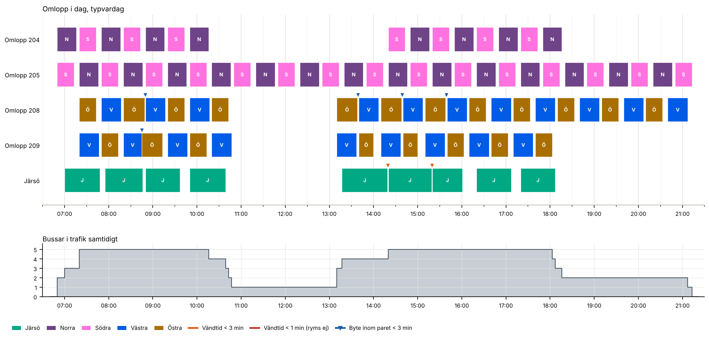

*Figur 4.1. Operatörens omlopp för en typisk vardag, ur påstigandedatan hösten 2026, med beställarens
rättelser. Varje rad är ett omlopp och varje stapel en tur i linjens färg. Markeringar anger byten under
3 minuter (blått: byte inom paret V → Ö). Det nedre diagrammet visar antalet bussar i trafik.*

## 4.2 UA 1a och UA 1b – Möckelö Strand ny

**Introduktion.** Linje V slutar i dag vid hållplatsen Möckelö Strand i stadstrafikens västra del. Där vänder
bussen och kör tillbaka mot Norrgårdsvägen. Söder om vändpunkten bor cirka 240 invånare som har mer än 400 m till
närmaste hållplats. Det är det största av de områden i kapitel 3 som bara kan nås med ändrad linjesträckning.
UA 1a och 1b förlänger linje V till en ny hållplats, *Möckelö Strand ny*, cirka 700 m söder om dagens vändpunkt.

- **Syfte:** ge invånarna söder om Möckelö Strand en hållplats inom 400 m. Den nya hållplatsen når 178 av dem.
- **I dag:** Möckelö Strand har 20 avgångar per vardag med linje V och cirka 5 påstigande per vardag (höst 2026).
- **Två vägval:**
  - UA 1a använder dagens vägar, och bussen kör samma väg fram och tillbaka till den nya hållplatsen.
  - UA 1b förutsätter att Norrgårdsvägen förlängs till Hamnskärsvägen, så att bussen kan köra en slinga. Vägen
    finns inte i dag.
- **Det som avgör:** om den längre körtiden på linje V ryms i dagens omlopp utan fler bussar, och om
  förlängningen av Norrgårdsvägen är värd att bygga.

**Utformning.** Linje V vänder i dag vid hållplatsen Möckelö Strand: bussen kör Norrgårdsvägen →
Möckelö Strand (1,6 min) → Norrgårdsvägen (1 min). Den nya hållplatsen, *Möckelö Strand ny*, placeras i det
indikativa läget från kapitel 3, cirka 700 m söder om dagens vändpunkt. Restiderna är beställarens:

- **den befintliga vägen** mellan Norrgårdsvägen och den nya hållplatsen tar 2 minuter (cirka 1,4 km längs
  gatunätet enligt OSRM, som i beställarens skiss);
- **förlängningen av Norrgårdsvägen** från Möckelö Strand till den nya hållplatsen skulle ta 1 minut
  (cirka 0,7 km). Vägen finns inte i dag.

De 3 minuter som angavs för dagens vägar är alltså Möckelö Strand → Norrgårdsvägen (1 min, som bussen redan
kör) plus den befintliga vägen (2 min). Två varianter har prövats:

- **1a – dagens vägar:** bussen kör som i dag till Möckelö Strand och tillbaka till Norrgårdsvägen. Därefter
  kör den den befintliga vägen till den nya hållplatsen och samma väg tillbaka. Tillägget blir
  2 + 0,5 + 2 = **4,5 minuter per tur** och 2,7 km per tur. Bussen måste kunna vända vid den nya hållplatsen.
- **1b – förlängd Norrgårdsvägen, slinga:** bussen kör Möckelö Strand → förlängningen (1 min) → den nya
  hållplatsen (0,5 min) → den befintliga vägen (2 min) → Norrgårdsvägen. Sträckan Möckelö Strand →
  Norrgårdsvägen (1 min enligt tidtabellen) körs inte längre. Tillägget blir 1 + 0,5 + 2 − 1 = **2,5 minuter
  per tur** och 1,5 km per tur. Som känslighet har 3,5 minuter prövats, om tidtabellens minut inte kan
  räknas av. Bussen kör alltså rakt fram från Möckelö Strand på den nya vägen till den nya hållplatsen och
  tillbaka till Norrgårdsvägen på befintlig väg, bl.a. Möckelövägen, i stället för att vända. Det motsvarar
  beställarens skiss 2026-10-15 (slingan 3 min, minus 1 min som inte körs tillbaka, plus 0,5 min uppehåll).

*Tabell 4.1. UA 1a och UA 1b – effekter och verifiering mot dagens omlopp (★ = huvudalternativ).*

| | UA 1a – dagens vägar | UA 1b – förlängd Norrgårdsvägen, slinga |
|---|---|---|
| Körtid per tur | +4,5 min | +2,5 min (känslighet +3,5) |
| **V och Ö sammanslagna** | **★ 16 av 20 turer, 5 bussar** | **★ 16 av 20 turer, 5 bussar** (känslighet: 16 av 20) |
| Minsta tid i centrum i de ändrade varven (krav 5 min) | 5,5 min | 7,5 min (känslighet 6,5) |
| Ö-turer som avgår senare än i dag | 14, 2 min efter pulsen | inga (känslighet: 14, 1 min) |
| V-turer som kör som i dag | 07:50, 08:20, 13:40, 14:40 | 07:50, 08:20, 13:40, 14:40 |
| Alla 20 turer, dagens tidtabell | 6 bussar – **utesluten** (kräver ett fordon till) | 5 bussar, men 1,5–2,5 min i centrum i varven med Ö:s skolturer – uppfyller inte kravet |
| Dagens tidtabell, de turer som ryms | 8 av 20 | 16 av 20 (samma som sammanslagna) |
| **Kostnad: fordonskm per vardag (per år)** | **+44 km (cirka +11 500)** | **+25 km (cirka +6 500)** |
| **Kostnad: fler fordon** | **Nej, 5 som i dag** (alla turer: +1, utesluten) | **Nej, 5 som i dag** |
| Invånare som får hållplats inom 400 m | 178 | 178 |
| Avgångar vid nya hållplatsen | 16 per vardag | 16 per vardag |
| Invånare med fler / färre avgångar inom 400 m | 178 (+16) / 0 | 178 (+16) / 0 |
| Uppskattat påstigande (höst 2026) | 1,5–6,5 per vardag | 1,5–6,5 per vardag |
| Restid, befintliga resenärer | +25 resenärsminuter per vardag | +12 resenärsminuter per vardag |

Restiden för befintliga resenärer är netto: omvägen för genomresande på linje V, cirka 8 resor per vardag, minus
vinsten för resor mellan V och Ö som slipper bytet (cirka 3 resenärsminuter per vardag).

**Bedömning.**

- **UA 1a, alla turer med dagens tidtabell – utesluten:** kräver ett sjätte fordon.
- **UA 1a med dagens tidtabell:** ryms bara på 8 turer.
- **UA 1a ★ med V och Ö sammanslagna (huvudalternativ):** 16 av 20 turer ryms med fem bussar (avsnitt 4.5,
  figur 4.9). Ö avgår då 2 minuter efter pulsen på 14 turer, och de ändrade varven har minst 5,5 minuter i
  centrum. Möckelö Strand ny kan alltså trafikeras redan med dagens vägar, utan fler bussar.
- **UA 1b ★ med V och Ö sammanslagna (huvudalternativ):** 16 av 20 turer ryms med fem bussar. V-turen kommer
  tillbaka en halv minut före Ö:s avgång, så Ö kan behålla pulsen, och varven har minst 7,5 minuter i centrum.
  Med alla 20 turer får varven med Ö:s skolturer bara 1,5–2,5 minuter i centrum.
- **Samma fyra turer kör som i dag i båda varianterna:**
  - V 07:50, 13:40 och 14:40 följs av Ö:s skolturer (28–29 minuter). De varven har redan i dag bara 4–5
    minuter i centrum.
  - V 08:20 vänder direkt till Ö:s skoltur 08:45. Varvet har 7 minuter i centrum, men med omvägen startar
    Ö 08:45 så mycket senare att det inte blir 5 minuter kvar (1a: 2,5 minuter, 1b: 4,5 minuter).
- **UA 1b med Solberget indraget på Ö:s skolturer 14:10 och 15:10:** då ryms även V 13:40 och 14:40, alltså 18
  av 20 turer. Varven blir dock 55,2 minuter, dvs. 4,8 minuter i centrum,
  strax under kravet på 5 minuter. Med "säg 5 minuter" som riktvärde är det en möjlig variant att pröva mot
  verkliga körtider. Solberget har cirka 16 påstigande per vardag (höst 2026).
- **Effekt:** båda varianterna ger 178 invånare en hållplats inom 400 m med 16 avgångar per vardag. Ingen får
  färre avgångar. Det beräknade påstigandet är 1,5–6,5 per vardag med höstens nivå.

UA 1a och UA 1b ger alltså lika många turer. Förlängningen av Norrgårdsvägen ger kortare omväg (2,5 i stället
för 4,5 minuter), större marginal i centrum och att Ö kan behålla pulsen, men den förutsätter en ny väg. För 1a
behövs en vändmöjlighet vid den nya hållplatsen.

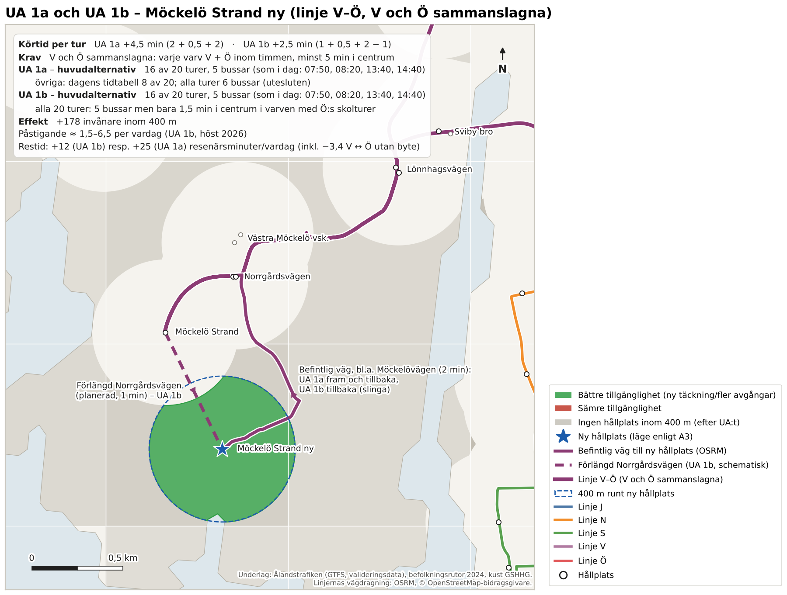

*Figur 4.2. UA 1a och UA 1b – huvudalternativen. Linje V visas som del av den genomgående linjen V–Ö. Grönt
anger invånare som får bättre tillgänglighet och grått befolkning som
fortfarande saknar hållplats inom 400 m. Linjerna och den befintliga vägen följer gatunätet (OSRM), och
förlängningen (streckad) är schematisk eftersom vägen inte finns i dag.*

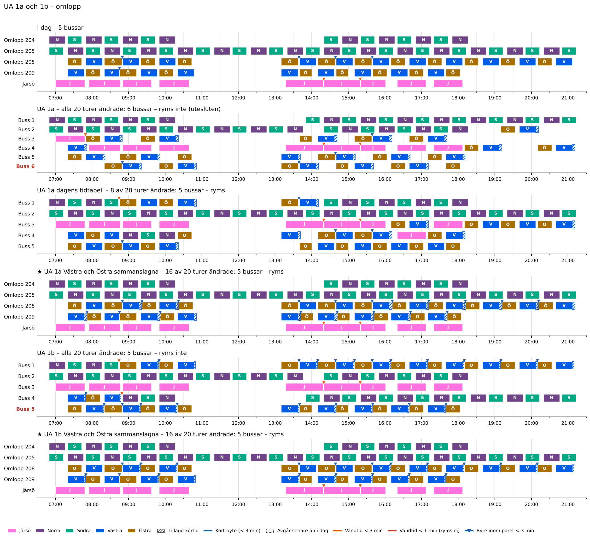

*Figur 4.3. Omlopp före och efter för UA 1a och UA 1b, alla driftformer (★ = huvudalternativ). Skrafferad del av en tur är tillagd körtid och prickad ram
anger att turen avgår senare än i dag. Rubriker i rött anger lösningar som kräver fler bussar eller inte
uppfyller kravet på 5 minuter i centrum per varv. Blå markering anger kort byte inom linjeparet.*

## 4.3 UA 2 – N2 på linje Ö

**Introduktion.** Linje Ö kör från Österkullagatan ut till Kalmarnäs vändplan i sydöstra Mariehamn och tillbaka
samma väg. Sträckan är cirka 1,8 km lång och saknar hållplats. Invånarna längs mitten av sträckan har därför mer
än 400 m till närmaste hållplats, trots att bussen passerar dem. UA 2 lägger hållplatsen N2 från kapitel 3 där
bussen redan kör.

- **Syfte:** 58 invånare får en hållplats inom 400 m utan att körvägen ändras.
- **I dag:** Kalmarnäs vändplan har 21 avgångar per vardag (linje Ö och landsbygdslinje 5) och cirka 10
  påstigande per vardag. Österkullagatan har cirka 2.
- **Prövas:** ett uppehåll vid N2 på alla 20 Ö-turer, i genomsnitt 0,5 minut per tur.
- **Det som avgör:** att den extra halva minuten ryms i varven V + Ö, särskilt i varven med Ö:s skolturer.

**Utformning.** Hållplatsen N2 placeras på sträckan mellan Österkullagatan och Kalmarnäs vändplan, i
läget från kapitel 3. Bussen passerar läget i båda riktningarna. Ett uppehåll per tur i genomsnitt
(0,5 minut) har antagits.

**Resultat.**

- **Omlopp:** alla 20 turer ryms med fem bussar (figur 4.5), och alternativet är lika robust som i dag.
  Skolturen 08:20 kommer tillbaka 08:49,5 och bussen fortsätter som linje V 08:50 efter ett kort byte. Om
  kravet på 5 minuter i centrum per varv V + Ö ska gälla även här får varven med Ö:s skolturer 3,5–4,5
  minuter, mot 4–5 minuter i dag.
- **Täckning:** 58 invånare får en hållplats inom 400 m med 20 avgångar per vardag. Ingen får färre avgångar.
- **Påstigande:** det uppskattade påstigandet är 2,2–11,8 per vardag med höstens nivå. Linje Ö har stadsnätets
  högsta påstigande per invånare.
- **Ombordvarande:** cirka 15 resor per vardag passerar N2 och får en halv minut längre restid, sammanlagt
  cirka 8 resenärsminuter per vardag.
- **Kostnad:** ±0 fordonskm, eftersom hållplatsen ligger på linjens väg; inga fler fordon.

**Bedömning.** Alternativet ryms i dagens omlopp.

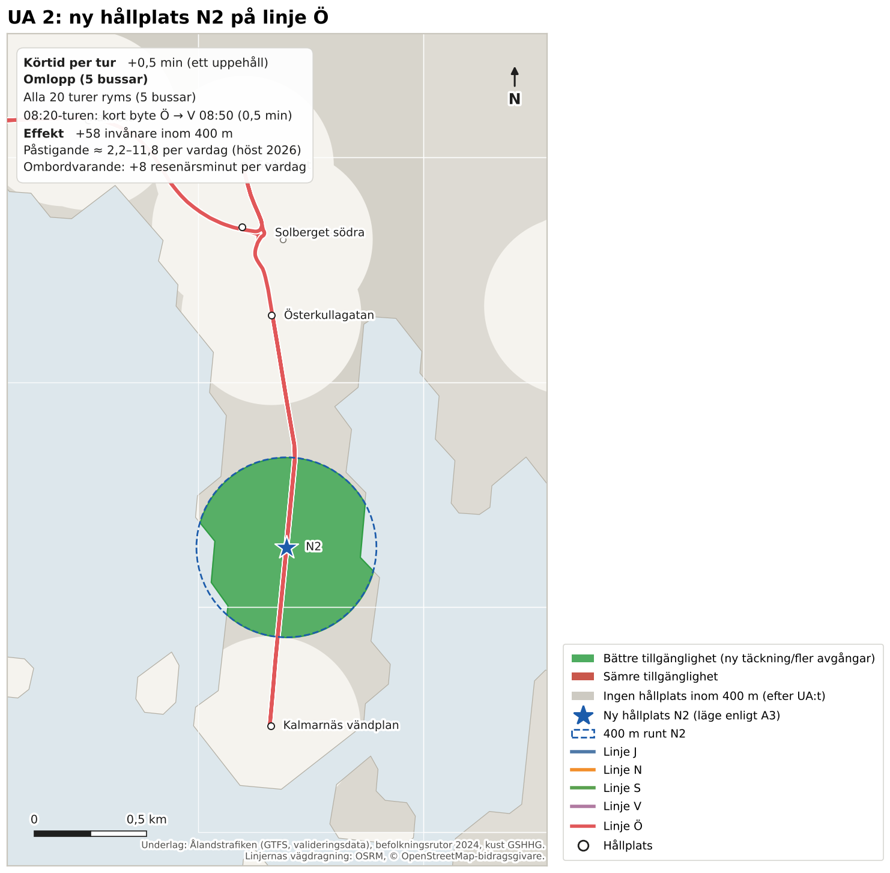

*Figur 4.4. UA 2, ny hållplats N2 på linje Ö.*

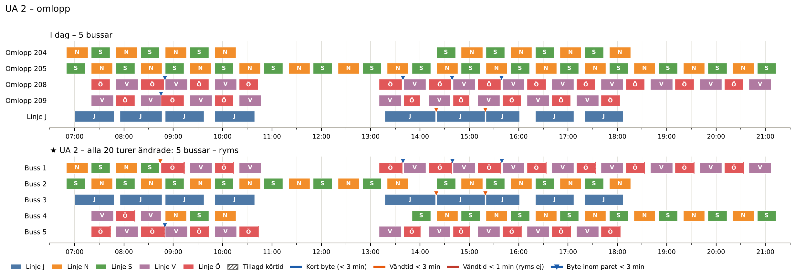

*Figur 4.5. Omlopp före och efter för UA 2.*

## 4.4 UA 3 – Linje N via Bo-Bil

**Introduktion.** Linje N kör norrut från centrum till Maxinge och vidare via Vikingagränd mot Bolstavägen.
Enligt beställaren måste bussen ofta vänta vid Nya Godbyvägen för att komma till Maxinge. UA 3 låter linje N i
stället köra Maxinge – Bo-Bil – Bolstavägen och stanna vid Bo-Bil på Nya Godbyvägen, där landsbygdslinjerna
redan stannar.

- **Syfte:** en jämnare körtid för linje N, utan väntan vid Nya Godbyvägen, och linje N:s avgångar vid Bo-Bil.
- **I dag:**
  - Vikingagränd har 22 avgångar per vardag med linje N men bara cirka 0,06 påstigande per vardag.
  - Bo-Bil trafikeras av landsbygdslinjerna 1–4, med 14–15 avgångar per vardag och riktning.
- **Prövas:** den nya körvägen på alla 22 turer. Längs gatunätet är den ungefär lika lång som dagens.
- **Det som avgör:** att körtiden blir i stort sett oförändrad, och om förlusten för de närmast boende vid
  Vikingagränd vägs upp av vinsten vid Bo-Bil.

**Utformning.** Linje N kör i dag Maxinge – Vikingagränd – Bolstavägen. I alternativet kör linjen i stället
Maxinge – Bo-Bil – Bolstavägen och stannar vid hållplatsen Bo-Bil på Nya Godbyvägen (figur 4.6).

**Resultat.**

- **Körtid:** längs gatunätet (OSRM) är den nya körvägen ungefär lika lång som dagens, 1,45 km mot 1,47 km.
  Körtiden för själva vägen blir därför oförändrad, men Bo-Bil blir ett verkligt uppehåll (+0,5 minut),
  medan bussen i dag sällan stannar vid Vikingagränd. Netto blir körtiden +0,5 minut per tur, och
  fordonskilometrarna är i stort sett oförändrade. Den minskade väntan vid Nya Godbyvägen ingår inte,
  eftersom den inte kan beräknas utan realtidsdata. Den talar för kortare och jämnare körtid. (I den
  tidigare versionen, med fågelvägen, var vägen 27 % kortare och körtiden +0,1 minut.)
- **Omlopp:** alternativet ryms med alla 22 turer och fem bussar (figur 4.7). Linje N:s vändtid blir 3,5
  minuter i stället för 4.
- **Bo-Bil:** hållplatsen får linje N:s 22 avgångar utöver landsbygdslinjernas. Cirka 44 invånare får
  därmed minst 30 avgångar per vardag i stället för 15–29.
- **Vikingagränd:** 23 invånare förlorar hållplats inom 400 m. Påstigandet vid Vikingagränd är cirka 0,06 per
  vardag (höst 2026), och hållplatsen bedömdes redan i kapitel 3 som en hållplats som bör prövas.
- **Fler och färre avgångar (figur 4.16):** 44 invånare vid Bo-Bil får 22 avgångar fler per vardag inom 400 m,
  och 24 invånare vid Vikingagränd får 22 färre. Av dem förlorar 23 hållplatsen inom 400 m helt.
- **Restid:** cirka 27 resor per vardag på linje N berörs, men förändringen är liten, cirka 20
  resenärsminuter per vardag.
- **Kostnad:** ±0 fordonskm (vägen är lika lång som i dag); inga fler fordon.

**Bedömning.** Alternativet ryms och förbättrar körtidens tillförlitlighet. Den förlorade täckningen vid
Vikingagränd är liten men bör vägas in. Den kan mildras om hållplatsen N3 söder om Maxinge (kapitel 3)
genomförs samtidigt.

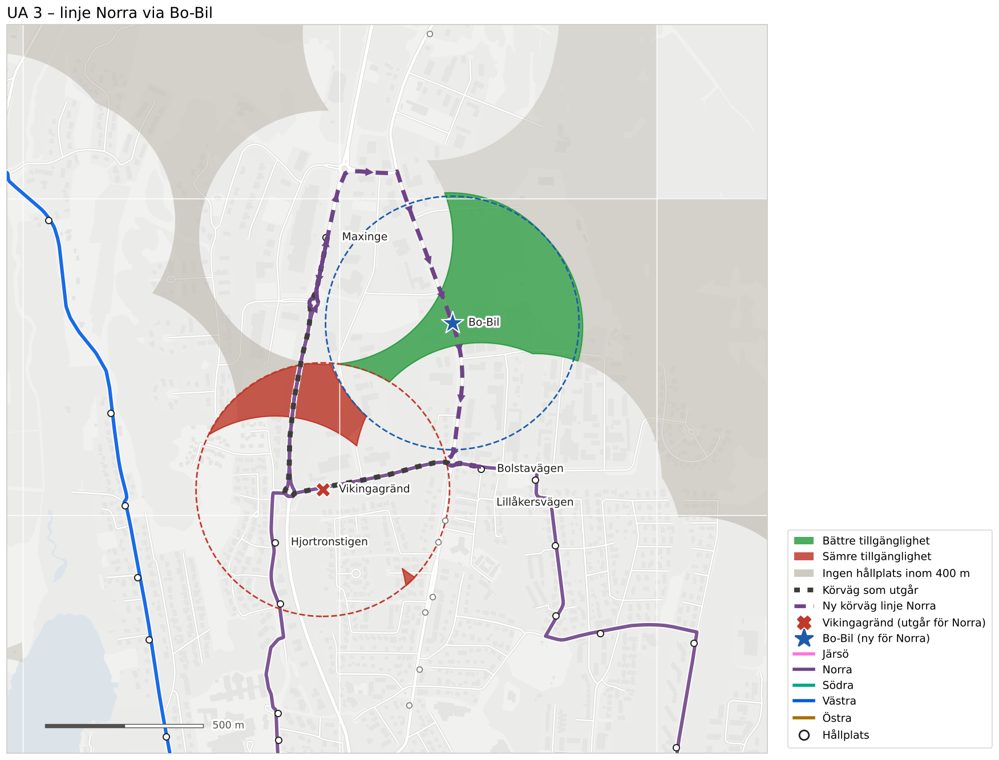

*Figur 4.6. UA 3. Rött anger invånare som får sämre tillgänglighet och grönt invånare som får bättre.
Körvägarna följer gatunätet (OSRM).*

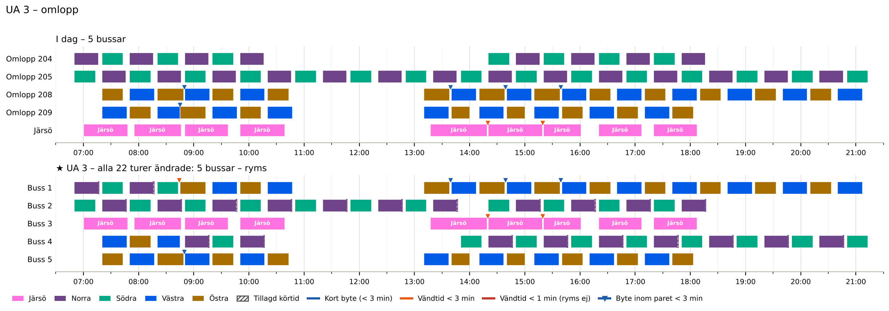

*Figur 4.7. Omlopp före och efter för UA 3.*

## 4.5 Sammanslagning av linjer

### 4.5.1 Princip – ett varv inom timmen

Bussarna växlar redan i dag mellan linjerna i paren S ↔ N och Ö ↔ V. Varje byte har i dag en egen reglering,
lika med linjens vändtid. Slås paret ihop till en genomgående linje fortsätter bussen direkt från A till B efter
0,5 minut, och regleringen tas en gång per varv. Kravet (beställaren) är att hela varvet A + B ryms inom timmen
med minst 5 minuter i centrum. Utrymmet för att förlänga A blir då det minsta av två tal:

- **varvet inom timmen:** 60 − 5 − körtiden för A − körtiden för B;
- **pulsen:** 30 − 0,5 − körtiden för A, om B ska avgå i pulsen. Flyttas B så att den startar när A har
  kommit tillbaka gäller bara varvet.

Om bytet skyltas som genomgående linje kan resenärerna dessutom sitta kvar på bussen.

*Tabell 4.2. Utrymme för förlängning per tur utan fler bussar (30 minuters turintervall, vanligt varv).*

| Linje (körtid) | Reglering ≥ 3 min vid varje byte | Genomgående, partnern i pulsen | Genomgående, partnern startar senare (varvet ≤ 55 min) |
|---|---|---|---|
| N (26 min), partner S | 1 min | 3,5 min | 6 min |
| S (23 min), partner N | 4 min | 6 min | 6 min |
| V (27 min), partner Ö | 0 min | 2,5 min | 5 min |
| Ö (23 min, skolturer 28–29), partner V | 4 min | 5 min | 5 min |

I varven med Ö:s skolturer finns inget utrymme alls för linje V: 27 + 28 minuter lämnar bara 5 minuter i
centrum, vilket är kravet.

**Behov.** Behovet har jämförts med de nio områden som enligt kapitel 3 kräver ändrad linjesträckning
(figur 4.8). Behövd tid per tur har beräknats som två gånger avståndet till närmaste körväg × 1,3 i
hastigheten 25 km/h plus 0,5 minuts uppehåll. För Möckelö Strand har beställarens restider via dagens vägar
(1a, 4,5 min) använts.

- **Ryms som genomgående linje med Ö i pulsen:** Solberget (linje Ö, cirka 5 min), Kalmsta (linje Ö, cirka
  4,5 min) och Solberget södra (linje Ö, cirka 4 min).
- **Ryms om partnerlinjen startar senare än pulsen:**
  - Möckelö Strand (linje V, 4,5 min, se avsnitt 4.5.2);
  - Dalkullavägen (linje V, 4,4 min).
- **Ryms inte:** Lillåkersvägen (linje N, 6,5 min), Österkalmare (linje N, 10 min) och Strömsnäs (linje Ö,
  10 min) kräver en större omläggning.

Utrymmet i ett par kan bara användas en gång, eftersom kravet gäller hela varvet. Förlängs linje V med 4,5
minuter finns bara 0,5 minut kvar för Ö. Tabellen gäller vanliga varv. I varven med Ö:s skolturer är utrymmet
mindre.

**Resor som kan bli direkta.** Skyltas bytet som genomgående linje kan resenärerna sitta kvar. För dagens
par ger det cirka 2,5 resor per vardag (N/S) respektive 1,5 (V/Ö), med höstens resande. Paret S/Ö skulle ge
flest, cirka 7 per vardag, men är inte ett av dagens par. Paren avgår från samma hållplatsläge i centrum
(V och Ö från läge 66202, N och S från läge 66201).

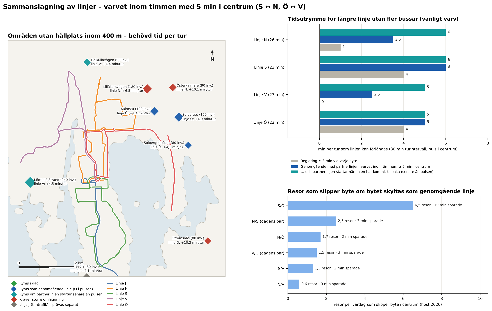

*Figur 4.8. Sammanslagning av linjer. Till vänster områden utan hållplats inom 400 m. Uppe till höger
tidsutrymmet per linje (minuter per tur) i ett vanligt varv, med kravet 5 minuter i centrum per varv. Nere
till höger resor per vardag som kan bli direkta om bytet skyltas som genomgående linje.*

### 4.5.2 V och Ö sammanslagna – Möckelö Strand ny redan med dagens vägar?

Ett varv V → Ö → V tar 60 minuter, och två bussar kör varvet med 30 minuters förskjutning (figur 4.9). Kravet
är minst 5 minuter i centrum per varv.

- **I dag:** varvet består av V (27 min), byte (3 min), Ö (23 min) och byte (7 min), dvs. 10 minuter i centrum.
  Med Ö:s skolturer (28 min) blir det 5 minuter, och med skolturen 08:20 (29 min) 4 minuter. Avvikelserna i
  operatörens omlopp redovisas i avsnitt 4.1.
- **1a med dagens tidtabell:** V tar 31,5 minuter och kommer tillbaka 1,5 minut efter att Ö ska avgå. Bara 8 av
  20 turer ryms.
- **1a med V och Ö sammanslagna:** bussen fortsätter som linje Ö efter 0,5 minut. Ö avgår då 2 minuter efter
  pulsen, och varvet får 5,5 minuter i centrum. Det ryms.
- **1b med V och Ö sammanslagna:** V tar 29,5 minuter och hinner till Ö:s avgång i pulsen. Varvet får 7,5
  minuter i centrum.
- **Varv med Ö:s skolturer:** 1a ger 0,5 minut och 1b 2,5 minuter i centrum. Där kör V-turen som i dag.

Varje V-tur har prövats för sig med operatörens omlopp (b4_omlopp.py, figur 4.3). Resultatet:

- **Turer:** 16 av 20 V-turer kan trafikera Möckelö Strand ny med fem bussar, både i 1a och 1b. 07:50, 08:20,
  13:40 och 14:40 kör som i dag.
- **Ö:s avgångar (1a):** 14 av Ö:s 20 turer avgår 2 minuter senare än i dag, dvs. :22/:52 i stället för
  :20/:50 på förmiddagen och :12/:42 i stället för :10/:40 på eftermiddagen. I 1b avgår Ö som i dag.
- **Kostnad:** +44 fordonskm per vardag i 1a och +25 i 1b; inga fler fordon.

**Konsekvenser för resenärerna.** Resenärer som byter till linje Ö i pulsen får i 1a 2 minuter längre väntan,
och Ö kommer tillbaka till centrum 2 minuter senare. Ö når ändå centrum före nästa pulsavgång. Resenärer som åker
vidare från V till Ö kan sitta kvar. Nätverksmodellen räknar med det: resor mellan V- och Ö-området slipper
bytesstraffet. Med höstens resande gäller det cirka 1,5 resor per vardag, och restiden minskar med cirka 3
resenärsminuter per vardag (2,3 minuter per resa). Modellen räknar med en schablon för byten och fångar därför inte de 2 minuterna.

**Bedömning.** Ja – med V och Ö sammanslagna kan Möckelö Strand ny trafikeras redan med dagens vägar, på 16 av
20 turer och med dagens fem bussar. Förlängningen av Norrgårdsvägen (1b) ger inte fler turer, men den ger
följande:

- **Kortare omväg:** 2,5 i stället för 4,5 minuter per tur.
- **Större marginal:** minst 7,5 i stället för 5,5 minuter i centrum per varv.
- **Pulsen kvar:** Ö kan behålla sina avgångar i pulsen.

För 1a behövs en vändmöjlighet vid den nya hållplatsen.

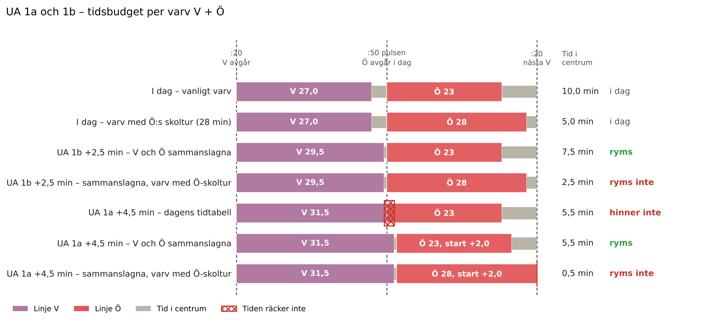

*Figur 4.9. Sammanslagning av linje V och Ö: tidsbudget per varv med tiden i centrum mot kravet 5 minuter.*

## 4.6 UA 4 – Linje V–Ö via flygplatsen

**Introduktion.** Mariehamns flygplats har vardagar sex flyg till och från Stockholm-Arlanda och Åbo, men ingen
busslinje når terminalen i dag. Närmaste hållplats är Posten på Flygfältsvägen, cirka 800 m längs vägen från
terminalen. Där stannar linje V och landsbygdslinjerna 1 och 4. UA 4 leder linje V upp till terminalen.

- **Syfte:** kollektivtrafik till och från flyget. Resenären ska kunna vara på flygplatsen 2–1,5 timmar före
  avgång och åka därifrån cirka 30 minuter efter landning (beställaren).
- **I dag:** Posten har 24 avgångar per vardag och cirka 2 påstigande per vardag på linje V.
- **Prövas:**
  - alla V-turer via terminalen, med dagens tidtabell och med V och Ö sammanslagna;
  - med hållplatsen Solberget indragen;
  - bara de turer som når ett flyg (UA 4Y);
  - extra turer för de flyg som tidtabellen inte når.
- **Det som avgör:** omvägens körtid, cirka 5 minuter per tur, och vilka flyg som ska nås.

**Utformning.** Linje V passerar i dag Posten på Flygfältsvägen. I alternativet kör bussen från Posten upp till
flygterminalen, runt terminalen och tillbaka till Norra Svibyvägen, och därefter vidare mot Källarvägen som i
dag (figur 4.10 och 4.20). Körvägen följer gatunätet enligt OSRM och stämmer i huvudsak med beställarens skiss, men
vägen till och från terminalen är något längre än skissen.

- **Omväg:** cirka 1,7 km per tur längs vägarna. Med 25 km/h och 0,5 minuts uppehåll blir tillägget cirka
  **5 minuter per tur** (känslighet 4–6 minuter). Med skissens längd, 1,4 km, var tillägget 4 minuter.
- **Vid flygplatsen:** bussen är där cirka 17 minuter efter avgången från centrum, t.ex. 09:07 med turen 08:50.

**Flygen (beställaren 2026-11-15).** Flygtiderna kommer från bokningssidan för vardagar i november 2026. Kravet
från beställaren:

- **avgående flyg:** resenären ska vara på flygplatsen 2–1,5 timmar före avgång;
- **ankommande flyg:** en buss ska gå från flygplatsen cirka 30 minuter efter landning. Här godtas 25–45 minuter,
  så att resenärerna hinner hämta bagaget.

Flygtiderna antas vara desamma alla vardagar. Skärmbilderna visar olika datum (16–18 november) för olika flyg.

*Tabell 4.4a. Flygen och bussen – vilken V-tur når varje flyg (figur 4.19).*

| Flyg | Bussen ska vara vid flygplatsen | V-tur i dagens tidtabell | Vid flygplatsen |
|---|---|---|---|
| Avgång 07:15 till Stockholm-Arlanda (HP 281) | 05:15–05:45 | ingen – första V-turen (07:20) är där 07:36 | – |
| Avgång 11:00 till Åbo (HP 285) | 09:00–09:30 | **V 08:50** | 09:07 (1 h 53 min före) |
| Ankomst 10:35 från Stockholm-Arlanda (HP 282) | 11:00–11:20 | ingen – V 10:20 är där 10:36, nästa V-tur går först 13:10 | – |
| Avgång 17:10 till Stockholm-Arlanda (HP 283) | 15:10–15:40 | **V 15:10** | 15:27 (1 h 43 min före) |
| Ankomst 16:45 från Åbo (HP 286) | 17:10–17:30 | **V 17:10** | 17:27 (42 min efter) |
| Ankomst 21:35 från Stockholm-Arlanda (HP 284) | 22:00–22:20 | ingen – sista V-turen (20:40) är där 20:56 | – |

Dagens V-turer når alltså tre av sex flyg: avgångarna 11:00 och 17:10 och ankomsten 16:45. UA 4Y av linjen kör
till flygplatsen bara på dessa tre turer (V 08:50, 15:10 och 17:10).

För de tre andra flygen har extra V-turer via flygplatsen prövats. De körs av ett omlopp som står stilla, så
inget extra fordon behövs:

*Tabell 4.4b. Extra V-turer för de flyg som dagens tidtabell inte når.*

| Flyg | Extra tur från centrum | Vid flygplatsen | Körs av | Fordonskm per vardag | Fler fordon? |
|---|---|---|---|---|---|
| Avgång 07:15 | 05:15–05:47 | 05:32 (1 h 43 min före) | omlopp 204, som i dag börjar 06:50 | +14,5 | Nej |
| Ankomst 10:35 | 10:50–11:22 | 11:07 (32 min efter) | omlopp 204, i uppehållet 10:16–14:20 | +14,5 | Nej |
| Ankomst 21:35 | 21:50–22:22 | 22:07 (32 min efter) | omlopp 205, efter sista turen 21:13 | +14,5 | Nej |
| **Summa** | | | | **+43,5** | **Nej** |

- **Ankomsten 10:35** är enklast att nå: omlopp 204 står stilla mitt på dagen. Uppehållet används troligen för
  förarens rast, och det behöver stämmas av med operatören.
- **Avgången 07:15 och ankomsten 21:35** ligger utanför dagens trafikdygn (06:50–21:13). Den extra turen
  förlänger trafikdygnet för omlopp 204 respektive 205. Anropsstyrd trafik eller taxi bör jämföras för dessa
  två flyg.

**Solberget.** Hållplatsen Solberget på linje Ö ligger på en omväg. Dras den in kör bussen direkt mellan
grannhållplatserna, vilket sparar 1,6–2,5 minuter per Ö-tur. Det har prövats som ett sätt att få mer tid i
varvet V + Ö.

*Tabell 4.4. UA 4 – alla driftformer, verifiering mot dagens omlopp (★ = huvudalternativ).*

| Driftform | Turer via flygplatsen | Fordon | Fler fordon? | Minsta tid i centrum i de ändrade varven (krav 5 min) | Fordonskm per vardag |
|---|---|---|---|---|---|
| Alla turer, dagens tidtabell – **utesluten** | 20 av 20 | **6** | **Ja, +1** | – | +34 |
| Dagens tidtabell, de turer som ryms | 7 av 20 | 5 | Nej | 8 min | +12 |
| **★ V och Ö sammanslagna** | **16 av 20** | 5 | Nej | 5 min | +27 |
| V och Ö sammanslagna + Solberget indragen | 16 av 20 | 5 | Nej | 7,1 min | +27 |
| UA 4Y: flygturerna, dagens tidtabell | 0 av 3 | 5 | Nej | – | ±0 |
| **UA 4Y: flygturerna, V och Ö sammanslagna** | **3 av 3** | 5 | Nej | 5 min | +5 |
| UA 4Y: dito + Solberget indragen | 3 av 3 | 5 | Nej | 7,1 min | +5 |
| Extra turer för flygen 07:15, 10:35 och 21:35 (tabell 4.4b) | 3 extra turer | 5 | Nej | – | +44 |
| Känslighet 4 min, sammanslagna | 16 av 20 | 5 | Nej | 6 min | +27 |
| Känslighet 6 min, sammanslagna | 6 av 20 | 5 | Nej | 7 min | +10 |

**Resultat.**

- **Dagens tidtabell:** omvägen ryms inte. Alla turer kräver ett sjätte fordon, och utan extra fordon ryms bara
  7 av 20 turer.
- **V och Ö sammanslagna:** bussen fortsätter direkt som linje Ö, och Ö avgår 2,5 minuter efter pulsen. Då ryms
  16 av 20 turer, och de ändrade varven har minst 5 minuter i centrum, alltså precis kravet. Fyra turer ryms inte:
  - V 07:50, 13:40 och 14:40 följs av Ö:s skolturer: 32 + 28 minuter lämnar ingen tid i centrum;
  - V 08:20 vänder direkt till Ö:s skoltur 08:45 och skulle få 2 minuter.
- **Solberget indragen dessutom:** Ö 08:45 blir 2,2 minuter kortare, men V 08:20 ryms ändå inte. Indragningen
  ger alltså inga fler turer, bara mer tid i centrum (minst 7,1 minuter), medan 49 invånare runt Solberget får
  20 avgångar färre per vardag.
- **UA 4Y:** de tre flygturerna (V 08:50, 15:10 och 17:10) ryms med V och Ö sammanslagna, utan att Solberget
  dras in. Varven har minst 5 minuter i centrum, och Ö 09:20, 15:40 och 17:40 avgår 2,5 minuter efter pulsen.
  Med dagens tidtabell ryms ingen av dem.
- **Flygen:** huvudalternativet (16 av 20 turer) innehåller alla tre turer som når ett flyg. Både UA 4 ★ och
  UA 4Y når därmed tre av sex flyg; övriga tre kräver extra turer (tabell 4.4b).
- **Känslighet:** med 3–5 minuters omväg ryms samma 16 turer. Den beräknade omvägen, 5 minuter, ligger precis
  på gränsen med exakt 5 minuter i centrum. Med 5,5–7 minuter behöver Solberget dras in på en del Ö-turer (se
  känsligheten nedan).

**Känslighet – omvägens körtid och Solberget på utvalda turer (tabell 4.5).** Omvägens körtid är osäker,
eftersom bussens verkliga körtid till terminalen inte är mätt. Ö startar när V har kommit tillbaka, och fyra driftformer har prövats
för omvägar på 3–8 minuter:

- **A:** varvet V + Ö ≤ 55 minuter (kravet), Solberget kvar. Det är huvudalternativet.
- **B:** som A, men Solberget dras in på de Ö-turer där varvet annars inte ryms. Det gäller bara den Ö-tur som
  följer en V-tur via flygplatsen.
- **C:** varvet ≤ 50 minuter (helst), Solberget kvar.
- **D:** som C, men Solberget dras in där det behövs.

*Tabell 4.5. UA 4 – känslighet: turer via flygplatsen per omväg och driftform, alla 20 V-turer / UA 4Y:s 3
flygturer, fem bussar. "Ö startar efter pulsen" gäller driftform A och B.*

| Omväg per tur | Ö startar efter pulsen (högst) | A – varvet ≤ 55 min (krav), Solberget kvar | B – varvet ≤ 55 min, Solberget indraget där det behövs | C – varvet ≤ 50 min (helst), Solberget kvar | D – varvet ≤ 50 min, Solberget indraget där det behövs |
|---|---|---|---|---|---|
| 3 min | 0,5 min | 16 / 3 | 17 / 3 – Solberget indraget på Ö 08:45 | 6 / 1 | 6 / 1 |
| 4 min | 1,5 min | 16 / 3 | 17 / 3 – Solberget indraget på Ö 08:45 | 4 / 1 | 6 / 1 – Solberget indraget på 2 Ö-turer |
| **5 min (beräknad)** | **2,5 min** | **16 / 3** | 16 / 3 | 4 / 1 | 4 / 1 |
| 5,5 min | 3 min | 6 / 1 | 16 / 3 – Solberget indraget på 10 / 2 Ö-turer | 4 / 1 | 4 / 1 |
| 6 min | 3,5 min | 6 / 1 | 16 / 3 – Solberget indraget på 10 / 2 Ö-turer | 4 / 1 | 4 / 1 |
| 6,5 min | 4 min | 6 / 1 | 16 / 3 – Solberget indraget på 10 / 2 Ö-turer | 4 / 1 | 4 / 1 |
| 7 min | 4,5 min | 6 / 1 | 16 / 3 – Solberget indraget på 10 / 2 Ö-turer | 4 / 1 | 4 / 1 |
| 7,5 min | 5 min | 6 / 1 | 6 / 1 | 4 / 1 | 4 / 1 |
| 8 min | 5,5 min | 6 / 1 | 6 / 1 | 4 / 1 | 4 / 1 |

- **Upp till 5 minuters omväg** ryms 16 av 20 turer (UA 4Y 3 av 3) utan att Solberget dras in. Vid 5 minuter
  startar Ö 2,5 minuter efter pulsen och varven har exakt 5 minuter i centrum. Med upp till 4 minuter ryms
  dessutom V 08:20 om Solberget dras in på Ö 08:45.
- **Med 5,5–7 minuters omväg** behövs Solberget. Dras hållplatsen in på de Ö-turer som följer en V-tur via
  flygplatsen ryms fortfarande 16 av 20 turer (UA 4Y 3 av 3). Det gäller 10 Ö-turer (UA 4Y: Ö 09:20 och 15:40),
  och Ö-turen blir då 1,6–2,5 minuter kortare. Ö startar 3–4,5 minuter efter pulsen. Utan indragning (A) når
  bara V 17:10 flygplatsen, och flygen 11:00 och 17:10 går förlorade.
- **Solberget i B:** hållplatsen behålls med 10 av 20 avgångar (alla turer) eller 18 av 20 (UA 4Y). Ingen
  förlorar hållplatsen inom 400 m. Med alla turer får 49 invånare lägre turtäthetsklass (10 avgångar färre per
  vardag), vilket berör cirka 8 av Solbergets cirka 16 påstigande per vardag (höst 2026). Med UA 4Y byter ingen
  klass, och cirka 1,6 påstigande per vardag berörs.
- **Över 7 minuter** ryms bara 6 V-turer: de som följs av uppställning eller dagens slut (V 09:50, 10:20, 17:10
  och 20:40) och de som följs av Ö:s korta eftermiddagsturer (V 13:10 och 14:10).
- **Helst ≤ 50 minuter (C och D)** nås bara i varv där Ö-turen är kort (13:40 och 14:40, 20 minuter) eller
  bussen ställs upp efteråt. Dagens vanliga varv ligger redan på exakt 50 minuter.

Körtiden till terminalen bör därför mätas. Blir den högst 5 minuter behövs ingen indragning. Blir den
5,5–7 minuter är det rimligt att dra in Solberget bara på de Ö-turer som följer flygturerna (UA 4Y: Ö 09:20 och 15:40).
Solberget har fler resenärer under terminstid än vad sommardatan visade, så indragningen bör begränsas till
de turer där den verkligen behövs.

**Effekter.**

- **Täckning:** 21 invånare nära terminalen får en hållplats inom 400 m med 16 avgångar per vardag (UA 4Y 3).
  Ingen får färre avgångar.
- **Restid:** genomresande på linje V får cirka 5 minuter längre restid på de turer som kör via flygplatsen.
  Netto, med vinsten för resor mellan V och Ö som slipper bytet, blir det cirka 35 resenärsminuter per vardag
  (UA 4Y cirka 4).
- **Flygresenärerna:** OD-matrisen saknar flygplatsen som målpunkt, så nyttan för dem ingår inte i beräkningen.
- **Solberget (bara i varianten med indragning på alla turer):** 49 invånare får 20 avgångar färre per vardag,
  och 42 av dem förlorar hållplatsen inom 400 m. Hållplatsen har cirka 16 påstigande per vardag (höst 2026),
  vilket talar emot att dra in den på alla turer.

**Bedömning.**

- **Utesluten:** att bara förlänga linje V till flygplatsen. Med dagens tidtabell krävs en sjätte buss.
- **Det enda rimliga är en genomgående linje V–Ö:** V och Ö slås ihop, och Ö avgår upp till 2,5 minuter efter
  pulsen.
- **Huvudalternativ ★:** linje V–Ö via flygplatsen. 16 av 20 turer ryms med fem bussar, och Solberget behålls.
  Kostnaden är +27 fordonskm per vardag (cirka +7 200 per år), inga fler fordon.
  Huvudalternativet visas i figur 4.10.
- **UA 4Y:** samma linje, men bara de tre flygturerna (V 08:50, 15:10 och 17:10) går via flygplatsen. Alla tre
  ryms med kravet uppfyllt, och Solberget behålls. Kostnaden är +5 fordonskm per vardag, inga fler fordon.
- **Flygen:** både UA 4 ★ och UA 4Y når tre av sex flyg (avgångarna 11:00 och 17:10 och ankomsten 16:45). För
  alla sex flyg behövs tre extra turer, +44 fordonskm per vardag, som körs av befintliga fordon (tabell 4.4b).
  Den extra turen 10:50 för ankomsten 10:35 ryms i ett uppehåll i ett befintligt omlopp. Morgonflyget 07:15 och
  kvällsflyget 21:35 ligger utanför dagens trafikdygn och bör jämföras med anropsstyrd trafik.

Det som behöver beslutas är om en 2,5 minuter senare avgång för Ö är acceptabel (14 turer, i UA 4Y 3 turer), och
vilka av de tre flygen utanför dagens tidtabell som ska nås. Den verkliga körtiden till terminalen bör mätas
innan alternativet går vidare, eftersom den beräknade omvägen ligger precis på gränsen för kravet.
UA 4 konkurrerar om samma tidsutrymme som Möckelö Strand ny (UA 1a och 1b), eftersom båda förlänger linje V. Två
förlängningar av V ryms inte tillsammans inom kravet utan fler bussar. Hur UA kan kombineras prövas i ett senare
skede.

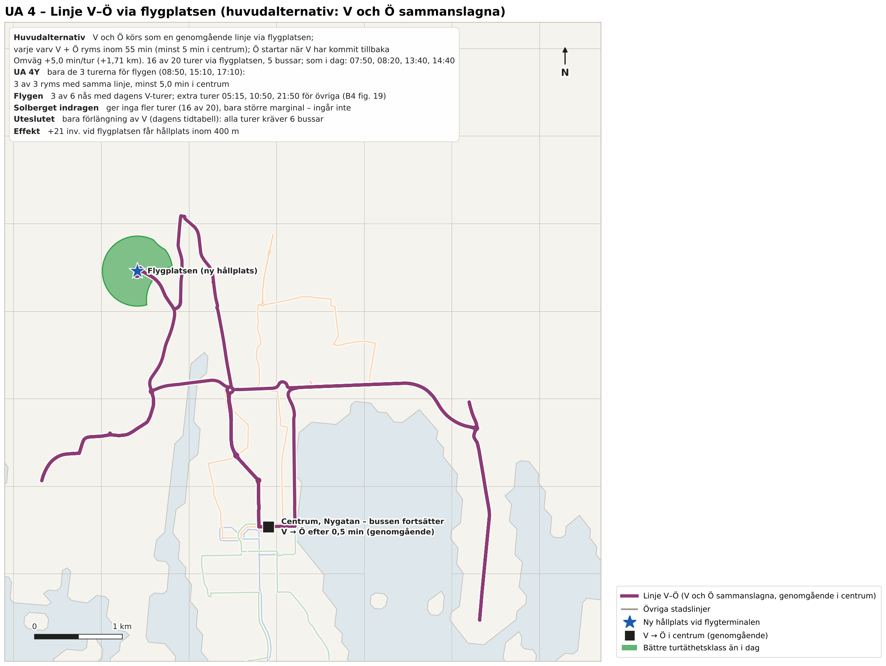

*Figur 4.10. UA 4 – huvudalternativet: linje V–Ö (V och Ö sammanslagna) via flygplatsen.
Körvägen följer gatunätet (OSRM). Kartan visar bara huvudalternativet; övriga driftformer finns i tabell 4.4.*

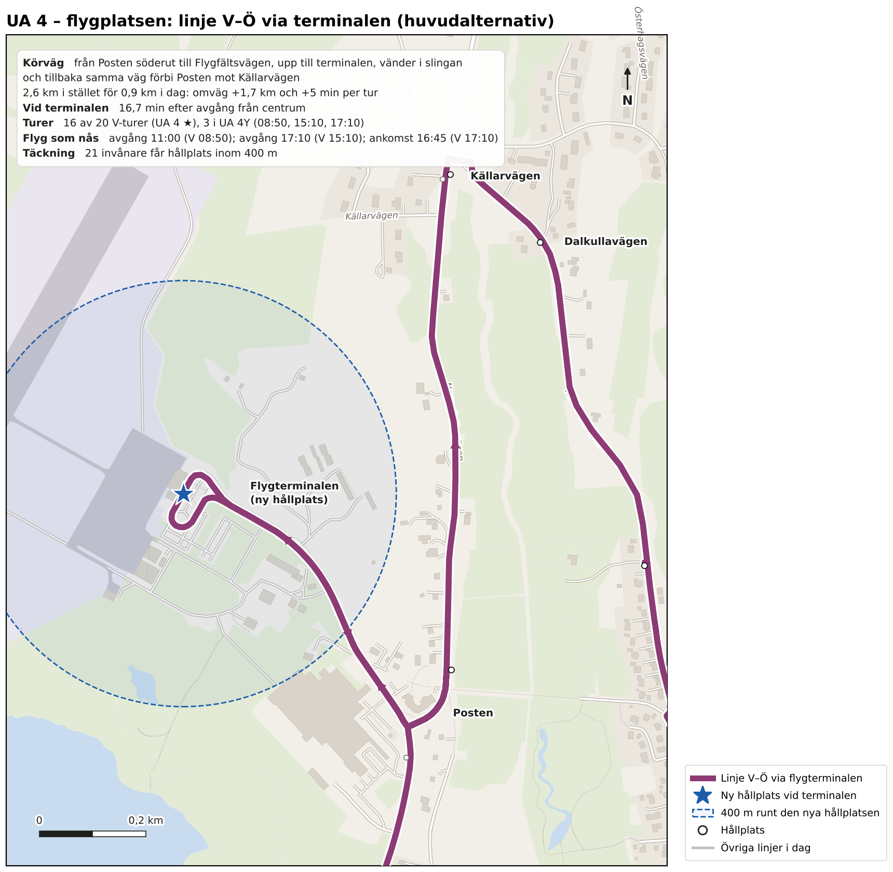

*Figur 4.20. UA 4 – flygplatsen inzoomad: linje V–Ö kör från Posten söderut till Flygfältsvägen, upp till
terminalen, vänder i slingan framför terminalbyggnaden och kör samma väg tillbaka förbi Posten mot Källarvägen.
Pilarna visar körriktningen.*

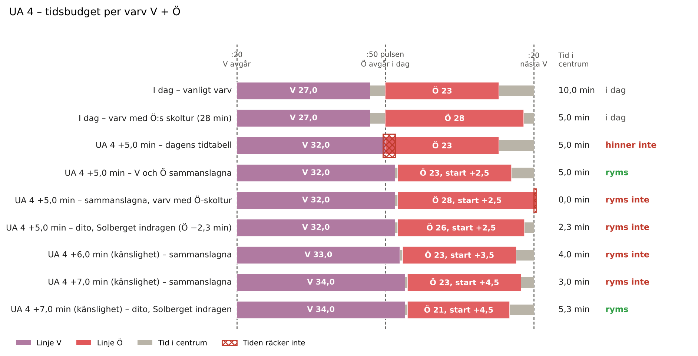

*Figur 4.11. UA 4: tidsbudget per varv V + Ö med tiden i centrum mot kravet 5 minuter.*

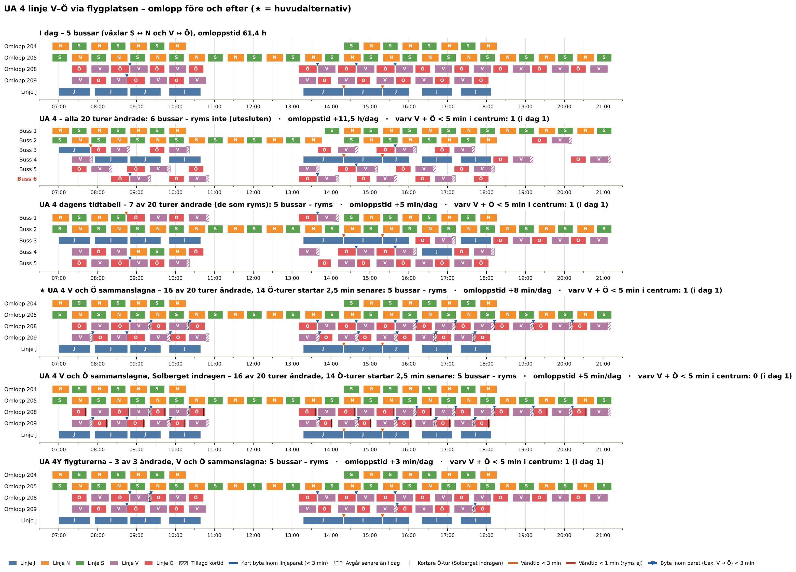

*Figur 4.12. Omlopp före och efter för UA 4, alla driftformer (★ = huvudalternativ). Skrafferad del är tillagd
körtid, svart prickad ram anger att turen avgår senare än i dag och ett svart streck i en Ö-tur anger kortare
körtid (Solberget indragen).*

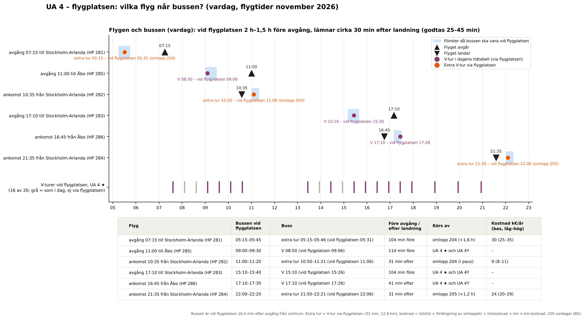

*Figur 4.19. UA 4 – flygen och bussen en vardag: fönstret då bussen ska vara vid flygplatsen (blått), V-turerna
i dagens tidtabell som når flygen och de extra turer som behövs för övriga flyg (se tabellen ovan).*

## 4.7 UA 5 – Linje V via Cedersvägen, linje N rakt på Västra utfarten

**Introduktion.** Linje N kör på väg mot centrum en sväng öster om Västra utfarten, via Stenhuggarvägen,
Cedersvägen och Klintvägen. Operatören har via beställaren (2026-11-15) föreslagit att linje V tar över svängen
och att linje N kör rakt på Västra utfarten. Enligt operatören sparar det linje N ett par minuter, vilket kan göra
stor skillnad. För de flesta är det inte långt att gå till hållplatserna på Västra utfarten, t.ex. för den som ska
till Maxinge.

- **Syfte:** mer marginal för linje N, som i dag har 4 minuter i centrum före bytet till linje S.
- **I dag:** svängens tre hållplatser har 22 avgångar per vardag med linje N, men tillsammans bara cirka 1
  påstigande per vardag.
- **Prövas:**
  - linje N rakt på Västra utfarten på alla 22 turer;
  - linje V via svängen, med dagens drift och med V och Ö sammanslagna;
  - en variant utan buss i svängen.
- **Det som avgör:** om linje V:s längre körtid ryms, och om gångavståndet till Västra utfarten är acceptabelt.

**Utformning (figur 4.17).** Båda linjerna kör svängen i riktning mot centrum.

- **Linje N i dag:** Sjukhuset → Stenhuggarvägen → Cedersvägen → Klintvägen → Elverksgatan, en sväng öster om
  Västra utfarten.
- **Linje N i UA 5:** rakt på Västra utfarten, Sjukhuset → Västra macken → Elverksgatan. N stannar vid Västra
  macken, där V och Ö redan stannar, i stället för vid Stenhuggarvägen 50 m bort.
- **Linje V i dag:** Åsvägen → Västra macken → Tekniska verken på Västra utfarten.
- **Linje V i UA 5:** svänger av vid Stenhuggarvägen och kör Stenhuggarvägen → Cedersvägen → Klintvägen tillbaka
  till Västra utfarten vid Tekniska verken. Avfarten ligger norr om hållplatsen Västra macken, så linje V
  stannar vid Stenhuggarvägen i stället för vid Västra macken 50 m bort.
- **Längd (längs gatunätet):** linje N får cirka 185 m kortare väg per tur (1 066 i stället för 1 251 m), och
  linje V cirka 185 m längre.

**Körtid.**

- **Huvudberäkningen** utgår från operatörens uppgift: svängen tar 2 minuter. Linje N blir 2 minuter kortare på
  alla 22 turer, och linje V blir 2 minuter längre på de turer som kör svängen.
- **Tidtabellen** ger en mindre skillnad. N kör Sjukhuset → Elverksgatan på 3,0 minuter. Ö kör Sjukhuset →
  Tekniska verken rakt på Västra utfarten på 2,0 minuter, och med resten till Elverksgatan blir det cirka 2,3
  minuter. Skillnaden enligt tidtabellen är alltså cirka 0,7 minuter. Tidtabellens tider mellan hållplatserna i
  svängen är grova, och operatörens uppgift bygger på verklig körtid. Därför redovisas 1 minut som känslighet.

*Tabell 4.6. UA 5 – driftformer, verifiering mot dagens omlopp (★ = huvudalternativ).*

| Driftform | V-turer via svängen | Fordon | Fler fordon? | Minsta tid i centrum, ändrade varv V + Ö (krav 5 min) | Linje N i centrum | Fordonskm per vardag |
|---|---|---|---|---|---|---|
| Alla V-turer, dagens drift | 20 av 20 | 5 | Nej | 2 min – ryms inte | 4 → 6 min | −1 |
| Dagens drift, de turer som ryms | 16 av 20 | 5 | Nej | 8 min | 4 → 6 min | −1 |
| **★ V och Ö sammanslagna** | **17 av 20** | 5 | Nej | 5 min | 4 → 6 min | −1 |
| Känslighet 1 min, sammanslagna | 17 av 20 | 5 | Nej | 6 min | 4 → 5 min | −1 |
| Variant: bara linje N rakt på, svängen utan buss | 0 | 5 | Nej | – (V oförändrad) | 4 → 6 min | −4 |

**Omlopp (figur 4.18).**

- **Linje N** får 6 minuter i centrum i stället för 4 vid alla 20 byten N → S. Det är 0,7 timmar mer
  reglering per vardag, med samma bussar och samma tidtabell för S. Det är den stora vinsten med alternativet:
  en försening på N sprids inte lika lätt vidare till S.
- **Linje V och Ö sammanslagna (★):** 17 av 20 V-turer ryms via svängen. V 07:50, 13:40 och 14:40 följs av
  Ö:s skolturer och kör rakt som i dag. V 08:20 ryms om Ö 08:45 avgår 2,5 minuter senare. Med 1 minuts körtid
  ryms samma 17 turer, och Ö 08:45 avgår 1,5 minut senare.
- **Dagens drift (V och Ö var för sig):** 16 av 20 V-turer ryms via svängen, och då kör även V 08:20 rakt.
  UA 5 kräver alltså inte att V och Ö slås ihop, till skillnad från UA 1a, 1b och 4.
- **Alla 20 V-turer** ryms inte. Varven med Ö:s skolturer får bara 2 minuter i centrum.
- **Kostnad:** −1 fordonskm per vardag (cirka −200 per år), eftersom N:s väg rakt på är kortare än svängen;
  inga fler fordon. Linje N:s vinst blir väntetid i centrum.

**Effekter.**

- **Påstigande i svängen:** 0,95 per vardag (höst 2026). Det är 0,42 vid Stenhuggarvägen, 0,10 vid Cedersvägen
  och 0,43 vid Klintvägen. Svängen används alltså nästan inte för påstigning.
- **Gångavstånd till Västra utfarten:** 50 m från Stenhuggarvägen till Västra macken, 130 m från Klintvägen
  till Tekniska verken och 300 m från Cedersvägen till Västra macken.
- **Täckning (figur 4.16):** ingen förlorar hållplatsen inom 400 m. 125 invånare får fler avgångar, upp till
  22 fler per vardag. Det gäller dels invånare kring Cedersvägen och Klintvägen som redan har linje N vid
  Sjukhuset och nu också får V, dels invånare väster om Västra macken som får linje N. 62 invånare lyfts till
  minst 30 avgångar per vardag. 11 invånare väster om Västra macken får 17 avgångar färre, eftersom linje V inte
  längre stannar där och de redan har linje N inom 400 m. Effekten är netto +1 837 invånare × avgångar per vardag.
- **Svängens hållplatser** (Stenhuggarvägen, Cedersvägen och Klintvägen) får 17 V-turer i stället för 22 N-turer,
  och Västra macken får 22 N-turer i stället för 17 V-turer. Vid V 07:50, 13:40 och 14:40 kör ingen buss
  svängen, och resenärerna får gå till Västra utfarten.
- **Restid:** cirka 4 resenärer per vardag åker genom svängen på linje N och sparar 2 minuter. Netto blir det
  cirka 9–10 resenärsminuter kortare restid per vardag, inklusive resor mellan V och Ö som slipper bytet. Med
  1 minuts körtid är effekten i stort sett noll (+2 resenärsminuter).
- **Till Maxinge:** linje N går i dag Centrum → Maxinge → … → Sjukhuset → svängen → Centrum. Den som ska från
  Cedersvägen till Maxinge åker alltså redan i dag via centrum. Från Västra macken (riktning ut från stan) går
  landsbygdslinjerna 2–4 till Maxinge 7 gånger per vardag (7–9 minuter). Landsbygdslinjerna ingår inte i
  nätmodellen.

**Variant: bara linje N rakt på.** Om svängen inte trafikeras alls och linje V kör som i dag gäller följande:

- ingen förlorar hållplatsen inom 400 m, och ingen får färre avgångar, eftersom svängens hållplatser ligger
  inom 400 m från Västra macken, Tekniska verken, Elverksgatan eller Sjukhuset;
- 28 invånare väster om Västra macken får linje N (+607 invånare × avgångar per vardag), och resenärerna vinner
  cirka 21 minuter per vardag;
- linje N får samma vinst i centrum, och linje V påverkas inte.

Avståndet till hållplatsen blir då längre för de närmast boende, upp till cirka 300 m från Cedersvägen till
Västra macken, och lutningen bör bedömas på plats.

**Bedömning.**

- **Huvudalternativ ★:** linje V via Cedersvägen med V och Ö sammanslagna. 17 av 20 V-turer kör svängen,
  och alternativet ryms med fem bussar. Med dagens drift ryms 16 av 20 utan sammanslagning.
- **Den stora vinsten är linje N:s robusthet:** 2 minuter mer reglering i varje varv N → S, utan fler bussar.
  Kostnaden för resenärerna är försumbar, eftersom svängen har cirka ett påstigande per vardag.
- **Varianten med bara linje N rakt på** ger samma vinst för N utan att belasta V. Ingen förlorar hållplatsen
  inom 400 m och ingen får färre avgångar. Den bör övervägas om gångvägen till Västra utfarten bedöms acceptabel.
- **Konflikt med UA 1a, 1b och 4:** UA 5 lägger 2 minuter på linje V och konkurrerar om samma tidsutrymme.
  Tillsammans med UA 4 blir tillägget cirka 7 minuter. Enligt tabell 4.5 kräver det att Solberget dras in på
  en del Ö-turer. Varianten med bara linje N rakt på konkurrerar inte med de andra alternativen.
- Operatörens uppgift om 2 minuter bör kontrolleras med restidsdata eller en provkörning.

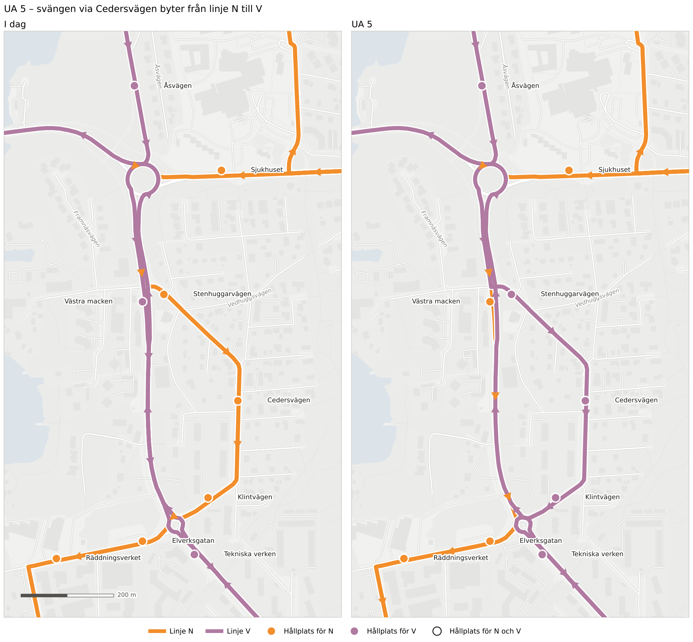

*Figur 4.17. UA 5 – linje N och V i dag (vänster) och med UA 5 (höger). Pilarna visar körriktningen, och
hållplatserna är färgade efter den linje som stannar där.*

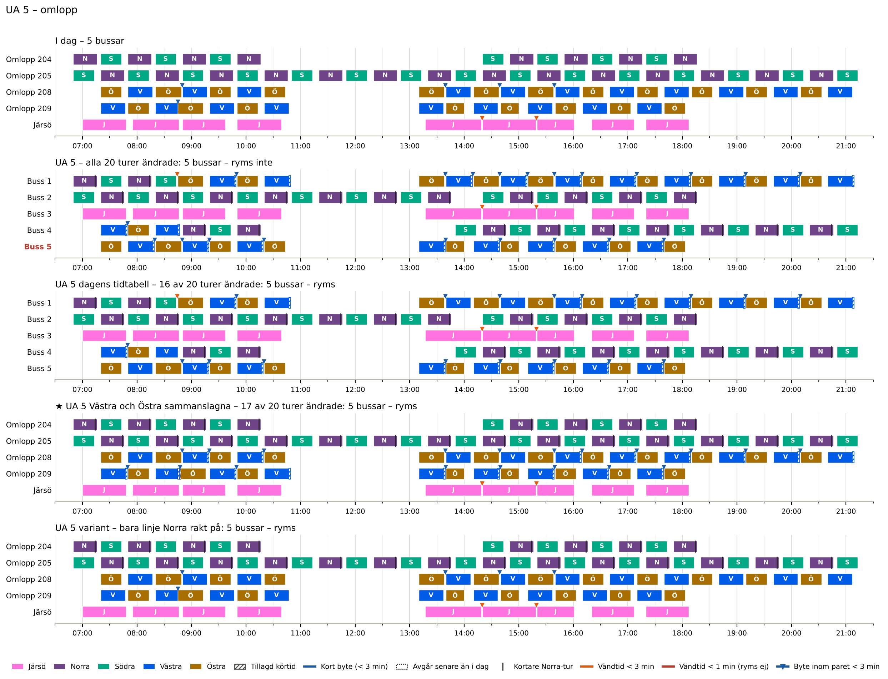

*Figur 4.18. Omlopp före och efter för UA 5, alla driftformer (★ = huvudalternativ). Svart streck i en N-tur
anger kortare körtid (rakt på Västra utfarten).*

## 4.8 Systemeffekter per UA

Varje UA har prövats för sig mot dagens nät (figur 4.13 och 4.14). Täckningen gäller invånarna i
Mariehamn (14 821). UA 4 redovisas i tabell 4.4 och UA 5 i tabell 4.6 och 4.7.

*Tabell 4.3. Systemeffekter, i dag och med UA 1–3 för sig (★ = huvudalternativ). UA 4 redovisas i tabell 4.4.*

| | I dag | UA 1a alla turer (utesluten) | UA 1a dagens tidtabell | UA 1a ★ V och Ö sammanslagna | UA 1b ★ V och Ö sammanslagna | UA 2 ★ N2 | UA 3 ★ Bo-Bil |
|---|---|---|---|---|---|---|---|
| Turer via alternativet | – | 20 av 20 | 8 av 20 | 16 av 20 | 16 av 20 | 20 av 20 | 22 av 22 |
| Hållplats inom 400 m | 83,6 % | 84,8 % | 84,8 % | 84,8 % | 84,8 % | 84,0 % | 83,4 % |
| Minst 15 avgångar per vardag | 81,0 % | 82,2 % | 81,0 % | 82,2 % | 82,2 % | 81,4 % | 80,8 % |
| Minst 30 avgångar per vardag | 55,6 % | 55,6 % | 55,6 % | 55,6 % | 55,6 % | 55,6 % | 55,9 % |
| Svag tillgänglighet (1–29 avg.) | 28,0 % | 29,2 % | 29,2 % | 29,2 % | 29,2 % | 28,4 % | 27,6 % |
| Invånare med bättre / sämre turtäthetsklass | – | 178 / 0 | 178 / 0 | 178 / 0 | 178 / 0 | 58 / 0 | 44 / 24 |
| **Invånare med fler / färre avgångar inom 400 m** (avgångar per vardag) | – | **178 (+20) / 0** | **178 (+8) / 0** | **178 (+16) / 0** | **178 (+16) / 0** | **58 (+20) / 0** | **44 (+22) / 24 (−22)** |
| Invånare × avgångar per vardag, netto | – | +3 557 | +1 423 | +2 846 | +2 846 | +1 164 | +444 |
| Fordon | 5 | **6** | 5 | 5 | 5 | 5 | 5 |
| Fordonskilometer per vardag | 1 287 | 1 342 | 1 309 | 1 331 | 1 312 | 1 287 | 1 287 |
| Varv V + Ö med < 5 min i centrum | 1 | 1 | 1 | 1 | 1 | 3 | 1 |
| Längre restid, befintliga resenärer (resenärsmin. per vardag) | – | 35 | 14 | 25 | 12 | 8 | 20 |

Restiden för UA 1a och 1b med V och Ö sammanslagna är netto, efter vinsten för resor mellan V och Ö som slipper
bytet. Det varv som redan i dag har under 5 minuter i centrum är V 07:50 med Ö:s skoltur 08:20 (4 minuter).

**Effekt: fler och färre avgångar × befolkning.** Turtäthetsklassen visar bara när invånarna byter klass.
Därför redovisas också effekten, dvs. hur antalet avgångar per vardag inom 400 m ändras för varje invånare:

> effekt = (avgångar efter − avgångar i dag) × invånare

Effekten räknas per 50 m-punkt och läggs ut som en utjämnad yta (gaussisk utjämning, 150 m), så att man ser
var vinnarna (grönt) och förlorarna (rött) bor. Hållplatserna färgas efter hur mycket antalet avgångar ändras i
procent (figur 4.16). Antalet avgångar är antalet unika turer som stannar inom 400 m.

- **Fler avgångar:** i UA 1a och 1b får 178 invånare vid Möckelö Strand ny 16 avgångar mer per vardag. I UA 2
  får 58 invånare vid N2 20 mer, och i UA 4 får 22 invånare vid flygplatsen 16 mer (UA 4Y 3 mer).
- **Färre avgångar i UA 3:** 24 invånare vid Vikingagränd får 22 avgångar färre. Samtidigt får 44 invånare vid
  Bo-Bil 22 fler, så att nettot blir positivt (+444 invånare × avgångar per vardag).
- **Solberget indragen (variant av UA 4):** 49 invånare får 20 avgångar färre, mot 22 invånare med 16 fler vid
  flygplatsen. Nettot blir negativt (−631 invånare × avgångar per vardag).
- **UA 5:** 125 invånare får fler avgångar, upp till 22 per vardag, och 11 invånare väster om Västra macken får
  17 färre. Nettot blir +1 837 invånare × avgångar per vardag. Med bara linje N rakt på får 28 invånare fler
  (+607) och ingen färre.

*Tabell 4.7. Systemeffekter av UA 5 (Mariehamn).*

| | I dag | UA 5 ★ V och Ö sammanslagna | UA 5 dagens drift | UA 5 variant: bara N rakt på |
|---|---|---|---|---|
| V-turer via svängen | – | 17 av 20 | 16 av 20 | 0 |
| Hållplats inom 400 m | 83,6 % | 83,6 % | 83,6 % | 83,6 % |
| Minst 30 avgångar per vardag | 55,6 % | 56,0 % | 56,0 % | 55,6 % |
| Svag tillgänglighet (1–29 avg.) | 28,0 % | 27,6 % | 27,6 % | 28,0 % |
| Invånare med fler / färre avgångar inom 400 m | – | 125 (+22) / 11 (−17) | 125 (+22) / 11 (−16) | 28 (+22) / 0 |
| Invånare × avgångar per vardag, netto | – | +1 837 | +1 765 | +607 |
| Fordon | 5 | 5 | 5 | 5 |
| Fordonskilometer per vardag | 1 287 | 1 286 | 1 286 | 1 283 |
| Restid befintliga resenärer (resenärsmin. per vardag) | – | −9 | −8 | −21 |

I QGIS finns effekten i gruppen för varje UA:

- `b4_effekt`: effektytan som rutnät, grönt för vinnare och rött för förlorare, i invånare × avgångar per
  vardag och hektar;
- `b4_hallplatser_frekvens`: hållplatserna efter förändrat antal avgångar i procent, med etiketter som
  "Vikingagränd 22 → 0";
- `b4_avgangar_forandring`: de exakta 400 m-ytorna med antal avgångar och invånare (släckt från början).

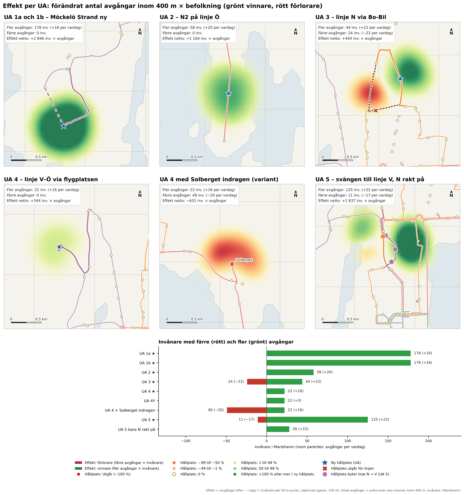

*Figur 4.16. Fler och färre avgångar inom 400 m per UA: förändrat antal avgångar × befolkning, utjämnad yta
(grönt fler, rött färre), och hållplatserna efter förändrat antal avgångar i procent. Till höger nere: invånare
i Mariehamn som får fler respektive färre avgångar.*

Förändringarna är lokala och syns bara i de berörda områdena (figur 4.14):

- **Möckelö Strand ny:** 178 invånare som i dag saknar hållplats får en med 16 avgångar per vardag. Med
  dagens tidtabell blir det 8 avgångar. Andelen med svag tillgänglighet ökar därför. Det är en förbättring:
  invånarna flyttar från *ingen hållplats* till *svag tillgänglighet*.
- **N2:** 58 invånare får en hållplats inom 400 m med 20 avgångar.
- **Bo-Bil:** 44 invånare lyfts till minst 30 avgångar per vardag, medan 23 invånare vid Vikingagränd förlorar
  hållplatsen inom 400 m.
- **Flygplatsen:** 21 invånare nära terminalen får en hållplats inom 400 m. Nyttan för flygresenärerna ingår
  inte, eftersom OD-matrisen saknar flygplatsen som målpunkt.
- **Solberget indragen (bara en variant av UA 4):** 42 invånare skulle förlora sin hållplats inom 400 m och 7
  få färre avgångar, sammanlagt 49 med 20 avgångar färre per vardag.
- **Svängen (UA 5):** invånarna kring Cedersvägen och Klintvägen har redan linje N inom 400 m vid Sjukhuset
  eller Västra utfarten. Därför förlorar ingen avgångar när N lämnar svängen, medan de som får V lyfts. Några
  få väster om Västra macken förlorar V-turerna där.

Förlusten för befintliga resenärer är högst 35 resenärsminuter per vardag, i det uteslutna alternativet med
alla turer i UA 1a. Med höstens resande, cirka tre gånger sommarens, är restidsförlusterna större än i den
tidigare versionen men fortfarande små: högst cirka 4,5 minuter per berörd resa, och cirka 3 minuter i
huvudalternativen. Kostnaden (fordonskilometer och fordon) sammanfattas i kapitel 5.

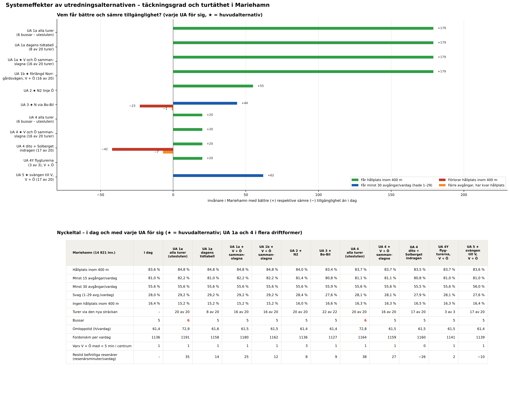

*Figur 4.13. Systemeffekter: invånare med bättre respektive sämre tillgänglighet för varje UA för sig
(UA 1a och 4 i flera driftformer; ★ = huvudalternativ). Nyckeltalen redovisas i tabellen ovan.*

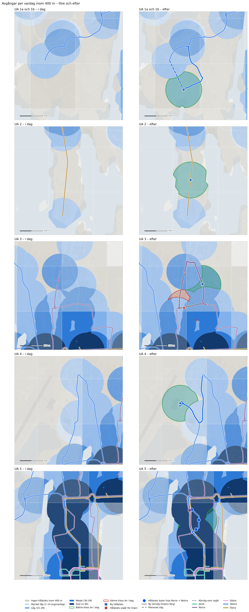

*Figur 4.14. Turtäthet inom 400 m i dag och med alternativet, inzoomat per UA. Grön ram anger bättre och
röd ram sämre klass än i dag.*

## 4.9 Fortsatt arbete

Nästa leverans ska redovisa följande:

1. **V och Ö sammanslagna.** Pröva tidtabellen mot verkliga körtider, särskilt Ö:s skolturer, som avgör vilka
   V-turer som ryms. Pröva Ö:s senare start (0–2,5 minuter efter pulsen) mot bytena i centrum, och undersök vändmöjligheten
   vid den nya hållplatsen (1a).
2. **Paret N ↔ S.** Reglering vid bytet N → S, med S som startar senare än pulsen, ger utrymme för linje N
   att nå Örtvägen. Pröva det tillsammans med Bo-Bil (3), alternativt i kombination med indragning av
   hållplatser på linje S enligt kapitel 3.
3. **Nordost.** En omläggning av linje N och Ö norr och nordost om centrum prövas för Lillåkersvägen,
   Solberget och Österkalmare, med och utan bibehållen puls.
4. **Dalkullavägen** på linje V ryms enligt screeningen i vanliga varv om Ö avgår efter pulsen, men konkurrerar
   om samma utrymme som Möckelö Strand och flygplatsen.
5. **Flygplatsen.** Kontrollera körtiden Posten – terminalen (restidsdata eller
   provkörning). Den avgör om Solberget behöver dras in på flygturerna (tabell 4.5). Stäm av de extra turerna
   (tabell 4.4b) med operatören, särskilt förarens rast i omlopp 204 mitt på dagen, och jämför morgon- och
   kvällsflyget med anropsstyrd trafik. Pröva vändmöjligheten vid terminalen.
6. **Svängen (UA 5).** Kontrollera operatörens 2 minuter med restidsdata eller provkörning, bedöm gångvägen
   från Cedersvägen till Västra utfarten och välj mellan V i svängen och bara N rakt på. Pröva UA 5
   tillsammans med UA 1b eller UA 4.

## 4.10 Osäkerheter

- **Omloppen** är operatörens, enligt påstigandedatan från hösten 2026, med beställarens rättelser av omlopp
  204, 205 och 208 och kvällens omlopp sammanslagna med dagens (avsnitt 4.1). Förarnas raster ingår inte. Driftformerna där omloppen byggs om (UA 2 och 3, dagens tidtabell) använder omlopp som är
  härledda ur tidtabellen.
- **Körtider för nya delsträckor** bygger på beställarens restider (Möckelö Strand: 2 minuter på den befintliga
  vägen, 1 minut på förlängningen) och på vägavstånd längs gatunätet (Bo-Bil, flygplatsen). Alla linjer och nya
  delsträckor är ruttade med OSRM (OpenStreetMap). Den befintliga vägen till Möckelö Strand ny är 1,37 km enligt
  OSRM, nästan exakt som i beställarens skiss (1,36 km). OSRM:s egna körtider redovisas för kontroll i `b4_ua.json`.
- **Vägdragningen** följer OSRM:s bilprofil. Där OSRM väljer en annan väg än bussen styrs rutten med via-punkter
  (lagret `00_viapunkter`; t.ex. linje V mellan Lönnhagsvägen och Norrgårdsvägen). Linje N:s busslänk mellan
  Doktorsvägen och Uppgårdsvägen är inte öppen för bilar och ritas rak (cirka 100 m).
- **Flygplatsen:** körvägen följer gatunätet (OSRM), men hållplatsens läge vid terminalen är uppskattat ur
  beställarens skiss, och bussens verkliga körtid är inte mätt. Den beräknade omvägen (5 minuter) ligger precis
  på gränsen för kravet på 5 minuter i centrum. Flygtiderna
  gäller vardagar i november 2026 och antas vara desamma alla vardagar; de ändras med flygbolagets
  tidtabell.
- **Svängen (UA 5):** körtidsvinsten är operatörens uppgift (2 minuter). Tidtabellen ger cirka 0,6 minuter, och
  med 1 minut blir effekten för resenärerna i stort sett noll. Antalet turer som ryms ändras inte.
- **Ö efter pulsen (1a och 4 med V och Ö sammanslagna)** förutsätter att resenärer som byter till Ö kan vänta
  1,5–2 minuter längre. Effekten på bytesresor ingår inte i nätverksmodellen.
- **Kravet på varvet** (≤ 55 minuter, helst ≤ 50) är beställarens riktvärde. I UA 1a ändras antalet turer
  inte om marginalen ligger mellan 3 och 5,5 minuter: varven med Ö:s skolturer får 0,5–2,5 minuter och de
  ändrade varven minst 5,5 minuter. I UA 1b ryms V 08:20 om kravet sänks till 4,5 minuter. Nivån 50 minuter (10 minuter i centrum) nås inte med någon av förlängningarna av V,
  eftersom dagens vanliga varv redan ligger på exakt 50 minuter.
- **Normen för linjebyten** (S ↔ N, Ö ↔ V) bygger på beställarens uppgift och bör stämmas av mot
  operatörens omloppsplaner.
- **Påstigande och restider** bygger på den tvättade höstdatan (kapitel 1), som avser terminstid. Linje J
  bygger på sommardata, men berörs inte av utredningsalternativen. Ingen data har korrigerats.
- **Hållplatslägena** för Möckelö Strand och N2 är indikativa. Befolkningen är jämnt fördelad inom varje
  1 km-ruta, så antalet invånare som får täckning beror på det exakta läget.
