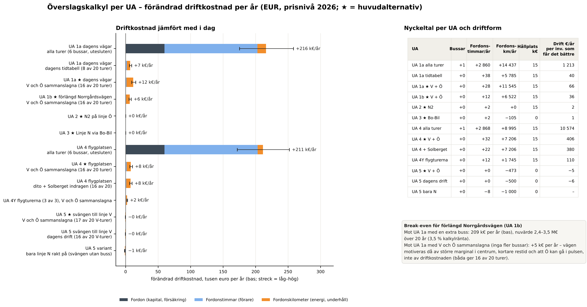

# 5 Ekonomisk kalkyl (överslag)

> **Sammanfattning.** Varje utredningsalternativ (UA) har kalkylerats för sig, i alla driftformer
> (★ = huvudalternativ). UA på linje V har prövats med kravet att varje varv V + Ö ryms inom timmen med minst
> 5 minuter i centrum.
>
> - **UA 1a – Möckelö Strand ny via dagens vägar:**
>   - ★ med V och Ö sammanslagna (16 av 20 turer, fem bussar): cirka 11 800 euro per år (9 200–15 400);
>   - alla turer med dagens tidtabell kräver en sjätte buss, cirka 216 000 euro per år, och är utesluten.
> - **UA 1b – Möckelö Strand ny via förlängd Norrgårdsvägen ★:** V och Ö sammanslagna, 16 av 20 turer, cirka
>   6 500 euro per år (5 100–8 600), utöver vägen.
> - **UA 2 – N2 på linje Ö ★:** praktiskt taget kostnadsneutralt.
> - **UA 3 – Linje N via Bo-Bil ★:** praktiskt taget kostnadsneutralt (vägen är lika lång som i dag).
> - **UA 4 – Linje V–Ö via flygplatsen:**
>   - ★ V och Ö sammanslagna (16 av 20 turer): cirka 8 100 euro per år;
>   - UA 4Y med de tre flygturerna: cirka 2 200 euro per år;
>   - extra turer för de tre flyg som dagens tidtabell inte når (avgång 07:15, ankomst 10:35 och 21:35): cirka
>     65 000 euro per år (54 000–77 000), varav 10:50-turen för ankomsten 10:35 cirka 10 000 euro;
>   - bara förlängning av V kräver en sjätte buss, cirka 211 500 euro per år, och är utesluten.
> - **UA 5 – Linje V via Cedersvägen, linje N rakt på Västra utfarten ★:** sparar cirka 400 euro per år, eftersom
>   linje N:s väg rakt på är kortare än svängen. Varianten med bara linje N rakt på sparar cirka 1 300 euro per år.
>
> Kilometrarna är vägavstånd längs gatunätet (OSRM).
>
> Förlängningen av Norrgårdsvägen (UA 1b) är motiverad ur busstrafikens perspektiv om den kostar mindre än
> 2,4–3,5 miljoner euro, om jämförelsen är UA 1a med en extra buss. Mot huvudalternativet för UA 1a är
> driftbesparingen bara cirka 5 000 euro per år, och båda ger 16 av 20 turer. Vägen motiveras då av kortare
> restid, större marginal i centrum och att Ö kan behålla pulsen, inte av busstrafikens driftkostnad.

## 5.1 Metod och antaganden

Kalkylen omfattar förändrad driftkostnad per år jämfört med i dag:

> Δ driftkostnad = Δ fordon × fordonskostnad + Δ fordonstimmar × timkostnad + Δ fordonskm × km-kostnad

- **Förändringar:** Δ fordon, Δ omloppstid (fordonstimmar) och Δ km per vardag kommer från
  omloppsverifieringen i kapitel 4.
- **Årsvolym:** 250 vardagar per år med typvardagens tidtabell. GTFS-underlaget omfattar bara hösten 2026,
  så helårsvolymen är ett antagande. Lördagstrafiken, med fem turer per linje, påverkas bara genom körda
  kilometer. Samma andel av turerna som på vardagar antas gå via den nya hållplatsen.
- **Enhetskostnader** (euro, prisnivå 2026):

  | Kostnadspost | Låg | Bas | Hög |
  |---|---|---|---|
  | Fordon (kapital, försäkring, uppställning), per fordon och år | 45 000 | 60 000 | 75 000 |
  | Fordonstimme (förare inkl. sociala avgifter och omkostnader) | 42 | 50 | 58 |
  | Fordonskilometer (energi, däck, underhåll) | 0,7 | 0,9 | 1,2 |
  | Nytt hållplatsläge (engångs) | 8 000 | 15 000 | 30 000 |

  Förlängningen av Norrgårdsvägen (1b) och en vändmöjlighet vid den nya hållplatsen (1a) har inte
  kostnadsberäknats.

  Värdena utgår från Trivector (2023), *Trafikeringskostnader för buss 2019 och 2045*, för Trafikverket.
  Där anges för tätortstrafik 2019 cirka 0,65 MSEK per fordon och år och cirka 480 kr per fordonstimme.
  Värdena är omräknade till euro och uppräknade till 2026. De är schabloner och ska ersättas med
  avtalspriserna i landskapsregeringens trafikavtal.
- **Kalkylränta och tid:** nuvärden har beräknats med 3,5 % kalkylränta och 20 års kalkyltid.

## 5.2 Resultat

*Tabell 5.1. Förändrad driftkostnad per år jämfört med i dag (euro, prisnivå 2026). Varje UA för sig.*

| UA | Bussar | Fordonstimmar per år | Fordonskm per år | Driftkostnad per år, bas (låg–hög) | Per invånare med bättre tillgänglighet |
|---|---|---|---|---|---|
| UA 1a dagens vägar, alla 20 turer – utesluten | +1 | +2 860 | +14 400 | +216 000 (175 200–258 200) | 1 213 €/år |
| UA 1a dagens vägar, dagens tidtabell (8 av 20 turer) | 0 | +38 | +5 800 | +7 100 (5 600–9 100) | 40 €/år |
| UA 1a ★ dagens vägar, V och Ö sammanslagna (16 av 20 turer) | 0 | +28 | +11 500 | +11 800 (9 200–15 400) | 66 €/år |
| UA 1b ★ förlängd Norrgårdsvägen, V och Ö sammanslagna (16 av 20 turer) | 0 | +12 | +6 500 | +6 500 (5 100–8 600) | 36 €/år |
| UA 2 ★ N2 på linje Ö | 0 | +2 | 0 | ±0 | – |
| UA 3 ★ Linje N via Bo-Bil | 0 | +2 | −100 | ±0 | – |
| UA 4 flygplatsen, alla 20 turer – utesluten | +1 | +2 870 | +9 000 | +211 500 (171 700–252 100) | 10 574 €/år |
| UA 4 ★ flygplatsen, V och Ö sammanslagna (16 av 20 turer) | 0 | +32 | +7 200 | +8 100 (6 400–10 500) | 406 €/år |
| UA 4 flygplatsen, dito + Solberget indragen (16 av 20) | 0 | +22 | +7 200 | +7 600 (6 000–10 000) | 380 €/år |
| UA 4Y flygturerna (3 av 3), V och Ö sammanslagna | 0 | +12 | +1 700 | +2 200 (1 700–2 800) | 110 €/år |
| UA 4 extra turer för flygen 07:15, 10:35 och 21:35 (tabell 5.2) | 0 | +1 110 | +10 900 | +65 200 (54 100–77 300) | – |
| UA 5 ★ svängen till linje V, V och Ö sammanslagna (17 av 20 V-turer) | 0 | 0 | −500 | −400 (−300 – −600) | – |
| UA 5 svängen till linje V, dagens drift (16 av 20 V-turer) | 0 | 0 | −500 | −500 (−400 – −600) | – |
| UA 5 variant: bara linje N rakt på (svängen utan buss) | 0 | −8 | −1 000 | −1 300 (−1 000 – −1 600) | – |

Kostnaden per invånare med bättre tillgänglighet är inte rättvisande för UA 4. Nyttan gäller främst
flygresenärer, som inte finns i OD-matrisen.

**Extra turer för flygen (UA 4).** Tre flyg nås inte av dagens V-turer. De extra turerna är V-turer via
flygplatsen (32 minuter, 14,5 km längs vägarna) och körs av ett omlopp som står stilla, så ingen extra buss behövs.
Fordonstimmarna räknas försiktigt: turens körtid plus den tid omloppet förlängs, även när bussen väntar.

*Tabell 5.2. Extra V-turer för flygen (euro per år, 250 vardagar).*

| Flyg | Extra tur | Körs av | Fordonstimmar per vardag | Kostnad per år, bas (låg–hög) |
|---|---|---|---|---|
| Avgång 07:15 | 05:15 (vid flygplatsen 05:32) | omlopp 204, som i dag börjar 06:50 | 2,2 | 30 400 (25 300–35 800) |
| Ankomst 10:35 | 10:50 (vid flygplatsen 11:06) | omlopp 204, i uppehållet 10:16–14:20 | 0,5 | 9 900 (8 100–12 000) |
| Ankomst 21:35 | 21:50 (vid flygplatsen 22:06) | omlopp 205, efter sista turen 21:13 | 1,7 | 24 900 (20 700–29 400) |
| **Summa** | | | **4,4** | **65 200 (54 100–77 300)** |

Turen 10:50 kostar bara körtiden, men uppehållet i omlopp 204 används troligen för förarens rast. Morgon- och
kvällsturen förlänger trafikdygnet och består till stor del av väntan; anropsstyrd trafik eller taxi kan vara
billigare för dessa flyg.

**UA 5.** Linje N blir 2 minuter kortare och linje V 2 minuter längre per tur. Omloppstiden ändras inte,
eftersom vinsten för N blir väntetid i centrum. Längs gatunätet är N:s väg rakt på cirka 210 m kortare per tur
än svängen, medan V kör cirka 115 m längre. Det ger en liten besparing i fordonskilometer. I varianten med bara
linje N rakt på slutar dessutom N:s sista tur 2 minuter tidigare.

**UA 1a med alla turer.** Merkostnaden domineras av den sjätte bussen, cirka 60 000 euro per år, och
dess förartimmar, cirka 143 000 euro per år. Kan operatören använda en befintlig reservbuss faller
fordonskostnaden bort, och driftkostnaden blir cirka 156 000 euro per år. Reserven för fordonsbortfall
minskar då.

**UA 1a med V och Ö sammanslagna.** Bussen fortsätter direkt som linje Ö efter en halv minut, och 14
Ö-turer avgår 2 minuter efter pulsen (avsnitt 4.5). Kostnaden är nästan bara körda kilometer (omvägen är
2,7 km per tur). Antalet bussar och fordonstimmar är i praktiken oförändrat.

**Förlängningen av Norrgårdsvägen** har inte kostnadsberäknats. Jämförelsen beror på alternativet:

- **Mot 1a med en extra buss:** merkostnaden är cirka 209 500 euro per år (170 100–249 700). Med 3,5 %
  kalkylränta motsvarar det ett nuvärde på 2,4–3,5 miljoner euro över 20 år. En vägförlängning som kostar
  mindre än så är billigare än att köra 1a med en extra buss.
- **Mot 1a med V och Ö sammanslagna:** skillnaden i driftkostnad är bara cirka 5 000 euro per år, ett nuvärde
  på cirka 0,06–0,09 miljoner euro. Båda ger 16 av 20 turer. Vägen ger i stället:
  - en kortare omväg, 2,5 i stället för 4,5 minuter per tur;
  - större marginal i centrum, minst 7,5 i stället för 5,5 minuter per varv;
  - Ö kan behålla sina avgångar i pulsen.

Vägen ger dessutom nytta för annan trafik.

**Intäkter.** Det tillkommande påstigandet vid den nya hållplatsen i Möckelö Strand beräknas till 1,5–6,5 per
vardag med höstens nivå, dvs. cirka 400–1 600 resor per år. Biljettintäkterna är små jämfört med
driftkostnaden och påverkar inte bedömningen.

*Figur 5.1. Förändrad driftkostnad per år per UA (bas; strecken anger låg–hög) och nyckeltal.*

## 5.3 Osäkerheter

- **Enhetskostnader:** de är schabloner. Avtalspriserna kan avvika, särskilt för fordon, där det har
  betydelse om fordonen är eldrivna och om operatören har en reservbuss.
- **Vardagar per år:** 250 vardagar är ett antagande. Tidtabellen kan skilja mellan termin och sommar.
- **Fordonstimmar:** den extra bussen i 1a har beräknats med minsta möjliga omloppstid. Kan bussen samordnas
  med annan trafik, till exempel skolskjutsar, kan kostnaden bli lägre.
- **Kilometer** är vägavstånd längs gatunätet (OSRM). Den befintliga vägen till Möckelö Strand ny är 1,37 km
  enkel väg, i stort sett som i beställarens skiss.
