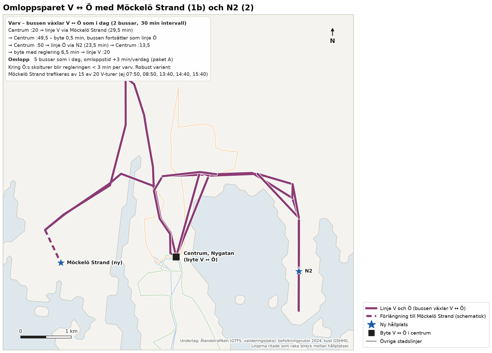
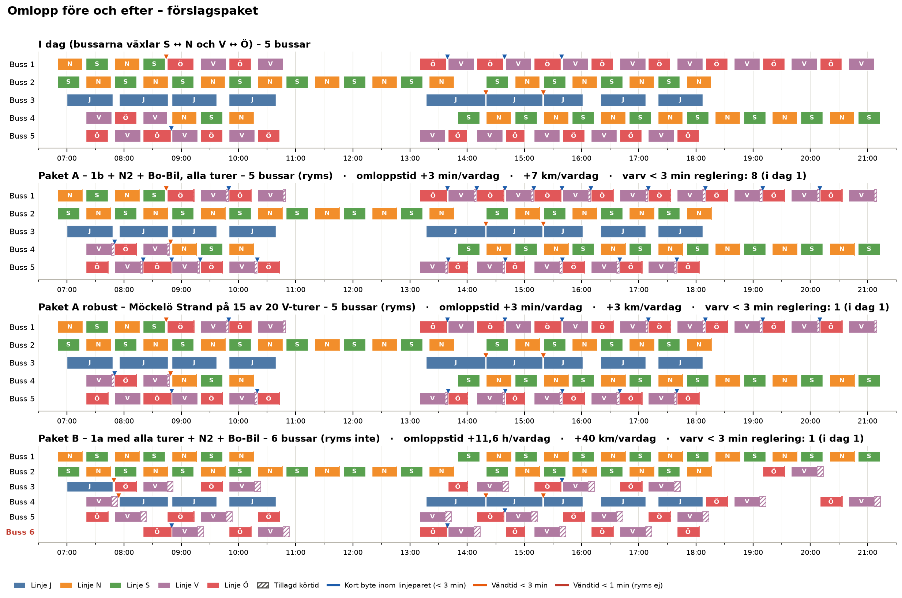
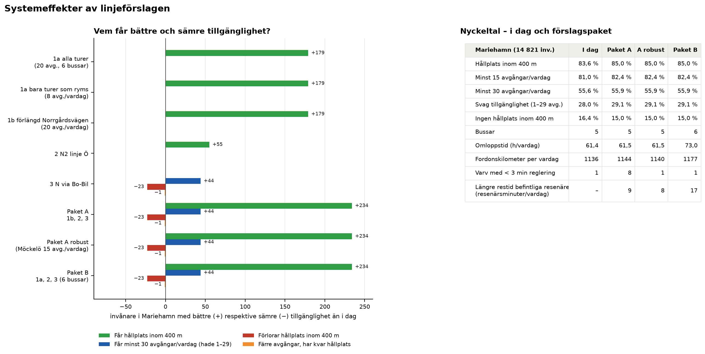
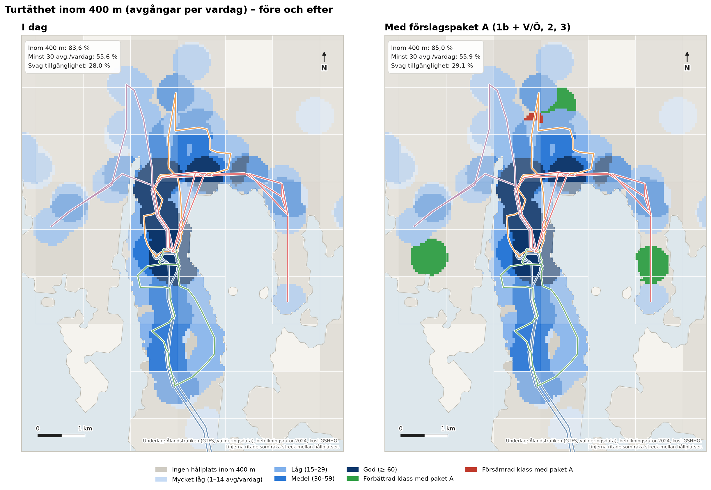

# PM – Linjeförslag för Mariehamns stadstrafik

**Uppdrag:** Linjenätsutredning för busslinjerna i Mariehamn
**Datum:** 2026-10-14
**Status:** Arbetsmaterial, Fas B (delleverans). Underlag till PM:ets kapitel 4 och 5.

## Sammanfattning

PM:et redovisar fyra linjeförslag som beställaren valde ut efter granskningen av Fas A:

- **1a:** linje V till en ny hållplats i Möckelö Strand via dagens gator;
- **1b:** samma förslag via en förlängd Norrgårdsvägen;
- **2:** en ny hållplats N2 på linje Ö;
- **3:** linje N via Bo-Bil i stället för Vikingagränd.

Varje förslag har prövats mot ramen för uppdraget: inga fler bussar och samma omloppstid som i dag.
Omloppen följer förarnas norm att byta linje i centrum, Syd ↔ Norr (S ↔ N) och Öst ↔ Väst (Ö ↔ V). Förslagen
har också sammanställts i två paket: paket A med 1b, 2 och 3, och paket B med 1a, 2 och 3.

Stadstrafiken körs i dag med fem bussar. Två bussar växlar mellan S och N, två mellan V och Ö, och en kör
linje J. Marginalerna är små: bussen har 3 minuter vid bytet V → Ö och 7 minuter vid bytet Ö → V.

- **1a (dagens gator):** omvägen tar 6,5 minuter per tur. Det ryms inte i omloppen. Alla turer kräver en
  sjätte buss, och driftkostnaden ökar med cirka **216 000 euro per år** (176 000–259 000). Utan extra buss
  ryms bara 8 av 20 turer, och de går på oregelbundna tider.
- **1b (förlängd Norrgårdsvägen):** omvägen tar 2,5 minuter per tur. Förslaget ryms med alla 20 turer.
  Bytet V → Ö blir 0,5 minut, och regleringen tas vid bytet Ö → V. Kring Ö:s skolturer blir regleringen då
  kortare än 3 minuter per varv. En robust variant trafikerar Möckelö Strand med 15 av 20 turer.
  Driftkostnaden ökar med cirka 4 600 euro per år, enbart genom fler kilometer.
- **2 (N2 på linje Ö):** hållplatsen ryms med alla 20 turer och ger 55 invånare en hållplats inom 400 m.
- **3 (linje N via Bo-Bil):** förslaget är i praktiken körtidsneutralt. Vägen blir kortare, men Bo-Bil blir
  ett nytt verkligt uppehåll, och förslaget ryms. Cirka 45 invånare får minst 30 avgångar per vardag, medan
  23 invånare vid Vikingagränd förlorar hållplatsen inom 400 m.

**Paket A** ger 278 invånare i Mariehamn bättre tillgänglighet och 24 sämre, med samma fem bussar och en
driftkostnad som är praktiskt taget oförändrad (+2 300 euro per år). Andelen invånare med hållplats inom
400 m ökar från 83,6 % till 85,0 %. Paket B ger samma täckning men kräver en sjätte buss.

Förlängningen av Norrgårdsvägen är därför avgörande för Möckelö Strand. Ur busstrafikens perspektiv
motsvarar den sparade merkostnaden för 1a ett nuvärde på 2,4–3,6 miljoner euro över 20 år. **Paket A
rekommenderas för fortsatt utformning**, under förutsättning att vägen byggs. Börja med den robusta
varianten tills körtiderna kring Ö:s skolturer har stämts av.

## 1 Bakgrund och uppdrag

I Fas A granskades och korrigerades OD-matrisen, och täckningsgraden analyserades med hänsyn till
turtätheten. Där identifierades också nya hållplatslägen och områden som bara kan nås med ändrad
linjesträckning. Efter granskningen den 14 oktober 2026 bad beställaren om en utredning av de enskilda
effekterna av fyra förslag:

1. **Möckelö Strand.** Linje V till en ny hållplats i Möckelö Strand. Restiden till hållplatsen är 3 minuter
   via dagens gator (1a) och 1 minut om Norrgårdsvägen förlängs till Hamnskärsvägen (1b).
2. **N2.** En ny hållplats N2 på linje Ö mellan Österkullagatan och Kalmarnäs vändplan.
3. **Bo-Bil.** Linje N stannar vid Bo-Bil i stället för vid Vikingagränd, så att bussen inte behöver vänta vid
   Nya Godbyvägen för att komma till Maxinge.

Dessutom skulle möjligheten att slå ihop linjer prövas för 1b. För 1a skulle en överslagskalkyl göras, och
systemeffekterna skulle redovisas för hela nätet.

## 2 Förutsättningar

### 2.1 Ramen – inga fler bussar

Förslagen får inte kräva fler bussar. Linjenätet ska rymmas inom dagens omloppsplaner, med samma antal
fordon och samma omloppstid. Varje förslag har verifierats mot detta:

- förslagets körtidsförändring läggs på berörda turer;
- avgångstiderna från centrum ligger fast, så att pulsen och bytena behålls;
- omloppen byggs om med minsta möjliga antal fordon och enligt förarnas norm för linjebyten;
- förslaget ryms om antalet bussar inte ökar och omloppstiden ökar med högst 10 minuter per vardag;
- förslaget är robust om det inte ger fler varv med mindre än 3 minuters reglering än i dag. Ett varv är
  två på varandra följande byten.

### 2.2 Dagens omlopp

GTFS-underlaget saknar omloppsuppgifter. Omloppen har därför härletts ur tidtabellen för en typisk
vardag, tisdag 2026-09-01, med förarnas norm för linjebyten (figur 1):

- **Trafik:** fem bussar kör 93 turer. Körtiden är 42,5 timmar och omloppstiden 61,4 timmar per vardag.
- **Puls:** linjerna N, S, V och Ö avgår från Centrum, Nygatan i en gemensam puls (:20 och :50) med 30
  minuters intervall i rusningstid. Linje J går ungefär en gång i timmen.
- **Linjebyten:** bussarna byter S → N, N → S, V → Ö och Ö → V. Ingen buss fortsätter på samma linje,
  utom J.
- **Bytestider i centrum:** V → Ö 3 minuter, Ö → V 7 minuter, S → N 7 minuter och N → S 4 minuter.
  Efter Ö:s skolturer är bytestiden 1–2 minuter.
- **Marginaler:** med krav på 2 minuters lägsta vändtid i stället för dagens 1 minut skulle det behövas en
  sjätte buss. I dag finns ett varv med mindre än 3 minuters reglering (linje J 13:17–15:20).

*Figur 1. Härledd omloppsplan för en typisk vardag. Varje rad är en buss och varje stapel en tur.*

### 2.3 Data och metod i korthet

- **Täckning:** befolkningen 2024 i 1 km-rutor har fördelats på 50 m-delpunkter på land. För varje delpunkt
  har antalet avgångar per vardag inom 400 m räknats (kapitel 2).
- **Svag tillgänglighet:** hållplats inom 400 m men färre än 30 avgångar per vardag.
- **Resenärseffekter:** den korrigerade OD-matrisen från kapitel 1 har lagts ut på ett restidsnät byggt på
  GTFS. Det tillkommande påstigandet har uppskattats med påstigande per invånare vid linjens
  bostadshållplatser.
- **Sommardata:** påstigandet är mätt under sommaren och därför lågt i absoluta tal.
- **Körvägar:** analysen och kartorna är förberedda för linjernas vägdragning längs gatunätet (OSRM),
  inklusive förslagens nya delsträckor. OSRM kunde inte nås från analysmiljön, så i den här versionen är
  linjerna ritade som raka streck mellan hållplatserna.

## 3 Förslagen

*Tabell 1. Förslagen var för sig – verifiering mot dagens omlopp och effekter.*

| Förslag | Körtid per tur | Ryms i dagens omlopp (5 bussar) | Invånare med bättre / sämre tillgänglighet | Driftkostnad per år |
|---|---|---|---|---|
| 1a Möckelö Strand, dagens gator | +6,5 min | Nej – alla turer kräver 6 bussar. 8 av 20 turer ryms. | 179 / 0 | +216 000 € (alla turer) |
| 1b Möckelö Strand, förlängd Norrgårdsvägen | +2,5 min | Ja, 20 av 20. Robust variant: 15 av 20. | 179 / 0 | +4 600 € |
| 2 N2 på linje Ö | +0,5 min | Ja, 20 av 20 | 55 / 0 | ±0 € |
| 3 Linje N via Bo-Bil | +0,1 min | Ja | 44 / 24 | −2 000 € |

### 3.1 Förslag 1a – Möckelö Strand via dagens gator

**Utformning.** Den nya hållplatsen placeras i det indikativa läget från kapitel 3, cirka 700 m söder om
dagens vändpunkt vid Möckelö Strand (figur 2). Bussen kör från vändpunkten till hållplatsen och samma väg
tillbaka. Tillägget blir 2 × 3 minuter plus 0,5 minuts uppehåll, dvs. 6,5 minuter per tur.

**Omlopp.** Tillägget är större än bytestiden V → Ö (3 minuter) och större än det utrymme som finns om all
reglering läggs vid bytet Ö → V (2,5 minuter). Med alla 20 turer krävs en sjätte buss, och omloppstiden
ökar med 11,6 timmar per vardag (figur 3). Utan extra buss ryms 8 av 20 turer, men de går på oregelbundna
tider: 07:20, 09:50, 10:20, 13:10, 13:40, 15:40, 16:40 och 17:40.

**Effekter.**

- 179 invånare får hållplats inom 400 m.
- Påstigandet uppskattas till 0,5–2 per vardag på sommarnivå.
- Genomresande på linje V får 6,5 minuter längre restid.

**Bedömning.** Förslaget ryms inte i ramen. Kostnaderna redovisas i avsnitt 5.

### 3.2 Förslag 1b – Möckelö Strand via förlängd Norrgårdsvägen

**Utformning.** Norrgårdsvägen förlängs till Hamnskärsvägen, och restiden till den nya hållplatsen blir
1 minut. Tillägget blir 2 × 1 minut plus 0,5 minuts uppehåll, dvs. 2,5 minuter per tur.

**Sammanslagning – omloppsparet V ↔ Ö.** Bussen som kör linje V fortsätter redan i dag som linje Ö. Med 1b
läggs regleringen vid bytet Ö → V i stället för vid båda bytena. Varvet ser då ut så här (figur 4):

1. Bussen avgår :20 som linje V och kör via Möckelö Strand på 29,5 minuter.
2. Efter ett byte på 0,5 minut i centrum fortsätter den :50 som linje Ö.
3. Efter Ö-turen tar bussen sin reglering, 6,5 minuter, innan nästa V-tur.

Två bussar kör varvet med 30 minuters förskjutning, så båda linjerna behåller 30 minuters turintervall och
avgår i pulsen. Om bytet dessutom skyltas som en genomgående linje kan resenärerna sitta kvar på bussen.

- **Ryms:** alla 20 turer ryms med fem bussar (figur 3). Omloppstiden ökar med 3 minuter per vardag.
- **Robusthet:** kring Ö:s skolturer (07:50–08:50 och 13:40–15:40) blir regleringen kortare än 3 minuter per
  varv, totalt 8 varv mot 1 i dag. En robust variant kör inte omvägen på V-turerna 07:50, 08:50, 13:40,
  14:40 och 15:40. Hållplatsen får då 15 avgångar per vardag.

**Effekter.**

- 179 invånare får en hållplats med 15–20 avgångar per vardag.
- Fordonskilometrarna ökar med cirka 17 km per vardag.

*Figur 2. Förslag 1. Grönt anger invånare som får hållplats inom 400 m. Körvägen till den nya hållplatsen
är schematisk tills vägdragningen har hämtats.*

*Figur 3. Omlopp före och efter för förslag 1a och 1b. Skrafferad del av en tur är tillagd körtid. Röd
rubrik anger att lösningen kräver fler bussar.*

*Figur 4. Omloppsparet V ↔ Ö med Möckelö Strand (1b) och N2 (2).*

### 3.3 Förslag 2 – ny hållplats N2 på linje Ö

**Utformning.** Hållplatsen N2 placeras på sträckan Österkullagatan – Kalmarnäs vändplan, som bussen kör i
båda riktningarna. Ett uppehåll per tur i genomsnitt (0,5 minut) har antagits.

**Omlopp.** Alla 20 turer ryms, och förslaget är lika robust som i dag (figur 6). Skolturen 08:20 kommer
tillbaka 08:49,5 och fortsätter som linje V 08:50 efter ett kort byte.

**Effekter.**

- 55 invånare får hållplats inom 400 m med 20 avgångar per vardag.
- Påstigandet uppskattas till 0,4–1,8 per vardag på sommarnivå.
- Förlusten för dem som redan sitter på bussen är försumbar.

*Figur 5. Förslag 2, ny hållplats N2 på linje Ö.*

*Figur 6. Omlopp före och efter för förslag 2.*

### 3.4 Förslag 3 – linje N via Bo-Bil i stället för Vikingagränd

**Utformning.** Linje N kör Maxinge – Bo-Bil – Bolstavägen i stället för Maxinge – Vikingagränd –
Bolstavägen (figur 7).

**Körtid.** Ändringen är i praktiken körtidsneutral, +0,1 minut per tur:

- körvägen är cirka 27 % kortare fågelvägen, vilket ger −0,4 minut;
- Bo-Bil blir ett verkligt uppehåll, +0,5 minut. Vid Vikingagränd stannar bussen sällan i dag, med cirka
  0,05 påstigande per vardag.

Den minskade väntan vid Nya Godbyvägen ingår inte, eftersom den inte kan beräknas utan realtidsdata. Den
talar för en kortare och framför allt jämnare körtid.

**Omlopp.** Förslaget ryms med alla 22 turer. Bytet N → S blir 3,9 minuter i stället för 4.

**Effekter.**

- Bo-Bil får linje N:s 22 avgångar utöver landsbygdslinjernas. 44 invånare får därmed minst 30 avgångar per
  vardag.
- 23 invånare vid Vikingagränd förlorar hållplats inom 400 m.
- Fordonskilometrarna minskar med cirka 9 km per vardag.

*Figur 7. Förslag 3. Grönt anger bättre och rött sämre tillgänglighet.*

## 4 Systemeffekter

Förslagen har sammanställts i tre paket som verifierats mot omloppen tillsammans (figur 8):

- **Paket A:** 1b, 2 och 3 med alla turer. Paketet ryms med fem bussar, och omloppstiden ökar med 3 minuter
  per vardag. Kring Ö:s skolturer blir regleringen kort (8 varv med mindre än 3 minuter, mot 1 i dag).
- **Paket A robust:** som paket A, men Möckelö Strand trafikeras av 15 av 20 V-turer. Paketet ryms med fem
  bussar och är lika robust som i dag.
- **Paket B:** 1a med alla turer, 2 och 3. Paketet kräver sex bussar och 11,6 fler fordonstimmar per vardag.

*Tabell 2. Systemeffekter i Mariehamn (14 821 invånare).*

| | I dag | Paket A | Paket A robust | Paket B |
|---|---|---|---|---|
| Hållplats inom 400 m | 83,6 % | 85,0 % (+211 inv.) | 85,0 % | 85,0 % |
| Minst 15 avgångar per vardag | 81,0 % | 82,4 % | 82,4 % | 82,4 % |
| Minst 30 avgångar per vardag | 55,6 % | 55,9 % (+43 inv.) | 55,9 % | 55,9 % |
| Svag tillgänglighet (1–29 avgångar) | 28,0 % | 29,1 % | 29,1 % | 29,1 % |
| Ingen hållplats inom 400 m | 16,4 % | 15,0 % | 15,0 % | 15,0 % |
| Invånare med bättre / sämre tillgänglighet | – | 278 / 24 | 278 / 24 | 278 / 24 |
| Bussar | 5 | 5 | 5 | 6 |
| Omloppstid (fordonstimmar per vardag) | 61,4 | 61,5 | 61,5 | 73,0 |
| Fordonskilometer per vardag | 1 136 | 1 144 | 1 140 | 1 177 |
| Varv med < 3 min reglering | 1 | 8 | 1 | 1 |
| Längre restid för befintliga resenärer (resenärsminuter per vardag) | – | 9 | 8 | 17 |

Andelen med svag tillgänglighet ökar något. Det beror på att invånare som i dag saknar hållplats får en med
15–20 avgångar per vardag: de flyttar från gruppen *ingen hållplats* till *svag tillgänglighet*, vilket är en
förbättring (figur 9 och 10).

Förlusten för befintliga resenärer är liten, under 10 resenärsminuter per vardag för paket A. Den ska vägas
mot att 234 invånare får hållplats inom 400 m.

*Figur 8. Omlopp före och efter för paket A, paket A robust och paket B.*

*Figur 9. Invånare med bättre respektive sämre tillgänglighet per förslag, och nyckeltal för paketen.*

*Figur 10. Turtäthet inom 400 m i dag och med paket A. Grönt anger förbättrad och rött försämrad klass.*

## 5 Överslagskalkyl

**Kostnadsmodell.** Kalkylen omfattar förändrad driftkostnad per år (figur 11) och består av tre delar:

- **Fordon:** antal fordon × fordonskostnad (kapital, försäkring, uppställning), 45 000–75 000 euro per år;
- **Fordonstimmar:** förare inklusive sociala avgifter, 42–58 euro per timme;
- **Fordonskilometer:** energi och underhåll, 0,7–1,2 euro per km.

Enhetskostnaderna är orienterande värden för tätortstrafik från Trivector (2023), *Trafikeringskostnader
för buss 2019 och 2045*, för Trafikverket. De är omräknade till euro och uppräknade till 2026 och ska ersättas
med avtalspriserna i landskapsregeringens trafikavtal.

**Årsvolym.** Beräkningen bygger på 250 vardagar per år. Lördagstrafiken påverkas bara genom körda
kilometer.

*Tabell 3. Förändrad driftkostnad per år jämfört med i dag (euro, prisnivå 2026).*

| Förslag | Bussar | Fordonstimmar per år | Fordonskm per år | Driftkostnad per år, bas (låg–hög) | Per invånare med bättre tillgänglighet |
|---|---|---|---|---|---|
| 1a alla turer | +1 | +2 900 | +13 150 | **+216 000** (176 000–259 000) | 1 209 €/år |
| 1a bara 8 turer | 0 | +28 | +5 650 | +6 000 | 36 €/år |
| 1b förlängd Norrgårdsvägen | 0 | +12 | +4 400 | +4 600 (3 600–6 000) | 26 €/år |
| 2 N2 | 0 | +2 | 0 | ±0 | – |
| 3 Bo-Bil | 0 | 0 | −2 500 | −2 000 | – |
| Paket A | 0 | +12 | +1 900 | **+2 300** (1 900–3 000) | 8 €/år |
| Paket A robust | 0 | +12 | +850 | +1 400 (1 100–1 800) | 5 €/år |
| Paket B | +1 | +2 900 | +10 700 | **+214 000** (174 000–256 000) | 771 €/år |

**Merkostnad för 1a.** Merkostnaden för 1a domineras av den sjätte bussen och dess förartimmar. Om
operatören kan använda en befintlig reservbuss faller fordonskostnaden på cirka 60 000 euro per år bort.
Driftkostnaden blir då cirka 156 000 euro per år, men reserven för fordonsbortfall minskar.

**Investeringar.** Nya hållplatslägen kostar cirka 8 000–30 000 euro styck beroende på utrustning. Paket
A innehåller två nya lägen. Hållplatsen Bo-Bil finns redan.

**Förlängningen av Norrgårdsvägen.** Vägen har inte kostnadsberäknats. Merkostnaden för 1a jämfört med 1b
är cirka 212 000 euro per år. Med 3,5 % kalkylränta och 20 års kalkyltid motsvarar det ett nuvärde på
2,4–3,6 miljoner euro. Kostar vägförlängningen mindre än så är den billigare för samhället än att köra 1a med
en extra buss. Vägen ger dessutom nytta för annan trafik.

*Figur 11. Förändrad driftkostnad per år per förslag (bas; strecken anger låg–hög).*

## 6 Slutsatser och rekommendation

1. **Ramen är snäv.** Ingen linje kan förlängas mer än någon minut om varje byte ska ha full reglering.
   Eftersom bussarna redan växlar i paren S ↔ N och V ↔ Ö kan regleringen läggas vid det ena bytet i varvet.
   Då frigörs upp till 2,5 minuter per tur för den andra linjen.
2. **Möckelö Strand** bör trafikeras enligt 1b. Det förutsätter att Norrgårdsvägen förlängs. Variant 1a
   ryms inte och kostar cirka 216 000 euro per år. Ett utbud med bara 8 turer på oregelbundna tider
   rekommenderas inte.
3. **Robusthet:** börja med den robusta varianten av 1b, 15 av 20 turer, tills körtiderna kring Ö:s
   skolturer har stämts av mot verkliga körtider.
4. **N2 på linje Ö** rekommenderas och ryms med alla turer.
5. **Linje N via Bo-Bil** rekommenderas. Förslaget är körtidsneutralt men ger jämnare körtid och fler
   avgångar vid Bo-Bil. Förlusten vid Vikingagränd (23 invånare) bör vägas in, och den kan mildras med
   hållplatsen N3 söder om Maxinge från kapitel 3.
6. **Paket A** ger 278 invånare bättre tillgänglighet, med fem bussar och praktiskt taget oförändrad driftkostnad (cirka
   +2 300 euro per år) utöver investeringar i två hållplatser och vägförlängningen.

## 7 Osäkerheter och fortsatt arbete

- **Omloppen** är härledda ur tidtabellen med beställarens norm för linjebyten (S ↔ N, Ö ↔ V). Förarnas raster
  och operatörens faktiska omloppsplaner ingår inte och behöver stämmas av.
- **Restiderna** för Möckelö Strand bygger på beställarens uppgifter. Det har antagits att bussen kör samma
  väg tillbaka. Kan den fortsätta i en slinga blir tillägget ungefär hälften. Körtiderna vid Bo-Bil bygger på
  fågelvägsavstånd.
- **Vägdragningen** längs gatunätet (OSRM) kunde inte hämtas i analysmiljön, så linjerna är ritade som raka
  streck. När `python src/kor_alla.py` körs med nätåtkomst ruttas både dagens linjer och förslagens nya
  delsträckor. OSRM:s körtider för de nya delsträckorna redovisas då för kontroll.
- **Hållplatslägena** för Möckelö Strand och N2 är indikativa. Befolkningen är jämnt fördelad inom varje
  1 km-ruta, så antalet invånare som får täckning beror på det exakta läget.
- **Påstigande och resenärseffekter** bygger på sommardata och bör räknas om med terminsdata.
- **Enhetskostnaderna** är schablonvärden och bör ersättas med avtalspriser.
- **Fortsatt arbete:** pröva reglering vid bytet N → S för områdena kring linje N (Lillåkersvägen och
  Örtvägen) och en omläggning av linje N och Ö i nordost.

## Bilaga – Kartor i QGIS

Alla kartor finns som lager i `output/gis/linjenatsutredning.gpkg` (EPSG:3067) med inbäddade stilar.

1. Kör `output/gis/oppna_i_qgis.py` i QGIS Python-konsol. Lagren läggs då in med en grupp per förslag och en
   grupp för systemeffekterna, med filter för respektive förslag.
2. Projektet sparas som `linjenatsutredning.qgz` och kan därefter öppnas direkt.

| Grupp i QGIS | Innehåll |
|---|---|
| Paket A (rekommenderat) | Nya och ändrade hållplatser, linjer i paketet, förändrad tillgänglighet |
| Förslag 1a, 1b, 2, 3 | Ny hållplats, körväg, linjen efter förslaget, förändrad tillgänglighet |
| Systemeffekter | Turtäthet inom 400 m i dag och med paket A; tabell med nyckeltal per scenario |
| Sammanslagning av linjer | Områden utan hållplats och behövd tid per tur |
| Bakgrund | Stadslinjerna i dag med vägdragning (förskjutna där de delar gata), hållplatser, befolkningsrutor, land |

Linjerna levereras som raka streck. Vägdragningen längs gatunätet hämtas genom att köra
`output/gis/rutta_med_osrm.py` i QGIS Python-konsol på en dator med internet. Skriptet ruttar varje
hållplatssegment med OSRM och uppdaterar linjerna i *Bakgrund* och i förslagsgrupperna, inklusive
förskjutningen där linjer delar gata. Fältet `vagdragning` anger om en linje är ruttad.
