# PM – Utredningsalternativ (UA) för Mariehamns stadstrafik

**Uppdrag:** Linjenätsutredning för busslinjerna i Mariehamn
**Datum:** 2026-10-15, uppdaterat 2026-11-02 med tvättad påstigandedata och operatörens omlopp (hösten 2026) och
2026-11-15 med UA 5 (operatörens förslag om svängen via Cedersvägen) och flygtiderna för UA 4
**Status:** Arbetsmaterial, Fas B (delleverans). Underlag till PM:ets kapitel 4 och 5.

## Sammanfattning

PM:et redovisar sex utredningsalternativ (UA). Varje UA prövas **för sig** mot ramen för uppdraget: inga fler
bussar och samma omloppstid som i dag. Verifieringen utgår från operatörens omlopp, som finns i den tvättade
påstigandedatan från hösten 2026. Omloppen följer förarnas norm att byta linje i centrum, Södra ↔ Norra
och Östra ↔ Västra.

Varje UA har prövats i flera driftformer:

- **Uteslutna:** driftformer som kräver fler bussar.
- **Huvudalternativ (★):** den mest realistiska driftformen. Den visas på kartorna.
- **Övriga driftformer:** redovisas i tabellerna.

Kombinationer av UA prövas i ett senare skede.

Stadstrafiken körs i dag med fem bussar. Efter en Västra-tur har bussen 3 minuter innan den fortsätter som linje Östra,
och efter en Östra-tur 7 minuter. Linje Västra kan därför inte förlängas utan att Västra och Östra slås ihop till en genomgående
linje Västra–Östra. Bussen fortsätter då efter en halv minut, och resenärer mellan Västra och Östra kan sitta kvar. Det enda kravet
(beställaren 2026-10-15) är att varje varv Västra + Östra ryms inom 55 minuter, dvs. minst 5 minuter i centrum, och helst
inom 50 minuter. Östra startar när Västra har kommit tillbaka, i huvudalternativen 0–2,5 minuter efter pulsen.

Linjerna och utredningsalternativens körvägar följer gatunätet (OSRM, OpenStreetMap), och fordonskilometrarna
är vägavstånd. Med den verkliga vägdragningen kör stadstrafiken 1 287 km per vardag.

| UA | Huvudalternativ (★) | Ryms (5 bussar) | Effekt | Kostnad: fordonskm per vardag, fler fordon? | Utesluten driftform |
|---|---|---|---|---|---|
| **UA 1a – Möckelö Strand ny via dagens vägar** (+4,5 min/tur) | Västra och Östra sammanslagna | 16 av 20 turer | 178 inv. får hållplats (+16 avg./vardag) | +44 km, nej | Alla turer med dagens tidtabell (6 fordon, +55 km) |
| **UA 1b – Möckelö Strand ny via förlängd Norrgårdsvägen** (+2,5 min/tur) | Västra och Östra sammanslagna, Östra i pulsen | 16 av 20 | 178 inv. får hållplats (+16 avg./vardag) | +25 km, nej (+ väg) | – |
| **UA 2 – N2 på linje Östra** (+0,5 min/tur) | Alla turer | 20 av 20 | 58 inv. får hållplats (+20 avg./vardag) | ±0 km, nej | – |
| **UA 3 – Linje Norra via Bo-Bil** (+0,9 min/tur) | Alla turer | 22 av 22 | 44 inv. +22 avg./vardag (Bo-Bil); 24 inv. −22 (Vikingagränd) | +10 km, nej | – |
| **UA 4 – Linje Västra–Östra via flygplatsen** (+5 min/tur) | Västra och Östra sammanslagna | 16 av 20 | 21 inv. får hållplats (+16 avg./vardag); 3 av 6 flyg nås | +27 km, nej (alla 6 flyg: +44 km till, nej) | Bara förlängning av Västra (6 fordon, +34 km) |
| **UA 5 – Linje Västra via Cedersvägen, linje Norra rakt på Västra utfarten** (Västra +2, Norra −2 min/tur) | Västra och Östra sammanslagna | 17 av 20 Västra-turer | 125 inv. fler avgångar (upp till +22), 11 färre (−17); Norra 6 i stället för 4 min i centrum | −1 km, nej | – |
| **UA 6 – Linje Norra i båda riktningarna** (kräver extra buss) | Norra även moturs, var 30:e minut | 22 turer till | Restid −164 resenärsmin. per vardag; 888 inv. får minst 30 avg./vardag | +257 km, ja (+1 fordon) | – |
| **UA 7 – Kvällstrafik efter efterfrågan** | Norra åt båda hållen efter kl. 18 i stället för Västra | 3 turer flyttas | Restid −16 resenärsmin. per kväll; cirka 4 Västra-resenärer per kväll får anropsstyrd resa | −3 km, nej | – |

I UA 1a, 1b och 4 kör samma fyra Västra-turer som i dag, eftersom deras varv saknar marginal i operatörens omlopp:

- 07:50, 13:40 och 14:40 följs av Östras skolturer (28–29 minuter);
- 08:20 vänder direkt, utan uppehåll, till Östras skoltur 08:45.

**Övriga driftformer:**

- **UA 1a med dagens tidtabell:** 8 av 20 turer.
- **UA 1b med alla 20 turer:** ryms med fem bussar, men varven med Östras skolturer får bara 1,5–2,5 minuter i
  centrum och uppfyller inte kravet.
- **UA 4 med Solberget indragen dessutom:** inga fler turer (16 av 20), bara mer tid i centrum. Solberget har
  cirka 16 påstigande per vardag, och 49 invånare skulle få 20 avgångar färre per vardag (42 av dem förlorar
  hållplatsen inom 400 m).
- **UA 4Y:** bara de tre Västra-turer som når ett flyg (Västra 08:50 till flyget 11:00, Västra 15:10 till flyget 17:10 och
  Västra 17:10 från flyget som landar 16:45). Alla tre ryms med Västra och Östra sammanslagna och minst 6 minuter i centrum,
  utan att Solberget dras in, för +5 fordonskm per vardag och inga fler fordon.
- **Flygen (tider från beställaren 2026-11-15):** dagens Västra-turer når tre av sex flyg. Avgången 07:15 och
  ankomsterna 10:35 och 21:35 kräver extra turer, sammanlagt +44 fordonskm per vardag (14,5 km per tur). De
  körs av fordon som står stilla, så inga fler fordon behövs. Den extra turen 10:50, för ankomsten 10:35, ryms
  mitt på dagen i ett befintligt omlopp.
- **UA 5 med dagens drift:** 16 av 20 Västra-turer via svängen, utan att Västra och Östra slås ihop. **Variant:** bara linje Norra
  rakt på och ingen buss i svängen. Det ger samma vinst för Norra, ingen förlorar hållplatsen inom 400 m och linje Västra
  påverkas inte.

**Effekt på täckningen.** Med Möckelö Strand ny ökar andelen invånare i Mariehamn med hållplats inom 400 m från
83,6 till 84,8 %. Bara UA 3 ger någon färre avgångar: 24 invånare vid Vikingagränd får 22 avgångar färre per
vardag, medan 44 vid Bo-Bil får 22 fler (figur 12b).

**Ny påstigandedata.** Den tvättade datan från hösten 2026 har inte det registreringsfel som sommardatan hade,
och resandet är ungefär tre gånger så stort (cirka 320 påstigande per vardag). All data används som den är,
utan korrigering. Det ändrar inte vilka alternativ som ryms, men resenärseffekterna blir större. Den nya
hållplatsen i Möckelö Strand beräknas få 1,5–6,5 påstigande per vardag.

**UA 5** ger linje Norra 2 minuter mer tid i centrum i varje varv, vilket gör Norra mer robust mot förseningar. Svängen
via Cedersvägen har i dag cirka 1 påstigande per vardag.

**UA 1a, 1b, 4 och 5** förlänger alla linje Västra och använder samma tidsutrymme. Två av dem ryms inte tillsammans
inom kravet utan fler bussar. UA 5 med bara linje Norra rakt på påverkar inte linje Västra.

## 1 Bakgrund och uppdrag

I Fas A granskades och korrigerades OD-matrisen, och täckningsgraden analyserades med hänsyn till
turtätheten. Där identifierades också nya hållplatslägen och områden som bara kan nås med ändrad
linjesträckning. Efter granskningen den 14 oktober 2026 bad beställaren om en utredning av de enskilda
effekterna av följande utredningsalternativ (UA):

1. **Möckelö Strand.** Linje Västra till en ny hållplats i Möckelö Strand, via dagens vägar (1a) och via en
   förlängning av Norrgårdsvägen till Hamnskärsvägen (1b). Beställarens restider: den befintliga vägen från
   Norrgårdsvägen till den nya hållplatsen tar 2 minuter och förlängningen 1 minut.
2. **N2.** En ny hållplats N2 på linje Östra mellan Österkullagatan och Kalmarnäs vändplan.
3. **Bo-Bil.** Linje Norra stannar vid Bo-Bil i stället för vid Vikingagränd, så att bussen inte behöver vänta vid
   Nya Godbyvägen för att komma till Maxinge.
4. **Flygplatsen.** Linje Västra följer vägen från Posten upp till flygterminalen. Det ska prövas med Västra och Östra
   sammanslagna, med hållplatsen Solberget indragen och som en UA 4Y med bara de turer som behövs för flygen.
   Den 15 november 2026 lämnade beställaren de exakta flygtiderna. Resenären ska vara på flygplatsen 2–1,5
   timmar före avgång, och en buss ska gå från flygplatsen cirka 30 minuter efter landning.
5. **Svängen via Cedersvägen** (operatörens förslag, 2026-11-15). Linje Västra tar över svängen via Cedersvägen och
   linje Norra kör rakt på Västra utfarten, vilket enligt operatören sparar linje Norra ett par minuter.

Den 15 oktober 2026 preciserade beställaren kravet för en sammanslagen linje Västra–Östra: varje varv Västra + Östra ska rymmas
inom timmen med minst 5 minuter i centrum, och den kortare restiden för resor mellan Västra och Östra ska räknas med.

Dessutom skulle möjligheten att slå ihop linjer prövas, särskilt om sammanslagning av Västra och Östra gör att den nya
hållplatsen i Möckelö Strand kan trafikeras redan med dagens vägar. För 1a skulle kostnaden bedömas.
Systemeffekterna skulle redovisas för alla UA.

## 2 Förutsättningar

### 2.1 Ramen – inga fler bussar

Utredningsalternativen får inte kräva fler bussar. Linjenätet ska rymmas inom dagens omloppsplaner, med samma antal
fordon och samma omloppstid. Varje UA har verifierats mot detta:

- alternativets körtidsförändring läggs på berörda turer;
- avgångstiderna från centrum ligger fast, så att pulsen och bytena behålls. Undantaget är sammanslagning av Västra
  och Östra, där Östra startar när Västra har kommit tillbaka;
- omloppen byggs om med minsta möjliga antal fordon och enligt förarnas norm för linjebyten;
- alternativet ryms om antalet bussar inte ökar och omloppstiden ökar med högst 10 minuter per vardag;
- **UA på linje Västra (Västra och Östra sammanslagna):** operatörens omlopp ligger fast, så att varje Västra-tur fortsätter som
  den tur som samma buss kör i dag. Det enda kravet är att varje varv Västra + Östra ryms inom 55 minuter, dvs. minst
  5 minuter i centrum, och helst inom 50 minuter. Varv som redan i dag har mindre marginal godtas oförändrade
  (Västra 07:50 följd av Östras skoltur 08:20 har i dag 4 minuter);
- **UA 2 och 3:** alternativet är robust om det inte ger fler varv med mindre än 3 minuters reglering än i dag.

### 2.2 Dagens omlopp

Stadstrafiken har fem linjer som alla utgår från Centrum (figur figur 0). Västra, Norra och Södra är slingor som körs
i en riktning, med Västras sträcka till Möckelö och Norras till Maxinge fram och tillbaka. Östra kör ut via Nabben
till Solberget och Kalmarnäs och tillbaka via Sjukhuset. Järsö kör söderut till Järsö och tillbaka.

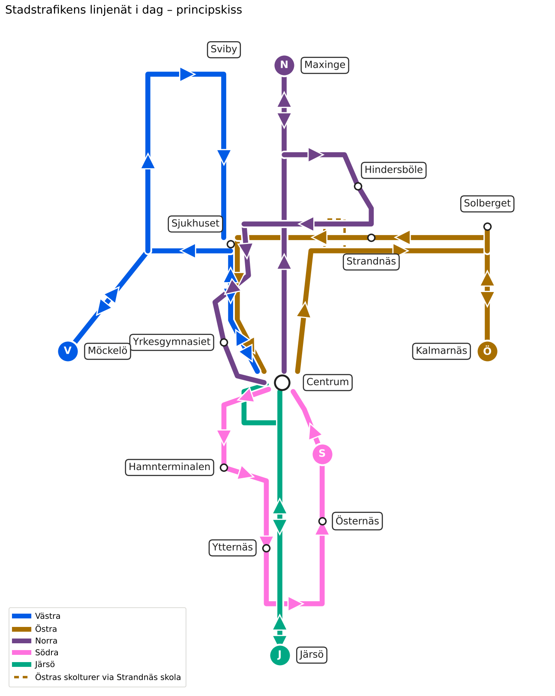

*Figur 0. Stadstrafikens linjenät i dag – principskiss med grova drag och körriktningar (ej skalenlig). Dubbelpil anger
sträckor som körs i båda riktningarna.*

Den tvättade påstigandedatan från hösten 2026 anger operatörens omlopp för varje tur. De används som dagens
omlopp för en typisk vardag, tisdag 2026-09-01 (figur 1), med beställarens rättelser 2026-11-03:
Norra 11:20, Södra 11:50, Norra 12:20 och Södra 10:50 hör till omlopp 205, och Norra 16:50, Södra 17:20 och Norra 17:50 till omlopp 204.
Kvällens Södra/Norra körs vidare av omlopp 205 och kvällens Västra/Östra av omlopp 208.

- **Trafik:** fem bussar kör 93 turer i fyra omlopp (204, 205, 208 och 209) och linje Järsö i ett eget omlopp.
  Körtiden är 42,5 timmar och omloppstiden 61,4 timmar per vardag.
- **Puls:** linjerna Norra, Södra, Västra och Östra avgår från Centrum, Nygatan i en gemensam puls med 30 minuters intervall i
  rusningstid. Linje Järsö går ungefär en gång i timmen.
- **Linjebyten:** bussarna byter Södra → Norra, Norra → Södra, Västra → Östra och Östra → Västra. Ingen buss fortsätter på samma linje, utom Järsö.
- **Bytestider i centrum:** Västra → Östra 3 minuter, Östra → Västra 7 minuter, Södra → Norra 7 minuter och Norra → Södra 4 minuter.
  Efter Östras skolturer, som tar 28–29 minuter, är bytestiden 1–2 minuter. Ett varv Västra + Östra har alltså normalt
  10 minuter i centrum, och 4–5 minuter i varven med Östras skolturer. Västra 08:20 vänder direkt till Östras extra
  skoltur 08:45, och varvet har 7 minuter.
- **Marginaler:** med krav på 2 minuters lägsta vändtid i stället för dagens 1 minut skulle det behövas en
  sjätte buss. I dag finns ett varv med mindre än 3 minuters reglering.

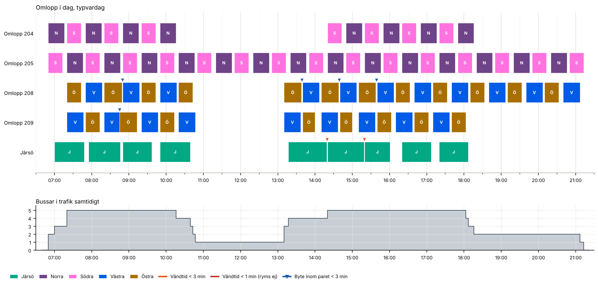

*Figur 1. Operatörens omlopp för en typisk vardag, med beställarens rättelser. Varje rad är ett omlopp och
varje stapel en tur.*

### 2.3 Data och metod i korthet

- **Täckning:** befolkningen 2024 i 1 km-rutor har fördelats på 50 m-delpunkter på land. För varje delpunkt
  har antalet avgångar per vardag inom 400 m räknats, före och efter varje UA. Så redovisas både hur många
  invånare som får fler respektive färre avgångar och hur många som byter turtäthetsklass. Kartornas
  täckningsytor är exakta 400 m-cirklar runt hållplatserna.
- **Svag tillgänglighet:** hållplats inom 400 m men färre än 30 avgångar per vardag.
- **Påstigandedata:** tvättad data för vardagar hösten 2026, linjerna Norra, Södra, Västra och Östra. Kontrollen visar att
  påstigningarna vid centrum nu registreras på rätt tur. Ingen data korrigeras. Linje Järsö finns bara i
  sommardatan och används som den är.
- **Resenärseffekter:** OD-matrisen ur höstdatan har lagts ut på ett restidsnät byggt på GTFS. Det
  tillkommande påstigandet har uppskattats med påstigande per invånare vid linjens bostadshållplatser. När Västra och Östra slås ihop kan resenärer mellan
  Västra och Östra sitta kvar; nätet räknar då med en genomgående linje utan bytesstraff.
- **Körvägar:** linjerna och utredningsalternativens nya delsträckor följer gatunätet. Varje sträcka mellan två
  hållplatser är ruttad med OSRM (OpenStreetMap), och körvägarnas längder ger fordonskilometrarna. Bara
  förlängningen av Norrgårdsvägen (UA 1b), som inte finns i dag, är ritad schematiskt.

## 3 Utredningsalternativen

*Tabell 1. Utredningsalternativen var för sig – alla driftformer, verifiering mot dagens omlopp och effekter.*

| UA | Körtid per tur | Ryms i dagens omlopp (5 bussar) | Invånare med bättre / sämre tillgänglighet | Kostnad: fordonskm per vardag och fordon |
|---|---|---|---|---|
| UA 1a – Möckelö Strand ny via dagens vägar | +4,5 min | **★ Västra och Östra sammanslagna: 16 av 20.** Dagens tidtabell: 8 av 20. Alla turer: 6 bussar (utesluten). | 178 / 0 | **★ +44 km, inga fler fordon** (dagens tidtabell +22 km; utesluten: +55 km och +1 fordon) |
| UA 1b – Möckelö Strand ny via förlängd Norrgårdsvägen | +2,5 min | **★ Västra och Östra sammanslagna: 16 av 20.** Alla 20 turer: 5 bussar men under 5 min i centrum (uppfyller inte kravet). | 178 / 0 | ★ +25 km, inga fler fordon |
| UA 2 – N2 på linje Östra | +0,5 min | ★ Alla 20 av 20 | 58 / 0 | ±0 km, inga fler fordon |
| UA 3 – Linje Norra via Bo-Bil | +0,9 min | ★ Alla 22 av 22 | 44 / 24 | +10 km, inga fler fordon |
| UA 4 – Linje Västra–Östra via flygplatsen | +5 min | **★ Västra och Östra sammanslagna: 16 av 20.** Med Solberget indragen: 16 av 20. UA 4Y: 3 av 3. Dagens tidtabell: 7 av 20. Alla turer: 6 bussar (utesluten). | 22 / 0 (Solberget indragen: 22 / 49) | **★ +27 km, inga fler fordon** (UA 4Y +5 km; extra turer för alla flyg +44 km, inga fler fordon; utesluten: +34 km och +1 fordon) |
| UA 5 – Linje Västra via Cedersvägen, linje Norra rakt på Västra utfarten | Västra +2 min, Norra −2 min | **★ Västra och Östra sammanslagna: 17 av 20 Västra-turer.** Dagens drift: 16 av 20. Bara Norra rakt på: alla Norra-turer. | 79 / 0 (bara Norra rakt på: 0 / 0) | **★ −1 km, inga fler fordon** (bara Norra rakt på −4 km) |
| UA 6 – Linje Norra i båda riktningarna (kräver extra buss) | – | Kräver ett extra fordon (22 turer moturs) | 888 inv. får minst 30 avg./vardag; restid −164 resenärsmin. per vardag | +257 km, +1 fordon |
| UA 7 – Kvällstrafik efter efterfrågan | – | ★ Ryms; omlopp 208 kör Östra/Norra moturs efter kl. 18 | Restid −16 resenärsmin. per kväll; cirka 4 Västra-resenärer per kväll får anropsstyrd resa | −3 km, inga fler fordon |

### 3.1 UA 1a och UA 1b – Möckelö Strand ny

**Introduktion.** Linje Västra slutar i dag vid hållplatsen Möckelö Strand i stadstrafikens västra del. Där vänder
bussen och kör tillbaka mot Norrgårdsvägen. Söder om vändpunkten bor cirka 240 invånare som har mer än 400 m till
närmaste hållplats. Det är det största av de områden i kapitel 3 som bara kan nås med ändrad linjesträckning.
UA 1a och 1b förlänger linje Västra till en ny hållplats, *Möckelö Strand ny*, cirka 700 m söder om dagens vändpunkt.

- **Syfte:** ge invånarna söder om Möckelö Strand en hållplats inom 400 m. Den nya hållplatsen når 178 av dem.
- **I dag:** Möckelö Strand har 20 avgångar per vardag med linje Västra och cirka 5 påstigande per vardag (höst 2026).
- **Två vägval:**
  - UA 1a använder dagens vägar, och bussen kör samma väg fram och tillbaka till den nya hållplatsen.
  - UA 1b förutsätter att Norrgårdsvägen förlängs till Hamnskärsvägen, så att bussen kan köra en slinga. Vägen
    finns inte i dag.
- **Det som avgör:** om den längre körtiden på linje Västra ryms i dagens omlopp utan fler bussar, och om
  förlängningen av Norrgårdsvägen är värd att bygga.

**Utformning.** Linje Västra vänder i dag vid hållplatsen Möckelö Strand: bussen kör Norrgårdsvägen → Möckelö
Strand → Norrgårdsvägen. Den nya hållplatsen, *Möckelö Strand ny*, placeras cirka 700 m söder om dagens
vändpunkt (figur 2). Den befintliga vägen från Norrgårdsvägen till den nya hållplatsen tar 2 minuter (cirka
1,4 km längs gatunätet). Dagens 3 minuter från Möckelö Strand är alltså 1 minut tillbaka till Norrgårdsvägen, som bussen redan
kör, plus den befintliga vägen.

- **1a – dagens vägar:** bussen kör som i dag till Möckelö Strand och tillbaka till Norrgårdsvägen. Därefter kör
  den den befintliga vägen till den nya hållplatsen och samma väg tillbaka. Tillägget blir 2 + 0,5 + 2 =
  **4,5 minuter per tur** och 2,7 km. Bussen måste kunna vända vid den nya hållplatsen.
- **1b – förlängd Norrgårdsvägen:** bussen kör en slinga – Möckelö Strand → förlängningen (1 minut) → den nya
  hållplatsen (0,5 minut) → den befintliga vägen (2 minuter) → Norrgårdsvägen. Sträckan Möckelö Strand →
  Norrgårdsvägen (1 minut) körs inte längre. Tillägget blir 1 + 0,5 + 2 − 1 = **2,5 minuter per tur** och 1,5 km.
  Som känslighet har 3,5 minuter prövats, om tidtabellens minut inte kan räknas av. Bussen kör alltså rakt
  fram från Möckelö Strand på den nya vägen till den nya hållplatsen och tillbaka på befintlig väg, bl.a.
  Möckelövägen, i stället för att vända (beställarens skiss 2026-10-15).

**Omlopp.**

- **1a, dagens tidtabell:** 8 av 20 turer ryms. Alla turer kräver ett sjätte fordon (figur 3).
- **1a med Västra och Östra sammanslagna:** 16 av 20 turer ryms, se avsnitt 3.2.
- **1b med Västra och Östra sammanslagna:** 16 av 20 turer ryms med fem bussar. Västra-turen kommer tillbaka en halv minut
  före Östras avgång, så Östra kan behålla pulsen, och varven har minst 7,5 minuter i centrum. Med alla 20 turer får
  varven med Östras skolturer bara 1,5–2,5 minuter i centrum. Med 3,5 minuter i stället för 2,5 ryms också 16 av 20.
  Dras Solberget in på Östras skolturer 14:10 och 15:10 ryms 18 av 20 turer, men
  varven får då 4,8 minuter i centrum (55,2 minuter), strax under kravet.

**Effekter.** 178 invånare får en hållplats inom 400 m med 16 avgångar per vardag, och ingen får färre
avgångar. Påstigandet uppskattas till 1,5–6,5 per vardag (höst 2026). Restiden för befintliga resenärer ökar
netto med cirka 12 (1b) respektive 25 (1a) resenärsminuter per vardag, efter vinsten för resor mellan Västra och Östra som slipper bytet.

**Kostnad.** Huvudalternativen ryms med dagens fem fordon. Fordonskilometrarna ökar med 44 per vardag i 1a
(omvägen 2,7 km per tur) och med 25 per vardag i 1b (1,6 km per tur).

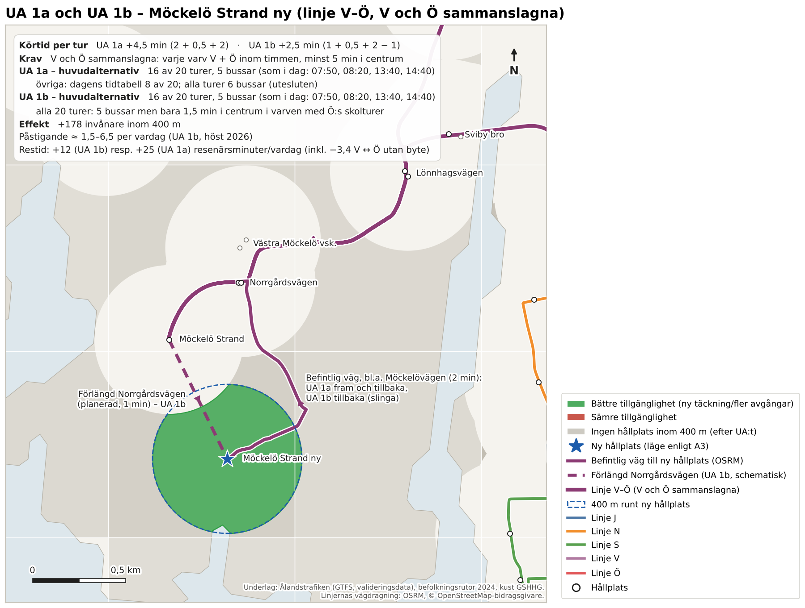

*Figur 2. UA 1a och UA 1b – huvudalternativen; linje Västra visas som del av linje Västra–Östra. Grönt anger invånare som får hållplats inom 400 m. Linjerna och den befintliga vägen följer
gatunätet (OSRM); förlängningen (streckad) är schematisk eftersom vägen inte finns i dag.*

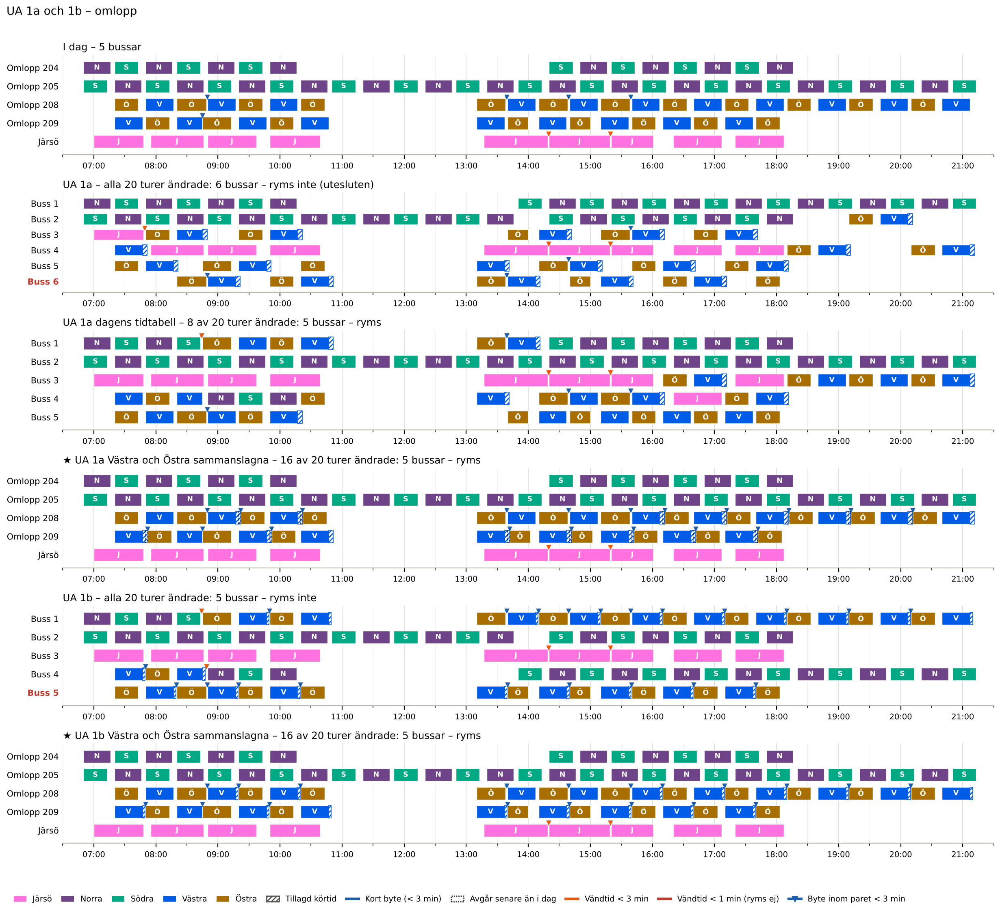

*Figur 3. Omlopp före och efter för UA 1a och UA 1b, alla driftformer (★ = huvudalternativ). Skrafferad del av en tur är tillagd körtid, och prickad ram
anger att turen avgår senare än i dag. Röd rubrik anger att lösningen kräver fler bussar eller inte uppfyller
kravet på 5 minuter i centrum per varv.*

### 3.2 Sammanslagning av Västra och Östra – Möckelö Strand ny redan med dagens vägar?

Ett varv Västra → Östra → Västra tar 60 minuter, och två bussar kör varvet med 30 minuters förskjutning (figur 4). Kravet är
minst 5 minuter i centrum per varv:

- **I dag:** varvet består av Västra (27 minuter), byte (3 minuter), Östra (23 minuter) och byte (7 minuter), dvs.
  10 minuter i centrum. I varven med Östras skolturer blir det 4–5 minuter.
- **1a med dagens tidtabell:** Västra tar 31,5 minuter och kommer tillbaka 1,5 minut efter att Östra ska avgå.
- **1a med Västra och Östra sammanslagna:** bussen fortsätter som linje Östra efter en halv minut, och Östra avgår då
  2 minuter efter pulsen (:22/:52 i stället för :20/:50). Varvet får 5,5 minuter i centrum och ryms.
- **1b med Västra och Östra sammanslagna:** Västra tar 29,5 minuter och hinner till Östra i pulsen. Varvet får 7,5 minuter.
- **Varv med Östras skolturer** (28–29 minuter): 1a ger 0,5 och 1b 2,5 minuter i centrum. Där kör Västra-turen som i dag.

Varje Västra-tur har prövats för sig med operatörens omlopp. Resultatet:

- **Turer:** 16 av 20 Västra-turer kan trafikera Möckelö Strand ny med fem bussar, i både 1a och 1b. 07:50, 08:20,
  13:40 och 14:40 kör som i dag.
- **Östras avgångar (1a):** 14 av Östras 20 turer avgår 2 minuter senare än i dag. I 1b avgår Östra som i dag.
- **Kostnad:** +44 fordonskm per vardag i 1a och +25 i 1b; inga fler fordon.

**Konsekvenser för resenärerna.** Den som byter till linje Östra i pulsen får i 1a 2 minuter längre väntan, och Östra
kommer tillbaka till centrum 2 minuter senare, men före nästa pulsavgång. Den som åker vidare från Västra till Östra kan
sitta kvar på bussen. Med höstens resande gäller det cirka 1,5 resor per vardag.

**Bedömning.** Ja – med Västra och Östra sammanslagna kan Möckelö Strand ny trafikeras redan med dagens vägar, på 16 av
20 turer och med dagens fem bussar. Förlängningen av Norrgårdsvägen (1b) ger inte fler turer, men den ger tre
fördelar:

- en kortare omväg, 2,5 i stället för 4,5 minuter per tur;
- större marginal i centrum, minst 7,5 i stället för 5,5 minuter per varv;
- Östra kan behålla sina avgångar i pulsen.

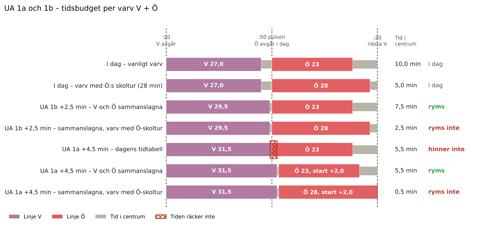

*Figur 4. Sammanslagning av linje Västra och Östra: tidsbudget per varv med tiden i centrum mot kravet 5 minuter.*

### 3.3 UA 2 – N2 på linje Östra

**Introduktion.** Linje Östra kör från Österkullagatan ut till Kalmarnäs vändplan i sydöstra Mariehamn och tillbaka
samma väg. Sträckan är cirka 1,8 km lång och saknar hållplats. Invånarna längs mitten av sträckan har därför mer
än 400 m till närmaste hållplats, trots att bussen passerar dem. UA 2 lägger hållplatsen N2 från kapitel 3 där
bussen redan kör.

- **Syfte:** 58 invånare får en hållplats inom 400 m utan att körvägen ändras.
- **I dag:** Kalmarnäs vändplan har 21 avgångar per vardag (linje Östra och landsbygdslinje 5) och cirka 10
  påstigande per vardag. Österkullagatan har cirka 2.
- **Prövas:** ett uppehåll vid N2 på alla 20 Östra-turer, i genomsnitt 0,5 minut per tur.
- **Det som avgör:** att den extra halva minuten ryms i varven Västra + Östra, särskilt i varven med Östras skolturer.

**Utformning.** Hållplatsen N2 placeras på sträckan Österkullagatan – Kalmarnäs vändplan, som bussen kör i
båda riktningarna. Ett uppehåll per tur i genomsnitt (0,5 minut) har antagits.

**Omlopp.** Alla 20 turer ryms, och alternativet är lika robust som i dag (figur 6). Varven Västra + Östra med Östras
skolturer får 3,5–4,5 minuter i centrum, mot 4–5 minuter i dag.

**Effekter.**

- **Täckning:** 58 invånare får en hållplats inom 400 m med 20 avgångar per vardag. Ingen får färre avgångar.
- **Påstigande:** uppskattas till 2,2–11,8 per vardag (höst 2026).
- **Ombordvarande:** cirka 15 resor per vardag får en halv minut längre restid, sammanlagt cirka 8
  resenärsminuter per vardag.
- **Kostnad:** ±0 fordonskm (hållplatsen ligger på linjens väg); inga fler fordon.

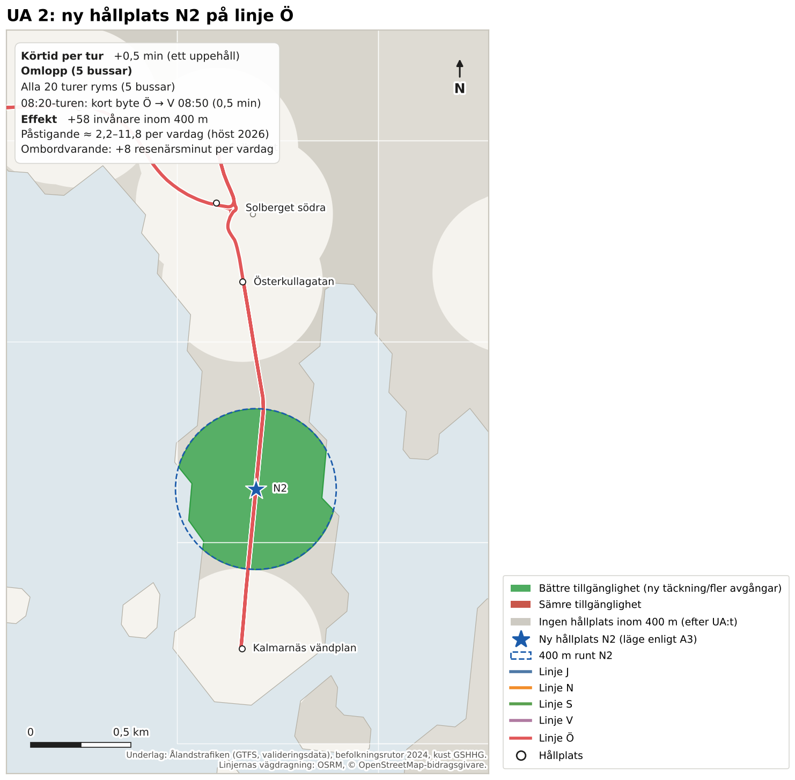

*Figur 5. UA 2, ny hållplats N2 på linje Östra.*

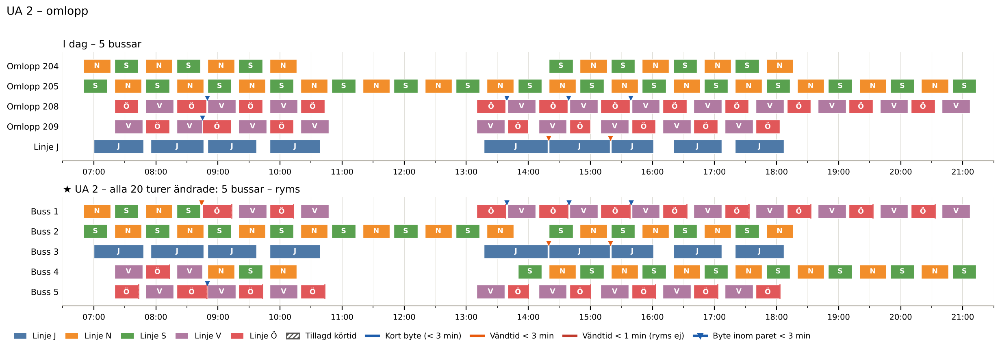

*Figur 6. Omlopp före och efter för UA 2.*

### 3.4 UA 3 – Linje Norra via Bo-Bil

**Introduktion.** Linje Norra är en enkelriktad slinga. Från centrum kör den norrut till Maxinge och därefter via
Vikingagränd österut mot Bolstavägen. Maxinge har bara en hållplats, på västra sidan av Nya Godbyvägen, så
bussen kan bara stanna där när den kör söderut. UA 3 låter linje Norra stanna vid Bo-Bil på Godbyvägen, där
landsbygdslinjerna redan stannar, i stället för vid Vikingagränd.

- **Syfte:** linje Norras avgångar vid Bo-Bil, och om möjligt en jämnare körtid.
- **I dag:**
  - Vikingagränd har 22 avgångar per vardag med linje Norra men bara cirka 0,06 påstigande per vardag.
  - Bo-Bil trafikeras av landsbygdslinjerna 1–4, med 14–15 avgångar per vardag och riktning.
- **Prövas:** den nya körvägen på alla 22 turer.
- **Det som avgör:** om omvägen ryms i omloppen, och om förlusten för de närmast boende vid Vikingagränd vägs
  upp av vinsten vid Bo-Bil.

**Utformning.** Bussen kör söderut vid Maxinge, och Bo-Bil ligger öster därom. Efter Maxinge vänder bussen därför i
rondellen söder om hållplatsen, kör norrut till rondellen norr om Maxinge, Michaelsvägen österut och Godbyvägen
söderut till Bo-Bil och vidare till Bolstavägen (figur 7). Att köra direkt till Bo-Bil utan att stanna vid Maxinge
ger samma väglängd som i dag, men då förlorar linje Norra Maxinge, en av de största målpunkterna.

**Körtid.** Delsträckan Maxinge – Bolstavägen blir cirka 450 m längre (1,92 i stället för 1,47 km). Med
dagens tidtabellshastighet och uppehållet vid Bo-Bil (+0,5 minut) ökar körtiden med cirka 0,9 minut per tur; med
25 km/h genom rondellerna med cirka 1,6 minuter. Väntan vid Nya Godbyvägen minskar inte, eftersom bussen
fortfarande kör förbi Maxinge.

**Omlopp.** Alternativet ryms med alla 22 turer och fem fordon. Linje Norras vändtid i centrum blir cirka 3 minuter
i stället för 4.

**Kostnad.** +10 fordonskm per vardag (450 m per tur); inga fler fordon.

**Effekter.**

- **Bo-Bil:** hållplatsen får linje Norras 22 avgångar utöver landsbygdslinjernas, och 44 invånare får minst 30
  avgångar per vardag.
- **Vikingagränd:** 24 invånare får 22 avgångar färre per vardag, och 23 av dem förlorar hållplatsen inom 400 m.
- **Restid:** cirka 27 resor per vardag får längre restid, sammanlagt cirka 30 resenärsminuter per vardag.

**Vända linje Norra?** Kör hela Norra åt andra hållet når bussen Maxinge från Bo-Bil och Michaelsvägen utan att
vända, och delsträckan Bolstavägen – Maxinge – Hjortronstigen blir 64 m kortare än i dag. Men Norras största
flöden går medurs: Centrum – Maxinge på förmiddagen skulle ta 14 i stället för 8 minuter. Totalt får resenärerna
cirka 105 resenärsminuter längre restid per vardag (mot 30 i UA 3), så att vända linjen rekommenderas inte.

**Bedömning.** Alternativet ryms, men omvägen tar det mesta av linje Norras marginal i centrum, och nyttan är liten
i förhållande till omvägen. Den verkliga körtiden genom rondellerna bör mätas innan alternativet går vidare.

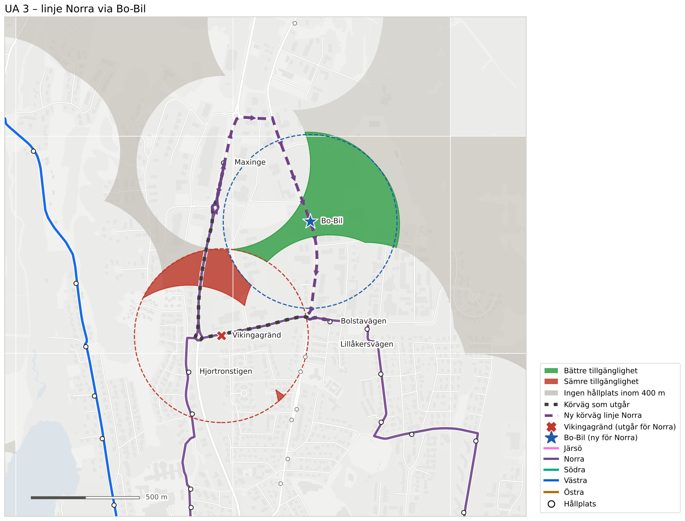

*Figur 7. UA 3. Grönt anger bättre och rött sämre tillgänglighet. Pilarna visar körriktningen.*

### 3.5 UA 4 – Linje Västra–Östra via flygplatsen

**Introduktion.** Mariehamns flygplats har vardagar sex flyg till och från Stockholm-Arlanda och Åbo, men ingen
busslinje når terminalen i dag. Närmaste hållplats är Posten på Flygfältsvägen, cirka 800 m längs vägen från
terminalen. Där stannar linje Västra och landsbygdslinjerna 1 och 4. UA 4 leder linje Västra upp till terminalen.

- **Syfte:** kollektivtrafik till och från flyget. Resenären ska kunna vara på flygplatsen 2–1,5 timmar före
  avgång och åka därifrån cirka 30 minuter efter landning (beställaren).
- **I dag:** Posten har 24 avgångar per vardag och cirka 2 påstigande per vardag på linje Västra.
- **Prövas:**
  - alla Västra-turer via terminalen, med dagens tidtabell och med Västra och Östra sammanslagna;
  - med hållplatsen Solberget indragen;
  - bara de turer som når ett flyg (UA 4Y);
  - extra turer för de flyg som tidtabellen inte når.
- **Det som avgör:** omvägens körtid, cirka 5 minuter per tur, och vilka flyg som ska nås.

**Utformning.** Linje Västra passerar i dag Posten på Flygfältsvägen. I alternativet kör bussen från Posten upp till
flygterminalen, runt terminalen och tillbaka till Norra Svibyvägen, och därefter vidare mot Källarvägen som i
dag (figur 8 och 8b).

- **Körväg:** följer gatunätet (OSRM) och stämmer i huvudsak med beställarens skiss.
- **Omväg:** cirka 1,7 km per tur längs vägarna. Med 25 km/h och 0,5 minuts uppehåll blir tillägget cirka
  **5 minuter per tur** (känslighet 4–6 minuter). Med skissens längd var tillägget 4 minuter.
- **Vid flygplatsen:** bussen är där cirka 17 minuter efter avgången från centrum.

**Flygen och UA 4Y.** Flygtiderna gäller vardagar i november 2026 (beställaren 2026-11-15). Bussen ska vara
vid flygplatsen 2–1,5 timmar före avgång och lämna flygplatsen cirka 30 minuter efter landning (25–45 minuter
godtas, så att resenärerna hinner hämta bagaget).

*Tabell 2a. Flygen och bussen (figur 10b).*

| Flyg | Bussen ska vara vid flygplatsen | Västra-tur i dag | Extra tur (om ingen Västra-tur når flyget) | Fordonskm per vardag |
|---|---|---|---|---|
| Avgång 07:15 till Stockholm-Arlanda | 05:15–05:45 | – (första Västra-turen 07:20) | 05:15, vid flygplatsen 05:32 (omlopp 204) | +14,5 |
| Avgång 11:00 till Åbo | 09:00–09:30 | **Västra 08:50**, vid flygplatsen 09:07 | – | – |
| Ankomst 10:35 från Stockholm-Arlanda | 11:00–11:20 | – (Västra 10:20 är där 10:36) | 10:50, vid flygplatsen 11:07 (omlopp 204, i uppehåll) | +14,5 |
| Avgång 17:10 till Stockholm-Arlanda | 15:10–15:40 | **Västra 15:10**, vid flygplatsen 15:27 | – | – |
| Ankomst 16:45 från Åbo | 17:10–17:30 | **Västra 17:10**, vid flygplatsen 17:27 | – | – |
| Ankomst 21:35 från Stockholm-Arlanda | 22:00–22:20 | – (sista Västra-turen 20:40) | 21:50, vid flygplatsen 22:07 (omlopp 205) | +14,5 |

Dagens Västra-turer når alltså tre av sex flyg. UA 4Y kör till flygplatsen bara på dessa tre turer. De tre extra
turerna körs av omlopp som står stilla, så inga fler fordon behövs; de ger sammanlagt +44 fordonskm per vardag.
Morgon- och kvällsturen ligger utanför dagens trafikdygn och förlänger trafikdygnet för omlopp 204 och 205. Där
bör anropsstyrd trafik eller taxi jämföras. Flygtiderna antas vara desamma alla vardagar.

**Solberget.** Hållplatsen Solberget på linje Östra ligger på en omväg. Dras den in sparas 1,6–2,5 minuter per
Östra-tur. Det har prövats som ett sätt att få mer tid i varvet Västra + Östra.

*Tabell 2. UA 4 – alla driftformer (fem bussar om inget annat anges; ★ = huvudalternativ).*

| Variant | Turer via flygplatsen | Minsta tid i centrum i de ändrade varven (krav 5 min) | Fordonskm per vardag | Fler fordon? |
|---|---|---|---|---|
| Alla turer, dagens tidtabell | 20 av 20 | – | +34 | **Ja, +1 (6 fordon)** |
| Dagens tidtabell utan extra fordon | 7 av 20 | 8 min | +12 | Nej |
| **★ Västra och Östra sammanslagna** | **16 av 20** | **5 min** | **+27** | **Nej** |
| Västra och Östra sammanslagna + Solberget indragen | 16 av 20 | 7,1 min | +27 | Nej |
| **Y: de 3 flygturerna, Västra och Östra sammanslagna** | **3 av 3** | **5 min** | **+5** | **Nej** |
| Y: de 3 flygturerna, dito + Solberget indragen | 3 av 3 | 7,1 min | +5 | Nej |
| Extra turer för flygen 07:15, 10:35 och 21:35 | 3 extra turer | – | +44 | Nej |
| Känslighet: omvägen 4 min, sammanslagna | 16 av 20 | 6 min | +27 | Nej |
| Känslighet: omvägen 6 min, sammanslagna | 6 av 20 | 7 min | +10 | Nej |

**Resultat.**

- **Västra och Östra sammanslagna:** Östra avgår 2,5 minuter efter pulsen, och 16 av 20 turer ryms med minst 5 minuter i
  centrum, alltså precis kravet. Västra 07:50, 13:40 och 14:40 följs av Östras skolturer, där 32 + 28 minuter inte
  lämnar någon tid i centrum. Västra 08:20 vänder direkt till Östras skoltur 08:45.
- **Solberget indragen:** ger inga fler turer (16 av 20), bara mer tid i centrum. Solberget har cirka 16
  påstigande per vardag, och 49 invånare skulle få 20 avgångar färre per vardag.
- **UA 4Y:** de tre flygturerna ryms med Västra och Östra sammanslagna, utan att Solberget dras in. Varven har minst 5
  minuter i centrum. Huvudalternativet innehåller samma tre turer, så både UA 4 ★ och UA 4Y når tre av sex flyg.

**Effekter.**

- **Täckning:** 21 invånare nära terminalen får en hållplats inom 400 m.
- **Flygresenärerna:** nyttan för dem ingår inte i beräkningen, eftersom OD-matrisen saknar flygplatsen som
  målpunkt.
- **Solberget (bara i varianten med indragning på alla turer):** 49 invånare skulle få 20 avgångar färre per
  vardag, och 42 av dem förlorar hållplatsen inom 400 m. Hållplatsen har cirka 16 påstigande per vardag (höst 2026).

**Bedömning.**

- **Utesluten:** att bara förlänga linje Västra till flygplatsen. Omloppen spricker, och ett sjätte fordon krävs.
- **Det enda rimliga är en genomgående linje Västra–Östra.**
- **Huvudalternativ ★:** linje Västra–Östra via flygplatsen. 16 av 20 turer ryms med fem bussar, och Solberget behålls;
  se figur 8, som bara visar huvudalternativet. Kostnaden är +27 fordonskm per vardag och inga fler fordon.
- **UA 4Y:** samma linje men bara de tre flygturerna. Alla tre ryms, och Solberget behålls (+5 fordonskm per
  vardag, inga fler fordon).
- **Alla sex flyg** kräver tre extra turer, +44 fordonskm per vardag, som körs av befintliga fordon. Turen
  10:50 för ankomsten 10:35 ryms i ett omlopp som står stilla mitt på dagen.

**Känslighet – omvägens körtid och Solberget på utvalda turer (tabell 2c).** Östra startar när Västra har kommit tillbaka.
Upp till 5 minuters omväg ryms 16 av 20 turer (UA 4Y 3 av 3) utan att Solberget dras in. Den beräknade omvägen,
5 minuter, ligger precis på gränsen med exakt 5 minuter i centrum. Med 5,5–7 minuters omväg ryms varvet bara om Solberget dras in på de Östra-turer som följer
en Västra-tur via flygplatsen. Då ryms fortfarande 16 av 20 turer (UA 4Y 3 av 3). Det gäller 10 Östra-turer (UA 4Y: Östra
09:20 och 15:40), som blir 1,6–2,5 minuter kortare. Solberget behåller 10 respektive 18 av 20 avgångar, och ingen
förlorar hållplatsen. Med alla turer får 49 invånare lägre turtäthet och cirka 8 av Solbergets 16 påstigande per
vardag berörs; med UA 4Y byter ingen klass. Över 7 minuter ryms bara 6 turer, och flygen 11:00 och 17:10 nås inte.

Nivån 50 minuter per varv nås inte med omvägen, eftersom dagens vanliga varv redan ligger på exakt 50 minuter.

Körtiden till terminalen bör därför mätas: blir den högst 5 minuter behövs ingen indragning, och blir den
5,5–7 minuter är det rimligt att dra in Solberget bara på de Östra-turer som följer flygturerna.

*Tabell 2c. UA 4 – känslighet: turer via flygplatsen per omväg och driftform, alla 20 Västra-turer / UA 4Y:s 3
flygturer, fem bussar. "Östra startar efter pulsen" gäller driftform A och B.*

| Omväg per tur | Östra startar efter pulsen (högst) | A – varvet ≤ 55 min (krav), Solberget kvar | B – varvet ≤ 55 min, Solberget indraget där det behövs | C – varvet ≤ 50 min (helst), Solberget kvar | D – varvet ≤ 50 min, Solberget indraget där det behövs |
|---|---|---|---|---|---|
| 3 min | 0,5 min | 16 / 3 | 17 / 3 – Solberget indraget på Östra 08:45 | 6 / 1 | 6 / 1 |
| 4 min | 1,5 min | 16 / 3 | 17 / 3 – Solberget indraget på Östra 08:45 | 4 / 1 | 6 / 1 – Solberget indraget på 2 Östra-turer |
| **5 min (beräknad)** | **2,5 min** | **16 / 3** | 16 / 3 | 4 / 1 | 4 / 1 |
| 5,5 min | 3 min | 6 / 1 | 16 / 3 – Solberget indraget på 10 / 2 Östra-turer | 4 / 1 | 4 / 1 |
| 6 min | 3,5 min | 6 / 1 | 16 / 3 – Solberget indraget på 10 / 2 Östra-turer | 4 / 1 | 4 / 1 |
| 6,5 min | 4 min | 6 / 1 | 16 / 3 – Solberget indraget på 10 / 2 Östra-turer | 4 / 1 | 4 / 1 |
| 7 min | 4,5 min | 6 / 1 | 16 / 3 – Solberget indraget på 10 / 2 Östra-turer | 4 / 1 | 4 / 1 |
| 7,5 min | 5 min | 6 / 1 | 6 / 1 | 4 / 1 | 4 / 1 |
| 8 min | 5,5 min | 6 / 1 | 6 / 1 | 4 / 1 | 4 / 1 |

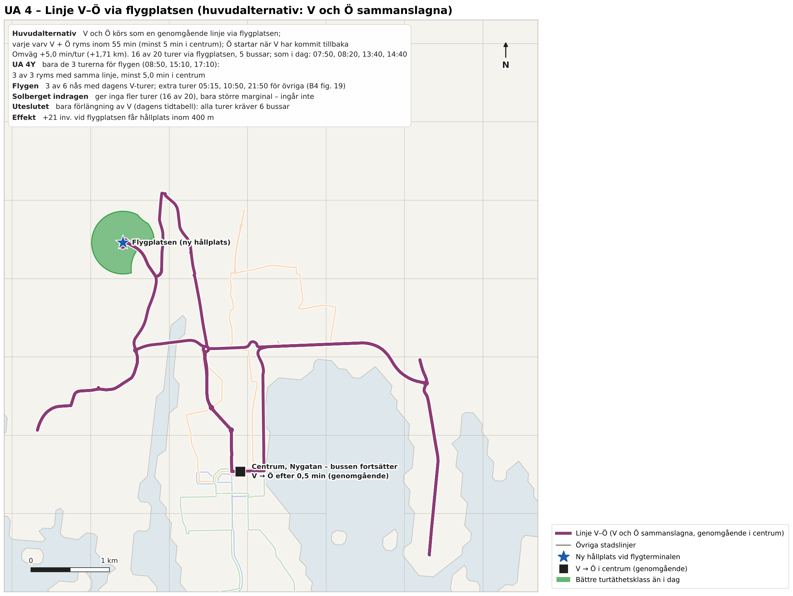

*Figur 8. UA 4 – huvudalternativet: linje Västra–Östra (Västra och Östra sammanslagna) via flygplatsen.*

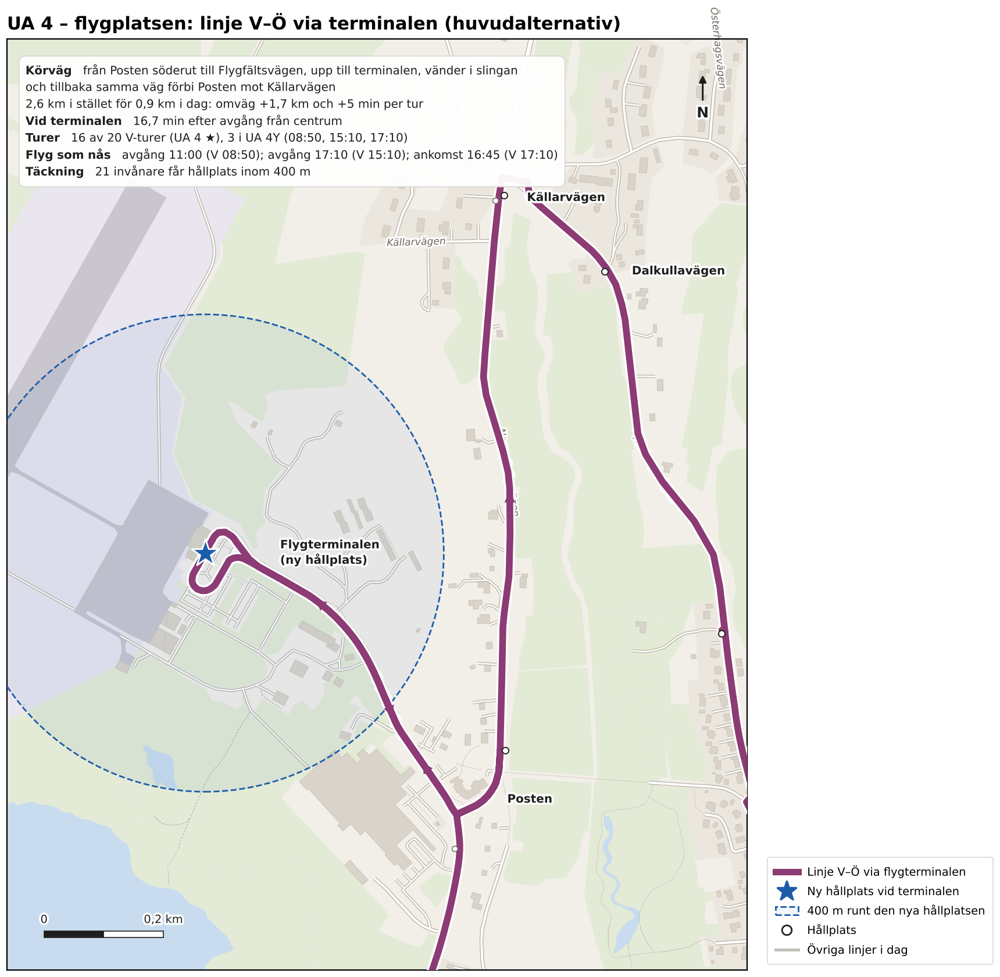

*Figur 8b. Flygplatsen inzoomad: linje Västra–Östra kör från Posten söderut till Flygfältsvägen, upp till terminalen,
vänder i slingan framför terminalbyggnaden och kör samma väg tillbaka förbi Posten mot Källarvägen.*

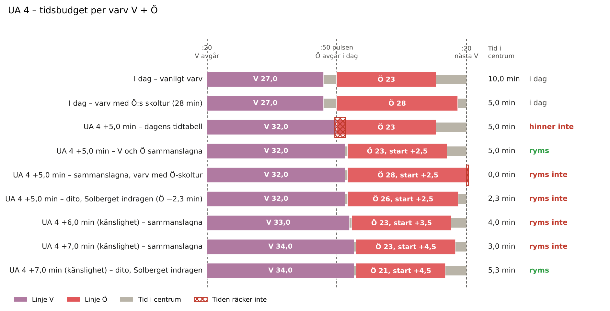

*Figur 9. UA 4: tidsbudget per varv Västra + Östra med tiden i centrum mot kravet 5 minuter.*

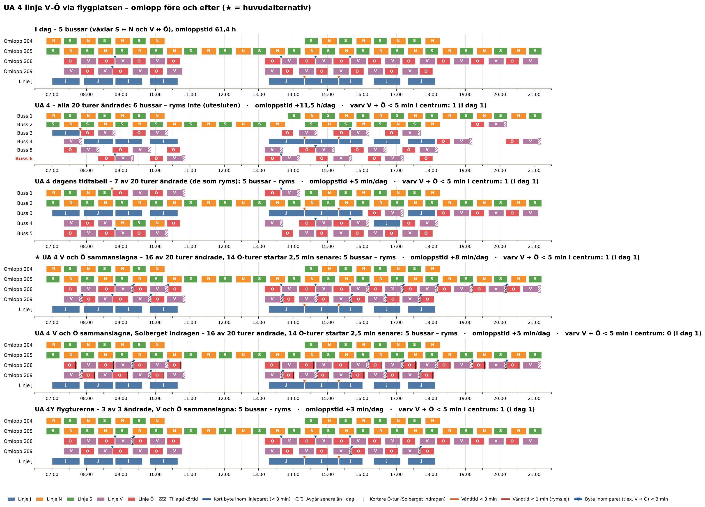

*Figur 10. Omlopp före och efter för UA 4, alla driftformer (★ = huvudalternativ).*

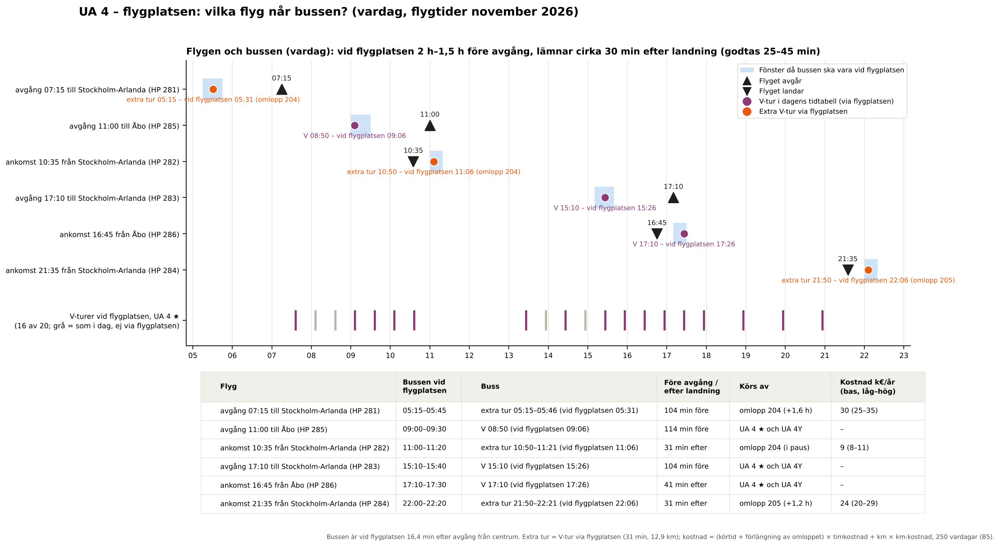

*Figur 10b. UA 4 – flygen och bussen en vardag: fönstret då bussen ska vara vid flygplatsen, Västra-turerna som når
flygen och de extra turer som behövs för övriga flyg.*

### 3.6 UA 5 – Linje Västra via Cedersvägen, linje Norra rakt på Västra utfarten

**Introduktion.** Linje Norra kör på väg mot centrum en sväng öster om Västra utfarten, via Stenhuggarvägen,
Cedersvägen och Klintvägen. Operatören har via beställaren (2026-11-15) föreslagit att linje Västra tar över svängen
och att linje Norra kör rakt på Västra utfarten. Enligt operatören sparar det linje Norra ett par minuter, vilket kan göra
stor skillnad. För de flesta är det inte långt att gå till hållplatserna på Västra utfarten, t.ex. för den som ska
till Maxinge.

- **Syfte:** mer marginal för linje Norra, som i dag har 4 minuter i centrum före bytet till linje Södra.
- **I dag:** svängens tre hållplatser har 22 avgångar per vardag med linje Norra, men tillsammans bara cirka 1
  påstigande per vardag.
- **Prövas:**
  - linje Norra rakt på Västra utfarten på alla 22 turer;
  - linje Västra via svängen, med dagens drift och med Västra och Östra sammanslagna;
  - en variant utan buss i svängen.
- **Det som avgör:** om linje Västras längre körtid ryms, och om gångavståndet till Västra utfarten är acceptabelt.

**Utformning (figur 10c).** Båda linjerna kör svängen mot centrum.

- **Linje Norra:** kör i dag Sjukhuset → Stenhuggarvägen → Cedersvägen → Klintvägen → Elverksgatan. I UA 5 kör Norra
  Sjukhuset → Västra macken → Elverksgatan, och stannar vid Västra macken i stället för Stenhuggarvägen 50 m
  bort.
- **Linje Västra:** svänger av vid Stenhuggarvägen, norr om hållplatsen Västra macken, och kör Stenhuggarvägen →
  Cedersvägen → Klintvägen tillbaka till Västra utfarten vid Tekniska verken. Västra stannar alltså vid
  Stenhuggarvägen i stället för vid Västra macken.
- **Körtid:** enligt operatören tar svängen ett par minuter. Huvudberäkningen använder 2 minuter: Norra blir 2
  minuter kortare på alla 22 turer och Västra 2 minuter längre. Tidtabellen ger bara cirka 0,7 minuter, och 1 minut
  redovisas som känslighet. Längs gatunätet blir Norras väg cirka 185 m kortare per tur och Västras lika mycket längre.

*Tabell 2b. UA 5 – driftformer (fem bussar; ★ = huvudalternativ).*

| Driftform | Västra-turer via svängen | Linje Norra i centrum | Fordonskm per vardag | Fler fordon? |
|---|---|---|---|---|
| Alla Västra-turer, dagens drift | 20 av 20 – ryms inte (2 min i centrum) | – | −1 | Nej |
| Dagens drift, de turer som ryms | 16 av 20 | 4 → 6 min | −1 | Nej |
| **★ Västra och Östra sammanslagna** | **17 av 20** | **4 → 6 min** | **−1** | **Nej** |
| Variant: bara linje Norra rakt på (svängen utan buss) | 0 | 4 → 6 min | −4 | Nej |

**Resultat.**

- **Linje Norra** får 6 minuter i centrum i stället för 4 vid alla 20 byten Norra → Södra (0,7 timmar mer reglering per
  vardag). En försening på Norra sprids då inte lika lätt vidare till Södra. Det är den stora vinsten.
- **Linje Västra:** med Västra och Östra sammanslagna ryms 17 av 20 Västra-turer via svängen. Västra 07:50, 13:40 och 14:40 kör rakt som i
  dag. Med dagens drift ryms 16 av 20, alltså utan att Västra och Östra slås ihop. Med 1 minuts körtid ryms samma turer.
- **Påstigande i svängen:** cirka 1 per vardag (Stenhuggarvägen 0,42, Cedersvägen 0,10 och Klintvägen 0,43).
- **Täckning:** ingen förlorar hållplatsen inom 400 m. 125 invånare får fler avgångar (upp till 22 fler per
  vardag), och 62 lyfts till minst 30 avgångar per vardag. 11 invånare väster om Västra macken får 17 färre,
  eftersom linje Västra inte längre stannar där.
- **Restid:** cirka 4 resenärer per vardag åker genom svängen på Norra och sparar 2 minuter. Netto blir det cirka
  9–10 resenärsminuter kortare restid per vardag.
- **Kostnad:** −1 fordonskm per vardag, eftersom linje Norras väg rakt på är kortare än svängen; inga fler fordon.
- **Gångavstånd:** 50–300 m från svängens hållplatser till Västra macken eller Tekniska verken. Till Maxinge åker
  man redan i dag via centrum, eller med landsbygdslinjerna 2–4 från Västra macken (7 avgångar per vardag).

**Bedömning.**

- **Huvudalternativ ★:** linje Västra via Cedersvägen med Västra och Östra sammanslagna, 17 av 20 Västra-turer.
- **UA 5 kräver inte sammanslagning:** med dagens drift ryms 16 av 20 Västra-turer.
- **Variant med bara linje Norra rakt på:** svängen trafikeras inte, men ingen förlorar hållplatsen inom 400 m och
  ingen får färre avgångar, linje Norra får samma vinst och linje Västra påverkas inte. Resenärerna vinner cirka 21 minuter per vardag. Varianten
  bör övervägas om gångvägen till Västra utfarten bedöms acceptabel.
- **Kombinationer:** UA 5 lägger 2 minuter på linje Västra och konkurrerar därför med UA 1a, 1b och 4. Varianten med
  bara linje Norra rakt på gör det inte.

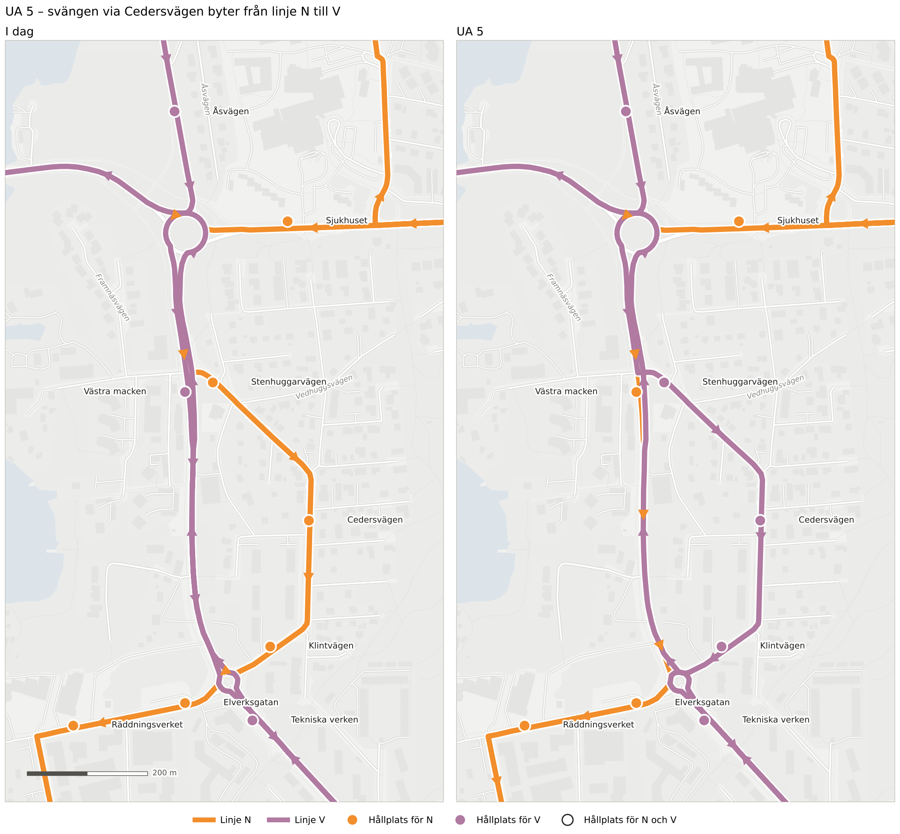

*Figur 10c. UA 5 – linje Norra och Västra i dag (vänster) och med UA 5 (höger). Pilarna visar körriktningen, och
hållplatserna är färgade efter den linje som stannar där.*

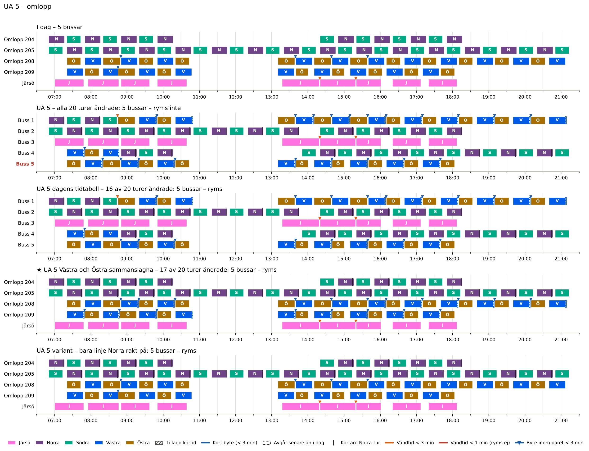

*Figur 10d. Omlopp före och efter för UA 5, alla driftformer (★ = huvudalternativ).*

### 3.7 UA 6 – Linje Norra i båda riktningarna

**Introduktion.** UA 6 är ett friare förslag än UA 1–5 och prövas utanför ramen om inga fler fordon. Linje Norra
är i dag en enkelriktad slinga: Centrum – Doktorsvägen – Maxinge – Hindersbölevägen – Nabben – Sjukhuset –
Norragatan – Centrum, med 22 turer per vardag. Den som åker ut från centrum på morgonen åker oftast direkt, men
hemresan går hela varvet runt. Maxinge, den tredje största målpunkten, ligger tidigt i slingan, så
den som åker hem från Maxinge till centrum på eftermiddagen får åka via Hindersböle, Nabben och Sjukhuset.

- **Syfte:** kortare restid åt båda hållen och dubbel turtäthet längs Norra.
- **Prövas:** linje Norra kör även moturs, med samma 22 turer per vardag som i dag (var 30:e minut).
- **Det som avgör:** hur mycket restiden kortas för dagens resenärer, och vad det extra fordonet ger i turtäthet.

Andra idéer har också prövats i nätmodellen, bland annat en tvärlinje Kalmarnäs – Solberget – Kalmsta –
Hindersböle – Bo-Bil – Maxinge och en tvärlinje via Strandnäs skola och Godbyvägen. De ger högst en
åttondel av restidsvinsten i UA 6 med dagens resmönster (cirka 4–19 resenärsminuter per vardag) och har därför
inte gått vidare.

**Utformning.** Moturs kör bussen samma gator och stannar vid samma hållplatser som i dag, i omvänd ordning
(figur 4.21). Vid Maxinge finns bara hållplats för södergående buss. Moturs kommer bussen från Vikingagränd, kör
norrut till rondellen norr om Maxinge och stannar vid Maxinge på väg söderut, spegelvänt mot i dag. Busslänken
mellan Doktorsvägen och Uppgårdsvägen behöver kunna köras i båda riktningarna.

**Resultat.**

- **Restid:** −164 resenärsminuter per vardag för dagens resenärer, och cirka 36 resor per vardag blir kortare.
  Den största vinsten är hemresan Maxinge – Centrum på eftermiddagen, som går från cirka 17 till 8 minuter.
  Resor från Hindersbölevägen, Uppgårdsvägen och Doktorsvägen till centrum blir 3–8 minuter kortare.
  Nätmodellen räknar inte väntetid, så vinsten av den dubblade turtätheten kommer därutöver.
- **Turtäthet:** Norras hållplatser får 44 avgångar per vardag i stället för 22. 888 invånare får minst 30
  avgångar per vardag, och 1 459 får minst 60. Andelen av Mariehamns invånare med minst 30 avgångar inom 400 m
  ökar från 55,6 till 61,6 %.
- **Omlopp:** förarna växlar i dag mellan Södra och Norra vid varje vändning, och linjerna har lika många turer
  (22 var). Med Norra åt båda hållen blir det 44 Norra-turer men fortfarande 22 Södra-turer, så det går inte att
  växla Norra – Södra – Norra som i dag. I stället körs Norra/Södra-gruppen av tre bussar i en fast rotation:
  Norra medurs → Södra → Norra moturs → Norra medurs … (figur 10f). Vid varje puls avgår en buss på varje
  linje och riktning. Föraren byter linje eller riktning vid varje vändning och kör Södra var tredje tur. Norra
  har 4 minuters reglering i centrum (26 minuters varv) och Södra 7 minuter. Västra/Östra och Järsö körs som i
  dag. Totalt behövs 6 fordon i stället för 5, och omloppstiden ökar från 61,4 till 75,4 timmar per vardag.
- **Utan extra fordon (variant B):** med dagens fem fordon kan varannan Norra-tur köras moturs, och omloppen
  ändras inte. Då går varje riktning bara en gång i timmen. Med väntetiden räknad som halva turintervallet blir
  restiden för dagens resenärer cirka 385 resenärsminuter per vardag längre än i dag, så variant B är sämre än att
  låta Norra vara som i dag. Med ett extra fordon (variant A) blir restiden cirka 154 resenärsminuter kortare,
  även med väntetiden medräknad.
- **Kostnad:** +256 fordonskm per vardag (11,7 km per varv × 22 turer) och ett extra fordon.

**Bedömning.** UA 6 ger den största restidsvinsten av alla alternativ, cirka 15 gånger mer än UA 5, och dubbel
turtäthet för cirka 6 000 invånare längs Norra. Det kräver ett extra fordon och ligger därför utanför uppdragets
ram. Med dagens efterfrågan, cirka 320 påstigande per vardag, är ett extra fordon svårt att motivera, och UA 6
redovisas därför som ett alternativ för ett läge med växande resande, inte som ett förslag nu. Att köra varannan
tur moturs med dagens fordon fungerar inte: turtätheten halveras i varje riktning och
restiden blir längre än i dag. UA 6 förutsätter alltså ett extra fordon, och omloppen blir effektiva med en fast
rotation Norra medurs → Södra → Norra moturs på tre bussar.

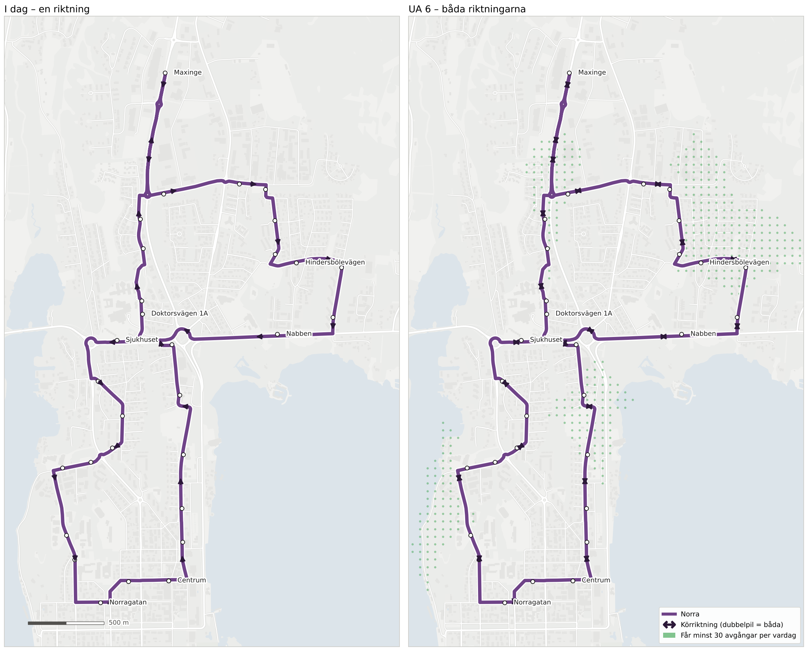

*Figur 10e. UA 6 – linje Norra i dag (en riktning) och med UA 6 (båda riktningarna). Grönt anger invånare som
får minst 30 avgångar per vardag inom 400 m.*

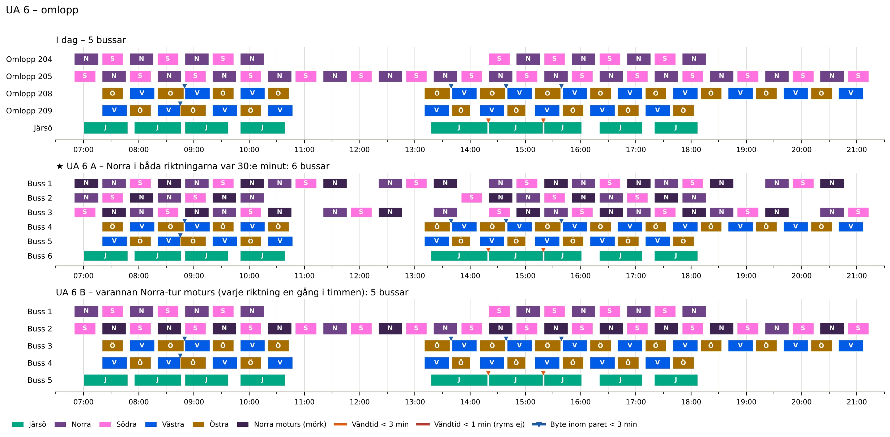

*Figur 10f. UA 6 – omlopp i dag, med Norra i båda riktningarna var 30:e minut (A, sex bussar) och med varannan
Norra-tur moturs (B, fem bussar). Mörk Norra-stapel = moturs.*

### 3.8 UA 7 – Kvällstrafik efter efterfrågan

**Introduktion.** Stadstrafiken har cirka 320 påstigande per vardag, och efterfrågan räcker inte för att motivera
fler bussar. UA 7 flyttar i stället kvällens resurser till den linje som har resenärerna. Efter kl. 18 kör två
bussar: omlopp 205 kör Södra och Norra varannan halvtimme, och omlopp 208 kör Östra och Västra. Efter kl. 18 stiger
cirka 22 resenärer på per vardag, varav 11 på Norra, 5 på Södra, 4 på Västra och 2 på Östra. På
Norra stiger cirka 3,6 på vid Maxinge, troligen personer som slutar arbetet, och de flesta av dem ska
till centrum. Med dagens enkelriktade Norra åker de hela varvet runt.

- **Syfte:** kortare restid för kvällens resenärer på Norra, utan fler bussar och utan fler fordonskilometer.
- **Prövas:** omlopp 208 kör Norra moturs i stället för Västra efter kl. 18 (18:40, 19:40, 20:40). Norra går då åt
  båda hållen varje timme på kvällen, medurs :20 och moturs :40. Östra körs som i dag, och Västras få
  kvällsresenärer hänvisas till anropsstyrd trafik.
- **Det som avgör:** om vinsten på Norra är större än förlusten på Västra.

**Varianter.** Flera sätt att flytta kvällsturer till Norra har prövats. Kvällens resor bygger på påstigandet efter
kl. 18 per hållplats, med destinationer enligt eftermiddagens OD-matris, och väntetiden räknas som halva
turintervallet.

*Tabell. UA 7 – varianter för kvällstrafiken efter kl. 18 (per kväll, cirka 20 resor).*

| Variant | Restid (resenärsminuter; minus = kortare) | Resor kortare | Resor längre |
|---|---|---|---|
| Alla tre Västra-turer blir Norra moturs | −16 | 2,4 | 0,0 |
| Varannan Västra-tur blir Norra moturs | ±0 | 1,7 | 0,8 |
| Varannan Östra-tur blir Norra moturs | +29 | 1,6 | 4,2 |
| Västra och Östra varannan timme, Norra moturs varje timme | +25 | 2,3 | 4,8 |
| Södra varannan timme, Norra moturs varannan timme | +14 | 1,7 | 2,1 |

Att göra varannan Västra-tur till Norra moturs ger ingen vinst: Norra moturs och Västra går då båda bara varannan
timme, och vinsten för Norras resenärer äts upp av förlusten för Västras. Att ta turer från Östra eller Södra ger
längre restid, eftersom de har fler kvällsresenärer än Västra. Bäst är att låta alla tre Västra-turer bli Norra
moturs.

**Resultat (huvudvarianten).**

- **Restid:** cirka 16 resenärsminuter kortare per kväll, och cirka 2,4 resor blir kortare, främst
  Maxinge – Centrum (17 i stället för 8 minuter).
- **Västra:** de cirka 4 resenärerna per kväll på Västra (de flesta stiger på i Centrum, vid Lönnhagsvägen
  och Sviby bro) får ingen buss efter kl. 18 och hänvisas till anropsstyrd trafik.
- **Omlopp:** omlopp 208 kör Östra 18:10 → Norra moturs 18:40 → Östra 19:10 osv. Norra moturs tar 26 minuter, så
  det blir 4 minuters reglering före Östra och 7 minuter före Norra. Föraren byter linje vid varje vändning.
- **Kostnad:** −3 fordonskm per vardag (Norra är 1,1 km kortare än Västra per tur); inga fler fordon.
  Därtill kommer kostnaden för några anropsstyrda resor per kväll.
- **Turtäthet:** Norras hållplatser får 3 avgångar till per vardag och Västras 3 färre. Det ändrar knappt
  täckningen (4 invånare kommer över och 12 under 30 avgångar per vardag).

**Jämförelse: Västra och Östra anropsstyrda.** Om både Västra och Östra blir anropsstyrda efter kl. 18 kan omlopp
208 sluta 18:07. Det sparar 81 fordonskm och 3 fordonstimmar per vardag, men ger ingen förbättring för
resenärerna, och cirka 6,5 resenärer per kväll får anropsstyrd resa i stället för buss.

**Bedömning.** UA 7 är realistiskt med dagens efterfrågan. Det gör inte nätet dyrare, ger kvällens största
resenärsgrupp på Norra en direkt resa hem från Maxinge, och påverkar bara ett fåtal resenärer på Västra. Effekten
är liten i absoluta tal, eftersom kvällens resande är litet, men den går åt rätt håll. Det förutsätter en lösning
för Västras få kvällsresenärer, till exempel anropsstyrd trafik.

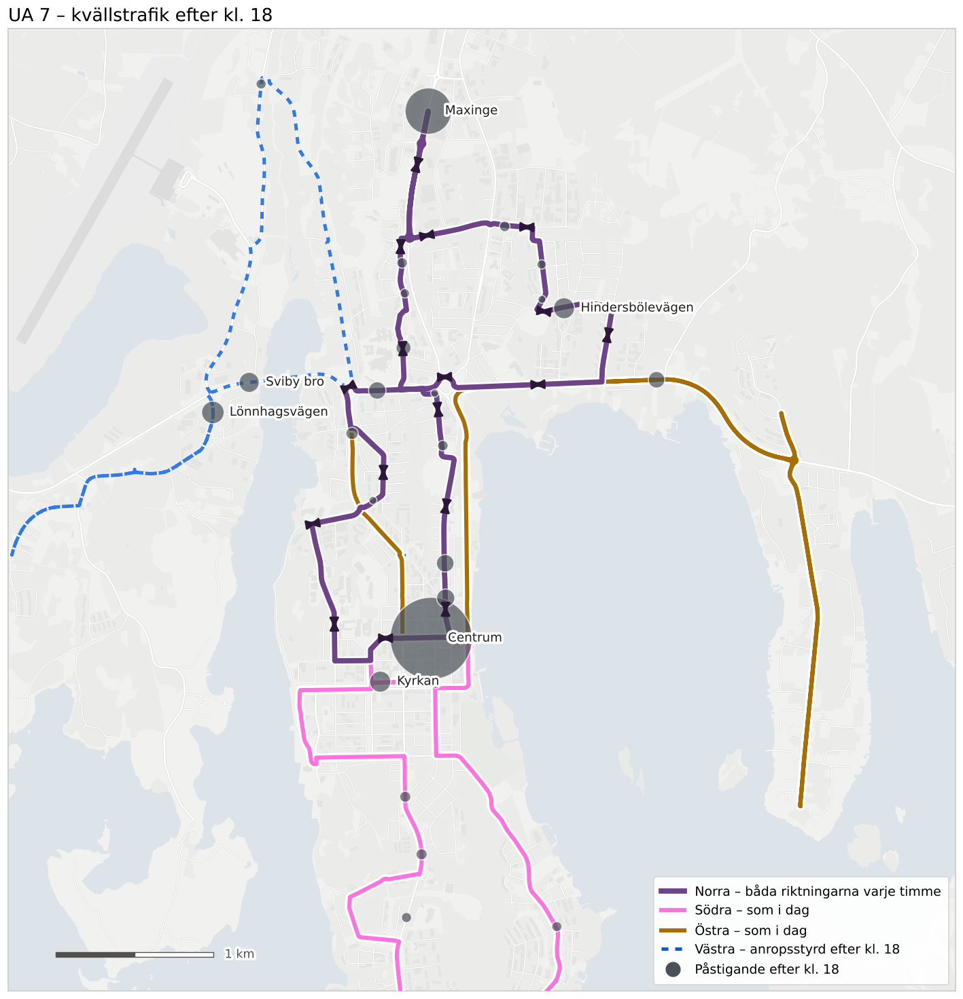

*Figur 10g. UA 7 – kvällstrafik efter kl. 18: Norra åt båda hållen varje timme, Södra och Östra som i dag, Västra
anropsstyrd. Cirklarna visar påstigande efter kl. 18.*

## 4 Systemeffekter

Systemeffekterna redovisas för varje UA för sig (figur 11, 12 och 12b). Täckningen gäller invånarna i
Mariehamn (14 821). Utöver turtäthetsklassen redovisas hur många invånare som får fler respektive färre
avgångar per vardag inom 400 m, viktat med befolkningen.

*Tabell 3. Systemeffekter i Mariehamn, i dag och med varje UA för sig.*

| | I dag | 1a Västra och Östra sammanslagna | 1b Västra och Östra sammanslagna | 2 N2 | 3 Bo-Bil | 4 Västra och Östra sammanslagna | 4Y flygturerna | 5 Västra och Östra sammanslagna |
|---|---|---|---|---|---|---|---|---|
| Hållplats inom 400 m | 83,6 % | 84,8 % | 84,8 % | 84,0 % | 83,4 % | 83,7 % | 83,7 % | 83,6 % |
| Minst 15 avgångar per vardag | 81,0 % | 82,2 % | 82,2 % | 81,4 % | 80,8 % | 81,2 % | 81,0 % | 81,0 % |
| Minst 30 avgångar per vardag | 55,6 % | 55,6 % | 55,6 % | 55,6 % | 55,9 % | 55,6 % | 55,6 % | 56,0 % |
| Svag tillgänglighet (1–29 avgångar) | 28,0 % | 29,2 % | 29,2 % | 28,4 % | 27,6 % | 28,2 % | 28,2 % | 27,6 % |
| Invånare med bättre / sämre turtäthetsklass | – | 178 / 0 | 178 / 0 | 58 / 0 | 44 / 24 | 22 / 0 | 21 / 0 | 79 / 0 |
| **Invånare med fler / färre avgångar** (avgångar per vardag) | – | **178 (+16) / 0** | **178 (+16) / 0** | **58 (+20) / 0** | **44 (+22) / 24 (−22)** | **22 (+16) / 0** | **22 (+3) / 0** | **125 (+22) / 11 (−17)** |
| Invånare × avgångar per vardag, netto | – | +2 846 | +2 846 | +1 164 | +444 | +344 | +64 | +1 837 |
| Bussar | 5 | 5 | 5 | 5 | 5 | 5 | 5 | 5 |
| Omloppstid (h per vardag) | 61,4 | 61,5 | 61,5 | 61,4 | 61,4 | 61,6 | 61,5 | 61,4 |
| Fordonskilometer per vardag | 1 287 | 1 331 | 1 312 | 1 287 | 1 287 | 1 314 | 1 292 | 1 286 |
| Varv Västra + Östra med < 5 min i centrum | 1 | 1 | 1 | 3 | 1 | 1 | 1 | 1 |
| Restid, befintliga resenärer (resenärsmin. per vardag; minus = kortare) | – | +25 | +12 | +8 | +30 | +35 | +4 | −9 |

Restiderna för alternativen med Västra och Östra sammanslagna är netto, efter vinsten för resor mellan Västra och Östra som slipper
bytet (cirka 3 resenärsminuter per vardag). Med höstens resande, cirka tre gånger sommarens, är restidseffekterna
större än i den tidigare versionen, men högst cirka 3 minuter per berörd resa i huvudalternativen. Det varv som i
dag har under 5 minuter i centrum är Västra 07:50 med Östras skoltur 08:20; sammanslagningen lägger inte till några.

**Effekt: fler och färre avgångar × befolkning.** Effekten är förändrat antal avgångar per vardag inom 400 m
gånger antalet invånare, utlagd som en utjämnad yta där grönt är vinnare och rött förlorare (figur 12b).
Hållplatserna färgas efter förändrat antal avgångar i procent. I UA 3 får 24 invånare vid Vikingagränd 22 avgångar
färre per vardag, medan 44 invånare vid Bo-Bil får 22 fler. I UA 5 får 11 invånare väster om Västra macken 17
avgångar färre, eftersom linje Västra inte längre stannar där. Om Solberget dras in på alla Östra-turer (variant av
UA 4) får 49 invånare 20 avgångar färre, mot 22 invånare med 16 fler vid flygplatsen, och nettot blir negativt.
Kring själva svängen i UA 5 får ingen färre avgångar, eftersom invånarna där redan har linje Norra inom 400 m vid
Sjukhuset eller Västra utfarten.
I QGIS visas effektytan i lagret `b4_effekt` och hållplatserna i `b4_hallplatser_frekvens`, i gruppen för varje UA.

Andelen med svag tillgänglighet ökar med Möckelö Strand ny. Det beror på att invånare som i dag saknar
hållplats får en med 16 avgångar per vardag: de flyttar från gruppen *ingen hållplats* till *svag
tillgänglighet*, vilket är en förbättring. Förändringarna är lokala och syns i figur 12. Alla driftformer för
1a och 4 redovisas i figur 11.

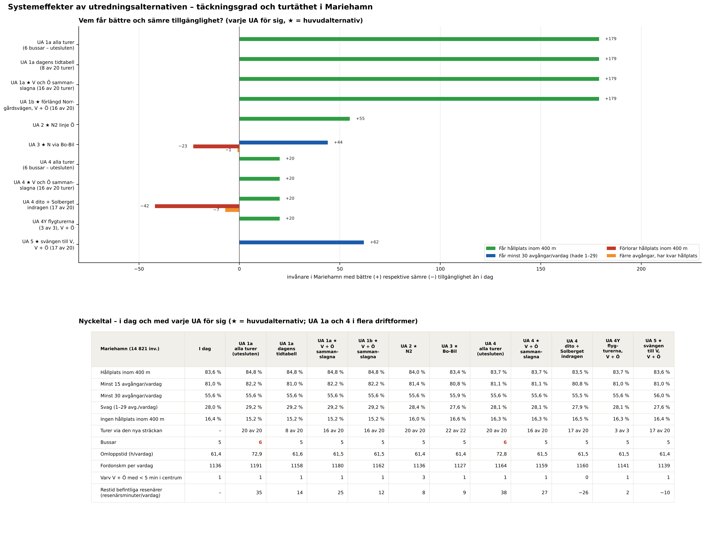

*Figur 11. Invånare med bättre respektive sämre tillgänglighet för varje UA för sig.*

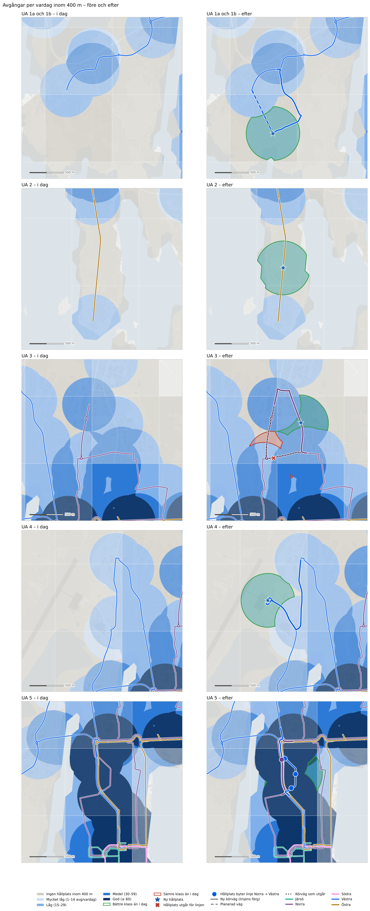

*Figur 12. Turtäthet inom 400 m i dag och med alternativet, inzoomat per UA. Grön ram anger bättre och röd
ram sämre klass än i dag.*

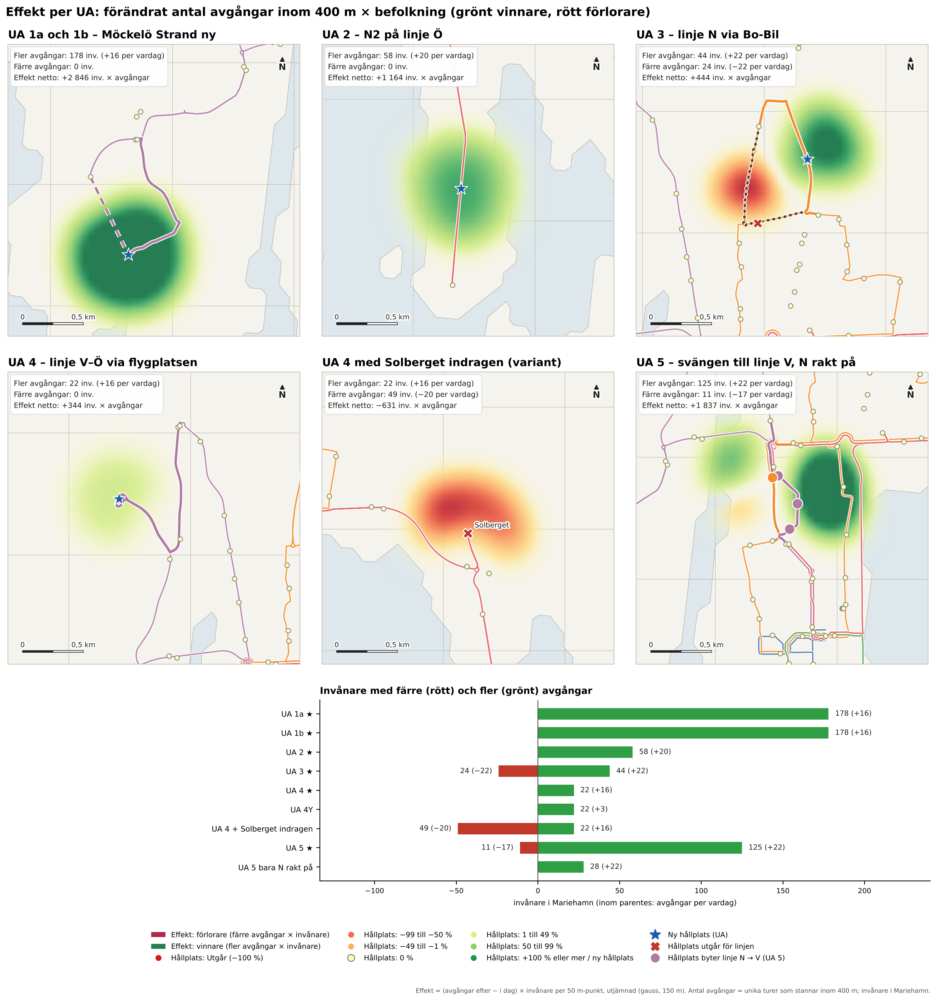

*Figur 12b. Fler och färre avgångar inom 400 m × befolkning per UA (grönt fler, rött färre),
och hållplatserna efter förändrat antal avgångar i procent.*

## 5 Kostnad – fordonskilometer och fordon

Kostnaden redovisas som förändrade fordonskilometer och om linjen kräver fler fordon än i dag för att kunna
hållas. I dag körs stadslinjerna Norra, Södra, Västra och Östra med fem fordon och cirka 1 287 fordonskm per vardag.
Fordonskilometrarna är vägavstånd längs gatunätet (OSRM). Årsvärdena bygger på 250 vardagar och
lördagstrafiken.

*Tabell 4. Fordon och fordonskilometer jämfört med i dag.*

| UA | Fordon | Fler fordon? | Fordonskm per vardag | Fordonskm per år |
|---|---|---|---|---|
| UA 1a alla turer – utesluten | 6 | **Ja, +1** | +55 | +14 400 |
| UA 1a dagens tidtabell (8 av 20 turer) | 5 | Nej | +22 | +5 800 |
| UA 1a ★ Västra och Östra sammanslagna (16 av 20 turer) | 5 | Nej | +44 | +11 500 |
| UA 1b ★ förlängd Norrgårdsvägen, Västra och Östra sammanslagna (16 av 20 turer) | 5 | Nej | +25 | +6 500 |
| UA 2 ★ N2 | 5 | Nej | ±0 | ±0 |
| UA 3 ★ Bo-Bil | 5 | Nej | +10 | +2 600 |
| UA 4 flygplatsen, alla turer – utesluten | 6 | **Ja, +1** | +34 | +9 000 |
| UA 4 ★ Västra och Östra sammanslagna (16 av 20 turer) | 5 | Nej | +27 | +7 200 |
| UA 4 dito + Solberget indragen (16 av 20) | 5 | Nej | +27 | +7 200 |
| UA 4Y flygturerna (3 av 3), Västra och Östra sammanslagna | 5 | Nej | +5 | +1 700 |
| UA 4 extra turer för flygen 07:15, 10:35 och 21:35 | 5 | Nej | +44 | +10 900 |
| UA 5 ★ svängen till linje Västra, Västra och Östra sammanslagna (17 av 20 Västra-turer) | 5 | Nej | −1 | −200 |
| UA 5 dagens drift (16 av 20 Västra-turer) | 5 | Nej | −1 | −200 |
| UA 5 variant: bara linje Norra rakt på | 5 | Nej | −4 | −1 000 |
| UA 6 linje Norra i båda riktningarna (kräver extra buss) | 6 | **Ja, +1** | +257 | +67 200 |
| UA 7 kvällstrafik: Norra åt båda hållen efter kl. 18 i stället för Västra | 5 | Nej | −3 | −900 |

Alla huvudalternativ ryms med dagens fem fordon. Bara de uteslutna driftformerna, där alla turer på linje Västra
förlängs med dagens tidtabell, kräver ett sjätte fordon. UA 6 prövas utanför ramen och kräver ett extra fordon.

**Förlängningen av Norrgårdsvägen (UA 1b)** ger 19 fordonskm färre per vardag än UA 1a (cirka 5 000 per år),
och båda ger 16 av 20 turer med fem fordon. Vägen ger dessutom:

- en kortare omväg (1,6 i stället för 2,7 km per tur);
- större marginal i centrum (minst 7,5 i stället för 5,5 minuter per varv);
- att Östra kan behålla sina avgångar i pulsen.

Vägen ger också nytta för annan trafik.

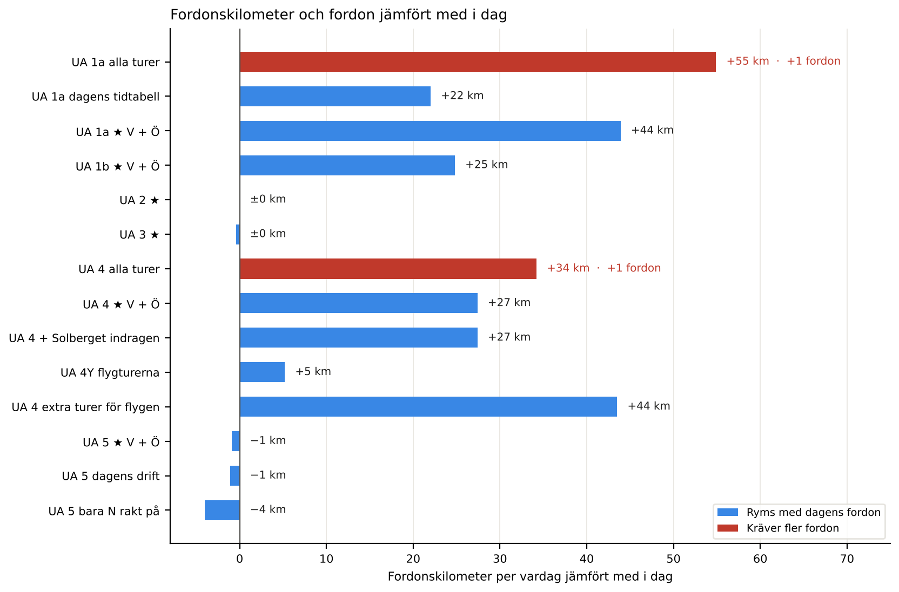

*Figur 13. Förändrade fordonskilometer per vardag per UA jämfört med i dag. Rött anger att alternativet kräver
fler fordon.*

## 6 Slutsatser

1. **Ramen är snäv.** Ingen linje kan förlängas mer än någon minut om varje byte ska ha full reglering.
   Eftersom bussarna redan växlar i paren Södra ↔ Norra och Västra ↔ Östra kan paren slås ihop till genomgående linjer. Med
   kravet att varje varv ryms inom timmen med minst 5 minuter i centrum kan linje Västra då förlängas upp till
   4,5 minuter per tur i vanliga varv, men inte alls i varven med Östras skolturer.
2. **UA 1a – Möckelö Strand ny via dagens vägar.** Huvudalternativet slår ihop Västra och Östra och ger 16 av 20 turer
   med fem fordon, för +44 fordonskm per vardag. Möckelö Strand ny kan alltså trafikeras redan med dagens vägar.
   Alla turer med dagens tidtabell kräver ett sjätte fordon och är utesluten.
3. **UA 1b – Möckelö Strand ny via förlängd Norrgårdsvägen.** Med Västra och Östra sammanslagna ryms också 16 av 20 turer,
   med fem fordon, men med kortare omväg (+25 fordonskm per vardag), större marginal och Östra kvar i pulsen. UA 1b
   förutsätter att vägen byggs.
4. **UA 2 – N2 på linje Östra** ryms med alla turer och ger 58 invånare en hållplats, utan fler fordonskm eller fordon.
5. **UA 3 – Linje Norra via Bo-Bil** ryms med fem fordon. Eftersom Norra är enkelriktad och Maxinge bara har
   hållplats för södergående buss måste bussen vända vid Maxinge för att nå Bo-Bil: 450 m och cirka 1–1,5 minuter
   längre per tur (+10 fordonskm per vardag), och Norras vändtid i centrum minskar till cirka 3 minuter. 44 invånare
   vid Bo-Bil får 22 avgångar fler per vardag, medan 24 vid Vikingagränd får 22 färre. Nyttan är liten i förhållande
   till omvägen. Förlusten vid Vikingagränd kan mildras med hållplatsen N3 söder om Maxinge från kapitel 3.
6. **UA 4 – Linje Västra–Östra via flygplatsen.** Att bara förlänga Västra är uteslutet, eftersom det kräver ett sjätte fordon.
   Det enda rimliga är en genomgående linje Västra–Östra. Längs vägarna är omvägen 1,7 km och cirka 5 minuter per tur.
   Huvudalternativet ger 16 av 20 turer med fem fordon och precis 5 minuter i centrum, och Solberget behålls
   (+27 fordonskm per vardag). Både huvudalternativet och UA 4Y (de tre flygturerna, +5 fordonskm) når tre av
   sex flyg; alla sex kräver tre extra turer, +44 fordonskm per vardag, med befintliga fordon.
7. **UA 5 – Linje Västra via Cedersvägen, linje Norra rakt på Västra utfarten** ryms med fem fordon (−1 fordonskm per
   vardag), också utan att Västra och
   Östra slås ihop (16 av 20 Västra-turer). Linje Norra får 2 minuter mer i centrum i varje varv. Svängen har cirka 1
   påstigande per vardag, och ingen förlorar hållplatsen inom 400 m. Varianten med bara linje Norra rakt på ger
   samma vinst utan att belasta Västra, och där får ingen färre avgångar.
8. **Genomgående linje Västra–Östra** ger kortare restid för resor mellan Västra och Östra, men med höstens resande gäller det
   bara cirka 1,5 resor per vardag.
9. **UA 1a, 1b, 4 och 5** förlänger alla linje Västra. Två av dem ryms inte tillsammans inom kravet utan fler fordon.
   Kombinationer av UA prövas i ett senare skede.
10. **UA 6 – Linje Norra i båda riktningarna** ger den största restidsvinsten av alla alternativ, cirka 164
    resenärsminuter per vardag, och dubbel turtäthet för cirka 6 000 invånare längs Norra (888 får minst 30 avgångar
    per vardag). Det kräver ett extra fordon (+257 fordonskm per vardag) och ligger utanför uppdragets ram, men är
    den förbättring av nätet som ger mest nytta för dagens resenärer. Omloppen blir effektiva med en fast rotation
    Norra medurs → Södra → Norra moturs på tre bussar, så att förarna fortsatt byter linje vid varje vändning. Med
    dagens fem fordon (varannan tur moturs) blir restiden däremot längre än i dag. Med dagens efterfrågan är det
    extra fordonet svårt att motivera; UA 6 är ett alternativ för ett läge med växande resande.
11. **UA 7 – Kvällstrafik efter efterfrågan** är realistiskt med dagens efterfrågan. Efter kl. 18 kör bussen som i dag
    kör Västra i stället Norra moturs, så att Norra går åt båda hållen varje timme. Det ger kortare restid för
    kvällens största resenärsgrupp (Maxinge – Centrum), utan fler fordon eller fordonskilometer. Västras cirka 4
    kvällsresenärer behöver anropsstyrd trafik. Att i stället göra varannan Västra-tur till Norra moturs ger ingen
    vinst.

## 7 Osäkerheter och fortsatt arbete

- **Omloppen** är operatörens, enligt påstigandedatan från hösten 2026, med beställarens rättelser av omlopp
  204, 205 och 208 och kvällens omlopp sammanslagna med dagens. Förarnas raster ingår inte.
- **Restiderna** för Möckelö Strand bygger på beställarens uppgifter. Körtiden till flygplatsen är beräknad ur
  vägavståndet längs gatunätet (OSRM) med 25 km/h, och körtiden vid Bo-Bil ur vägavståndet. Den beräknade
  omvägen till flygplatsen, 5 minuter, ligger precis på gränsen för kravet och bör mätas.
- **Flygtiderna** gäller vardagar i november 2026 och antas vara desamma alla vardagar. Ändras de väljs UA 4Ys
  turer och de extra turerna om automatiskt (`FLYG_AVGANGAR` och `FLYG_ANKOMSTER` i `src/b4_ua.py`). Förarens
  rast i omlopp 204 mitt på dagen behöver stämmas av.
- **Svängen (UA 5):** körtidsvinsten är operatörens uppgift (2 minuter); tidtabellen ger cirka 0,6 minuter.
  Den bör kontrolleras med restidsdata eller en provkörning.
- **Östra efter pulsen:** sammanslagning av Västra och Östra förutsätter att Östra kan starta 2–2,5 minuter efter pulsen (1a och
  4). Effekten på bytesresor ingår inte i nätverksmodellen.
- **Kravet 5 minuter i centrum per varv** är beställarens riktvärde. För UA 1a ändras resultatet inte om kravet
  ligger mellan 3 och 5,5 minuter. I UA 1b ryms Västra 08:20 om kravet sänks till 4,5 minuter.
- **Östras skolturer** avgör vilka Västra-turer som ryms. Deras verkliga körtider bör kontrolleras.
- **Vägdragningen** följer OSRM:s bilprofil, som i enstaka fall kan välja en annan gata än bussen. Linje Norras
  busslänk vid Doktorsvägen saknas i OSRM och är ritad rak (cirka 100 m).
- **Hållplatslägena** för Möckelö Strand ny, N2 och flygplatsen är indikativa.
- **Påstigande och resenärseffekter** bygger på den tvättade höstdatan (terminstid). Linje Järsö finns bara i
  sommardatan men berörs inte av utredningsalternativen.
- **Fortsatt arbete:** pröva sammanslagning av Norra och Södra för Örtvägen, en omläggning av linje Norra och Östra i nordost,
  anropsstyrd trafik för flygen 07:15 och 21:35, och UA 5 tillsammans med UA 1b eller 4.

## Bilaga – Kartor i QGIS

Alla kartor finns som lager i `output/gis/linjenatsutredning.gpkg` (EPSG:3067) med inbäddade stilar.

1. Öppna **`output/gis/linjenatsutredning.qgz`** (*Projekt > Öppna*). Projektet öppnas inzoomat på Mariehamn,
   med en grupp per UA. Använd inte en äldre sparad projektfil.
2. Alternativt: kör `output/gis/oppna_i_qgis.py` i QGIS Python-konsol i ett nytt, tomt projekt.

| Grupp i QGIS | Innehåll |
|---|---|
| UA 1a, 1b, 2, 3, 4, 5 | Huvudalternativet per UA: ny hållplats, körväg, linjen (Västra–Östra som en genomgående linje i UA 1a, 1b, 4 och 5) och förändrad turtäthet (grönt bättre, rött sämre) |
| Systemeffekter – huvudalternativ per UA | Turtäthet inom 400 m och förändring mot i dag för i dag och huvudalternativen. Gruppen är exklusiv: ett scenario i taget |
| Övriga alternativ | Övriga driftformer, bl.a. de uteslutna som kräver fler bussar (redovisas i rapporten). Exklusiv grupp |
| Sammanslagning av linjer | Områden utan hållplats och behövd tid per tur |
| Bakgrund | Stadslinjerna i dag (förskjutna där de delar gata), hållplatser, via-punkter för OSRM, befolkningsrutor, land |
| Nyckeltal per UA och driftform | Tabell med fordon, fler fordon, fordonskm, täckning, huvudalternativ och utesluten |

Förändringarna är lokala. Zooma in vid Möckelö Strand, Kalmarnäs, Bo-Bil, flygplatsen, Cedersvägen eller Solberget för att
se dem.

**Vägdragning.** Linjerna och de nya delsträckorna följer gatunätet (OSRM). Vägdragningen kan hämtas om genom
att köra `output/gis/rutta_med_osrm.py` i QGIS Python-konsol på en dator med internet.

- **Via-punkter:** där OSRM väljer en annan väg än bussen läggs en *via-punkt* ("gömt stopp") i lagret
  `00_viapunkter`, och skriptet körs igen. Lagret innehåller redan en punkt: linje Västra mellan Lönnhagsvägen och
  Norrgårdsvägen kör vägen söder om huvudvägen och vänder inte vid hållplatsen.
- **Om lager saknas eller är tomma:** se `output/gis/LASMIG.md`. GeoPackage-filer i synkade mappar (OneDrive)
  kan ge felet *unable to open database file*. Kopiera då mappen till en lokal disk.
