# PM – Utredningsalternativ (UA) för Mariehamns stadstrafik

**Uppdrag:** Linjenätsutredning för busslinjerna i Mariehamn
**Datum:** 2026-10-15
**Status:** Arbetsmaterial, Fas B (delleverans). Underlag till PM:ets kapitel 4 och 5.

## Sammanfattning

PM:et redovisar fem utredningsalternativ (UA). Varje UA prövas **för sig** mot ramen för uppdraget: inga fler
bussar och samma omloppstid som i dag. Omloppen följer förarnas norm att byta linje i centrum, Syd ↔ Norr
(S ↔ N) och Öst ↔ Väst (Ö ↔ V).

Varje UA har prövats i flera driftformer:

- **Uteslutna:** driftformer som kräver fler bussar.
- **Huvudalternativ (★):** den mest realistiska driftformen. Den visas på kartorna.
- **Övriga driftformer:** redovisas i tabellerna.

Kombinationer av UA prövas i ett senare skede.

Stadstrafiken körs i dag med fem bussar. Efter en V-tur har bussen 3 minuter innan den fortsätter som linje Ö,
och efter en Ö-tur 7 minuter. Linje V kan därför inte förlängas utan att V och Ö slås ihop till en genomgående
linje V–Ö. Bussen fortsätter då efter en halv minut, och resenärer mellan V och Ö kan sitta kvar. Det enda kravet
(beställaren 2026-10-15) är att varje varv V + Ö ryms inom 55 minuter, dvs. minst 5 minuter i centrum, och helst
inom 50 minuter. Ö startar när V har kommit tillbaka, i huvudalternativen 0–2 minuter efter pulsen.

| UA | Huvudalternativ (★) | Ryms (5 bussar) | Effekt | Driftkostnad per år | Utesluten driftform |
|---|---|---|---|---|---|
| **UA 1a – Möckelö Strand ny via dagens vägar** (+4,5 min/tur) | V och Ö sammanslagna | 16 av 20 turer | 179 inv. får hållplats | +12 000 € | Alla turer med dagens tidtabell (6 bussar, +216 000 €) |
| **UA 1b – Möckelö Strand ny via förlängd Norrgårdsvägen** (+2,5 min/tur) | V och Ö sammanslagna, Ö i pulsen | 16 av 20 | 179 inv. får hållplats | +7 000 € (+ väg) | – |
| **UA 2 – N2 på linje Ö** (+0,5 min/tur) | Alla turer | 20 av 20 | 55 inv. får hållplats | ±0 € | – |
| **UA 3 – Linje N via Bo-Bil** (+0,1 min/tur) | Alla turer | 22 av 22 | 44 inv. får ≥ 30 avg.; 23 förlorar (Vikingagränd) | −2 000 € | – |
| **UA 4 – Linje V–Ö via flygplatsen** (+4 min/tur) | V och Ö sammanslagna | 16 av 20 | 20 inv. får hållplats | +6 000 € | Bara förlängning av V (6 bussar, +209 000 €) |

I UA 1a, 1b och 4 kör samma fyra V-turer som i dag: 07:50, 13:40 och 14:40, som följs av Ö:s skolturer
(28–29 minuter), och 08:20, där bussen fortsätter som linje N. I de varven finns inte 5 minuter kvar i centrum.

**Övriga driftformer:**

- **UA 1a med dagens tidtabell:** 8 av 20 turer.
- **UA 1b med alla 20 turer:** ryms med fem bussar, men varven med Ö:s skolturer får bara 1,5–2,5 minuter i
  centrum och uppfyller inte kravet.
- **UA 4 med Solberget indragen dessutom:** samma 16 turer, bara större marginal. Indragningen behövs inte.
- **UA 4Y:** bara de 8 V-turer som behövs för flygen 11:00 och 17:10. Alla 8 ryms med V och Ö sammanslagna och
  minst 6 minuter i centrum, utan att Solberget dras in, för cirka 3 000 euro per år.

**Effekt på täckningen.** Med Möckelö Strand ny ökar andelen invånare i Mariehamn med hållplats inom 400 m från
83,6 till 84,8 %.

**UA 1a, 1b och 4** förlänger alla linje V och använder samma tidsutrymme. Två av dem ryms inte tillsammans inom
kravet utan fler bussar.

## 1 Bakgrund och uppdrag

I Fas A granskades och korrigerades OD-matrisen, och täckningsgraden analyserades med hänsyn till
turtätheten. Där identifierades också nya hållplatslägen och områden som bara kan nås med ändrad
linjesträckning. Efter granskningen den 14 oktober 2026 bad beställaren om en utredning av de enskilda
effekterna av följande utredningsalternativ (UA):

1. **Möckelö Strand.** Linje V till en ny hållplats i Möckelö Strand, via dagens vägar (1a) och via en
   förlängning av Norrgårdsvägen till Hamnskärsvägen (1b). Beställarens restider: den befintliga vägen från
   Norrgårdsvägen till den nya hållplatsen tar 2 minuter och förlängningen 1 minut.
2. **N2.** En ny hållplats N2 på linje Ö mellan Österkullagatan och Kalmarnäs vändplan.
3. **Bo-Bil.** Linje N stannar vid Bo-Bil i stället för vid Vikingagränd, så att bussen inte behöver vänta vid
   Nya Godbyvägen för att komma till Maxinge.
4. **Flygplatsen.** Linje V följer vägen från Posten upp till flygterminalen. Det ska prövas med V och Ö
   sammanslagna, med hållplatsen Solberget indragen och som en UA 4Y med bara de turer som behövs för flygen.

Den 15 oktober 2026 preciserade beställaren kravet för en sammanslagen linje V–Ö: varje varv V + Ö ska rymmas
inom timmen med minst 5 minuter i centrum, och den kortare restiden för resor mellan V och Ö ska räknas med.

Dessutom skulle möjligheten att slå ihop linjer prövas, särskilt om sammanslagning av V och Ö gör att den nya
hållplatsen i Möckelö Strand kan trafikeras redan med dagens vägar. För 1a skulle en överslagskalkyl göras.
Systemeffekterna skulle redovisas för alla UA.

## 2 Förutsättningar

### 2.1 Ramen – inga fler bussar

Utredningsalternativen får inte kräva fler bussar. Linjenätet ska rymmas inom dagens omloppsplaner, med samma antal
fordon och samma omloppstid. Varje UA har verifierats mot detta:

- alternativets körtidsförändring läggs på berörda turer;
- avgångstiderna från centrum ligger fast, så att pulsen och bytena behålls. Undantaget är sammanslagning av V
  och Ö, där Ö startar när V har kommit tillbaka;
- omloppen byggs om med minsta möjliga antal fordon och enligt förarnas norm för linjebyten;
- alternativet ryms om antalet bussar inte ökar och omloppstiden ökar med högst 10 minuter per vardag;
- **UA på linje V (V och Ö sammanslagna):** dagens omlopp ligger fast, så att varje V-tur fortsätter som den
  Ö-tur som samma buss kör i dag. Det enda kravet är att varje varv V + Ö ryms inom 55 minuter, dvs. minst
  5 minuter i centrum, och helst inom 50 minuter. Varv som redan i dag har mindre marginal godtas oförändrade
  (V 07:50 följd av Ö:s skoltur 08:20 har i dag 4 minuter);
- **UA 2 och 3:** alternativet är robust om det inte ger fler varv med mindre än 3 minuters reglering än i dag.

### 2.2 Dagens omlopp

GTFS-underlaget saknar omloppsuppgifter. Omloppen har därför härletts ur tidtabellen för en typisk
vardag, tisdag 2026-09-01, med förarnas norm för linjebyten (figur 1):

- **Trafik:** fem bussar kör 93 turer. Körtiden är 42,5 timmar och omloppstiden 61,4 timmar per vardag.
- **Puls:** linjerna N, S, V och Ö avgår från Centrum, Nygatan i en gemensam puls med 30 minuters intervall i
  rusningstid. Linje J går ungefär en gång i timmen.
- **Linjebyten:** bussarna byter S → N, N → S, V → Ö och Ö → V. Ingen buss fortsätter på samma linje, utom J.
- **Bytestider i centrum:** V → Ö 3 minuter, Ö → V 7 minuter, S → N 7 minuter och N → S 4 minuter.
  Efter Ö:s skolturer, som tar 28–29 minuter, är bytestiden 1–2 minuter. Ett varv V + Ö har alltså
  10 minuter i centrum, och 4–5 minuter i varven med Ö:s skolturer.
- **Marginaler:** med krav på 2 minuters lägsta vändtid i stället för dagens 1 minut skulle det behövas en
  sjätte buss. I dag finns ett varv med mindre än 3 minuters reglering.

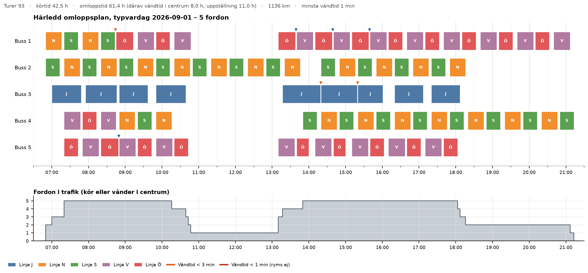

*Figur 1. Härledd omloppsplan för en typisk vardag. Varje rad är en buss och varje stapel en tur.*

### 2.3 Data och metod i korthet

- **Täckning:** befolkningen 2024 i 1 km-rutor har fördelats på 50 m-delpunkter på land. För varje delpunkt
  har antalet avgångar per vardag inom 400 m räknats. Kartornas täckningsytor är exakta 400 m-cirklar runt
  hållplatserna.
- **Svag tillgänglighet:** hållplats inom 400 m men färre än 30 avgångar per vardag.
- **Resenärseffekter:** den korrigerade OD-matrisen har lagts ut på ett restidsnät byggt på GTFS. Det
  tillkommande påstigandet har uppskattats med påstigande per invånare vid linjens bostadshållplatser.
  Påstigandet är mätt under sommaren och därför lågt i absoluta tal. När V och Ö slås ihop kan resenärer mellan
  V och Ö sitta kvar; nätet räknar då med en genomgående linje utan bytesstraff.
- **Körvägar:** de nya delsträckorna är ritade efter beställarens skisser (den befintliga vägen till Möckelö
  Strand ny och vägen till flygplatsen). Förlängningen av Norrgårdsvägen är schematisk. Linjernas vägdragning
  längs gatunätet (OSRM) kunde inte hämtas i analysmiljön men kan hämtas i QGIS (bilaga).

## 3 Utredningsalternativen

*Tabell 1. Utredningsalternativen var för sig – alla driftformer, verifiering mot dagens omlopp och effekter.*

| UA | Körtid per tur | Ryms i dagens omlopp (5 bussar) | Invånare med bättre / sämre tillgänglighet | Driftkostnad per år (bas) |
|---|---|---|---|---|
| UA 1a – Möckelö Strand ny via dagens vägar | +4,5 min | **★ V och Ö sammanslagna: 16 av 20.** Dagens tidtabell: 8 av 20. Alla turer: 6 bussar (utesluten). | 179 / 0 | **★ +12 000 €** (dagens tidtabell +7 000 €; utesluten +216 000 €) |
| UA 1b – Möckelö Strand ny via förlängd Norrgårdsvägen | +2,5 min | **★ V och Ö sammanslagna: 16 av 20.** Alla 20 turer: 5 bussar men under 5 min i centrum (uppfyller inte kravet). | 179 / 0 | ★ +7 000 € |
| UA 2 – N2 på linje Ö | +0,5 min | ★ Alla 20 av 20 | 55 / 0 | ±0 € |
| UA 3 – Linje N via Bo-Bil | +0,1 min | ★ Alla 22 av 22 | 44 / 24 | −2 000 € |
| UA 4 – Linje V–Ö via flygplatsen | +4 min | **★ V och Ö sammanslagna: 16 av 20.** Med Solberget indragen: 16 av 20. UA 4Y: 8 av 8. Dagens tidtabell: 8 av 20. Alla turer: 6 bussar (utesluten). | 20 / 0 (Solberget indragen: 20 / 49) | **★ +6 000 €** (UA 4Y +3 000 €; utesluten +209 000 €) |

### 3.1 UA 1a och UA 1b – Möckelö Strand ny

**Utformning.** Linje V vänder i dag vid hållplatsen Möckelö Strand: bussen kör Norrgårdsvägen → Möckelö
Strand → Norrgårdsvägen. Den nya hållplatsen, *Möckelö Strand ny*, placeras cirka 700 m söder om dagens
vändpunkt (figur 2). Den befintliga vägen från Norrgårdsvägen till den nya hållplatsen tar 2 minuter (cirka
1,4 km). Dagens 3 minuter från Möckelö Strand är alltså 1 minut tillbaka till Norrgårdsvägen, som bussen redan
kör, plus den befintliga vägen.

- **1a – dagens vägar:** bussen kör som i dag till Möckelö Strand och tillbaka till Norrgårdsvägen. Därefter kör
  den den befintliga vägen till den nya hållplatsen och samma väg tillbaka. Tillägget blir 2 + 0,5 + 2 =
  **4,5 minuter per tur** och 2,7 km. Bussen måste kunna vända vid den nya hållplatsen.
- **1b – förlängd Norrgårdsvägen:** bussen kör en slinga – Möckelö Strand → förlängningen (1 minut) → den nya
  hållplatsen (0,5 minut) → den befintliga vägen (2 minuter) → Norrgårdsvägen. Sträckan Möckelö Strand →
  Norrgårdsvägen (1 minut) körs inte längre. Tillägget blir 1 + 0,5 + 2 − 1 = **2,5 minuter per tur** och 1,6 km.
  Som känslighet har 3,5 minuter prövats, om tidtabellens minut inte kan räknas av. Bussen kör alltså rakt
  fram från Möckelö Strand på den nya vägen till den nya hållplatsen och tillbaka på befintlig väg, bl.a.
  Möckelövägen, i stället för att vända (beställarens skiss 2026-10-15).

**Omlopp.**

- **1a, dagens tidtabell:** 8 av 20 turer ryms. Alla turer kräver en sjätte buss och 11,4 timmar mer
  omloppstid per vardag (figur 3).
- **1a med V och Ö sammanslagna:** 16 av 20 turer ryms, se avsnitt 3.2.
- **1b med V och Ö sammanslagna:** 16 av 20 turer ryms med fem bussar. V-turen kommer tillbaka en halv minut
  före Ö:s avgång, så Ö kan behålla pulsen, och varven har minst 7,5 minuter i centrum. Med alla 20 turer får
  varven med Ö:s skolturer bara 1,5–2,5 minuter i centrum. Med 3,5 minuter i stället för 2,5 ryms också 16 av 20.
  Dras Solberget in på Ö:s skolturer 14:10 och 15:10 ryms 18 av 20 turer, men varven får då 4,8 minuter i
  centrum (55,2 minuter), strax under kravet.

**Effekter.** 179 invånare får en hållplats inom 400 m med 16 avgångar per vardag. Påstigandet uppskattas
till 0,4–1,8 per vardag på sommarnivå. Restiden för befintliga resenärer ökar netto med cirka 3 (1b) respektive
7 (1a) resenärsminuter per vardag, efter vinsten för resor mellan V och Ö som slipper bytet.

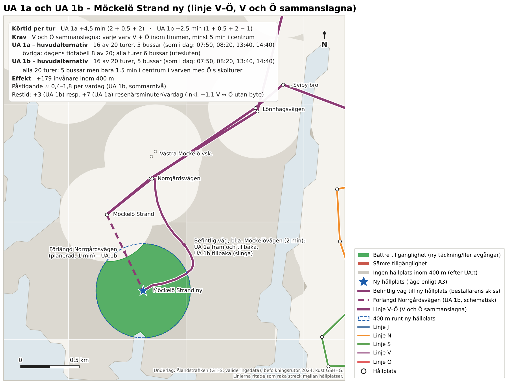

*Figur 2. UA 1a och UA 1b – huvudalternativen; linje V visas som del av linje V–Ö. Grönt anger invånare som får hållplats inom 400 m. Den befintliga vägen är ritad efter
beställarens skiss och förlängningen (streckad) är schematisk.*

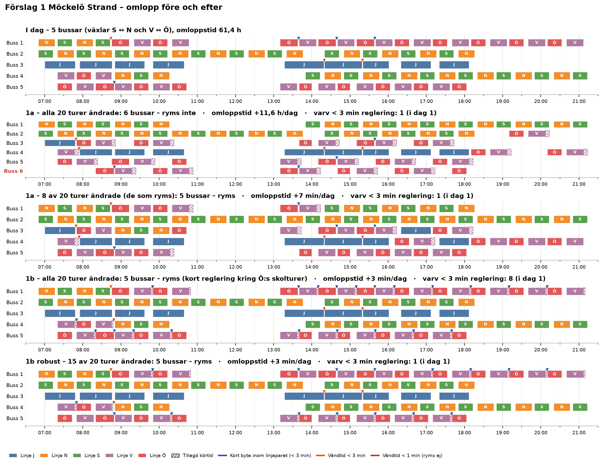

*Figur 3. Omlopp före och efter för UA 1a och UA 1b, alla driftformer (★ = huvudalternativ). Skrafferad del av en tur är tillagd körtid, och prickad ram
anger att turen avgår senare än i dag. Röd rubrik anger att lösningen kräver fler bussar eller inte uppfyller
kravet på 5 minuter i centrum per varv.*

### 3.2 Sammanslagning av V och Ö – Möckelö Strand ny redan med dagens vägar?

Ett varv V → Ö → V tar 60 minuter, och två bussar kör varvet med 30 minuters förskjutning (figur 4). Kravet är
minst 5 minuter i centrum per varv:

- **I dag:** varvet består av V (27 minuter), byte (3 minuter), Ö (23 minuter) och byte (7 minuter), dvs.
  10 minuter i centrum. I varven med Ö:s skolturer blir det 4–5 minuter.
- **1a med dagens tidtabell:** V tar 31,5 minuter och kommer tillbaka 1,5 minut efter att Ö ska avgå.
- **1a med V och Ö sammanslagna:** bussen fortsätter som linje Ö efter en halv minut, och Ö avgår då
  2 minuter efter pulsen (:22/:52 i stället för :20/:50). Varvet får 5,5 minuter i centrum och ryms.
- **1b med V och Ö sammanslagna:** V tar 29,5 minuter och hinner till Ö i pulsen. Varvet får 7,5 minuter.
- **Varv med Ö:s skolturer** (28–29 minuter): 1a ger 0,5 och 1b 2,5 minuter i centrum. Där kör V-turen som i dag.

Varje V-tur har prövats för sig med dagens omlopp. Resultatet:

- **Turer:** 16 av 20 V-turer kan trafikera Möckelö Strand ny med fem bussar, i både 1a och 1b. 07:50, 08:20,
  13:40 och 14:40 kör som i dag.
- **Ö:s avgångar (1a):** 14 av Ö:s 20 turer avgår 2 minuter senare än i dag. I 1b avgår Ö som i dag.
- **Kostnad (1a):** omloppstiden ökar med cirka 7 minuter och körsträckan med 43 km per vardag.

**Konsekvenser för resenärerna.** Den som byter till linje Ö i pulsen får i 1a 2 minuter längre väntan, och Ö
kommer tillbaka till centrum 2 minuter senare, men före nästa pulsavgång. Den som åker vidare från V till Ö kan
sitta kvar på bussen. Med sommarens resande gäller det cirka 1 resa per vardag.

**Bedömning.** Ja – med V och Ö sammanslagna kan Möckelö Strand ny trafikeras redan med dagens vägar, på 16 av
20 turer och med dagens fem bussar. Förlängningen av Norrgårdsvägen (1b) ger inte fler turer, men den ger tre
fördelar:

- en kortare omväg, 2,5 i stället för 4,5 minuter per tur;
- större marginal i centrum, minst 7,5 i stället för 5,5 minuter per varv;
- Ö kan behålla sina avgångar i pulsen.

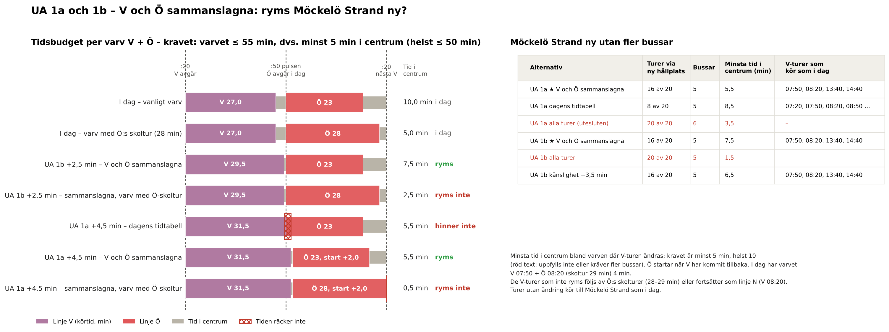

*Figur 4. Sammanslagning av linje V och Ö: tidsbudget per varv med tiden i centrum mot kravet 5 minuter, och
antal turer som ryms per alternativ.*

### 3.3 UA 2 – N2 på linje Ö

**Utformning.** Hållplatsen N2 placeras på sträckan Österkullagatan – Kalmarnäs vändplan, som bussen kör i
båda riktningarna. Ett uppehåll per tur i genomsnitt (0,5 minut) har antagits.

**Omlopp.** Alla 20 turer ryms, och alternativet är lika robust som i dag (figur 6). Varven V + Ö med Ö:s
skolturer får 3,5–4,5 minuter i centrum, mot 4–5 minuter i dag.

**Effekter.**

- **Täckning:** 55 invånare får en hållplats inom 400 m med 20 avgångar per vardag.
- **Påstigande:** uppskattas till 0,4–1,9 per vardag på sommarnivå.
- **Ombordvarande:** förlusten för dem som redan sitter på bussen är försumbar.

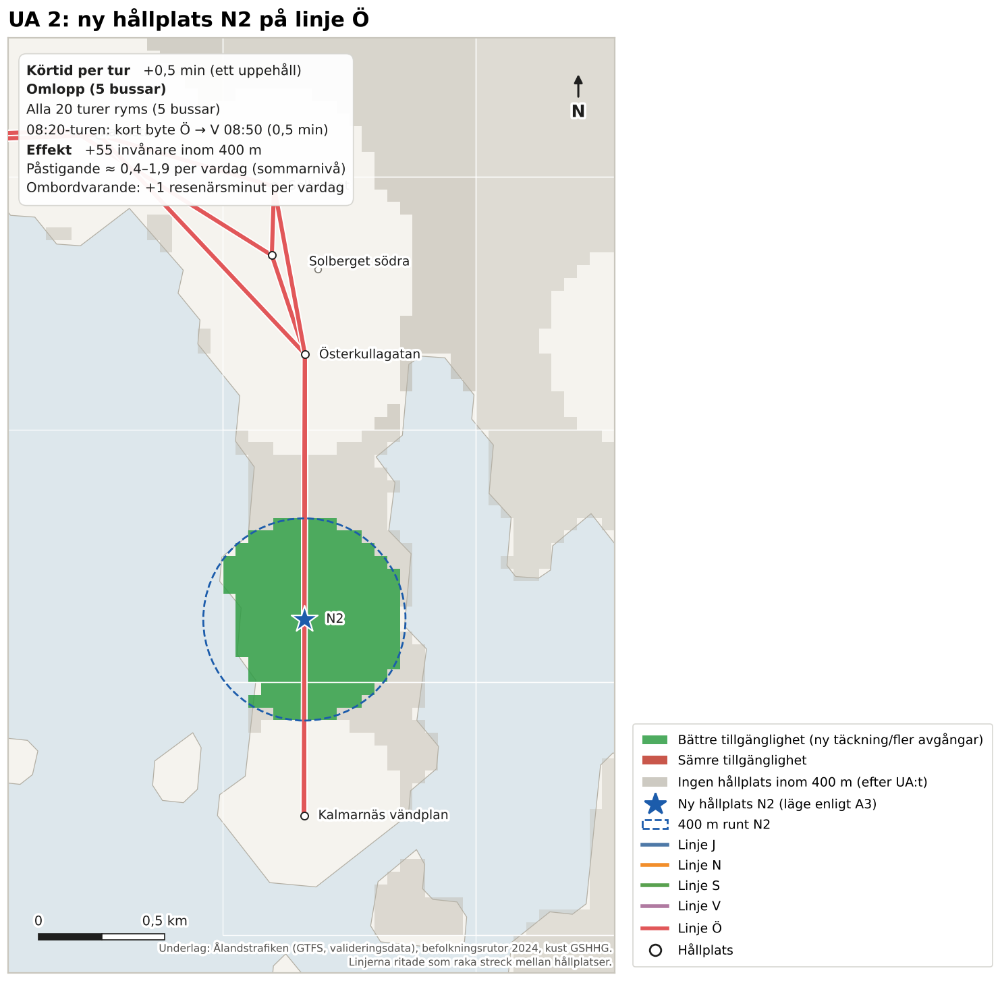

*Figur 5. UA 2, ny hållplats N2 på linje Ö.*

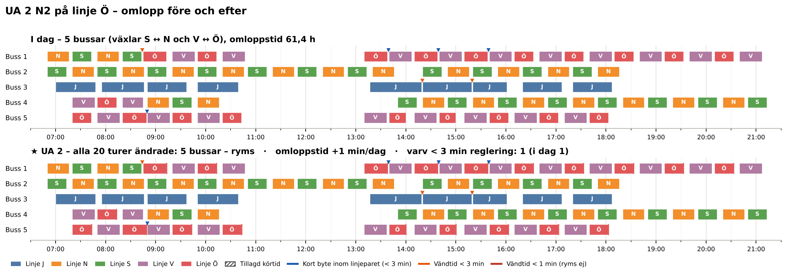

*Figur 6. Omlopp före och efter för UA 2.*

### 3.4 UA 3 – Linje N via Bo-Bil

**Utformning.** Linje N kör Maxinge – Bo-Bil – Bolstavägen i stället för Maxinge – Vikingagränd –
Bolstavägen (figur 7).

**Körtid.** Ändringen är i praktiken körtidsneutral, +0,1 minut per tur:

- körvägen är cirka 27 % kortare fågelvägen, vilket ger −0,4 minut;
- Bo-Bil blir ett verkligt uppehåll, +0,5 minut. Vid Vikingagränd stannar bussen sällan i dag (cirka 0,05
  påstigande per vardag).

Den minskade väntan vid Nya Godbyvägen ingår inte, eftersom den inte kan beräknas utan realtidsdata. Den talar
för en kortare och framför allt jämnare körtid.

**Omlopp.** Alternativet ryms med alla 22 turer.

**Effekter.**

- **Bo-Bil:** hållplatsen får linje N:s 22 avgångar utöver landsbygdslinjernas, och 44 invånare får minst 30
  avgångar per vardag.
- **Vikingagränd:** 23 invånare förlorar hållplats inom 400 m.
- **Fordonskilometer:** minskar med cirka 9 km per vardag.

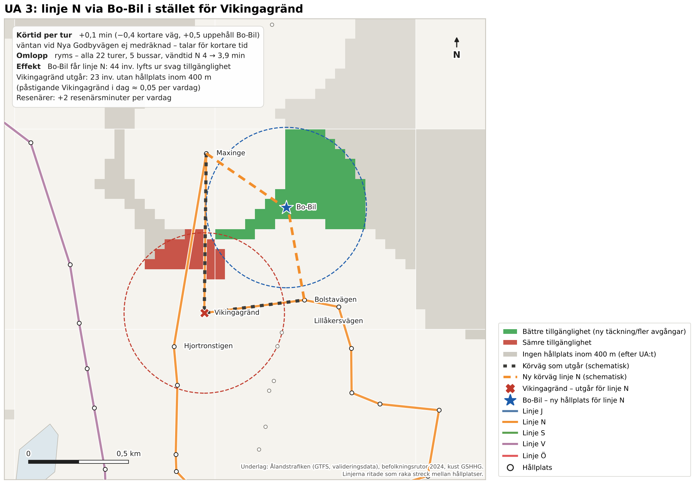

*Figur 7. UA 3. Grönt anger bättre och rött sämre tillgänglighet.*

### 3.5 UA 4 – Linje V–Ö via flygplatsen

**Utformning.** Linje V passerar i dag Posten på Flygfältsvägen. I alternativet kör bussen från Posten upp till
flygterminalen, runt terminalen och tillbaka till Norra Svibyvägen, och därefter vidare mot Källarvägen som i
dag (figur 8).

- **Körväg:** digitaliserad ur beställarens skiss.
- **Omväg:** cirka 1,4 km per tur. Med 25 km/h och 0,5 minuts uppehåll blir tillägget cirka **4 minuter per
  tur** (känslighet 3–5 minuter).
- **Vid flygplatsen:** bussen är där cirka 16 minuter efter avgången från centrum.

**Flygen och UA 4Y.** Enligt Finavia avgår flyg 07:15 (Arlanda), 11:00 (Åbo) och 17:10 (Arlanda).
Ankomsttiderna fanns inte i underlaget. Det har antagits att samma flygplan landar 35 minuter före
avgångarna 11:00 och 17:10. UA 4Y kör till flygplatsen bara på de V-turer som behövs för flygen:

- **till flyget**, vid flygplatsen 2 timmar till 30 minuter före avgång: 08:50, 09:20, 09:50, 15:10, 15:40
  och 16:10;
- **från flyget:** 10:20 och 16:40, vid flygplatsen 10:36 och 16:56;
- **07:15-flyget** kan inte nås med dagens första V-tur (vid flygplatsen 07:36).

**Solberget.** Hållplatsen Solberget på linje Ö ligger på en omväg. Dras den in sparas 1,6–2,5 minuter per
Ö-tur. Det har prövats som ett sätt att få mer tid i varvet V + Ö.

*Tabell 2. UA 4 – alla driftformer (fem bussar om inget annat anges; ★ = huvudalternativ).*

| Variant | Turer via flygplatsen | Minsta tid i centrum i de ändrade varven (krav 5 min) | Driftkostnad per år |
|---|---|---|---|
| Alla turer, dagens tidtabell | 20 av 20 – **6 bussar** | – | +209 000 € |
| Dagens tidtabell utan extra buss | 8 av 20 | 9 min | – |
| **★ V och Ö sammanslagna** | **16 av 20** | **6 min** | **+6 400 €** |
| V och Ö sammanslagna + Solberget indragen | 16 av 20 | 8,1 min | +5 900 € |
| **Y: de 8 flygturerna, V och Ö sammanslagna** | **8 av 8** | **6 min** | **+2 800 €** |
| Y: de 8 flygturerna, dito + Solberget indragen | 8 av 8 | 8,1 min | – |
| Känslighet: omvägen 5 min, sammanslagna | 2 av 20 | – | – |

**Resultat.**

- **V och Ö sammanslagna:** Ö avgår 1,5 minut efter pulsen, och 16 av 20 turer ryms med minst 6 minuter i
  centrum. V 07:50, 13:40 och 14:40 följs av Ö:s skolturer, där 31 + 28 minuter bara lämnar 1 minut i centrum.
  V 08:20 fortsätter som linje N.
- **Solberget indragen:** varven med skolturerna får ändå bara cirka 3 minuter i centrum. Inga fler turer ryms,
  så indragningen behövs inte.
- **UA 4Y:** alla 8 flygturer ryms med V och Ö sammanslagna, utan att Solberget dras in. Varven med flygturerna
  har minst 6 minuter i centrum.

**Effekter.**

- **Täckning:** 20 invånare nära terminalen får en hållplats inom 400 m.
- **Flygresenärerna:** nyttan för dem ingår inte i beräkningen, eftersom OD-matrisen saknar flygplatsen som
  målpunkt.
- **Solberget (bara i varianten med indragning):** 42 invånare skulle förlora sin hållplats inom 400 m.
  Hållplatsen har cirka 2 påstigande per vardag på sommarnivå.

**Bedömning.**

- **Utesluten:** att bara förlänga linje V till flygplatsen. Omloppen spricker, och en sjätte buss krävs.
- **Det enda rimliga är en genomgående linje V–Ö.**
- **Huvudalternativ ★:** linje V–Ö via flygplatsen. 16 av 20 turer ryms med fem bussar, och Solberget behålls;
  se figur 8, som bara visar huvudalternativet.
- **UA 4Y:** samma linje men bara de 8 flygturerna. Alla 8 ryms, och Solberget behålls.

**Känslighet – omvägens körtid och Solberget på utvalda turer (figur 9b).** Ö startar när V har kommit tillbaka.
Upp till 5 minuters omväg ryms 16 av 20 turer (UA 4Y 8 av 8) utan att Solberget dras in; vid 5 minuter med
exakt 5 minuter i centrum. Med 5,5–7 minuters omväg ryms varvet bara om Solberget dras in på de Ö-turer som följer
en V-tur via flygplatsen. Då ryms fortfarande 16 av 20 turer (UA 4Y 8 av 8). Det gäller 10 Ö-turer (UA 4Y 6),
som blir 1,6–2,5 minuter kortare. Solberget behåller 10 respektive 14 av 20 avgångar, ingen förlorar hållplatsen,
men 49 invånare får lägre turtäthet. Över 7 minuter ryms nästan inga turer.

Nivån 50 minuter per varv nås inte med omvägen, eftersom dagens vanliga varv redan ligger på exakt 50 minuter.

Körtiden till terminalen bör därför mätas: blir den högst 5 minuter behövs ingen indragning, och blir den
5,5–7 minuter är det rimligt att dra in Solberget bara på de Ö-turer som följer flygturerna.

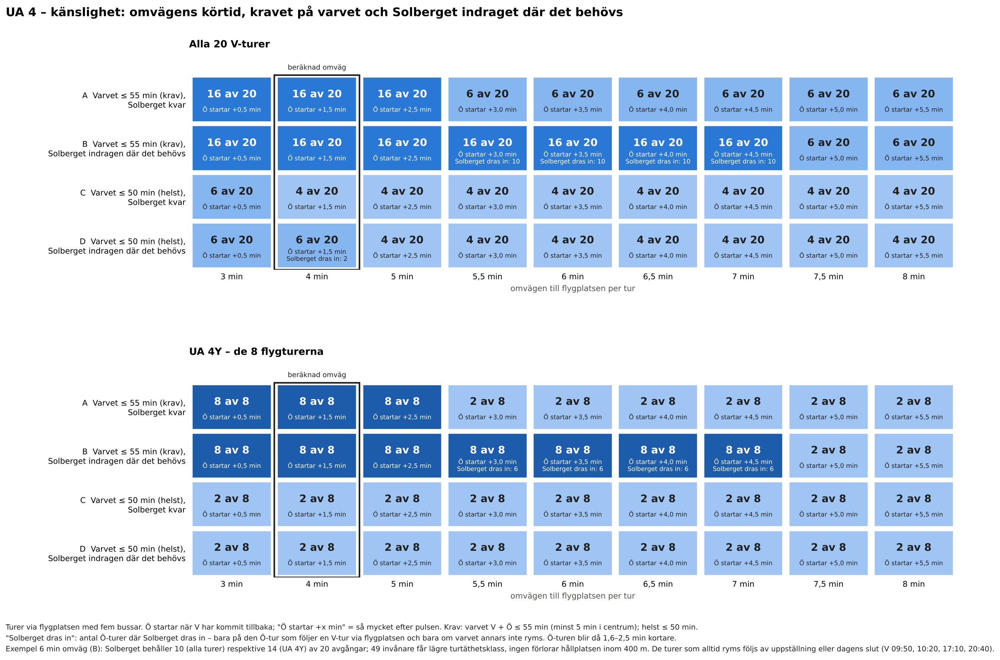

*Figur 9b. UA 4 – känslighet: turer via flygplatsen per omväg och driftform. A: varvet ≤ 55 minuter (krav),
Solberget kvar. B: dito, Solberget indraget där det behövs. C: varvet ≤ 50 minuter (helst), Solberget kvar.
D: dito, Solberget indraget där det behövs.*

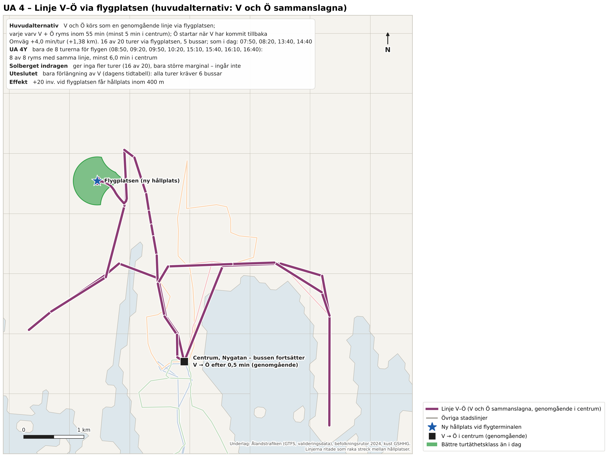

*Figur 8. UA 4 – huvudalternativet: linje V–Ö (V och Ö sammanslagna) via flygplatsen.*

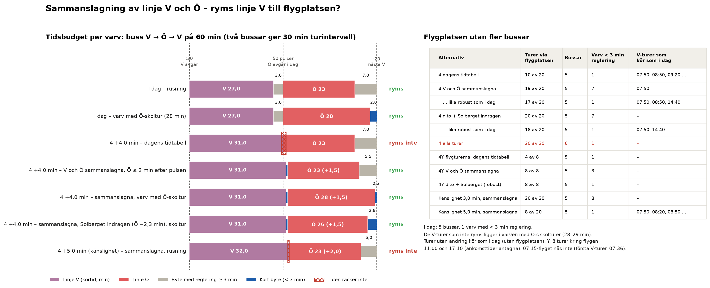

*Figur 9. UA 4: tidsbudget per varv V + Ö med tiden i centrum mot kravet 5 minuter, och antal turer som ryms per
variant.*

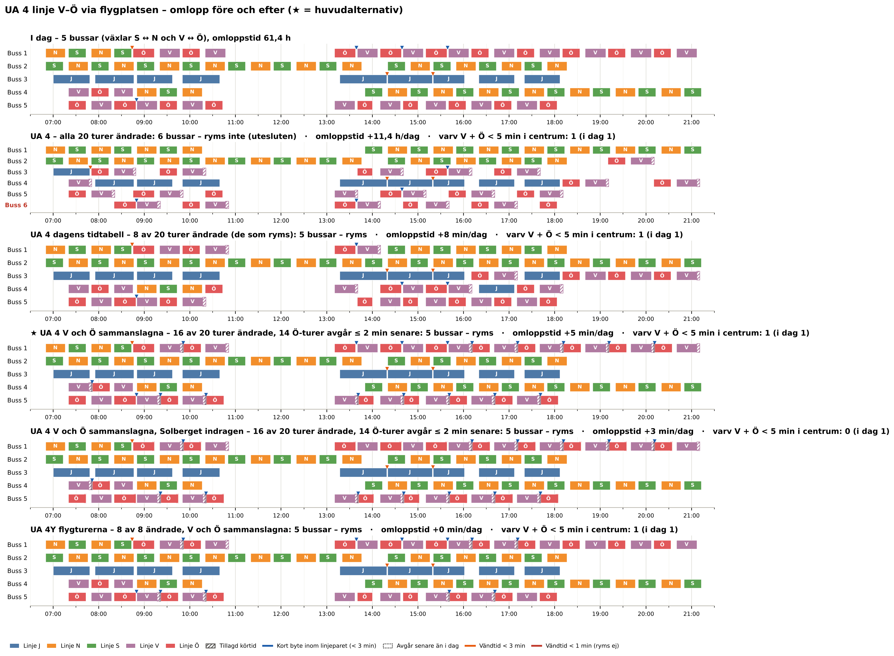

*Figur 10. Omlopp före och efter för UA 4, alla driftformer (★ = huvudalternativ).*

## 4 Systemeffekter

Systemeffekterna redovisas för varje UA för sig (figur 11 och 12). Täckningen gäller invånarna i
Mariehamn (14 821).

*Tabell 3. Systemeffekter i Mariehamn, i dag och med varje UA för sig.*

| | I dag | 1a V och Ö sammanslagna | 1b V och Ö sammanslagna | 2 N2 | 3 Bo-Bil | 4 V och Ö sammanslagna | 4Y flygturerna |
|---|---|---|---|---|---|---|---|
| Hållplats inom 400 m | 83,6 % | 84,8 % | 84,8 % | 84,0 % | 83,4 % | 83,7 % | 83,7 % |
| Minst 15 avgångar per vardag | 81,0 % | 82,2 % | 82,2 % | 81,4 % | 80,8 % | 81,1 % | 81,0 % |
| Minst 30 avgångar per vardag | 55,6 % | 55,6 % | 55,6 % | 55,6 % | 55,9 % | 55,6 % | 55,6 % |
| Svag tillgänglighet (1–29 avgångar) | 28,0 % | 29,2 % | 29,2 % | 28,4 % | 27,6 % | 28,1 % | 28,1 % |
| Invånare med bättre / sämre | – | 179 / 0 | 179 / 0 | 55 / 0 | 44 / 24 | 20 / 0 | 20 / 0 |
| Bussar | 5 | 5 | 5 | 5 | 5 | 5 | 5 |
| Omloppstid (h per vardag) | 61,4 | 61,5 | 61,5 | 61,4 | 61,4 | 61,5 | 61,4 |
| Fordonskilometer per vardag | 1 136 | 1 180 | 1 162 | 1 136 | 1 127 | 1 159 | 1 148 |
| Varv V + Ö med < 5 min i centrum | 1 | 1 | 1 | 3 | 1 | 1 | 1 |
| Längre restid, befintliga resenärer (resenärsmin. per vardag) | – | 7 | 3 | 1 | 2 | 8 | 4 |

Restiderna för alternativen med V och Ö sammanslagna är netto, efter vinsten för resor mellan V och Ö som slipper
bytet (cirka 1 resenärsminut per vardag).

Andelen med svag tillgänglighet ökar med Möckelö Strand ny. Det beror på att invånare som i dag saknar
hållplats får en med 16 avgångar per vardag: de flyttar från gruppen *ingen hållplats* till *svag
tillgänglighet*, vilket är en förbättring. Förändringarna är lokala och syns i figur 12. Alla driftformer för
1a och 4 redovisas i figur 11.

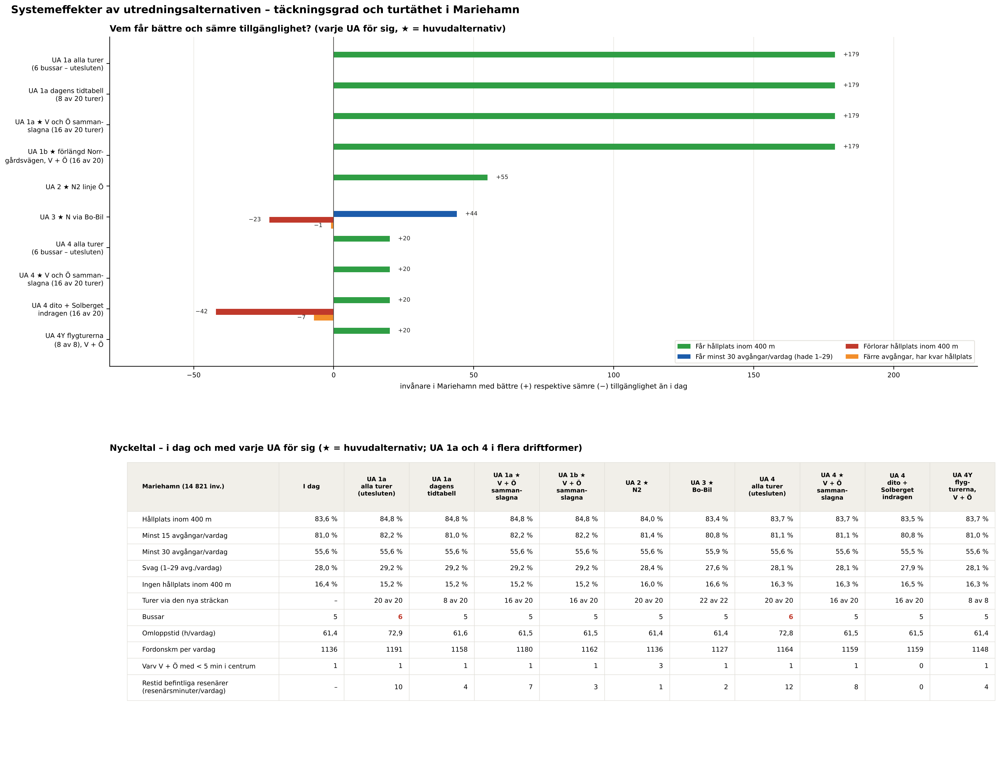

*Figur 11. Invånare med bättre respektive sämre tillgänglighet och nyckeltal för varje UA för sig.*

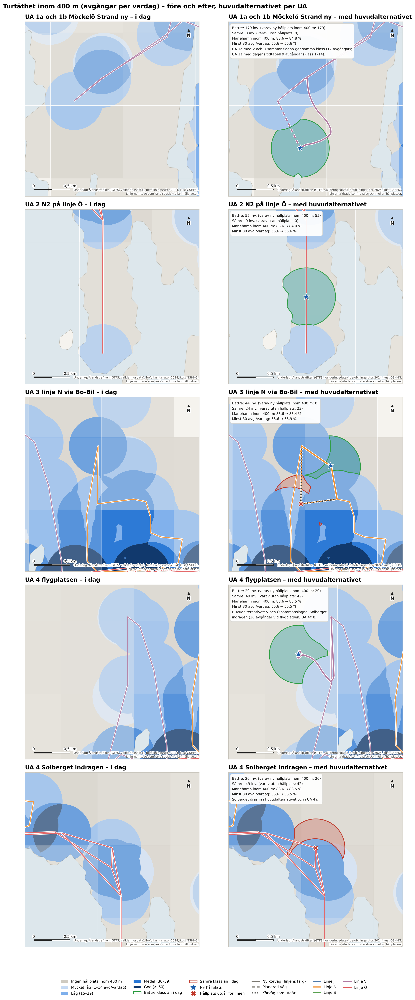

*Figur 12. Turtäthet inom 400 m i dag och med alternativet, inzoomat per UA. Grön ram anger bättre och röd
ram sämre klass än i dag.*

## 5 Överslagskalkyl

**Kostnadsmodell.** Kalkylen omfattar förändrad driftkostnad per år (figur 13) och består av tre delar:

- **Fordon:** antal fordon × fordonskostnad (kapital, försäkring, uppställning), 45 000–75 000 euro per år;
- **Fordonstimmar:** förare inklusive sociala avgifter, 42–58 euro per timme;
- **Fordonskilometer:** energi och underhåll, 0,7–1,2 euro per km.

Enhetskostnaderna är orienterande värden för tätortstrafik från Trivector (2023), *Trafikeringskostnader
för buss 2019 och 2045*, för Trafikverket. De är omräknade till euro och uppräknade till 2026 och ska ersättas
med avtalspriserna i landskapsregeringens trafikavtal. Beräkningen bygger på 250 vardagar per år.

*Tabell 4. Förändrad driftkostnad per år jämfört med i dag (euro, prisnivå 2026).*

| UA | Bussar | Fordonstimmar per år | Fordonskm per år | Driftkostnad per år, bas (låg–hög) |
|---|---|---|---|---|
| UA 1a alla turer – utesluten | +1 | +2 860 | +14 300 | **+216 000** (175 000–258 000) |
| UA 1a dagens tidtabell (8 av 20 turer) | 0 | +38 | +5 700 | +7 000 |
| UA 1a ★ V och Ö sammanslagna (16 av 20 turer) | 0 | +28 | +11 400 | +11 600 (9 100–15 300) |
| UA 1b ★ förlängd Norrgårdsvägen, V och Ö sammanslagna (16 av 20 turer) | 0 | +12 | +6 700 | +6 700 (5 200–8 800) |
| UA 2 ★ N2 | 0 | +2 | 0 | ±0 |
| UA 3 ★ Bo-Bil | 0 | 0 | −2 500 | −2 200 |
| UA 4 flygplatsen, alla turer – utesluten | +1 | +2 850 | +7 300 | **+209 000** (170 000–249 000) |
| UA 4 ★ V och Ö sammanslagna (16 av 20 turer) | 0 | +22 | +5 800 | +6 400 (5 000–8 300) |
| UA 4 dito + Solberget indragen (16 av 20) | 0 | +12 | +5 800 | +5 900 (4 600–7 700) |
| UA 4Y flygturerna (8 av 8), V och Ö sammanslagna | 0 | 0 | +3 100 | +2 800 (2 200–3 700) |

**Investeringar.** Nya hållplatslägen kostar cirka 8 000–30 000 euro styck beroende på utrustning. Därtill
kommer för 1a en vändmöjlighet vid den nya hållplatsen, och för 1b förlängningen av Norrgårdsvägen. Ingen av
dem har kostnadsberäknats.

**Förlängningen av Norrgårdsvägen.** Jämförelsen beror på alternativet:

- **Mot 1a med en extra buss:** merkostnaden är cirka 209 000 euro per år, ett nuvärde på 2,4–3,5 miljoner
  euro över 20 år (3,5 % kalkylränta).
- **Mot 1a med V och Ö sammanslagna:** skillnaden är bara cirka 5 000 euro per år, och båda ger 16 av 20 turer.

Med sammanslagning motiveras vägen därför inte av busstrafikens driftkostnad, utan av:

- en kortare omväg;
- större marginal i centrum (minst 7,5 i stället för 5,5 minuter per varv);
- att Ö kan behålla sina avgångar i pulsen.

Vägen ger dessutom nytta för annan trafik.

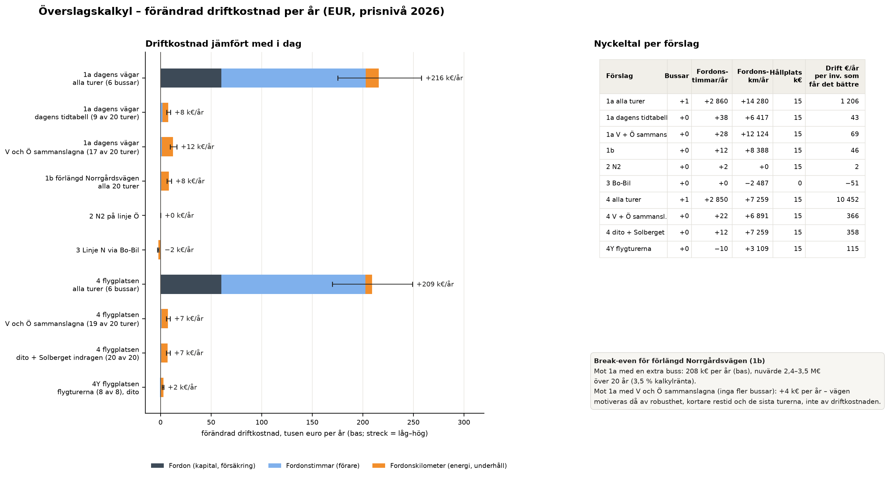

*Figur 13. Förändrad driftkostnad per år per UA (bas; strecken anger låg–hög).*

## 6 Slutsatser

1. **Ramen är snäv.** Ingen linje kan förlängas mer än någon minut om varje byte ska ha full reglering.
   Eftersom bussarna redan växlar i paren S ↔ N och V ↔ Ö kan paren slås ihop till genomgående linjer. Med
   kravet att varje varv ryms inom timmen med minst 5 minuter i centrum kan linje V då förlängas upp till
   4,5 minuter per tur i vanliga varv, men inte alls i varven med Ö:s skolturer.
2. **UA 1a – Möckelö Strand ny via dagens vägar.** Huvudalternativet slår ihop V och Ö och ger 16 av 20 turer
   med fem bussar, för cirka 12 000 euro per år. Möckelö Strand ny kan alltså trafikeras redan med dagens vägar.
   Alla turer med dagens tidtabell kräver en sjätte buss och är utesluten.
3. **UA 1b – Möckelö Strand ny via förlängd Norrgårdsvägen.** Med V och Ö sammanslagna ryms också 16 av 20 turer,
   men med kortare omväg, större marginal och Ö kvar i pulsen. UA 1b förutsätter att vägen byggs.
4. **UA 2 – N2 på linje Ö** ryms med alla turer och ger 55 invånare en hållplats.
5. **UA 3 – Linje N via Bo-Bil** ryms och är körtidsneutral. Förlusten vid Vikingagränd (23 invånare) bör vägas in, och
   den kan mildras med hållplatsen N3 söder om Maxinge från kapitel 3.
6. **UA 4 – Linje V–Ö via flygplatsen.** Att bara förlänga V är uteslutet, eftersom det kräver en sjätte buss.
   Det enda rimliga är en genomgående linje V–Ö. Huvudalternativet ger 16 av 20 turer med fem bussar, och
   Solberget behålls. UA 4Y med de 8 flygturerna ryms helt, också utan att Solberget dras in.
7. **Genomgående linje V–Ö** ger kortare restid för resor mellan V och Ö, men med sommarens resande gäller det
   bara cirka 1 resa per vardag.
8. **UA 1a, 1b och 4** förlänger alla linje V. Två av dem ryms inte tillsammans inom kravet utan fler bussar.
   Kombinationer av UA prövas i ett senare skede.

## 7 Osäkerheter och fortsatt arbete

- **Omloppen** är härledda ur tidtabellen med beställarens norm för linjebyten (S ↔ N, Ö ↔ V). Förarnas raster
  och operatörens faktiska omloppsplaner ingår inte och behöver stämmas av.
- **Restiderna** för Möckelö Strand bygger på beställarens uppgifter. Körtiden till flygplatsen är beräknad ur
  beställarens skiss med 25 km/h. Körtiderna vid Bo-Bil bygger på fågelvägsavstånd.
- **Flygens ankomsttider** är antagna och ska ersättas med de verkliga tiderna. UA 4Ys turer väljs då om
  automatiskt (`FLYG_ANKOMSTER` i `src/b4_ua.py`).
- **Ö efter pulsen:** sammanslagning av V och Ö förutsätter att Ö kan starta 1,5–2 minuter efter pulsen (1a och
  4). Effekten på bytesresor ingår inte i nätverksmodellen.
- **Kravet 5 minuter i centrum per varv** är beställarens riktvärde. Resultatet ändras inte om kravet ligger
  mellan 3 och 5,5 minuter.
- **Ö:s skolturer** avgör vilka V-turer som ryms. Deras verkliga körtider bör kontrolleras.
- **Vägdragningen** längs gatunätet (OSRM) kunde inte hämtas i analysmiljön. Den hämtas i QGIS med
  `rutta_med_osrm.py`.
- **Hållplatslägena** för Möckelö Strand ny, N2 och flygplatsen är indikativa.
- **Påstigande och resenärseffekter** bygger på sommardata och bör räknas om med terminsdata.
- **Enhetskostnaderna** är schablonvärden och bör ersättas med avtalspriser.
- **Fortsatt arbete:** pröva sammanslagning av N och S för Örtvägen, en omläggning av linje N och Ö i nordost,
  och en extra morgontur till 07:15-flyget.

## Bilaga – Kartor i QGIS

Alla kartor finns som lager i `output/gis/linjenatsutredning.gpkg` (EPSG:3067) med inbäddade stilar.

1. Öppna **`output/gis/linjenatsutredning.qgz`** (*Projekt > Öppna*). Projektet öppnas inzoomat på Mariehamn,
   med en grupp per UA. Använd inte en äldre sparad projektfil.
2. Alternativt: kör `output/gis/oppna_i_qgis.py` i QGIS Python-konsol i ett nytt, tomt projekt.

| Grupp i QGIS | Innehåll |
|---|---|
| UA 1a, 1b, 2, 3, 4 | Huvudalternativet per UA: ny hållplats, körväg, linjen (V–Ö som en genomgående linje i UA 1a, 1b och 4) och förändrad turtäthet (grönt bättre, rött sämre) |
| Systemeffekter – huvudalternativ per UA | Turtäthet inom 400 m och förändring mot i dag för i dag och huvudalternativen. Gruppen är exklusiv: ett scenario i taget |
| Övriga alternativ | Övriga driftformer, bl.a. de uteslutna som kräver fler bussar (redovisas i rapporten). Exklusiv grupp |
| Sammanslagning av linjer | Områden utan hållplats och behövd tid per tur |
| Bakgrund | Stadslinjerna i dag (förskjutna där de delar gata), hållplatser, via-punkter för OSRM, befolkningsrutor, land |
| Nyckeltal per UA och driftform | Tabell med bussar, omloppstid, km, täckning, driftkostnad, huvudalternativ och utesluten |

Förändringarna är lokala. Zooma in vid Möckelö Strand, Kalmarnäs, Bo-Bil, flygplatsen eller Solberget för att
se dem.

**Vägdragning.** Linjerna levereras som raka streck mellan hållplatserna, utom de nya delsträckorna, som är
ritade efter beställarens skisser. Vägdragningen längs gatunätet hämtas genom att köra
`output/gis/rutta_med_osrm.py` i QGIS Python-konsol på en dator med internet.

- **Via-punkter:** där OSRM väljer en annan väg än bussen läggs en *via-punkt* ("gömt stopp") i lagret
  `00_viapunkter`, och skriptet körs igen. Lagret innehåller redan en punkt: linje V mellan Lönnhagsvägen och
  Norrgårdsvägen kör vägen söder om huvudvägen och vänder inte vid hållplatsen.
- **Om lager saknas eller är tomma:** se `output/gis/LASMIG.md`. GeoPackage-filer i synkade mappar (OneDrive)
  kan ge felet *unable to open database file*. Kopiera då mappen till en lokal disk.
